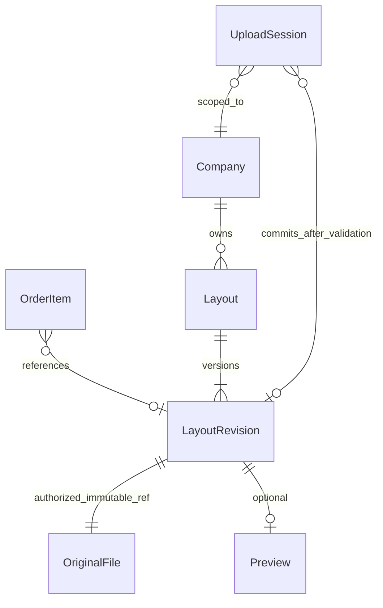

# Контракты и доказательства Flexomir OS

Назначение: единый технический сборник контрактов и датированных доказательств. Ответственный: Codex/frontend. Содержательная ревизия: 14.11.2026. Актуальный статус задач — в [состоянии](PROJECT_STATE.md), [плане](DELIVERY_PLAN.md) и [решениях](DECISIONS.md).

Датированные разделы сохраняют исходные результаты и OPEN на момент проверки; они не задают нынешнюю очередь. Исходные пути и SHA256 приведены перед каждым разделом, полные версии также доступны в Git. Frozen [manifest](FE11_MOTION_FROZEN_V0_2.json) остаётся отдельным исполняемым источником.

Быстрый переход: [текущая унификация M8](#evidence-ui-unification-2026-11-13) · [переписка и документы](#evidence-comm-docs-2026-11-12) · [действия с позицией](#evidence-fos06-item-actions-delivery-2026-11-12) · [Glass и motion](#evidence-fe11-popup-pilot-2026-11-09) · [материал Select](#evidence-fos-glass-material) · [исходный scope](#evidence-next-scope-13-2026-11-10).

## Содержание

| Исходный документ | Раздел |
| --- | --- |
| ACCEPTED_UI_ROLLOUT_2026-11-11.md | [Открыть](#evidence-accepted-ui-rollout-2026-11-11) |
| CODEX_SETUP.md | [Открыть](#evidence-codex-setup) |
| COMM_DOCS_2026-11-12.md | [Открыть](#evidence-comm-docs-2026-11-12) |
| FE11_POPUP_PILOT_2026-11-09.md | [Открыть](#evidence-fe11-popup-pilot-2026-11-09) |
| FE11_POPUP_REAUDIT_2026-11-10.md | [Открыть](#evidence-fe11-popup-reaudit-2026-11-10) |
| FOS03_MANAGER_SPACING_PILOT_2026-11-10.md | [Открыть](#evidence-fos03-manager-spacing-pilot-2026-11-10) |
| FOS05_REPEAT_ITEM_SAVE_2026-11-12.md | [Открыть](#evidence-fos05-repeat-item-save-2026-11-12) |
| FOS06_ITEM_ACTIONS_DELIVERY_2026-11-12.md | [Открыть](#evidence-fos06-item-actions-delivery-2026-11-12) |
| FOS07_DATEPICKER_PILOT_2026-11-11.md | [Открыть](#evidence-fos07-datepicker-pilot-2026-11-11) |
| FOS08_09_REPORT_2026-11-10.md | [Открыть](#evidence-fos08-09-report-2026-11-10) |
| FOS12_ARTWORK_STATES_PILOT_2026-11-11.md | [Открыть](#evidence-fos12-artwork-states-pilot-2026-11-11) |
| GIT_BRANCH_CLEANUP_2026-11-11.md | [Открыть](#evidence-git-branch-cleanup-2026-11-11) |
| GL02B_NAVIGATION_DRAWER.md | [Открыть](#evidence-gl02b-navigation-drawer) |
| GL03_Compact_Pill_Tabs_Contract_2026-11-04.md | [Открыть](#evidence-gl03-compact-pill-tabs-contract-2026-11-04) |
| M8_FINAL_AUDIT_2026-11-10.md | [Открыть](#evidence-m8-final-audit-2026-11-10) |
| NEXT_SCOPE_13_2026-11-10.md | [Открыть](#evidence-next-scope-13-2026-11-10) |
| POPUP_HOVER_ROLLOUT_2026-11-11.md | [Открыть](#evidence-popup-hover-rollout-2026-11-11) |
| SELECT_PLACEHOLDER_2026-11-11.md | [Открыть](#evidence-select-placeholder-2026-11-11) |
| TYPOGRAPHY_AUDIT_2026-11-09.md | [Открыть](#evidence-typography-audit-2026-11-09) |
| UI_UNIFICATION_2026-11-13.md | [Открыть](#evidence-ui-unification-2026-11-13) |
| fos-glass-material.md | [Открыть](#evidence-fos-glass-material) |
| glass-select-check.md | [Открыть](#evidence-glass-select-check) |

<a name="evidence-accepted-ui-rollout-2026-11-11"></a>
## ACCEPTED_UI_ROLLOUT_2026-11-11.md

Исходный путь: `docs/ACCEPTED_UI_ROLLOUT_2026-11-11.md`. SHA256 исходного файла: `26c81035eb1d5d25d152ece7d364c02e482c0ab341b527bf0b24e852a904185d`.

<a name="evidence-accepted-ui-rollout-2026-11-11-1-основные-прогрессы"></a>
#### 1. Основные прогрессы

Owner принял FOS12 на head `f509ebaad65d334caee66b9f61918c67f8fa3705` ответом «Принято». Затем поручил подключить принятый вариант после замечания к Manager DEMO-002 и явно разрешил: «все принятые задачи подключай и сливай в main/origin». После слияния требуется отдельная ветка следующей задачи от свежего origin/main.

В том же [PR #35](https://github.com/SigmeD/flexomir_os/pull/35) подключены принятые FOS03 и FOS12. ArtworkSource стал единым вариантом Client/Manager/production; DEV-флаг и reference-ветка удалены. Manager32/24 включён на обычном создании заказа. Статус под заголовком подключён общим PageHeader в Composer и readonly Detail обеих ролей, включая случай со скриншота.

<a name="evidence-accepted-ui-rollout-2026-11-11-2-какие-задачи-решались"></a>
#### 2. Какие задачи решались

Причина замечания: PageHeader ниже68px action-row добавлял28px до статуса вместо8px от48px H1. Ранее below-title был только в Manager DEV-пилоте. Теперь `subtitleRole=status` выбирает below-title по умолчанию; secondary/context в библиотеке сохраняют прежнюю композицию. Никаких negative margin, translate, копий Header или изменений кнопок/линзы.

Освобождённые20px компенсированы в общих композициях: desktop Composer body25px, Detail26px, Manager Detail24px. Для обычных коротких заголовков поле компании/продукция остаются на прежнем Y; compact overrides сохранены. На2048/1440/1024 statusY108, gap8, Manager Detail bodyY150 и Composer151. Длинные заголовки переносятся без пересечения actions.

| Источник → компонент | Подключение |
| --- | --- |
| Принятый FOS03 на6007e60, Owner Screenshot_1, CURRENT Manager Detail2560:10872, PageHeader2302:2138 | PageHeader status→below-title; Composer/Detail обеих ролей; Manager32/24 через data-order-role, без query/DEV |
| Принятый FOS12 наf509eba, Artwork634:445, Action835:243 | Один ArtworkSource без presentation API/legacy DOM; Client/Manager New/Edit/Repeat, production |
| LocalFileControl/FOSAction/FE11 | Переиспользованы без изменения native contract/material/physics и Save dirty&&valid |

Новые проверки автора:

- RED Manager DEMO-002: expected8, actual28. RED обычного FOS12: принятый states отсутствует. Обе причины исправлены на shared уровне.
- Отступы/длинный H1/secondary isolation/Manager0/1/N/private Save/адаптивы —60/60 PASS, Chromium/Firefox/WebKit/touch, включая2048 и пять стандартных ширин.
- Artwork states/native chooser/drop/cancel/HELP focus/disabled/error —52/52 PASS в четырёх проектах.
- Build PASS,238 modules. Production-preview:4/4 маршрута (обе роли, обычный URL/старый query) используют принятые состояния и status gap8, page errors0.
- 25/25 component PNG побайтово совпали с принятым FOS12-f509eba на пяти ширинах. Новые60 raw PNG сохранены отдельно от пилота; page errors/overflow0. Approved-source изображения не подменялись.
- Независимый review PASS WITH RISKS:19 собственных Chromium assertions, Manager DEMO-0022048/320, ordinary ArtworkSource обеих ролей, picker/ESC/focus;4 снимка. Frozen5/5 пересчитан независимо и автором.
- Первый полный прогон700:694 PASS/4 SKIP/2 FAIL старых assertions, ожидавших удаления input вHELP. Принятый контракт сохраняет hidden+disabled input ради фокуса; после снятияHELP он enabled. Старый тест актуализирован, весь Compose12/12 PASS. Полный повтор700 и CI нового head выполняются; фактический результат фиксируется в PR и Drive CURRENT.
- Повторный независимый review тестовой правки: PASS WITH RISKS, production blockers нет. В capture script метрика названа repeatGeometryMatches: повтор обычного URL проверяет повторяемость геометрии, а сохранение принятого вида доказывает отдельное сравнение25 PNG с f509eba.
- Финальный стабильный полный прогон на8b0f082:696 PASS/4 штатных SKIP/0 unexpected/0 flaky,547.66s. Предшествующий повтор695/4/1 был прерван Vite reload scripts/fos12-artwork-review.cjs ровно11:35:30Minsk/08:35:30UTC; companies10/10 отдельно PASS. Во время финального полного прогона файлы не менялись. Журналы сохранены отдельно.
- CI на8b0f082: Orders Core42988302691 и Accepted Artwork/Spacing42988302870 SUCCESS; M742988302669 прерван общим бюджетом20мин на последнем наборе124 проверок профиля. Все предыдущие шаги M7 SUCCESS. Бюджет задания увеличен до25мин; состав, пороги, браузеры и проверки сохранены. CI итогового коммита должен завершиться успешно до merge; это не обход failed assertion.

В новом тесте исправлена тестовая предпосылка: Client не содержит DEMO-002, используется существующий DEMO-003. Timeout неправильного fixture не объявляется продуктовым дефектом; исходный trace сохранён. Набор60 после исправления полностью повторён.

Доказательства локальные: output/playwright/{order-spacing-red,order-spacing-green,accepted-rollout}, output/accepted-rollout-full.log и accepted-rollout-full.json. Независимые изображения — accepted-rollout/independent. Скриншот Owner Screenshot_1.png остаётся untracked и не меняется; локальная копия в accepted-rollout/reference. Figma session2c676138-03dc-417a-b3d3-8895cb5c33ea прочитала CURRENT Manager Detail; canvas не менялась. Полная визуальная приёмка всех экранов не заявляется.

<a name="evidence-accepted-ui-rollout-2026-11-11-3-что-в-процессе"></a>
#### 3. Что в процессе

- Frontend/Codex: дождаться CI фактического PR head после исправления бюджета M7, затем выполнить уже разрешённый merge/main sync и проверить результат — текущая поставка11.11, календарная оценка не утверждена. Полная локальная регрессия завершена696/4/0.
- Frontend/Codex: удалить remote head после подтверждённого merge/auto-delete, сохранить локальные ветки и stash; создать обычную ветку следующего пункта от свежего origin/main — после merge.
- Owner/PO/Алексей: Save UX05, права/статусы06, API/storage10/11/13 и согласованный срок менеджера остаются отдельными решениями. Account02/DatePicker07 — отдельные пилоты; frozen engine не менять без отдельного решения. Даты не назначены.

<a name="evidence-accepted-ui-rollout-2026-11-11-4-основные-договорённости"></a>
#### 4. Основные договорённости

- Принятые варианты подключаются в продуктовый frontend и production-сборку, затем сливаются — frontend/Codex по прямому поручению Owner. Это не реализация backend/1С/storage и не разрешение неутверждённого hover-изменения FE11.
- Один текущий инкремент/PR #35 сохраняет код, тесты и LIVE docs; финальные title/body отражают rollout и замечание Owner, а не прежний DEV-only scope.
- После merge фактические SHA/CI/QA и следующая очередь синхронизируются в существующем [Drive CURRENT](https://docs.google.com/document/d/1fzILzuOPgP6PEn1K5RaR9-XTw6RW6gJYELJp02Bt9BE/edit). Предыдущая main398a93b и пилотf509eba — история исходных проверок, не финальный merge SHA.


---

<a name="evidence-codex-setup"></a>
## CODEX_SETUP.md

Исходный путь: `docs/CODEX_SETUP.md`. SHA256 исходного файла: `de57fd88118c982bba6b42acfe0646dfb78d18bdbf23236fe8edacbddfc88e1c`.

<a name="evidence-codex-setup-flexomir-os--подготовка-codex-на-windows"></a>
### Flexomir OS — подготовка Codex на Windows

Это снимок окружения 04.11.2026, не текущая инструкция установки. Версии, наличие навыков и активные настройки нужно проверять на рабочем месте; запуск приложения — в [README](../README.md). Глобальные настройки эта ревизия не меняет.

**Локальная папка:** `D:\Projects\flexomir_os`. Пакет сам ничего не устанавливал. Ниже он адаптирован к проверенному состоянию на **04.11.2026**; существующие Git, React и Superpowers сохраняются.

<a name="evidence-codex-setup-проверено-в-этой-установке"></a>
#### Проверено в этой установке

- Git `2.56.0.windows.4`, Node `v24.11.1`, npm `11.6.2`, Codex CLI `0.166.0`.
- `origin`: `https://github.com/SigmeD/flexomir_os.git`, ветка `main`, исходный коммит `cd0656a` опубликован. Репозиторий PUBLIC; вопрос приватности открыт, настройка доступа не изменялась.
- React/TypeScript/Vite приложение уже существует; `npm run build` PASS. Зависимости повторно не устанавливались, второй scaffold не создавался.
- Навыки `using-superpowers`, `brainstorming`, `writing-plans`, `using-git-worktrees`, `verification-before-completion` есть в `C:/Users/Max/.codex/skills/superpowers/<имя>/SKILL.md` и доступны в каталоге навыков текущей сессии. Marketplace-установка этим не подтверждается и не требовалась.
- Пользовательский `C:/Users/Max/.codex/config.toml` уже содержит `model_reasoning_effort = "high"`, модель `gpt-6.1-sol` и доверие для `d:/projects/flexomir_os`. Глобальный конфиг не изменялся. Это сведения о файле, не доказательство фактических настроек активного запроса.
- Проектный `.codex/config.toml` добавлен с двумя параметрами из пакета. Их поддержку проверили по [официальному справочнику](https://learn.chatgpt.com/docs/config-file/config-reference); слой проекта применяется для доверенного проекта по [порядку конфигурации](https://learn.chatgpt.com/docs/config-file/config-basic). Загрузка нового слоя новой сессией ещё не проверена.
- Корневой `AGENTS.md` установлен и прочитан в текущей сессии. Автоматическое обнаружение в следующей сессии проверять по [инструкции OpenAI](https://learn.chatgpt.com/docs/agent-configuration/agents-md).
- Глобальный и проектный `AGENTS.md` вместе с разделителем занимают 32 243 байта при стандартном лимите 32 KiB. Повторы QA сокращены, полный checklist сохранён отдельно. При расширении инструкций проверять общий размер, чтобы конец файла не отсекался.

<a name="evidence-codex-setup-1-прежде-всего-проверка-окружения"></a>
#### 1. Прежде всего проверка окружения

Открой PowerShell и последовательно выполни **read-only** команды:

```powershell
Set-Location 'D:\Projects\flexomir_os'
Get-ChildItem -Force | Select-Object Name, Mode, Length
Get-Command git, node, npm, codex -ErrorAction SilentlyContinue | Select-Object Name, Source
if (Test-Path .git) {
  git status --short --branch
  git remote -v
  git branch --show-current
  git worktree list
  git log -5 --oneline
}
if (Test-Path package.json) { Get-Content package.json }
```

**Не выполнять автоматически:** удаление файлов, `git init` поверх неизвестного каталога, `git add -A`, force-push/reset, создание второго приложения, замену README/AGENTS без сравнения. Для рабочего репозитория начни с `git status`. GitHub и remote уже выбраны владельцем; менять платформу или видимость только по его решению. `.gitignore` исключает secrets/.env, node_modules и результаты тестовых прогонов. По умолчанию работать в основной папке; worktree — только после объяснения пользы, пути, ветки и согласия владельца.

<a name="evidence-codex-setup-2-установка-superpowers-только-если-навыки-отсутствуют"></a>
#### 2. Установка Superpowers, только если навыки отсутствуют

В текущем окружении навыки уже доступны — повторная установка не нужна. Инструкция ниже оставлена для нового рабочего места.

**Предпочтительно — официальный marketplace:**

- **Codex App:** Plugins в боковой панели → `Superpowers` (раздел Coding) → `+` и шаги установки.
- **Codex CLI:** в интерактивной сессии введи `/plugins`, найди `superpowers`, выбери `Install Plugin`.
- Перезапусти сессию Codex и попроси: «Проверь, видны ли навыки using-superpowers, brainstorming, writing-plans, using-git-worktrees, verification-before-completion; перечисли реальные источники skills». Установку нельзя считать завершённой только от упоминания в `AGENTS.md`.

Официальный источник: https://github.com/obra/superpowers (внутри есть Codex App/CLI инструкции). Для альтернативной ручной установки следуй **текущей** инструкции автора; не копируй устаревшие команды установки из случайных блогов. Superpowers лучше устанавливать **один раз в профиле пользователя** Codex, а не класть его исходники в репозиторий Flexomir. Не соединять чужие плагины и рабочие репозитории.

<a name="evidence-codex-setup-3-режим-рассуждения"></a>
#### 3. Режим рассуждения

В комплекте `.codex/config.toml`:

```toml
model_reasoning_effort = "high"
model_reasoning_summary = "concise"
```

В зависимости от Codex и модели уровни могут различаться. Убедись, что проект отмечен доверенным и проектный конфиг реально загружен; если у тебя уже есть настройки — перенеси две строки аккуратно, не перезаписывая остальные. Не устанавливай `model`, auth/provider или sandbox вручную из этого шаблона. Для простых команд high не требует длинных объяснений; для спорных архитектурных решений агент обязан представить **сжатое обоснование вариантов и рисков**, а не поток скрытых внутренних мыслей.

Официальный справочник: https://learn.chatgpt.com/docs/config-file/config-reference .

<a name="evidence-codex-setup-4-проверка-agentsmd"></a>
#### 4. Проверка AGENTS.md

Codex читает `AGENTS.md` на старте проекта/сессии. Открой **именно** `D:\Projects\flexomir_os` в Codex, перезапусти сессию и спроси:

> «Прочитай проектные AGENTS.md и README.md. Не меняй файлы. Назови реальные пути инструкций, CURRENT источники Drive/Figma, два параллельных потока, FE-00, все блокеры, статус старого HTML. Проверь наличие Superpowers и фактическую модель/уровень reasoning. Составь безопасный read-only план инвентаризации Git/React».

Сверь ответы со статусом в `docs/PROJECT_STATE.md`. Не запускай установку зависимостей или scaffold до сверки существующего кода.

<a name="evidence-codex-setup-5-после-git-bootstrap-только-по-согласованию"></a>
#### 5. После Git bootstrap (только по согласованию)

- Один репозиторий Flexomir OS, не два независимых frontend приложения.
- `feature/frontend-screens` и `feature/glass-components` — возможные обычные ветки. Отдельные `git worktree` только при необходимости и явном согласии владельца; нельзя редактировать один каталог двум агентам одновременно.
- Сохранить существующие React/TypeScript/Vite и `package-lock.json`; пересмотр сборщика не входит в подключение правил. Для нового рабочего места сначала клонировать этот репозиторий.
- Использовать фактические scripts из `package.json`: `dev`, `build`, `preview`, `test:e2e`, `test:a11y`, `test:visual`, `test:material`, `verify:material-optics`. Не обещать отсутствующие отдельные `lint`/`typecheck`.
- Передать Алексею принятый пилот с PR, типами, data adapter, статусами контрактов и QA.

<a name="evidence-codex-setup-6-установка-прошла-успешно-когда"></a>
#### 6. Установка прошла успешно, когда

- [ ] Codex открывает именно нужный каталог и правильно перечисляет AGENTS+README и источники.
- [ ] Показывает доступные Superpowers навыки (или честно говорит, что plugin пока не установлен).
- [ ] Указывает действующую конфигурацию reasoning без выдумывания.
- [x] Реальный Git/status/remote проверен; чужие файлы сохранены.
- [x] Использован существующий React baseline, сборка проверена; второй scaffold не создавался.


---

<a name="evidence-comm-docs-2026-11-12"></a>
## COMM_DOCS_2026-11-12.md

Исходный путь: `docs/COMM_DOCS_2026-11-12.md`. SHA256 исходного файла: `05552345372510bc2f0d92a1986a2adf86b9a5e1aec3f370e2162820876f09b7`.

<a name="evidence-comm-docs-2026-11-12-fe-iter-2026-11-12-comm-docs--реализация-и-проверка"></a>
### FE-ITER-2026-11-12-COMM-DOCS — реализация и проверка

<a name="evidence-comm-docs-2026-11-12-1-основные-прогрессы"></a>
#### 1. Основные прогрессы

CURRENT /13.11 — PR #46 MERGED по прямому поручению Owner «сделай merge в main/origin». SHA приложения `479c59188b5ee0b2bda4dd3150b75803cf3d3886`, проверенный PR head `ea3f2b858d661592948c76760be6459c6c2bde28`, CI **6/6 SUCCESS**. Дерево squash совпадает с PR head. Новые post-merge build PASS, smoke **8/8**, bundled production1440/320 **2/2 PASS**, pageerrors=[]. Remote head удалён автоматически, локальная feat/comm-docs-20261112 сохранена; рабочая ветка main. Последующая синхронизация Markdown — только метаданные, не новый код приложения. Duplicate payload, Owner visual/D09, physical devices и production API/read/ACL/1С остаются OPEN. Merge12.11.2026 23:03:03UTC. Локальная main и origin/main синхронизированы; pre-merge заметки ниже — история.

Новые post-merge доказательства: `crud/post-merge-build.log` PASS; `crud/post-merge-smoke-results.json` **8/8 PASS** (Work old/new + opening release + frozen, обе Chromium ширины); `crud/post-merge-production-results.json` **2/2 PASS** (bundled1440/320, Save/inline edit/follow-up/delete и opening secondary release не удаляет сообщение), pageerrors=[]. Tree479c591 = treeea3f2b8 = `7747fcf6e0bd0e296dfc8074f73f0295028f8479`. Артефакты новые, не переименование pre-merge результатов. CI artwork прошёл с18min бюджетом; во втором прежнем12min запуске все104/104 теста успели PASS, отменён job на завершении, поэтому assertion failures не приписываются приложению.

Owner /13.11 поручил «сделай merge в main/origin» — MERGE APPROVED после технических проверок. Pre-merge CI выявил устаревший blanket-readonly assertion OrderDetail (Work chat теперь editable) и открывающий pointer-up, способный активировать пункт context menu на Linux. Первый исправлен только в тесте с отдельной проверкой readonly data/доступного чата; второй детерминированно воспроизведён RED (сообщение ошибочно удалялось). Point adapter OverflowMenu теперь подавляет secondary/unpaired pointer-up и допускает самостоятельный primary click/tap внутри меню; обычный More и frozen KEEP. Новые all-browser cases8/8 PASS; OrderDetail20/20 PASS; fresh build PASS. Повтор CI и независимая проверка fix — перед merge. Исторические «merge не поручен» ниже относятся к прежнему состоянию, не отменяют это прямое разрешение.

Pre-merge fix QA: shared Popup/ButtonRoot/Frozen14/14 PASS; независимый release script2/2 PASS WITH RISKS (mouse1440/touch320, actual click/tap/keyboard, deterministic opening PointerEvents). Проверены secondary/unpaired/cancel releases, повторный выбор, Copy/Escape/focus и обычный More→Delete→Cancel. Pageerrors=[]. Агент прочёл JSON/screenshots `crud/independent-release-evidence/`, product source не менял; подтверждённых блокеров нет. Native physical Linux opening gesture отдельно NOT RUN. Это дополнительная проверка адаптера, не изменение frozen engine и не production ACL.

Финальный source d59ae81: локальная полная communication matrix **193 PASS/11 native SKIP/0 FAIL** (204cases), CI communication — те же193/11 плюс10/10 shared/frozen; Orders Core, M7, Calendar и Account CI SUCCESS. Artwork дважды остановлен по общему12min timeout на заключительной регрессии после четырёх успешных групп52/48/60/60, без assertion failures. Бюджет только этого job увеличен до18min; команды/наборы/порог прохождения не ослаблены, приложение не менялось. Новый head должен получить актуальный CI до merge. Первые логи сохранены в `crud/merge-artwork-timeout*-ci.log`.

CURRENT /13.11: общий message CRUD и поправки Support реализованы в той же ветке и [draft PR #46](https://github.com/SigmeD/flexomir_os/pull/46). Новые Work сообщения допускают edit/delete до read; прежняя Work-переписка зафиксирована. Save+More видны сразу, clean Save disabled; follow-up без флага. **Новые CRUD cases59 PASS/1 native SKIP**, regression114/114, build/optics/production2/2 PASS, независимая QA7/7 PASS WITH RISKS. Дублирование тикета ожидает уточнения Owner; API/ACL/read receipts, Owner visual/D09, physical devices и merge отдельно OPEN. Результаты12.11 ниже — история предыдущего этапа; полный suite зелёным не объявляется.

Owner corrections /12.11: все четыре правки реализованы в той же ветке/PR. Переиспользован готовый HeaderAction(save), тикет возвращается в список с историей и приватными text/File/recording drafts. Добавлены delete по local fileID и header file-add/empty-only dropzone; shared recording поддерживает short tap/hold/release и pointer focus без рамки. Матрица того этапа **130 PASS /10 native recorder SKIP /0 FAIL**, regression **58/58**, build/optics PASS, bundled production **2/2**. Независимый повторный LIVE QA **PASS WITH RISKS**. Эти проверки не являются доказательствами нового follow-up13.11.

Первичная поставка до Owner corrections: [draft PR #46](https://github.com/SigmeD/flexomir_os/pull/46), код `617b777d9c065df41dfb399a8d59ea6a33a555a2`. Последующая синхронизация Markdown меняет только документацию. [CI Communication SUCCESS](https://github.com/SigmeD/flexomir_os/actions/runs/43285941194) на этом кодовом head; Calendar SUCCESS, остальные CI на момент handoff ещё выполняются. Drive CURRENT/checkpoint/index обновлены через revision-guarded native batch и проверены readback. Merge/Owner/API/production не приняты.

Источник — [живое ТЗ v1.0 R01–R12](https://docs.google.com/document/d/193nlQ9_pfdZI75V__dZhTwaHohaFOCm_m8rSWLE_hmw/edit), snapshot D:/downloads/FLEXOMIR_CODEX_AGENT_TASK_2026-11-12.md. ТЗ, CURRENT, checkpoint и указатель перечитаны через Drive. Baseline main/origin/main: f3c86fca37fa4583cfd4df1483fbcea6edaf2793; workspace чистый перед началом, единственный worktree D:/Projects/flexomir_os. Ветка feat/comm-docs-20261112. PR40 OPEN, a61a5b0bc0d1b4a80a0989d478ae509267a09e34: при первом этапе не включён. После Owner review переиспользованы только совместимые SectionAddItem/file glyph/CSS; сам PR40 не слит.

Поставляются общие React-компоненты с локальными адаптерами и синтетическими данными. Серверная доставка, долговременное хранение, production ACL и 1С не имитируются. Интеграционные D-решения остаются открытыми. Owner visual / merged / API-ready / production-ready — OPEN отдельно.

Гейты: G1 text pilot независимо проверен (8/8), затем G2–G4 реализация. G5: отдельный read-only QA PASS WITH RISKS после исправлений, финальная техническая/визуальная матрица ниже. G6: один draft PR, без merge.

<a name="evidence-comm-docs-2026-11-12-2-какие-задачи-решались"></a>
#### 2. Какие задачи решались

Owner follow-up /13.11 — IMPLEMENTED / FUNCTIONAL PASS / TECHNICAL PASS, VISUAL OPEN (продолжение PR46 от c97fa98; Duplicate OPEN):
- [x] Общая модель сообщения: author-only edit/delete до readBy другого участника; read guard повторно проверяется при действии. Order «Новое/На рассмотрении» допускает unread CRUD; переход в «В работе» фиксирует существовавшую переписку, новые после перехода допускают CRUD до прочтения (прямое уточнение Owner13.11). Реальный API/read receipts/capabilities остаются зоной Алексея; локальные события и fixtures не являются серверной доставкой.
- [x] 3388:3329/3397:3561 → EXTEND MessageThread/ConversationPanel, reuse MessageComposer и готовые FOS-контролы для редактирования. Right-click/long-press/Shift+F10 → EXTEND существующий OverflowMenu как point adapter → прежний FosPopup/FosPopupRows. Engine/material/hover/типографика frozen KEEP; новые копии Glass не создаются. Inline edit сохраняет ID, поддерживает замену File/записи; Header Save коммитит правку и повторно проверяет read guard. Copy доступен и после read, если есть текст; ошибка clipboard не выдаётся за успех.
- [x] Support create/detail → REUSE HeaderAction(save) и OverflowMenu. Save+More видны при первом входе, Save disabled без корректных несохранённых изменений. После первой отправки/чистого открытия Save disabled; own changes активируют сохранение с возвратом в свой список. More удаляет тикет через существующий ConfirmDialog и очищает только его локальный контекст.
- [ ] More содержит «Дублировать обращение», но действие disabled: уточнение переноса первого сообщения либо всей истории запрошено Owner. Зависимая логика OPEN, реализация дублирования не заявлена.
- [x] Все доступные чаты допускают продолжение разговора без commDemo-флага: Support requester Client/Manager, Order с явной local capability независимо от item/file lock, isolated media harness. Чужие/прочитанные/замороженные сообщения не мутируют, Copy не меняет историю.

Независимая QA13.11: **PASS WITH RISKS**,7/7 сценариев, pageerror=[]. Агент подготовил read-only script; из-за EPERM child CLI root выполнил его без изменений, агент прочёл JSON/screenshots и вынес вердикт. Артефакты `output/comm-docs/crud/independent-evidence/`. Обнаруженный дефект inline AudioReady не активировал Save при пустом тексте: RED E2E → отдельный recording File в состоянии редактора → GREEN. Дополнительно проверено сохранение исходного attachment при текстовой правке и замена его другим File. Physical touch, production read/API/ACL и Owner visual acceptance этим QA не подтверждены.

Свежие доказательства13.11 на окончательном source:
- `playwright.comm-docs.config.ts --workers=1`:200 cases, **188 PASS/11 native SKIP/1 FAIL**, `crud/initial-cross-browser-results.json`. Все новые message-crud-model/message-crud cases: **59 PASS/1 SKIP**, Chromium/Firefox/WindowsWebKit/Chromiumtouch. Единственный FAIL — старый recording-restore тест после смены clean Save пытался нажать скрытый на mobile breadcrumb. Продуктовый source не менялся: исправлена навигация теста на `page.goBack()`, точечный all-browser повтор **3 PASS/1 native SKIP**, `crud/recording-restore-recheck-results.json`. Полный200-run после этой test-only правки не повторялся.11 SKIP:10 прежних и1 новый native recording, только установленный WindowsWebKit без MediaRecorder; fallback PASS.
- `m7-support`, `m7-responsive-actions`, `button-system`, `fe11-frozen-contract`, `popup-dismissal`, `fos06-item-actions`, `orders-figma-parity` с `--workers=1`: **114/114 PASS**,0skip/0fail,205.5s, `crud/regression-results.json`. Проверены обе роли, в том числе существующие меню/фокус и совместимость Order edits.
- `npm run build` — PASS; существующий warning chunks>500kB (main651kB/PDF502kB/worker1.27MB). `npm run verify:material-optics` — PASS/errors=[]. Frozen engine/material без изменений.
- Bundled preview `crud/production.cjs`: **2/2 PASS**1440/320, create header/clean first Send/inline Header Save/follow-up/delete message/delete ticket; pageerrors=[]. `crud/production-results.json`, `production-menu-{1440,320}.png`. Временный preview остановлен, Vite5173 оставлен для Owner.
- Визуально просмотрены актуальные context menu1440/320, inline audio replacement и Support header; четыре ширины1440/768/390/320 сохранены в `crud/{browser-profile}/`. Shared material/rows совпадают с существующим Glass; Owner visual acceptance — OPEN. Новый axe проверяет chat+popup scope; whole-page baseline label-content на disabled Order Send и portal region не выдаются за исправленные. Регрессионный Orders/Support axe отдельно PASS в своём охвате.

Ручной чек-лист13.11 (локалка127.0.0.1:5173, новая матрица не является Owner-приёмкой):

|Действие|Ожидаемый результат|
|---|---|
|Client/Manager → Поддержка → добавить|Save+More присутствуют сразу; пустой Save disabled. После темы+описания Save активен и ведёт в список.|
|Создать через отправку в composer, затем открыть сохранённый тикет|Save disabled до новых изменений; доступен ввод следующего сообщения без commDemo.|
|Свое непрочитанное сообщение → правый клик / удержание / Shift+F10|Общее Glass-меню: удалить, редактировать, копировать. Escape возвращает фокус, свайп не открывает меню.|
|Редактировать текст или вложение, сохранить локально либо верхним Save|Один прежний messageID, исправленный payload; верхний Save возвращает в список. Cancel сохраняет исходное сообщение.|
|Один заказ открыть у второго участника в той же демосессии и вернуть автора|Видимое сообщение получает local read; edit/delete disabled, Copy текста доступен. Разные browser tabs не синхронизируются сервером.|
|Заказы → DEMO-003 «В работе» → отправить новое сообщение|Прежняя история заблокирована; новое своё unread можно edit/delete до read другим участником.|
|Тикет → More → удалить / отменить|Подтверждение удаляет только свой тикет и local context; отмена сохраняет данные и возвращает фокус More. Duplicate пока disabled/OPEN.|

План проверки13.11: сначала RED pure adapter tests на unread/read/foreign/stage transition/race/version и isolation; затем browser RED Support header/dirty/send/More и shared message context/edit/delete/copy/long-press. Реализация на model→shared popup adapter→thread/composer→hosts, затем один эталонный Order/Support на1440/768/390/320, остальные consumers, affected popup/frozen/recording regression, build и независимый QA. Новая бизнес-функция сохраняется в этой же ветке/PR, user PNG не меняются. Возврат статуса из «В работе» и завершённые/отменённые заказы — не новый разрешённый workflow; существующая readonly-политика вне подтверждённых local scenarios сохраняется до контракта.

Owner review /12.11, уточнение после ручной проверки (реализация в той же ветке/PR):
- [x] 1. DocumentPreviewDialog: контурная корзина справа от download, удалить текущий local fileID; SignedDocumentsSection обновляет список и возвращает empty dropzone после последнего удаления. Удаление доступно только при явном canAdd; backend/версии не меняются.
- [x] 2. SupportScreen: REUSE HeaderAction action=save. Owner уточнил: «Сохранить» сохраняет тикет с перепиской и возвращает в основной список поддержки. В локальной версии хранение в памяти; новая кнопка/иконка не создаётся.
- [x] 3. 3441:3719 → EXTEND существующий SectionAddItem icon=file/accessibility name из совместимого PR40; без merge PR40. Кнопка в header всегда при canAdd; FileDropzone только при нуле файлов; добавление через обе точки сохраняет оригинальные File и независимые ID.
- [x] 4. 3388:3329 → EXTEND shared MessageComposer/ConversationPanel: pointer-focus без рамки textarea, keyboard focus видим; crossfade glyphs с reduced-motion; short press переключает тип, hold пишет, release готовит File к явной отправке. Cancel/blur/hidden/unmount/late permission освобождают устройства. Owner этим уточнил D03; production file/API policy отдельно.

Проверяемый план: в tests/comm-docs-owner.spec.ts сначала воспроизвести отсутствие Delete/Add/Save и pointer focus; затем проверить реальные UI переходы, сохранение истории обеих ролей, отказ/позднее разрешение и pointer/keyboard/touch hold. Последовательно исправить пункты1→2→3→4, после каждого запускать его сценарии. Финал: build, новая четырёхбраузерная матрица, affected Support/SectionAddItem/frozen/button regression, одинаковые состояния на1440/768/390/320; скриншоты рядом с Owner refs. Принятый shared FE11 engine/material KEEP. Независимый QA — отдельная read-only проверка после реализации по обязательному процессу проекта. Четыре реализации выполнены; свежие доказательства Owner review приведены ниже отдельно от первоначального этапа.

Независимый Owner-fix QA обнаружил и воспроизвёл два дополнительных дефекта после включения записи: required Support text исчезал в prepared state; подготовленный, но неотправленный Blob терялся при Save/unmount. Исправления на общем уровне: requiredText-host сохраняет textarea рядом с PreparedMedia; original recording File хранится в localRecording(context,actor), восстанавливается через MediaCapture.restore без нового запроса устройства и очищается при send/cancel/reset. RED E2E поймал оба дефекта до fix; targeted required text3 PASS/1 native SKIP, recording restore+isolation7 PASS/1 native SKIP. Текст, File picker и запись сохраняются раздельно; сохранение не создаёт сообщение автоматически. Также устранён native image drag у glyph, который прерывал pointer hold при release за границами кнопки.

Свежие доказательства Owner corrections (после последнего изменения кода):
- `npx playwright test --config=playwright.comm-docs.config.ts --workers=1` — **130 PASS /10 SKIP /0 FAIL**,140 cases,4.2min; `output/comm-docs/owner/final-cross-browser-results.json`. Chromium/Firefox/WebKit/touch,1440/768/390/320, a11y, настоящий synthetic audio/video encode/playback и сохранение prepared drafts. Все10 native SKIP относятся к установленному WindowsWebKit без MediaRecorder:4 прежних lifecycle и6 новых recording cases; unsupported fallback PASS, физический iPhone/камера/микрофон не проверялись.
- `npx playwright test tests/m7-support.spec.ts tests/neutral-actions.spec.ts tests/button-system.spec.ts tests/fe11-frozen-contract.spec.ts --workers=1 --reporter=json --output=output/comm-docs/owner/regression` — **58/58 PASS**, `owner/regression-results.json`,71.5s. Это свежий прогон на окончательном коде, включая повторное открытие поддержки/readonly, Plus, shared native root и frozen contracts.
- `npm run build` — PASS; существующий chunk warning остаётся (main640kB/PDF502kB/worker1.27MB). `npm run verify:material-optics` — PASS,errors=[]. Frozen engine/material source не менялись.
- `node output/comm-docs/owner-production.cjs` — **2/2 PASS**, bundled preview1440/320: фактическое удержание/encode локального аудио, explicit send, PDF2pages/worker, delete→empty uploader, Support Save→list→reopen history, pageerrors=[]. `owner/production-results.json` и `owner/production-{1440,320}.png` — новые материалы.
- Independent LIVE QA повторил: same-name документы2→1→0 и скачивание survivor; trash справа от download; empty uploader/header focus; HeaderAction(save), history/text draft; pointer hold/releaseoutside→VideoReady160px/readyState4/tracksended/no-send; required text рядом с AudioReady; prepared audio Save/reopen и cancel/save/reopenEmpty, otherActorfalse. Вердикт **PASS WITH RISKS**; screenshots `output/comm-docs/qa-owner-dialog-{1440,320}.png` и `owner/{browser-profile}/`. Owner refs/Figma3441:3719 просмотрены; повторной Owner-приёмкой эти проверки не являются.

Первый параллельный Owner-run дал116 PASS/8 SKIP/8 FAIL:7 browser Target crashed/closed при одновременных build+другом runner и1 неверный test bbox ниже mobile viewport; bbox исправлен через scrollIntoView. Отдельная параллельная regression дала54/4 с завершением worker/страниц; serial58/58 PASS. Первоначальные JSON сохранены в `owner/initial-*-results.json`, не подменены. После requiredText исправления136 cases127/9 PASS/SKIP, после host recording-draft fix финальные140 cases130/10. Весь проектный suite после Owner corrections не запускался; исторические baseline/full failures ниже остаются отдельными, whole-suite green не заявлен.

|R-ID|Результат|Источник → общие компоненты и потребители|
|---|---|---|
|R01|Client плюс справа,44×44, прежний обработчик; Manager composition сохранена|1782:6074/1837:6469/1782:6160 → REUSE SectionAddItem, EXTEND OrderComposer layout|
|R02|Optional demo winding/labelsPerRoll/inkCount; integer validation при вводе, legacy не блокируются; edit/copy/ID/dirty прежние|3344:1499/3351:1486/3352:1566/3367:1653 → EXTEND DemoItem/OrderItemForm; REUSE FOSInput/Select/PrintingMethod/ArtworkSource|
|R03|Одна лента заказа, отдельный технический текст позиции; компания/объект в ключе, draft дополнительно по actor; reset очищает все File/text/messages/documents|3397:3561 → CREATE MessageThread/ConversationPanel/OrderConversation, OrderComposer/Detail Client+Manager|
|R04|Один composer: Empty/EmptyVideo/Text/FileReady/Sending/Error, запись/ready states через callback-контроллер; пробелы не отправляются, pending/operationID защищают от дублей, ошибка сохраняет payload|3388:3329 → CREATE MessageComposer; Order и Support используют один UI|
|R05|Native MediaCapture, permission/device/unsupported/error/late-response cleanup; настоящий локальный Blob/File и playback. Owner уточнил short tap/hold/release, жест включён в shared composer|MessageComposer/RecordButton/MediaCapture/PreparedMedia; изолированный callback стенд сохранён для диагностики|
|R06|Тема+текст обязательны; общий composer до создания, один Ticket/первое сообщение, ошибка→retry сохраняют ввод. Owner13.11: Header Save+More видны сразу, валидный Save создаёт и возвращает список; первый Send открывает уже сохранённый clean тикет|2412:10665/10680/10693 → EXTEND SupportTicketForm/Screen, REUSE HeaderAction(save)|
|R07|Общая лента с автором «Поддержка Flexomir OS»; requester Client/Manager разделены. Owner13.11: follow-up без флага, own unread CRUD через общий Glass context menu; read blocks mutations|3671:4180/3672:4205/4233 → SupportTicketDetail/ConversationPanel/MessageThread; production read/API BLOCKED D05|
|R08|Picker/drop через существующий LocalFileControl; отдельная dropzone без library/help, width min(506/350,100%), empty/error/disabled, оригинальный File|3476:3570 → CREATE FileDropzone; EXTEND LocalFileControl(optional clickable); REUSE FOSAction/upload asset|
|R09|Order-scoped список, стабильный fileID, несколько документов/длинные имена, click whole row, safe unsupported. После Owner review добавлены header file icon и удаление выбранного local fileID; empty dropzone только до первого файла|3391:3551/3441:3719 → SignedDocumentsSection + SectionAddItem(icon=file) из совместимой части PR40 без merge. Replace/version/item links отдельно OPEN|
|R10|Принятый850×730/r22 shell, настоящий PDF.js6.5.438 lazy canvas renderer и счётчик; оригинальный download; loading/error/unsupported; native modal/transparent backdrop/focus/ESC/keyboard scroll|3534:3626/5482/5364 → CREATE DocumentPreviewDialog/PdfPages; REUSE FosGlassMaterial, close/download assets, frozen unchanged|
|R11|1440/768/390/320, a11y, long text/name, keyboard, reduced motion, affected regression; реальные устройства отдельно NOT RUN|Одна адаптивная реализация на экран, скриншоты output/comm-docs|
|R12|Код/тесты/LIVE docs и единый draft PR; CURRENT/checkpoint/index синхронизация отдельно от нормативных SRS/Scope|PROJECT_STATE/DELIVERY_PLAN/REGISTRY/SCREEN_MAP/QA_CHECKLIST/HANDOFF/DECISIONS/SOURCES|

Ручная проверка Owner /12.11: локальный Vite на `http://127.0.0.1:5173`, ветка `feat/comm-docs-20261112`; сервер отвечает HTTP200, создание заказа открыто в браузере. Проверяющий — Owner/Максим, срок — текущая приёмка. Новых результатов Owner-приёмки эта инструкция не устанавливает.

|№ / реализованная задача|Где и что сделать|Ожидаемый результат|
|---|---|---|
|1. Плюс продукции R01|[Клиент](http://127.0.0.1:5173/?view=client-orders&demoTools=1) → «Добавить заказ» → плюс в «Продукция».|Плюс справа; один редактор позиции. Проверить также Tab→Enter и ширину320/390/768/1440.|
|2. Новые поля позиции R02|В редакторе заполнить обычные поля и макет, затем «Тип намотки», «Этикеток в рулоне»=250, «Количество красок»=4. Сохранить, открыть снова; добавить вторую позицию с другим значением.|Значения сохранены отдельно в каждой позиции. Отрицательные, дробные и нулевые числовые значения дают ошибку; пустые новые поля не блокируют прежние позиции. Намотки пока демонстрационные. Копирование/удаление — прежний механизм №06; новые параметры тоже переносятся в копию.|
|3. Комментарии заказа и файл R03–04|В новом заказе прокрутить к «Комментарии»: ввести пробелы, затем настоящий текст, отправить; выбрать файл скрепкой, убрать и выбрать снова, отправить.|Пробелы не отправляются; одно нажатие создаёт одно сообщение в истории, ввод очищается. Отправка сообщения не передаёт заказ менеджеру. Файл появляется в сообщении; технический комментарий позиции остаётся отдельным полем.|
|4. Общая история двух ролей R03–04|[Заказ с тестовыми позициями](http://127.0.0.1:5173/?view=client-orders&fixture=item-actions-review&demoTools=1) → DEMO-REVIEW-001. Отправить текст, оставить другой неотправленным. Вернуться в список, «Демо» → «Демо: менеджер», открыть тот же заказ и ответить; вернуться к клиенту.|Отправленные сообщения общие; неотправленный текст/выбранный файл клиента не виден менеджеру и остаётся у клиента. Всё выполнять в одной вкладке без перезагрузки. «Сбросить демо» очищает историю и черновики.|
|5. Подписные бланки R08–09|В новом заказе «Подписные бланки» → «Загрузить»/перетаскивание либо иконка документа с плюсом справа от заголовка. Добавить два файла с одинаковыми именами, отменить ещё один выбор. Открыть один файл и удалить корзиной справа от «Скачать».|После первого файла большой блок скрыт, следующие добавляются через header icon. Удаляется только выбранный fileID, одноимённый сосед остаётся; после последнего удаления большой блок возвращается, фокус на кнопке добавления. Отмена picker сохраняет список; пустой файл даёт ошибку.|
|6. PDF-просмотр R10|Открыть свой PDF с несколькими страницами, прокрутить, скачать; закрыть крестиком/Esc. Повторить с длинным именем, узким и невысоким окном, масштабом200%. Для проверки ошибки открыть повреждённый PDF; для неподдерживаемого формата — непустой .txt.|Реальные страницы PDF и их число; скачивается исходный файл. Фон окна прозрачный, действия доступны; Esc закрывает, фокус возвращается на строку. Ошибка PDF и отсутствие предпросмотра другого формата показаны разными сообщениями.|
|7. Создание/сохранение обращения R06|[Поддержка клиента](http://127.0.0.1:5173/?view=client-support) или [менеджера](http://127.0.0.1:5173/?view=manager-support) → «Добавить обращение». Заполнить тему и описание, при необходимости файл и отправить; в открытом тикете нажать верхнюю «Сохранить», открыть его снова из списка.|Создаётся одно локальное обращение с первым сообщением. Верхняя готовая HeaderAction(save) доступна, возвращает в «Мои обращения»; переписка сохранена в демосессии. Неотправленный текст остаётся черновиком, без самовольной отправки.|
|8. Ошибка и повтор поддержки R06|[Ошибка первой отправки](http://127.0.0.1:5173/?view=client-support&fixture=support-error) → создать обращение с темой и описанием, отправить дважды последовательно.|Первый раз показана ошибка, тема/описание/файл сохранены; повтор создаёт одно обращение. Это специальный тестовый сценарий.|
|9. История поддержки R07|[Локальные ответы](http://127.0.0.1:5173/?view=client-support&commDemo=1) → «Не открывается макет», ответить, открыть другое обращение. Сравнить с обычной ссылкой поддержки.|Автор ответа обозначен «Поддержка Flexomir OS». Новый ответ остаётся в своём обращении. В обычном режиме существующие обращения доступны только для чтения; commDemo включает лишь локальную проверку ответа.|
|10. Запись аудио/видео R05|В «Комментарии» заказа коротко нажать микрофон: плавная смена на видео. Удерживать выбранную кнопку, отпустить, прослушать/просмотреть запись, затем отправить либо удалить крестиком. Повторить удержанием Space/Enter, отменой Esc, отказом доступа и отпусканием до выдачи разрешения. [Стенд callbacks](http://127.0.0.1:5173/?view=neutral-actions&mediaPilot=1) сохранён.|Удержание300ms отличает запись от short tap; отпускание завершает без отправки, исходный local File воспроизводится. Отказ/unsupported дают ошибку и позволяют ввести текст. Отмена/уход/позднее разрешение освобождают tracks. Переключение180ms, reduced motion без анимации; физические устройства проверяет Owner отдельно.|

Проверка выполняется на локальных данных: файлы и сообщения не отправляются на сервер, перезагрузка страницы очищает демосессию. Для смены роли использовать «Демо» в той же вкладке; открытие другой ссылки начинает отдельную сессию. [Заблокированные файлы](http://127.0.0.1:5173/?view=client-orders&fixture=item-actions-transfer) → DEMO-REVIEW-001 позволяют отдельно проверить, что добавление бланков недоступно, а явно разрешённые комментарии продолжают работать. Адаптивность R11 проверяется на всех перечисленных сценариях, а R12 — документационная поставка в этом PR.

Карта составлена до JSX, в той же ветке. Frozen FE11 engine/material/formula KEEP. Приоритет: REUSE контролов → EXTEND формы/композиции → CREATE только shared messaging/documents. Полная библиотека Figma не переносилась.

План выполнен по проверяемым шагам: G1 failing geometry/text tests → fix → four-width pilot → независимая проверка; G2 item isolation/legacy validation → G3 local files/PDF → G4 Support → G5 regression/a11y/media lifecycle. Критические сценарии: повторные IDs после reset; общая история при двух подписчиках; actor-private draft; поздний permission отказ; длинное имя на коротком viewport.

Независимый QA (read-only отдельный агент): нашёл и проверил исправления reset/subscription/draft isolation, late-permission race, independent comment capability, Manager gap и empty media src. Синтетическое video UI: VideoReady/readyState4/160px, без inline error. Physical devices, весь suite и Owner acceptance агенту не приписаны.

Визуальное сопоставление: header plus — правая граница той же колонки, прежний Glass/master; composer — скрепка24, невидимые targets44, plain send24 и min-height64, текст переносится; comments — внешний заголовок, own/other по viewer; item — утверждённый порядок полей, добавлена честная пометка demo-политики D01; PDF — прозрачный фон, лёгкий корпус, непрозрачные viewport/страница, центрирование и доступные действия. Содержимое PDF и aspect ratio намеренно определяются исходным тестовым файлом; Figma placeholder не имитируется. После Owner review Add Signed File подключён через прежний44px SectionAddItem; повторно сверены header/file rows и trash справа от download на1440/320. Mobile/tablet Owner acceptance OPEN D09.

Проверки и артефакты: Baseline `npm run test:e2e -- --workers=2` на коде/tests f3c86fc: **800 PASS /8 SKIP /8 FAIL**,816 tests,13.7min. Артефакты: `output/comm-docs/baseline-results.json`, `baseline-artifacts/`. Eight failures: fe-debug-overlays More (оба viewport) + light/dark/matte97 GlassSelect snapshots (6); snapshots не обновлялись.

Полный прогон реализации той же командой: **835 PASS /8 SKIP /15 FAIL**,858 tests,12.5min, `full-before-followup-results.json` / `full-before-followup-artifacts/`. Из семи отличий от baseline шесть — устаревшие assertions после изменения числа полей и преобразования comment helper; они исправлены по новому контракту. Седьмое — intermittent момент проверки inert у закрывающегося popup; код frozen не менялся. Этот сценарий отдельно5/5 PASS и в повторной регрессии PASS. Полный набор после этих follow-up правок не повторялся; whole-suite green не заявляется.

Финальные команды:
- `npx playwright test --config=playwright.comm-docs.config.ts --workers=2` — **88 PASS /4 SKIP /0 FAIL**,92 cases; `output/comm-docs/final-cross-browser-results.json`. Chromium/Firefox/WebKit/touch, все4ширины и a11y. Четыре SKIP — native recorder lifecycle в установленном WebKit без MediaRecorder, с явными причинами; отдельный unsupported fallback PASS. Это не NOT-RUN физического устройства, выданный за PASS.
- `npx playwright test tests/fos06-item-actions.spec.ts tests/orders-figma-parity.spec.ts tests/popup-dismissal.spec.ts --workers=2 --reporter=json --output=output/comm-docs/regression` — **42/42 PASS**, JSON `output/comm-docs/regression-results.json`.
- После уникального ID заголовка/сброса таймера и mode в composer: `npx playwright test tests/comm-docs.spec.ts tests/media-capture.spec.ts --project=chromium-1440 --grep 'two mounted|visual/a11y|AudioRecording' --workers=1` — **3/3 PASS**.
- `npm run build` — PASS на окончательном коде. Прежнее предупреждение о больших chunks остаётся: main630kB, PDF chunk501kB и worker1.27MB; PDF загружается лениво.
- `npm run verify:material-optics` — PASS/errors=[]; frozen source-файлы без diff.
- `node output/comm-docs/production.cjs` — **2/2 PASS**: production preview1440/320, реальное локальное сообщение +2PDFстраницы, pageerror=[]; `production-results.json`.
- Local screenshots `output/comm-docs/{chromium-profile,firefox-profile,webkit-profile,chromium-touch-profile}/`: pilot/item/support/pdf на1440/768/390/320, long-name/short-height/200%zoom. Эталонные renders: `output/comm-docs/references/`. Полный длинный filename доступен через прокрутку/title, footer не выталкивается.
- GitHub workflow `Communication and signed documents QA` публикует воспроизводимые fresh screenshots/JSON в artifact `comm-docs-evidence`. Локальные output ignored и не обещаны другому checkout.

Независимая проверка: PASS WITH RISKS. Все исправленные findings описаны выше; отдельный агент не запускал полный suite и не проверял физическое устройство. Заключительная проверка локальных ссылок и diff выполняется перед коммитом.

|Q-ID|Фактическое покрытие / статус|
|---|---|
|Q01–03|PASS: общий плюс44 справа, Enter, четыре ширины и readonly consumer; произвольный новый title не вводился|
|Q04,Q07,Q08|PASS local: две позиции, edit/copy/new ID, dirty/cancel, optional legacy defaults; возврат введённого нового поля к пустому восстанавливает clean Save|
|Q05|PASS числовая demo-схема0/negative/fraction/unsafe integer/text/blank; production ranges BLOCKED D01|
|Q06|Production applicability flex/digit/нерулонная BLOCKED D01; новая обязательность не навязана|
|Q09–12|PASS local: whitespace, отдельный message/send order, stable operation IDs, errors/retry, две смонтированные роли и actor-private text/File draft, company/object key и reset. Production payload policy D02/D04/D10 OPEN|
|Q13–16|PASS local synthetic: denial, late permission cancel/reject race, настоящий encode/playback/File, остановка tracks/dispose; физические устройства NOT RUN|
|Q17|Owner подтвердил short tap/hold; реализован общий pointer/Space/Enter hold300ms, release→ready без отправки, Escape/cancel/late permission cleanup; новая матрица Owner tests отдельно ниже|
|Q18|Core Chromium/Firefox/WebKit/touch PASS; исходный этап имел4 native recording SKIP, новые recording cases и их точное число SKIP приведены в свежем Owner QA. Установленный WindowsWebKit без MediaRecorder; отдельный unsupported fallback PASS. Физический iPhone/Safari NOT RUN|
|Q19–21|PASS local: required subject+text, одинTicket/first message, error→retry без потери draft; сервер NOT RUN|
|Q22–24|PASS local: корректный author, follow-up в том жеTicket без флага по Owner13.11, разделение requester roles/thread; own unread CRUD/read guard. Company ACL/read production BLOCKED D05/D07|
|Q25|Подписка/дедупликация локального adapter PASS; реальный live update/reconnect/cursor BLOCKED D05/D10|
|Q26|PASS local: communication.canReply независимо от item/file lock|
|Q27–30|PASS local: выбор/клик dropzone/drop/cancel, пустой/повреждённый/unsupported файл, несколько файлов и одинаковое имя с разными ID; production limits BLOCKED D04|
|Q31|Cancel сохраняет local список; по прямой правке Owner delete текущего local fileID реализован, same-name sibling сохранён и last-file возвращает empty uploader. Production replace/delete/version BLOCKED D06|
|Q32|Оригинальный local download PASS; production permission/expired URL BLOCKED D07/D10|
|Q33–36|PASS local: unsupported без HTML/SVG execution, настоящий PDF1/2 pages, byte-exact download, ESC/focus,4 widths/keyboard-scroll/a11y, короткий viewport и200%CSSzoom. Owner adaptive gate OPEN D09|
|Q37–38|Затронутые сценарии и frozen/material проверены; полный набор и известные failures приводятся отдельно, whole-suite green не заявлен|
|Q39|Карта R→source→components→tests/docs/PR; local links и git diff --check проверяются перед коммитом|
|Q40|NOT RUN: merge не разрешён, main не менялся|
. Все новые результаты относятся к текущей поставке, исторические CI не считаются новым PASS. Первоначальный регрессионный прогон95PASS/5FAIL был затронут HMR во время реализации и не используется как финальная приёмка.

<a name="evidence-comm-docs-2026-11-12-3-что-в-процессе"></a>
#### 3. Что в процессе

|D-ID|Открыто / владелец|Точная граница|
|---|---|---|
|D01|Николай/Owner + Алексей/Дмитрий; срок не назначен|Production справочник/применимость/required/mapping. Сейчас только явно demo-поля и validation введённого числа, legacy optional|
|D02|Owner/PO; срок не назначен|Момент обязательности первого комментария, media-only/старые данные. Сохранение/Send Order не заблокированы новым правилом|
|D03|Owner/Максим; UI gesture APPROVED12.11|Прямое поручение: плавное переключение, удержание микрофона/видео запускает запись. Реализация сохраняет короткое нажатие для смены режима; отпускание готовит запись без автоматической отправки. Остальная production media policy D04 отдельно|
|D04|Алексей+Owner/PO; срок не назначен|Allowlist/лимиты/кодеки/хранение/сканирование. Local File не равен upload, произвольный формат не исполняется|
|D05|Owner/PO+Алексей; UI follow-up APPROVED13.11, production OPEN|Support follow-up без флага разрешён Owner; own unread CRUD/read guard реализованы локально. Delivery/read receipts/live/idempotency/ACL/API и операторская очередь отдельно|
|D06|Owner/PO+Алексей/Дмитрий; production OPEN|Owner12.11 разрешил удаление выбранного локального бланка корзиной в preview. Server delete/ACL, связи/версии/обязательность/replace/repeat остаются открытыми|
|D07|Алексей/Дмитрий+PO; срок не назначен|Server capabilities/status mapping/agreedDate. Локальный canReply задан независимо от item/file lock|
|D08|Owner/Максим; UI addition APPROVED12.11|Прямо запрошена header file-add и empty-only dropzone как в Figma. Использована совместимая часть PR40: SectionAddItem icon=file/CSS/local SVG; PR40 не merged, остальной pilot не включён|
|D09|Максим/visual QA; срок не назначен|Owner принятие adaptive PDF/320, отдельное от desktop-мастера|
|D10|Алексей; срок не назначен|Реальный API/error/cursor/download. Endpoints не выдуманы|
|D11|Owner; ответ ожидается|Дублирование тикета: переносить тему+первое сообщение/вложение либо всю историю. Пункт More виден disabled; реализация не заявлена до решения|

Невыполненные проверки: физические microphone/camera, реальный iPhone Safari, реальные API/ACL/1С, production download/expired URLs, real-time/reconnect. Неопределённые production schemas/лимиты не тестируются как утверждённые правила. Q40 post-merge — NOT RUN, merge не разрешён этим поручением.

<a name="evidence-comm-docs-2026-11-12-4-основные-договорённости"></a>
#### 4. Основные договорённости

Реализация и проверка четырёх Owner corrections — Codex — текущая поставка в том же PR46. D03/D08 и local delete уточнены Owner12.11; финальный Owner visual review/D09 — Максим/Owner — после новых доказательств. API/ACL/хранение/1С — Алексей — после готового согласованного контракта. Merge — только после отдельного прямого поручения Owner и нужного review/CI. Работать из D:/Projects/flexomir_os; нового worktree нет.

Figma read-only session f0e1d783-d65d-4d7b-9391-f85480d8ce9f. Источники: [workspace](https://www.figma.com/design/7rvIYc6yj3OA7gxmf1xJbv/flexomir-OS?node-id=3313-1403), [CURRENT](https://docs.google.com/document/d/1fzILzuOPgP6PEn1K5RaR9-XTw6RW6gJYELJp02Bt9BE/edit), [checkpoint](https://docs.google.com/document/d/1_Fvc5umK2qQ7-N7Rq2oYAjZbuxdAAWDgOOonAWX2SHg/edit). Canvas/SRS/Scope не менялись.

Технические источники: [PDF.js](https://github.com/mozilla/pdf.js), Context7 /mozilla/pdfjs-dist (getDocument/worker/numPages/render/destroy, actual6.5.438 types проверены локально); [MediaRecorder](https://developer.mozilla.org/en-US/docs/Web/API/MediaRecorder), [getUserMedia](https://developer.mozilla.org/en-US/docs/Web/API/MediaDevices/getUserMedia), [track.stop](https://developer.mozilla.org/en-US/docs/Web/API/MediaStreamTrack/stop). PDF worker bundled locally, не CDN. Object URL освобождается при уходе/смене файла. Browser записи проверены на синтетическом источнике отдельно от физического устройства.

Ревизия документации11.11, следующая25.11: двухнедельная уборка не просрочена. Актуальные артефакты не подменены историческими.


---

<a name="evidence-fe11-popup-pilot-2026-11-09"></a>
## FE11_POPUP_PILOT_2026-11-09.md

Исходный путь: `docs/FE11_POPUP_PILOT_2026-11-09.md`. SHA256 исходного файла: `7d9362222f9be747ed701262491b426add2695cd0b2d887430ecab13b0dae1af`.

<a name="evidence-fe11-popup-pilot-2026-11-09-fe-11--пилот-общих-liquid-glass-popup"></a>
### FE-11 — пилот общих Liquid Glass popup

Frozen v0.2 принят Owner; последующие rollout и hover v0.3 уточняют потребителей и adapter. Пилотные «More excluded», LAB ONLY и OWNER OPEN ниже не задают текущий охват. Действующие ограничения — [решения](DECISIONS.md), hashes — [manifest](FE11_MOTION_FROZEN_V0_2.json).

<a name="evidence-fe11-popup-pilot-2026-11-09-current--post-fe11-dismissalfocus-qa--09112026"></a>
#### CURRENT — post-FE11 dismissal/focus QA / 09.11.2026

Owner поручил закрыть оставшиеся QA-сбои после freeze и подготовить PR #29 к экранной приёмке. Это отдельное разрешение на lifecycle-исправления More; визуальная миграция More на FE11-v0.2 по-прежнему не выполнялась.

**Первопричины и исправления:**

- Закрытый popup оставался интерактивным во время exit-анимации. Roving focus мог перехватить pointer/focus у нового экрана. Общий Surface помечает closed-состояние inert и не принимает pointer; сама анимация/материал не изменены.
- После выбора Profile отложенный Radix close-autofocus мог отнять фокус у действий профиля. Account adapter передаёт владение фокусом экрану при profile action. FOSAction/useDirectionalPress не менялись.
- More повторно закрывался от того же pointerdown на trigger, который открывал его во время завершения предыдущего popup. Trigger-aware onInteractOutside предотвращает только это ложное outside dismissal.
- Escape в More после модального подтверждения терял return-focus из-за накопленного outside-interaction состояния. Адаптер различает Escape, outside click и consumer-owned focus; Escape возвращает trigger, внешний input сохраняет свой фокус.
- Отдельный read-only проход выявил возврат focus на body после отмены удаления. Новый failing regression подтвердил это; OrderComposer теперь сам возвращает focus на доступный More при Cancel/close/Escape диалога. Проверка удаления, отмены и сохранности другого черновика с новым focus-assert прошла во всех четырёх браузерных проектах.

Все три исходно падавших сценария воспроизведены до изменения и прошли после него. Добавлены регрессии exit/inert, immediate reopen, outside-field focus, Profile focus/Space/blur. Тест press/focus отделён от нативного OS file chooser; photo selection покрыта существующими Profile tests.

**Проверки:** build PASS; полный Chromium1440/390 прогон — **458 passed / 4 ожидаемых skips / 0 failed**, включая визуальные snapshots. Freeze-contract PASS; все пять frozen файлов и useDirectionalPress не изменены. Чистый critical cross-browser повтор — **35/35 PASS**; дополнительный Cancel-focus regression на итоговой форме — **4/4 PASS**. Матрица — Chromium/Firefox/WebKit/touch, responsive Account1440/1024/768/390/320 и основные Client/Manager сценарии. Итоговый повтор полного набора на delivery commit и live CI — [PR29 checks](https://github.com/SigmeD/flexomir_os/pull/29/checks).

CI: Orders Core включает новые lifecycle/freeze/adapter/session-draft тесты; M7 UI QA дополнен сериализованным cross-browser popup набором. Новых release-required check names не создавалось. Экранная приёмка Owner и merge остаются OPEN; внешний независимый reviewer не назначался. Отдельный авторский read-only browser/adversarial проход фиксируется в этом же отчёте, не выдаётся за внешнее review.

<a name="evidence-fe11-popup-pilot-2026-11-09-current--fe11-v02--owner-approved--frozen"></a>
#### CURRENT — FE11-v0.2 / OWNER APPROVED / FROZEN

Owner: «да теперь все верно, подтверждаю». Точный утверждённый исходник и реестр сохранены в Git commit `f527bcb`; [machine-readable freeze manifest](FE11_MOTION_FROZEN_V0_2.json) содержит исходные SHA-256, нормализованные LF fingerprints и hashes формулы/параметров.

Shared implementation checkpoint: `2c303654906365d7cca255aaef5e28ce9ff4ca05`, Draft PR #29. Последующие metadata/whitespace коммиты не изменяют замороженный контроллер.

Контроллер перенесён в `src/components/ui/fos-popup-rows.tsx`. Формула frame и JSX-параметры материала совпадают с эталоном; `FosGlassMaterial`, его CSS и `glass-motion` не изменены. Проверка `tests/fe11-frozen-contract.spec.ts` защищает также общий Rows/CSS от неутверждённых правок. Самостоятельного lab-контроллера больше нет: стенд и продуктовые адаптеры используют одну реализацию, временный render-slot удалён.

| Потребитель | Реализация и семантика | Статус |
| --- | --- | --- |
| NavigationDrawer / lab / Client / Manager | Один Surface + Rows, dialog/focus trap/body lock и route-after-rest остаются в адаптере | Перенесён; frozen scenario |
| AccountMenu / header+footer / обе роли | Тот же Surface + Rows, Radix menu, identity/разделители/disabled; profile — начальная визуальная опора без выдуманного ARIA selected | Перенесён; per-adapter QA |
| GlassSelect / body portal | Тот же Surface + Rows, listbox/value/keyboard/scroll; focus и hover не выбирают значение; выбор закрывает список по его контракту | Перенесён; per-adapter QA |
| Native FOSSelect | Нативный field master 1148:311 с required/validation/onChange | Отдельный контрактный этап, не заменялся автоматически по приёмке стенда |
| Order More | Существующая legacy surface/lens | EXCLUDED из визуальной миграции; последующие lifecycle-исправления описаны в CURRENT выше |
| ConfirmDialog | Alertdialog | Вне popup migration |

Рисунок оболочки, материал и оптика общие. Размеры строк остаются адаптерными (Drawer44, Account56, Select согласно своему контролу); выделен один движущийся материал, отдельный материал оболочки статичен. Поэтому два SVG displacement map в Chromium означают shell + lens, а не две активные линзы. Semantics, trigger placement и business callbacks не перенесены в visual primitive.

Обнаружен адаптерный lifecycle-дефект Account, который существовал до этого переноса: при Escape → быстрый повторный клик старый non-modal Radix layer воспринимал pointerdown на trigger как outside уже открывающегося меню и немедленно закрывал его. CLI trace зафиксировал expanded false→true→false и `dismissableLayer.pointerDownOutside` между ними. Минимальное исправление: ref trigger + `Content.onInteractOutside.preventDefault()` только для этого trigger. Утверждённые motion/scale/material не менялись. Старый responsive Account тест после исправления прошёл в Chromium1440 и390. Документация Radix проверена через Context7: Content onInteractOutside/onCloseAutoFocus и Root contract.

В Select исправлен только layout adapter: clamp к viewport, flip вверх, доступная высота scroll. Светлый фильм совпадает с общим white72/blur20; dark использует существующую палитру. Контраст light hover проверен ≥4.5:1 через существующий brand color, без изменения движка.

<a name="evidence-fe11-popup-pilot-2026-11-09-qa-после-переноса"></a>
##### QA после переноса

- Build PASS; freeze-contract PASS. Финальный FE-11 cross-browser прогон212: **201 passed / 3 Firefox browserContext.close protocol errors / 8 ожидаемых skips**. Все три Firefox случая затем повторены одним worker: **3/3 PASS**. Исходный прогон сохраняется как нестабильный, не выдан за полностью зелёный. Chromium, Firefox, WebKit и touch Chromium прошли сценарные проверки; app assertions в трёх случаях завершились до ошибки teardown браузера.
- Полный прогон до окончательного исправления Account: **444 passed / 8 failed / 4 skips** из456. Account failures (2) затем исправлены и проверены отдельно в Chromium1440/390 и четырёх browser проектах. M7 context320 прошёл отдельно. FOSAction Space press-state failure воспроизведён отдельно и не относится к popup motion. Два сценария Order More (удаление и возврат фокуса) повторились на двух проектах и остаются вне текущего scope. Этот полный прогон не считается зелёным; оставшиеся подтверждённые направления — исключённый More и отдельный FOSAction.
- Снимки новых адаптеров просмотрены; Select baseline обновлён под утверждённую общую оболочку, проверка visual snapshot 8/8. Это технические эталоны, не автоматическая приёмка новых экранов Owner.
- Адверсальный проход в отдельном Playwright CLI: длинный список12 строк, End меняет focus на «Статус12» без изменения value «Статус1»; после активации и открытия одна движущаяся линза; длинный label не создаёт page overflow; сокращение до1 строки и до0 удаляет линзу без ошибок. Console: 0 errors / 0 warnings. DOM-мутации использованы только как QA стресс в fixture, не в продукте.
- Покадровые проверки hover→leave→activation→partial/full overlap, rapid retarget, keyboard/touch, reduced-motion/forced-colors сохраняются. Авторский адверсальный QA выполнен; отдельного независимого внешнего reviewer не было. Статус всего релиза/ветки `READY WITH WARNINGS`, а не production acceptance.

Freeze эталона не разрешает менять его при будущих адаптациях. При дефекте сначала первопричина/влияние/предлагаемое изменение и отдельное Owner разрешение. Нативные fields, Order More, Figma masters и итоговая экранная приёмка остаются отдельными решениями. Merge в main не выполняется.

Поставляемый checkpoint сохраняет накопленные frontend/typography/FE-DEBUG правки существующей ветки вместе с FE-11; root PNG владельца и тяжёлые output-артефакты не добавляются. Накопленный до этой итерации diff More сохраняется без новой FE11-v0.2 миграции. Draft PR #29 остаётся единственным PR этого инкремента.

<a name="evidence-fe11-popup-pilot-2026-11-09-история-до-owner-approval--motion-candidate-v02--owner-open"></a>
#### История до Owner approval — motion candidate v0.2 / OWNER OPEN

Новое Owner-поручение и `D:/downloads/FLEXOMIR_FE11_NAVIGATION_DRAWER_LENS_SCENARIO_2026-11-09.md` заменяют прежний hover-preview сценарий ниже. Теперь hover меняет только цвет, keyboard focus — контур; только click/Enter/Space/tap ретаргетирует одну линзу. Увеличение всех реально пересекаемых DOM-label/icon определяется перекрытием с фактической позицией spring. Старая подпись уменьшается постепенно, новая не растёт до касания.

Первопричина предыдущего поведения: `FosPopupRows` использует pointerId/focusId как targetId, а scale рассчитывает только для этой цели; поэтому hover двигал линзу, а выбор преждевременно обнулял увеличение старой подписи. Это соответствовало предыдущему MD, но противоречит новому сценарию. Сам spring менять не потребовалось.

Один источник кандидата — `src/lab/DrawerLensCandidate.tsx`, подключён только в `NavigationDrawerLab` через семантически нейтральный `renderNavigation` slot. Он не содержит копии spring/Track, использует существующий `FosGlassMaterial.onTravelFrame`, постоянный DOM-узел линзы и неизменённые материал/физику Sidebar. Новых CSS-переопределений, таймеров масштаба или RAF в реализации нет. Общие popup engine и реальные экраны сохраняют предыдущее поведение до отдельного утверждения переноса; их расхождение со стендом на этом этапе намеренное и не считается завершённой миграцией.

<a name="evidence-fe11-popup-pilot-2026-11-09-порядок-approval-и-freeze"></a>
##### Порядок approval и freeze

1. v0.2 — LAB ONLY / OWNER OPEN: показать hover→leave→click, промежуточные кадры, keyboard/touch/rapid-click.
2. Получить явное подтверждение Owner с указанием версии и эталона; до него не писать `OWNER APPROVED / FROZEN`.
3. После разрешения перенести именно принятый контроллер в общий popup-компонент без копии motion/CSS/линзы. По каждому типу меню — отдельная проверка; Order More по-прежнему исключён.
4. Функциональный/визуальный/регрессионный/адверсальный QA; записать версию, source hashes, approval reference и Git SHA в этот реестр и реестр компонентов. Изменять frozen engine/материал/параметры/scale только по отдельному Owner разрешению после анализа причины и влияния.

Стенд: `http://127.0.0.1:5173/?view=navigation-drawer`; надпись `FE-11 v0.2 / OWNER OPEN`. Кадры и запись тестов — `output/playwright/fe11-scenario/`; test attachments `geometry-frames` фиксируют реальную позицию, scales, selection и сохранность DOM-узла на каждом кадре. Тесты проверяют ранние кадры до касания, частичное пересечение и финал. Видеофайл Owner `bandicam 2026-11-09 22-11-25-875.mp4` найден, прямой покадровый просмотр не выполнен; поведение проверено по текстовому сценарию и живому стенду.

QA v0.2: 107 passed / 5 ожидаемых modality skips, 0 failed в Chromium/Firefox/WebKit/touch Chromium. Команда: `npx playwright test --config=playwright.fe11.config.ts --workers=2 --output=output/playwright/fe11-scenario/results`. Промежуточные кадры проверены на всех четырёх проектах; пять ширин 1440/1024/768/390/320, высота600, Client/Manager, keyboard/touch/rapid retarget, Escape/restore/route-after-rest/reduced-motion/forced-colors. Отдельный Sidebar regression 14/14 PASS Chromium; build PASS, diff-check PASS (только Git CRLF notices). Первый тестовый замер сравнивал позиции во время popup-enter, затем исправлен на ожидание завершения существующей анимации; конечный прогон полностью зелёный.

Просмотрен снимок hover: линза остаётся под Orders, неактивная Support меняет лишь цвет; материал/геометрия соответствуют предыдущему пилоту. Короткая запись сценария: `output/playwright/fe11-scenario/v0.2-chromium-motion.webm`; покадровые JSON находятся в attachments `geometry-frames`. Авторские адверсальные проверки (rapid/duplicate/interrupt/Escape/пересечение/DOM identity) прошли; независимый адверсальный QA и Owner visual approval OPEN. Полная интеграционная регрессия после переноса остаётся отдельным этапом. Git freeze commit отсутствует, миграции на остальные popup нет.

<a name="evidence-fe11-popup-pilot-2026-11-09-fingerprints-кандидата-не-approval--не-freeze"></a>
##### Fingerprints кандидата (не approval / не freeze)

| Source | SHA-256 |
| --- | --- |
| `src/lab/DrawerLensCandidate.tsx` | `ED1E4A60C97DFF7F7CB2A3D42907AE500E83466720F17A5D7035F972F61D701B` |
| `src/components/ui/fos-glass-material.tsx` | `77F91E9D26CA33347A7EE627C20F9995210883C2CEDA1165347742DCDAC99E12` |
| `src/components/ui/fos-glass-material.css` | `03C3CF371D182C0C3426BA7F731408B27F71AE50DC479C5407E8EA9AE3314BE9` |
| `src/components/ui/glass-motion.ts` | `CB76E61997FB73FE82E9768152F2244153E61755EF6C8F4D1504AFAEEF527F50` |

Последние три файла не отличаются от Git HEAD; физика/material не менялись. Approval reference: отсутствует; frozen Git SHA: отсутствует. Фиксировать их только после утверждения и согласованного переноса/QA.

<a name="evidence-fe11-popup-pilot-2026-11-09-предыдущий-пилот-v01--исторический-checkpoint-hover-preview-superseded"></a>
#### Предыдущий пилот v0.1 — исторический checkpoint, hover-preview superseded

Статус: PILOT IMPLEMENTED / OWNER VISUAL OPEN. Дата: 09.11.2026. Дальнейшая миграция выполняется после одобрения пилота по разделам C–D ТЗ.

<a name="evidence-fe11-popup-pilot-2026-11-09-источники-и-границы"></a>
#### Источники и границы

- Постановка Owner: `D:/downloads/FLEXOMIR_FE11_UNIFIED_LIQUID_GLASS_POPUPS_2026-11-09.md`; визуальный эталон Sidebar 2.2.5 C / нейтральный `FosGlassMaterial`, форма `Форма бургер меню.png` просмотрена.
- CURRENT ссылки DS/FOS и Drive сверялись в этой сессии в ходе предыдущих frontend/typography работ: Drawer `1962:3834/3854`, lens `1578:493`, Account `3038:2667`, Overflow `1914:655`. В этом пилоте live Figma заново не запрашивалась и не менялась. Старые белые Account/Overflow masters расходятся с новым направлением Owner; это изменение направления, а не право переписать masters.
- Видео `C:/Users/Max/Documents/Bandicam/bandicam 2026-11-09 20-13-48-493.mp4` найдено. События и временные отметки использованы из MD; прямой покадровый просмотр видео не выполнен.
- `git fetch origin` выполнен; `origin/main=01721e1ce6577951ee12d3e35359a22f911224a2`; PR #29 OPEN Draft, head `1648282bd6aa0898a006a80c9ceca36dcaa0d57a`. Продолжена существующая ветка `feat/fe-debug-2026-11-09`; одно рабочее дерево. Незакоммиченные FE-DEBUG/typography изменения и исходные PNG сохранены.
- «Ещё» заказа исключено из этой итерации. Его уже существовавший незакоммиченный diff сохранён, новые изменения его файлов не вносились. ConfirmDialog остаётся alertdialog.

<a name="evidence-fe11-popup-pilot-2026-11-09-инвентаризация-и-первопричины"></a>
#### Инвентаризация и первопричины

| Потребитель | Семантика / размещение | Найденная реализация | Текущий этап |
| --- | --- | --- | --- |
| NavigationDrawer, Client/Manager AppShell и lab | dialog, собственный body portal; hamburger anchor, trap, inert/body lock | Surface уже общая, но линза и preview жили внутри SidebarNav. Старый hoverLens смешивал pointer/focus; оптика текста и механизм popup были разными | Пилот: общий FosPopupRows + существующий FosPopupSurface |
| AccountMenu, header/footer | Radix menu + portal + collision handling | Уже обёрнут в Surface; общий старый popup driver масштабирует всю строку сразу при hover, отдельно от приближения линзы | OWNER OPEN: следующий адаптер после пилота |
| GlassSelect, сейчас App/lab | listbox, собственный portal, placement, клавиатура/value | Surface уже подключена, но selected/focus и старый hover driver различаются; portal font исправлен typography task | OWNER OPEN: миграция после пилота |
| FOSSelect: CompanyOrders, OrderComposer, OrderItemForm, OrdersComponentsLab | Нативный select | Системный список браузера не рисуется общим React popup | Инвентаризирован; будущая миграция после одобрения и проверки listbox-контракта |
| OverflowMenu / CompletedOrderMenu / формы заказа | Radix menu + portal | Использует прежний Surface API | Исключено ТЗ. Будущий адаптер подключит Rows без изменения пунктов и действий |
| ConfirmDialog | alertdialog, отдельный portal | Не является меню | Вне миграции |

<a name="evidence-fe11-popup-pilot-2026-11-09-компоненты-и-api"></a>
#### Компоненты и API

| Источник / состояние | React | API / потребители | Решение |
| --- | --- | --- | --- |
| Sidebar 2.2.5 C material + lens proximity | `FosPopupRows` → `FosGlassMaterial` | `selectedId`, DOM children с `data-popup-item`, disabled, slots `data-popup-label/icon`; никаких бизнес-моделей | CREATE общий визуальный список, пилот Drawer |
| FOS Drawer geometry/material + новое Owner-направление | `FosPopupSurface` | Opt-in `sidebarMaterial`, `hoverLens=false`; ref/ARIA/placement остаются у адаптера | EXTEND существующий источник; legacy consumers пока сохранены |
| Drawer dialog | `NavigationDrawer` | items, activeId, onSelect, onSelectionSettled, closeOnSelection | REUSE поведение, переключить визуальный список; неизменная семантика |

Один `FosGlassMaterial` движется по списку. Его существующий spring и `onTravelFrame` управляют оптическим масштабом одного DOM-label (+4.3%) и icon (+2.2%). Нет второго текста, собственного RAF/spring в Rows или нового motion-двигателя. Фон popup матируется на внешней границе (white72%, blur20); тот же материал даёт световую кромку/тень без второго blur. Отдельный статичный материал оболочки не является второй движущейся линзой.

Preview отделён от selected: pointer/focus меняет цель линзы; click/Enter/Space вызывает адаптер. Pointer leave возвращает selected; touch не устанавливает hover; клавиатурные стрелки/Home/End перемещают focus. Sidebar source и его click-only политика в этой итерации не изменены. Font token из typography task используется без повторного определения.

Popup располагается под hamburger, переворачивается вверх при нехватке места; max-height ограничен viewport. Trap/Escape/restore focus/body lock/ожидание фактического rest перед route commit сохранены.

<a name="evidence-fe11-popup-pilot-2026-11-09-проверка-и-визуальные-доказательства"></a>
#### Проверка и визуальные доказательства

Команды: `npm run build` PASS; `npx playwright test --config=playwright.fe11.config.ts --workers=2`: 101 passed, 2 Firefox context-close protocol errors, 5 ожидаемых modality skips. Оба Firefox случая повторены отдельно в одном worker: 2/2 PASS. Это нестабильность browser teardown, исходный прогон не объявляется полностью зелёным. Дополнительный Client Orders + Manager Orders + SidebarNav regression: 35/35 PASS Chromium. `git diff --check` PASS (только предупреждения Git о CRLF).

Пакет включает предыдущие сценарии Drawer и новые проверки hover→leave, rapid retarget, совпадения положения линзы со строкой, масштаба текста, keyboard preview без commit, touch/reopen, пяти ширин 1440/1024/768/390/320 при высоте600, flip anchor и реальных Client/Manager shell. Reduced-motion, forced-colors, focus trap, body restore и duplicate tap покрывает существующий Drawer suite.

Артефакты локальные, ignored: `output/playwright/fe11-pilot/`. Пилот для просмотра: `http://127.0.0.1:5173/?view=navigation-drawer`; реальные экраны `?view=client-orders` / `?view=manager-orders` на ширине390.

Просмотрены Chromium hover и реальные Client/Manager снимки. С эталоном совпадают popup radius20/padding16, высота строки44/gap4, нейтральная линза и типографика навигации. Расположение привязано к hamburger; линза на hover стоит под preview-строкой при сохранённом `aria-current` на выбранной. Фоновая матовость восстановлена после визуально найденного дефекта вложенного backdrop; отдельная проверка геометрии ловит ранее найденный сдвиг линзы из-за CSS specificity. Before/after в одинаковых состояниях не подготовлены: старые снимки не выдаются за новую baseline-пару.

<a name="evidence-fe11-popup-pilot-2026-11-09-гейты-и-дальнейшая-миграция"></a>
#### Гейты и дальнейшая миграция

| Область | Статус |
| --- | --- |
| NavigationDrawer пилот | IMPLEMENTED; Chromium/Firefox/WebKit/touch проверки выполнены, два Firefox teardown сбоя прошли повторно; Owner visual OPEN |
| AccountMenu | OWNER OPEN, миграция остановлена до одобрения пилота |
| GlassSelect / native FOSSelect | OWNER OPEN, следующий адаптер после Account |
| Order More | EXCLUDED, будущий opt-in без изменения бизнес-действий |
| DS/FOS master update | OPEN, отдельно согласовать; не выполнено |
| Независимый адверсальный аудит / полная регрессия после миграции | OPEN; авторская проверка не считается независимой |
| Merge | Не выполнен; PR #29 Draft |

После одобрения пилота Account и Select переходят на один Rows через семантические адаптеры; старый Surface hover-driver удаляется лишь после миграции разрешённых потребителей и решения по исключённому More. Проверить disabled/0/1/N/длинные строки/внутренний scroll и nested поповеры на адаптерах. Текущий пилот не объявляет эти ещё не мигрированные сценарии принятыми.


---

<a name="evidence-fe11-popup-reaudit-2026-11-10"></a>
## FE11_POPUP_REAUDIT_2026-11-10.md

Исходный путь: `docs/FE11_POPUP_REAUDIT_2026-11-10.md`. SHA256 исходного файла: `4f2bd0092886ecaf99688aa4d0d26122a650e519dc77cff075584654940c813f`.

<a name="evidence-fe11-popup-reaudit-2026-11-10-fe11--единые-меню-и-списки-выбора"></a>
### FE11 — единые меню и списки выбора

**Статус 10.11.2026:** пилот принят Owner ответом «да подтверждаю». Распространение реализовано и локально QA VERIFIED. Полная регрессия: 516 PASS / 4 expected skips / 0 FAIL. CI отправленного head сверяется по PR checks. Merge отдельно.

**Поставка:** [PR #30](https://github.com/SigmeD/flexomir_os/pull/30), ветка feat/fe11-popup-unification-reaudit от a9ffa8a. PR #29 ранее слит в 03238af. Пилотный code/test checkpoint 4bc4a5d, CI пилотного head ef8d439 SUCCESS; это не CI нового rollout head.

**Задание:** D:/downloads/FLEXOMIR_FE11_POPUP_UNIFICATION_REAUDIT_2026-11-09.md. [План и этапы](#evidence-fe11-popup-reaudit-2026-11-10).

<a name="evidence-fe11-popup-reaudit-2026-11-10-1-что-изменилось"></a>
#### 1. Что изменилось

Account, Drawer, More и GlassSelect подключаются через один FosPopup. Все реальные FOSSelect открывают общий React listbox. Флаг popupPilot, временный FOSGlassSelect и legacy hover driver удалены.

Owner отдельно подтвердил **Manrope 14/18/500**. Устаревший пункт 13/18/600 исходного задания не применяется. Профильный блок, заголовки, подписи и типографика закрытых полей сохранены.

В действиях нет фиктивной выбранной строки: hover/focus не двигают линзу, callback выполняется сразу, первая активация даёт feedback в нажатой строке без выдуманной стартовой позиции. Переход может размонтировать меню раньше окончания feedback. Этот контракт принят в пилоте.

В списках выбора данные меняются сразу и один раз, popup закрывается после фактической остановки существующей линзы. Escape/outside закрывают его сразу и сохраняют уже принятое значение. Новая физика, таймер закрытия и повторный callback не добавлялись.

Frozen reference f527bcb, пять engine sources и manifest сохранены. Backend, API, ACL,1С и бизнес-статусы не менялись.

<a name="evidence-fe11-popup-reaudit-2026-11-10-2-какие-задачи-решены"></a>
#### 2. Какие задачи решены

| ID / потребитель | Воспроизведённая причина | Итог / общий компонент | Что осталось адаптерным |
| --- | --- | --- | --- |
| R1 / пункты | Старые 15/20 уже отсутствовали: до задачи общая 14/18/500 | Сохранён один menu-item token с navigation/popup aliases | Identity, field labels/body, triggers отдельные |
| R2–R3 / Account | Три separators и hardcoded profile selection | FosPopup actions, свободный список без initial lens | Radix dismiss/focus; прежний профиль/disabled |
| R4 / Shape, Material | Native SELECT рисует OS popup | Канонический FOSSelect → FOSSelectPopup → FosPopup | Настоящий select proxy: change/value/required/FormData/reset |
| R5 / More | Legacy Surface hover driver без Rows | FosPopup actions, та же нейтральная оболочка | MoreAction, команды, disabled/reason/confirm/cancel/focus |
| R6 / Drawer | Consumer вручную компонует Surface/Rows | FosPopup navigation, прежний Rows | Dialog/nav wrapper, trap/scroll lock, route commit/close lifecycle |
| R7 / GlassSelect | Другой compound API и lifecycle | FosPopup listbox с semantic-row slot | Item/onClick cancellation, labels, theme/current/matte/dark |
| Manager company | Native select обновляет draft company | Канонический FOSSelect | Прежний draft callback, single-string value |
| CompanyOrders | Native status filter и disabled sorting | Канонический FOSSelect | Empty string = «Все статусы», не placeholder; disabled reason |
| OrdersComponentsLab | Native demo select | Канонический FOSSelect | Controlled demo value |
| ConfirmDialog | Отдельный confirmation dialog | Сохранён | Не превращается в меню |

FosPopup — единственное место композиции Surface + Rows. Actions type запрещает selectedId; semanticRows доступен только listbox. Layout slots сохраняют Drawer nav/classes без копирования материала. Surface содержит только оболочку; её Track/spring/hoverLens и legacy lens CSS удалены.

Общий usePopupSelectionRest наблюдает существующую линзу: settled/off, реальные top/height с точностью 0.75px и generation. Повторный выбор, Escape/outside, reset, замена value, disabled/unmount отменяют устаревшее завершение. Hook не рассчитывает движение и не исполняет бизнес-действия.

Form adapter поддерживает только single string value. Multiple/size и native select focus API не обещаются совместимыми; реальные consumers их не используют. onChange получает настоящий select event; focus/blur/key/autofocus относятся к видимой кнопке. Readonly сохраняет submitted value и пропускает required validation; disabled исключается из FormData. Controlled rejection сохраняет значение/ошибку родителя.

<a name="evidence-fe11-popup-reaudit-2026-11-10-figma-и-требования"></a>
##### Figma и требования

Адресный sync после Owner approval выполнен в [FOS Technical Masters](https://www.figma.com/design/7rvIYc6yj3OA7gxmf1xJbv?node-id=1688-532):

- Создан shared text style FOS V2 / Menu / Item: Manrope Medium14/18/500, ID S:7b1a1bc5246031d4323a720db87c4aea89cc52e2,. Label MD не менялся.
- Navigation Item634:511 Default/Selected использует новую роль.
- Account set3042:2806,4 варианта: новая роль действий, скрыты 10 divider nodes с сохранением IDs; avatar/name/company сохранены.
- Header Overflow1914:655/658/663/668/673/676,2015:6085,2016:898,2033:1145: новая роль и нейтральная оболочка по Drawer shell, radius20. Команды не менялись, PROPOSED/CANDIDATE masters не затронуты.
- Select1148:311: датированный opening contract про общий React popup. Девять field text nodes, height44 и Default/Focus/Error/Readonly не менялись.

На мастерах записан датированный Owner delta; прежние descriptions сохранены ниже как история. SRS/Scope/Governance не переписаны. Static Figma effects описывают материал; spring/coverage/scale определяет frozen runtime. Sync мастеров не означает pixel parity всех экранов или release approval.

Ledger: output/design-system-state-fe11-2026-11-10.json. [Account](../output/playwright/fe11-reaudit/figma-synced-account.png), [More](../output/playwright/fe11-reaudit/figma-synced-more.png), [Navigation](../output/playwright/fe11-reaudit/figma-synced-navigation.png) после sync получены заново и просмотрены.

<a name="evidence-fe11-popup-reaudit-2026-11-10-визуальные-доказательства"></a>
##### Визуальные доказательства

Baseline снят до изменений; пять attachments исходного задания не выдаются за просмотренные. После rollout сняты 43 свежих screenshot обычных маршрутов без флага на 1440/1024/768/390/320. Профильный блок и закрытые поля сохранены; Account без полос/fake selection, More без hover lens, списки выбора в общей оболочке.

| Состояние | Baseline | После rollout |
| --- | --- | --- |
| Account | [Desktop](../output/playwright/fe11-reaudit/before-account-1440.png) | [Client1440](../output/playwright/fe11-rollout/screens/after-client-account-1440.png), [Manager320](../output/playwright/fe11-rollout/screens/after-manager-account-320.png) |
| More | [Mobile](../output/playwright/fe11-reaudit/before-more-390.png) | [1440](../output/playwright/fe11-rollout/screens/after-more-1440.png), [390](../output/playwright/fe11-rollout/screens/after-more-390.png) |
| Shape/Material | [Native closed field](../output/playwright/fe11-reaudit/before-item-390.png) | [Shape390](../output/playwright/fe11-rollout/screens/after-shape-390.png), [Material320](../output/playwright/fe11-rollout/screens/after-material-320.png) |
| Drawer | [Baseline](../output/playwright/fe11-reaudit/before-drawer.png) | [390](../output/playwright/fe11-rollout/screens/after-reference-drawer-390.png) |
| Остальные | Проверен исходный native/compound контракт | [Manager company320](../output/playwright/fe11-rollout/screens/company-320.png), [status768](../output/playwright/fe11-rollout/screens/status-768.png), [GlassSelect390](../output/playwright/fe11-rollout/screens/glass-select-390.png) |

Файлы ignored/local, недоступны через GitHub checkout. Это browser review и доказательства размеров/состояний, отдельные от Owner all-screen acceptance.

<a name="evidence-fe11-popup-reaudit-2026-11-10-проверки-и-независимый-qa"></a>
##### Проверки и независимый QA

| Проверка | Команда / результат | Доказательство |
| --- | --- | --- |
| Build | npm run build — PASS | output/fe11-rollout-build.log |
| Adapters | playwright rollout/Drawer/GlassSelect API/overlays/surface/reaudit, workers1 —82/82 PASS | output/fe11-rollout-adapters.log |
| Chromium/Firefox/WebKit/touch | npx playwright test --config=playwright.reaudit.config.ts --workers=1 --reporter=line —124/124 PASS | output/fe11-rollout-cross-browser-verified.log; CLI line reporter не обновляет config JSON |
| Полная regression | npx playwright test --workers=2 --output=output/playwright/fe11-rollout/full --reporter=line,json — 516 PASS / 4 expected skips / 0 FAIL (8.7m) | output/fe11-rollout-full.log; output/playwright/fe11-rollout/full-results.json |
| Frozen | normalized SHA256/frame/optics signatures PASS в cross-browser suite; diff5 sources+manifest пуст | [Manifest](FE11_MOTION_FROZEN_V0_2.json) |
| Motion frames | Свежий rollout4/4 PASS, тот же lens node, реальное уменьшение old scale/увеличение new scale | output/playwright/fe11-rollout/motion-evidence/*-frames.json; fresh motion-results.json, 79/113/87/79 samples |
| A11y | Axe form flow без color-contrast rule; keyboard/focus/required/readonly/disabled/forced-colors/reduced-motion, GlassSelect contrast | Scoped/full suites; полный screen reader audit не заявляется |
| Independent review | Итоговый whole-diff read-only review PASS, конкретных дефектов нет | Reviewer typography_review; runtime выполнял основной агент |
| GitHub CI | Результаты отправленного head — по ссылке; pilot ef8d439 m7/screen SUCCESS является историческим checkpoint | [PR checks](https://github.com/SigmeD/flexomir_os/pull/30/checks) |

Reviewer отметил отсутствие GlassSelect adapter-specific controlled rejection/pending lifecycle tests. Добавлены 3 сценария: controlled reject, Escape/outside→reopen, rapid retarget. Все проходят в 4 browser/input проектах; reviewer повторно проверил coverage и закрыл замечание. Acceptance/cancel/theme tests сохранены.

Диагностические FAIL сохранены:

- Пилот: baseline RED, затем исправлены reset sync, long label, visible focus callbacks, controlled rejection/error, readonly validity. Итог 80/80 cross-browser,4/4 frames,500 PASS/4 expected skips/0 FAIL. Два старых first-Tab tests получили ожидание видимого trigger; первоначальные FAIL и rechecks в output/fe11-reaudit-*.log.
- Rollout: baseline tests RED на legacy composition; первый прогон 34 PASS/2 FAIL из-за общего menu locator во время exit Account. Locator уточнён именем More; UI из-за этой проверки не менялся.
- Первый cross-browser rollout98 PASS/2 Firefox teardown errors: Browser.removeBrowserContext / _maybeDontRestoreTabs. Полный serial recheck с новыми GlassSelect cases124/124 PASS. Ошибки не скрыты retry-настройкой.

<a name="evidence-fe11-popup-reaudit-2026-11-10-3-что-в-процессе"></a>
#### 3. Что в процессе

- Полная regression завершена: 516 PASS / 4 expected skips / 0 FAIL; flaky 0. CI отправленного head — Codex проверяет до сдачи, текущий результат по PR checks. Локальный PASS не заменяет GitHub CI.
- Приёмка всех экранов и решение о merge — Owner, после просмотра PR/доказательств; дата не назначена. Пилот принят, production-ready не заявляется.
- Динамическая Figma/runtime pixel parity всех экранов и ручной screen reader audit — не выполнены в этом инкременте; отдельный объём при необходимости, исполнитель/дата не назначены.
- API/backend/ACL/1С — Алексей, по общему CURRENT roadmap; в поставку не входят.

<a name="evidence-fe11-popup-reaudit-2026-11-10-4-договорённости-и-следующий-шаг"></a>
#### 4. Договорённости и следующий шаг

1. Codex отправляет проверенные код/tests/LIVE docs в тот же PR #30 и обновляет существующий Drive CURRENT; проверяет CI фактического head. Новый PR не нужен.
2. Owner отдельно решает merge. Поручение не разрешает слияние или изменение frozen engine.
3. Следующий frontend этап — оставшиеся M8 UX/UI gates, затем M9 к согласованным доступным API Алексея, по Drive CURRENT.

Документация по задаче проверена 10.11.2026; следующая плановая ревизия 24.11.2026.


---

<a name="evidence-fos03-manager-spacing-pilot-2026-11-10"></a>
## FOS03_MANAGER_SPACING_PILOT_2026-11-10.md

Исходный путь: `docs/FOS03_MANAGER_SPACING_PILOT_2026-11-10.md`. SHA256 исходного файла: `73ad3741fff4eec0ddbc2890a32f1039b004c67e2157b94d21cd4ac773ffd40e`.

<a name="evidence-fos03-manager-spacing-pilot-2026-11-10-fos03--manager-new-order-spacing-pilot"></a>
### FOS03 — Manager New Order spacing pilot

Действующий результат: принятые отступы и Header подключены в PR #35. Пилотные reference/DEV-only и OPEN ниже относятся к этапу разработки. Общая карта подключения — [rollout](#evidence-accepted-ui-rollout-2026-11-11).

11.11.2026 Owner принял положение подписи «Черновик» и отступы на контрольном экране менеджера. Ниже сохранён план исходного пилота. [Аудит FOS03](#evidence-fos03-manager-spacing-pilot-2026-11-10).

> Исполнение: superpowers:executing-plans, небольшие проверяемые шаги. Источник — Owner «приступай к следующему этапу» после очереди03→08/09→02/07→12/13/06/10/11. Предыдущая поставка — [Draft PR33](https://github.com/SigmeD/flexomir_os/pull/33), не разрешение её merge.

<a name="evidence-fos03-manager-spacing-pilot-2026-11-10-цель-и-база"></a>
#### Цель и база

Один контрольный вариант Manager New Order из существующих React-компонентов: одинаковый ритм Company→Products→General и понятное отделение поля срока от заголовка/комментария, без смены размеров контролов, логики и дат.

База после fetch10.11: `origin/main=7b17db6dab85e3645c55f3e91fcef81b7dfe26b7`; ветка `feat/fos03-manager-spacing-pilot`, основная папка. PR33 OPEN/Draft, head25eb159,4CI SUCCESS, working tree до новой задачи clean,4stash сохранены. Пункт03 не зависит от исходных изменений A: diff OrderComposer/order-compose.css/order-date-fields.css от main к PR33 пустой. Новая ветка создана от main; PR33/main не меняются. Пересечения LIVE docs обеих веток должны быть объединены при последующем разрешённом merge, без потери записей A.

Drive CURRENT modified `2026-11-10T14:09:37.549Z` перечитан: wave B03/08/09, pilot→Owner gate; новые API/DS решения не утверждены. План13 пунктов доступен в PR33; не копировать его как второй CURRENT. Ревизия документов10.11, следующая24.11, уборка по14 дням сейчас не требуется.

<a name="evidence-fos03-manager-spacing-pilot-2026-11-10-figma-и-карта-компонентов-до-jsx"></a>
#### Figma и карта компонентов до JSX

Файл `7rvIYc6yj3OA7gxmf1xJbv`, read-only session `bb9a0704-e302-499e-b2bc-b52f01338d24`.

| Source | React | Решение / scope |
| --- | --- | --- |
| Manager0 D2569:24648/T2569:24851/M2569:25041;1-item D2569:24539/T2569:24757/M2569:24945 | OrderComposer | EXTEND opt-in spacing variant, один component для0/1/N. Legacy consumers не мигрировать до Owner |
| Select1148:292, Date1169:383, Note681:164 | FOSSelect, FOSDateField, FOSTextarea, OrderDateFields | REUSE44px, requested date desktop506px, existing width/readonly/validation; без новой согласованной даты Manager |
| PageHeader2302:2138, SectionAdd1986:774, ItemSummary2025:6608/6613/6618 | PageHeader, SectionAddItem, OrderItemRow | REUSE actions/hit areas/fonts/material/motion; форма только собирает блоки |
| DS V2 Variable633:148→633:80=32;633:122→633:79=24 | component-scoped primitive→semantic→composition CSS variables | section gap32; general heading→fields и dates→comment24. Не публиковать новый глобальный scale |

Metadata, screenshots и high-fidelity context D/T/M перечитаны, instances прослежены к masters. Figma canvas не изменяется.

Наблюдения Figma: Company bottom221→Products title253 на Desktop (32px); compact Company bottom272→title298 (26px), Add hitbox начинается296. Это вручную расставленные координаты, не связанный responsive gap-token. Pilot использует приоритетный DS section-gap32 между контейнерами и сохраняет существующее вертикальное центрирование h2/44px Add; точное совпадение всех title Y с этими frames не заявляется. Figma empty не показывает существующую React empty-подсказку; она сохраняется. Manager agreed-date и Provide-to-Client в frames остаются OPEN, не реализуются этим spacing-пилотом.

<a name="evidence-fos03-manager-spacing-pilot-2026-11-10-root-cause-и-подход"></a>
#### Root cause и подход

Current `OrderComposer.__body` — block flow: Company без bottom gap; General получает38/36px, а при0items63/68px; h2→date10/12/14px, dates→comment20px. Ритм зависит от наполнения и breakpoint. Shared scope: оба кабинета используют один composer, поэтому правка общей геометрии без gate затронула бы Client.

Варианты: общий rollout сейчас (преждевременен по Owner gate); копия Manager screen/локальный screen CSS (дублирует источник); opt-in вариант существующего shared composer (выбран для одного reference). `?view=manager-orders&composeSpacing=pilot` включает вариант только при `import.meta.env.DEV` и ownerRole=manager. Это служебный адрес просмотра, без новых controls/route/подсказок в продуктовом UI. Обычный Manager и Client с этим параметром сохраняют прежнюю геометрию; production build игнорирует параметр.

Variant задаёт grid row-gap32 на существующем body; component variables обнуляют legacy General offsets и задают24 для heading/notes. Все legacy declarations получают прежние fallback numbers. Без копий form, engines или контролов. Никакой оптики08/09, hover02, calendar07, Save05, API/storage/1С/ACL.

<a name="evidence-fos03-manager-spacing-pilot-2026-11-10-приёмка-и-передача"></a>
#### Приёмка и передача

FUNCTIONAL/TECHNICAL/visual observation/Owner acceptance/merge — отдельные статусы. До явного Owner visual approval новый spacing доступен только как DEV reference. После принятия — отдельный шаг распространения на согласованных consumers, подтверждение shared regression и синхронизация Figma/Drive по разрешённой поставке. Другие пункты NEXT_SCOPE не объявляются закрытыми этим пилотом.

Итог на 10.11: focused 48/48, full 544 PASS + 4 штатных skip, build PASS; 30 raw PNG, production PASS, page errors 0. Frozen fingerprints 5/5. Независимый read-only QA: PASS WITH RISKS для DEV reference. Owner visual acceptance, rollout и merge OPEN. Фактический CI head — в Draft PR этой ветки. [Подробности и ранние запуски](#evidence-fos03-manager-spacing-pilot-2026-11-10).

<a name="evidence-fos03-manager-spacing-pilot-2026-11-10-уточнение-после-визуального-просмотра"></a>
#### Уточнение после визуального просмотра

Owner поручил приблизить «Черновик» к «Новый заказ». [Аудит Header](#evidence-fos03-manager-spacing-pilot-2026-11-10). Один opt-in контракт PageHeader below-title; desktop subtitle Y128→108 (CURRENT Figma109), Company Y151 сохраняется, compact без перемещения. Новая проверка: RED28≠8 → focused cross-browser48, общие Header/forms/layout regression, build, production probe и 30 raw captures. Результаты исходного пилота выше — отдельный checkpoint, не доказательство нового head. Owner screen acceptance/rollout OPEN.

Итог Header follow-up: RED28≠8 зафиксирован; focused48/48, shared82/82, build/production1440/320 PASS,30 PNG, source/frozen hashes совпали. Независимый review READY с указанными в аудите рисками. Owner visual gate и CI нового head проверяются отдельно.

<a name="evidence-fos03-manager-spacing-pilot-2026-11-10-общая-роль-размера-статуса--owner1011"></a>
#### Общая роль размера статуса — Owner10.11

Принят статус PageHeader: desktop14 /compact12, единый token --fos-type-order-status-size, props subtitleRole=secondary|status. OrderComposer/OrderDetail обеих ролей REUSE общего контракта; LayoutBrowser/context сохраняют secondary12/18. Line-height18 и геометрия Header сохраняются. Figma styles Default/Compact подтверждены; AUTO line-height и полный screen parity не присвоены. План проверки: RED desktop12≠14 → typography-contract cross-browser (draft/detail + token propagation + secondary isolation), focused48, shared responsive/compose/detail/layout regression, build, production probes и30 raw captures. Это одна ветка/PR34; размер глобальный по принятому решению, spacing placement остаётся opt-in.

Status-size итог:32/32 typography,48/48 pilot,86/86 shared; build и production Client/Manager1440/390 PASS,30 raw PNG, source7/7/frozen5/5. Reviewer подтвердил source/runtime; test selector исправлен и полный набор повторён. Ранние параллельные browser crashes сохранены как неитоговый прогон; их первопричина не заявляется устранённой. Actual-head CI — в PR34. Размер компонента принят Owner; полный экран/spacing/line-height AUTO — отдельные gates.

<a name="evidence-fos03-manager-spacing-pilot-2026-11-10-fos03--аудит-новый-заказ--черновик--компания--основания-и-проверки"></a>
#### FOS03 — аудит «Новый заказ → Черновик → Компания» — основания и проверки

11.11 после Screenshot_1 Owner потребовал подключить принятый вариант обычным экранам и разрешил merge. Header.status стал below-title для Client/Manager Composer/Detail; Manager32/24 больше не DEV-only. [Подключение и новые проверки](#evidence-accepted-ui-rollout-2026-11-11). Предыдущие координаты и ограничения ниже относятся к исходному пилоту.

11.11.2026 Owner визуально принял положение «Черновика» и отступы в DEV-варианте нового заказа менеджера на версии `6007e60`. Ранее зафиксированные этапы QA ниже относятся к своим версиям. [PR #34](https://github.com/SigmeD/flexomir_os/pull/34).

<a name="evidence-fos03-manager-spacing-pilot-2026-11-10-1-основные-прогрессы"></a>
#### 1. Основные прогрессы

Последующее решение Owner: размер статуса14px desktop /12px compact принят общим компонентом. Новая роль PageHeader.subtitleRole=status и единый responsive size token применяются к OrderComposer/OrderDetail обеих ролей, включая production. Обычные secondary/context сохраняют12/18. Line-height18 сохранён; Figma AUTO — отдельное незакрытое расхождение. Координаты и hashes Header checkpoint7dcbbc4 ниже описывают предыдущую поставку; новые результаты фиксируются отдельным checkpoint.

После второго screenshot Owner поручил приблизить «Черновик» к «Новый заказ». Это отдельная корректировка текущего [Draft PR #34](https://github.com/SigmeD/flexomir_os/pull/34), а не визуальная приёмка всего экрана. Код до корректировки — 04eaa661695dc37889ffe170564162342601cf7f. Сравнение: `/output/playwright/fos03/index.html`; живой DEV pilot: `/?view=manager-orders&composeSpacing=pilot` → «Добавить заказ».

Проверены CURRENT Figma и реальный Chromium на 1440/1024/768/390/320. Figma не менялась. Подпись действительно смещена вниз на desktop; на compact такой проблемы по тем же координатам нет. Процентный сдвиг всех размеров был бы неверен.

<a name="evidence-fos03-manager-spacing-pilot-2026-11-10-2-какие-задачи-решались"></a>
#### 2. Какие задачи решались

Источник: Figma `7rvIYc6yj3OA7gxmf1xJbv`, read-only session `bb9a0704-e302-499e-b2bc-b52f01338d24`. Manager empty D2569:24648 / T2569:24851 / M2569:25041, filled D2569:24539; PageHeader component set2302:2138 и Desktop2302:2149 / Wide2302:2139 / Mobile2302:2144. Вложенный Title исследован через instances AppShell, не только по screenshot.

Координаты относительно viewport/frame, без resize изображения:

| Метрика | React до fix D1440 | CURRENT Figma D1440 | React compact | CURRENT Figma T/M |
| --- | --- | --- | --- | --- |
| H1 box Y / height | 52 / 48 | 55 / 48 | 98 / 48 | 105 / 48 |
| Subtitle Y / height | 128 / 18 | 109 / 19 | 154 / 18 | 156 / 16 |
| Company group Y | 151 | 151 | 193 | 202 |
| H1 box bottom → subtitle | 28 | 6 | 8 | 3 |
| Subtitle bottom → Company group | 5 | 23 | 21 | 30 |
| Subtitle type | 12px / 18px | 14px / AUTO | 12px / 18px | 12px / AUTO |

React на1024 совпадает с desktop по указанным Y/gaps. Замер glyph range отличается от H1 box: desktop glyph bottom96 → subtitle128 =32px. Это объясняет визуально большой промежуток; эти два разных способа измерения нельзя смешивать в одном утверждении. Figma title TEXT имеет box48px, это не пиксельная маска глифов.

Причина: PageHeader сначала рендерил flex-row с H1 высотой48 и actions высотой68, затем subtitle с margin-top8. На desktop 68 + 8 вместо 48 + 8 даёт лишние20px; на compact actions вынесены в fixed dock и row остаётся48px. Внешняя форма добавляет после всего header только5px на desktop /21px compact. Поэтому ошибка относится к композиции Header, а не к Glass/material или названию подписи.

Source discrepancy: в CURRENT экране lifecycle label — отдельный TEXT вне Header instance; у master Subtitle скрыт, а Desktop TitleRow имеет высоту68. Нельзя считать скрытую master-подпись утверждённым активным subtitle contract. Owner теперь явно поручил перемещение; новый вариант остаётся эталоном до визуальной приёмки. На Header checkpoint7dcbbc4 размер desktop14 vs12 оставался OPEN; последующим решением Owner размер14/12 принят как общая роль статуса. Compact CompanyY202 vs193 и Figma AUTO vs React18 остаются OPEN.

Выбран минимальный вариант общего PageHeader: `subtitlePlacement=below-title`. H1/subtitle/context находятся в текстовой колонке, независимой от высоты actions. Default `below-row` сохраняет существующий DOM/раскладку остальных consumers. Только DEV Manager OrderComposer pilot включает новый вариант. Его desktop body-gap25px вычислен как прежние5 + освобождённые20: CompanyY151 сохраняется, subtitleY128→108. До точного Figma labelY109 остаётся1px при сохранённой типографике. Между H1 box и subtitle теперь8px, между subtitle и Company25px. Compact остаётсяY154/193 без перемещения.

Варианты negative margin/translate и уменьшение высоты HeaderAction отклонены: они маскируют зависимость, могут перекрыть многострочный заголовок или нарушить утверждённую геометрию. Один shared opt-in контракт позволяет проверить эталон до распространения.

Impact map: PageHeader → OrderComposer (pilot); остальные потребители с subtitle — OrderDetail и LayoutBrowser, без subtitle — OrderItemForm. Они сохраняют default. HeaderAction68/48, More, focus, breadcrumbs, frozen FE11, menu14/18/500, данные и API не меняются. Откат — убрать opt-in prop и desktop body-offset из пилота; default поведение независимо.

Проверка:

- RED: desktop expected subtitle gap8, actual28; `output/fos03-header-red.log`, trace/screenshot в `output/playwright/fos03/header-audit/red`.
- GREEN: **48/48 PASS**, skipped/unexpected/flaky 0; Chromium/Firefox/WebKit/touch, пять ширин, 0/1/N. `output/fos03-header-focused.log`, `output/playwright/fos03/green/results.json`.
- Shared regression: **82/82 PASS** — responsive actions, Orders Figma parity, order-compose, private Manager drafts и LayoutBrowser на двух Chromium viewport. `output/fos03-header-shared.log`.
- Build PASS: `output/fos03-header-build.log`. Production preview PASS на 1440 и 320: новый вариант не включается; desktop subtitleY128/gap28/Company151 и отсутствие text-wrapper подтверждены в `output/playwright/fos03/header-audit/production-desktop.json`.
- Пересозданы **30 raw PNG**, page errors0, overflow0. `output/fos03-header-capture.log`; gallery `/output/playwright/fos03/index.html`. Пять source hashes совпадают с проверенными исходниками, frozen fingerprints5/5; manifest не изменён.
- Независимый read-only QA: **PASS WITH RISKS / READY для Owner reference**. Пять ширин/default/Client, отдельная проба длинного H1 на1440/320: перенос без пересечения actions, gap8, положительный gap до Company, overflow0. Скриншоты `output/playwright/fos03/header-audit/independent-{1440,390}.png`. Это не Owner visual acceptance и не полный screen parity.
- Предыдущие 48/48, 544 +4skip и CI2/2 исходного пилота не объявляются проверкой текущего изменения Header.

Source SHA256 Header checkpoint7dcbbc4 (CRLF→LF):

| Файл | SHA256 |
| --- | --- |
| src/components/orders/OrderComposer.tsx | 877df69ff52042575847a727ac316d5f75d804d1a5e4a8bd59560e749ebda1ea |
| src/components/orders/order-compose.css | a7d3afca7a3ac887c2cb16e22116c6b7927023c84f2afb09acbaf0712750dc5c |
| src/components/orders/order-date-fields.css | 35775b399f0f8542d87efb07030ccc5ce8d77142a2037724dfc94d8987dc0f11 |
| src/components/ui/page-header.tsx | 664f9ccfe393995cdde866d8779c8ffba67d4980ddbd5a0b0d26a347ada2fb5f |
| src/components/ui/page-header.css | 59f3274e334089d34a77a5c22b9fe0d05c293ed3bd1a85c492e0471316fca546 |

**Status-size follow-up — проверка принятого общего размера**

| Проверка | Результат |
| --- | --- |
| RED | Desktop expected14, actual12 до изменения; output/fos03-status-red.log |
| Typography, Chromium/Firefox/WebKit/touch | **32/32 PASS**, output/fos03-status-typography-final.log; новый selector использует data-order-open |
| Pilot focused | **48/48 PASS**, output/fos03-status-focused-final.log |
| Shared detail/compose/responsive/layout | **86/86 PASS**, output/fos03-status-shared-final.log |
| Build | PASS, output/fos03-status-build.log |
| Built production | Client+Manager draft/detail:14px на1440,12px на390, line-height18, pilot=null; output/playwright/fos03/status-size/production-final.json |
| Capture / integrity |30 PNG, page errors0, overflow0; все7 source hashes совпадают, frozen5/5. output/fos03-status-capture-final.log |
| Independent source/runtime review | PASS WITH RISKS / READY после исправления найденного тестового locator; size/span/token/secondary isolation проверены отдельно, большие suites reviewer не повторял |

Первый параллельный прогон не является итоговым: typography23 PASS/9 FAIL (новый неверный exact accessible-name locator и закрытие WebKit context), focused46/48 (Firefox protocol close, WebKit Target crashed), shared82/86 (в том числе Target crashed/timeout), capture завершился timeout в сборе screenshot ошибки. Первопричина browser crashes не установлена. Логи output/fos03-status-{typography,focused,shared,capture}.log и артефакты status-size/initial-focused, status-size/typography, status-size/shared сохранены. Исправлен только selector теста; продуктовые исходники между этими запусками и успешными последовательными прогонами не менялись. Таймауты и assertions не ослаблены, retries не добавлялись. Review script теперь сохраняет первичную ошибку до дополнительных screenshot/text/trace, чтобы сбой доказательств не скрывал причину.

Размер14/12 OWNER APPROVED как общий компонент; это не приёмка всего экрана/placement. Line-height18 сохранён по границе решения о размере, AUTO остаётся OPEN. Меню14/18/500 не менялось.

Source SHA256 status-size follow-up (CRLF→LF):

| Файл | SHA256 |
| --- | --- |
| src/components/orders/OrderComposer.tsx | 5439df4a64de20403cfec8a318d60d066a7febf8fd5cbc79a59e91003a628951 |
| src/components/orders/order-compose.css | a7d3afca7a3ac887c2cb16e22116c6b7927023c84f2afb09acbaf0712750dc5c |
| src/components/orders/order-date-fields.css | 35775b399f0f8542d87efb07030ccc5ce8d77142a2037724dfc94d8987dc0f11 |
| src/components/ui/page-header.tsx | 7981bce9fa7d9dd550471a9da83308cdd9d7322f4c939536d455dba96b9b2e9e |
| src/components/ui/page-header.css | b8e48db40f15f6358fb218b9a8fc2c27e5e805e5ee340148f6ad93bbffd49dc7 |
| src/components/orders/OrderDetail.tsx | bdc3d1b1413cc968e01d48c1611e082b6bdf1c3b1214031ca799e54c1ab10268 |
| src/styles.css | ddaad44e7c0a55d056e06ba9d317165eb956f2f0031943a9ab885a4c86e75267 |

<a name="evidence-fos03-manager-spacing-pilot-2026-11-10-3-что-в-процессе"></a>
#### 3. Что в процессе

- Codex — передать исправление в том же Draft PR #34; фактический CI нового head сверять в PR. Предыдущий copy-only head04eaa66 прошёл обе CI, это отдельный checkpoint.
- Owner — положение «Черновика» и отступы приняты 11.11.2026.
- Owner/дизайн — отдельно определить высоту строки AUTO и остальные compact-расхождения; размер14/12 уже принят, оставшиеся решения OPEN, срок не назначен.

<a name="evidence-fos03-manager-spacing-pilot-2026-11-10-4-основные-договорённости"></a>
#### 4. Основные договорённости

- Codex поднимает только подпись desktop в текущем DEV reference и сохраняет CompanyY; compact и остальные consumers не мигрируют до приёмки.
- Codex фиксирует источники и отдельные результаты нового head в том же PR #34; код/дизайн/типографика не объявляются полностью принятыми по успешному CI.
- Owner принимает визуальный эталон перед распространением. Merge и post-merge Drive sync остаются отдельными действиями по разрешённой поставке.

<a name="evidence-fos03-manager-spacing-pilot-2026-11-10-fos03--пилот-отступов-manager-new-order--основания-и-проверки"></a>
#### FOS03 — пилот отступов Manager New Order — основания и проверки

11.11.2026 Owner визуально принял отступы и положение «Черновика» на экране нового заказа менеджера в DEV-варианте `6007e60`. [PR #34](https://github.com/SigmeD/flexomir_os/pull/34).

<a name="evidence-fos03-manager-spacing-pilot-2026-11-10-1-основные-прогрессы-1"></a>
#### 1. Основные прогрессы

Owner принял размер статуса общим компонентом: 14px desktop /12px compact. Добавлены PageHeader.subtitleRole=status и один --fos-type-order-status-size; подключены OrderComposer/OrderDetail обеих ролей в обычном UI и production. Secondary/context остаются12/18, существующая высота строки18 сохраняется. Новый status-size follow-up: **32/32 typography +48/48 pilot +86/86 shared**, build/production PASS,30 PNG, source7/7 и frozen5/5. Независимый review подтвердил общую роль; найденный им тестовый locator исправлен и повторно проверен. Ранний параллельный прогон с browser crashes/ошибкой selector сохранён отдельно, подробности в [аудите](#evidence-fos03-manager-spacing-pilot-2026-11-10). Прошлые QA/CI ниже — исторические checkpoints; новый CI сверять в PR #34.

После второго просмотра Owner поручил поднять «Черновик» ближе к «Новый заказ». [Аудит Header](#evidence-fos03-manager-spacing-pilot-2026-11-10): причина — зависимость подписи от 68px actions row вместо 48px H1. В текущем DEV Manager pilot подготовлен opt-in PageHeader below-title: подпись поднимается на 20 px, Company Y сохраняется; обычные consumers и production остаются на прежнем варианте. Новый Header-вариант проверен отдельно: focused48/48, shared regression82/82, build PASS, production1440/320 PASS, 30 raw PNG без page errors/overflow, frozen5/5. Независимый QA — PASS WITH RISKS / READY для Owner reference. Предыдущие полные QA/CI не переносятся на новый head автоматически.

Уточнение Owner после просмотра: подпись формы переименована в «Черновик» для обеих ролей. Это изменение текста; отступы не менялись. Существующий тест Manager private draft обновлён: 2/2 PASS на desktop/mobile, build PASS (`output/fos03-subtitle-test.log`, `output/fos03-subtitle-build.log`). Полные 48/48, 544 + 4 skip и CI 2/2 ниже относятся к исходному пилоту 2d8a45b. Галерея пересоздана после переименования; OrderComposer на copy-only checkpoint04eaa66 (обе CI SUCCESS) SHA256: 9a282ee2f96fa599103908e313c8f70e0bfcf5863d5f97289088a0f9f43ca4d6.

Подготовлен один контрольный вариант формы менеджера из существующего OrderComposer. Ветка `feat/fos03-manager-spacing-pilot` создана от main `7b17db6dab85e3645c55f3e91fcef81b7dfe26b7`. [План и карта компонентов](#evidence-fos03-manager-spacing-pilot-2026-11-10). Предыдущая поставка остаётся в отдельном [Draft PR #33](https://github.com/SigmeD/flexomir_os/pull/33), четыре CI успешны; её изменения сюда не перенесены.

[Открыть пилот](http://127.0.0.1:5173/?view=manager-orders&composeSpacing=pilot) → «Добавить заказ». [До/после](http://127.0.0.1:5173/output/playwright/fos03/index.html): 30 исходных PNG для 0/1/2 позиций на ширинах 1440/1024/768/390/320. Параметр действует только в DEV для Manager, включая повторно открытый черновик. На 10.11 приёмка, распространение и объединение были открыты.

<a name="evidence-fos03-manager-spacing-pilot-2026-11-10-2-какие-задачи-решались-1"></a>
#### 2. Какие задачи решались

Проверены CURRENT Figma: пустая форма D2569:24648 / T2569:24851 / M2569:25041 и заполненная D2569:24539 / T2569:24757 / M2569:24945; metadata, context, screenshots, instance→master. DS V2: section-gap 633:148→633:80 = 32 px, block/md 633:122→633:79 = 24 px. Figma не менялась.

Причина: между Company и Products отсутствовал отступ; General получал разные margins при пустой и заполненной форме; внутри General использовались 10/12/14/20 px. В OrderComposer добавлен DEV query gate, в order-compose.css — scoped CSS variables и grid. Между группами теперь 32 px, внутри General — 24 px. Контролы 44 px, дата до 506 px Desktop, данные и действия сохранены.

| Проверка | Итог и доказательства |
| --- | --- |
| Baseline | 5/5 PASS; `output/fos03-baseline.log` |
| RED до реализации | Пять ожидаемых FAIL: Company gap 0 вместо 32; `output/fos03-red.log` |
| Итоговый focused, четыре проекта | **48/48 PASS**, flaky 0; `output/fos03-focused-stable.log`, `output/playwright/fos03/green/results.json` |
| Полный suite, два Chromium viewport | **544 PASS + 4 штатных skip**, flaky 0; `output/fos03-full-stable.log`, `output/playwright/glass-select-theme/results.json` |
| Build | PASS; `output/fos03-build-final.log` |
| Финальный capture | 30 PNG, page errors 0; `output/fos03-capture-stable.log`, `output/playwright/fos03/observations.json` |
| Built production preview | PASS на 5185: pilot=null, Company gap 0, General 68, дата 44 px, overflow 0 |
| Frozen FE11 / source evidence | 5/5 fingerprints совпали; три source hashes совпали с пересъёмкой; manifest не изменён |
| Независимый read-only QA | PASS WITH RISKS / READY для DEV reference: пять ширин, Client/default/production, WebKit 390 × 3 и Chromium functional/a11y × 2 |
| Документы | Девять документов: относительные Markdown-ссылки разрешаются; diff-check PASS |

12 тестов × 4 проекта покрывают 0/1/N, Save/edit/cancel, stable IDs, даты, длинное имя, Client/default isolation, axe, низкий экран, reduced motion, forced colors и CSS zoom 200% на поддерживаемой ширине. Это CSS zoom, не управление browser chrome zoom. M7 CI включает новый набор и artifacts; фактические head и CI доступны в Draft PR текущей ветки.

Source SHA256 исходного пилота 2d8a45b (CRLF→LF):

- OrderComposer.tsx: `61b957c2e91b1af0f07825f7cbfb8daecb4c34ce89278b5aad836ed9d9adac85`.
- order-compose.css: `149d2625fb78df28faa1da8f0a98b84fae752a35476d1f2e7bd17fffa22cf9cf`.
- Неизменённый order-date-fields.css: `35775b399f0f8542d87efb07030ccc5ce8d77142a2037724dfc94d8987dc0f11`.

Автор и reviewer просмотрели Figma D/T/M и выбранные React before/after. Полная визуальная приёмка экрана не заявляется: сохранены React empty-подсказка, Header/dock, h2/Add alignment и открытые бизнес-контролы Figma. Ручные Y-координаты frames отличаются от выбранных DS gaps между контейнерами. Manager agreed-date, публикация клиенту и пункты 08/09 этим пилотом не реализованы.

Ранние запуски сохранены отдельно. Первый focused: 45 PASS / 3 FAIL из-за ошибочной постановки zoom 390×200%=195 CSS px, ниже минимума 320. Исправленная постановка 780×200%=390 дала 4/4 PASS. Второй focused: 47 PASS / 1 WebKit timeout; WS trace доказал Vite full-reload по изменению review script во время теста. Первый capture остановился на 28 снимках; ранний full прерван. Эти запуски не считаются итоговыми. После завершения всех tracked writes выполнены финальные 48/48, 544 + 4 skip и 30-capture с явным production URL. Таймауты/assertions не ослаблялись, force не использовался. Reviewer подтвердил причину HMR, но полные авторские suites сам не повторял.

PNG/JSON локальные, ignored. На другом checkout: запустить dev server и built preview на 5185; в PowerShell задать `$env:FOS03_PRODUCTION_URL='http://127.0.0.1:5185'`, затем `node scripts/fos03-spacing-review.cjs`. Figma PNG содержат экспортные поля и тень; снимки не масштабировались.

<a name="evidence-fos03-manager-spacing-pilot-2026-11-10-3-что-в-процессе-1"></a>
#### 3. Что в процессе

- Owner — отступы и положение подписи на контрольном экране приняты 11.11.2026. Распространение пилота остаётся отдельным шагом.
- Codex — проверить actual-head GitHub CI текущего Draft PR до передачи на merge; локальный PASS не заменяет CI.
- Codex — после принятия распространить только согласованный вариант и повторить shared regression. Пункты 08/09, 02/07, 12/13 и API остаются отдельными этапами с собственными gates.
- Owner — отдельное решение о merge PR #33 и FOS03; поручение начать этап не трактовалось как разрешение merge.

<a name="evidence-fos03-manager-spacing-pilot-2026-11-10-4-основные-договорённости-1"></a>
#### 4. Основные договорённости

- Codex сохраняет DEV opt-in, frozen FE11, menu 14/18/500, размеры и бизнес-контракты до нового решения Owner. API/ACL/1С этим пилотом не реализованы.
- Codex передаёт сравнение, hashes, независимый QA и actual CI в текущем Draft PR; Визуальная приёмка отступов и положения подписи получена 11.11.
- Основная папка и обычная ветка сохранены; worktree не создавался. Ветка PR #33 и четыре старых stash сохранены. Codex объединит пересекающиеся LIVE docs без потери A при разрешённой интеграции.
- Codex синхронизирует существующий Drive CURRENT с post-merge SHA/CI после разрешённой поставки. SRS/DS/Governance не меняются этим пилотом.


---

<a name="evidence-fos05-repeat-item-save-2026-11-12"></a>
## FOS05_REPEAT_ITEM_SAVE_2026-11-12.md

Исходный путь: `docs/FOS05_REPEAT_ITEM_SAVE_2026-11-12.md`. SHA256 исходного файла: `c1164211aa02ee2659963fa08a0f15d81ece23b3634fe7c8859a5e7d9137b114`.

<a name="evidence-fos05-repeat-item-save-2026-11-12-fos05--сохранение-позиции-повторного-заказа"></a>
### FOS05 — сохранение позиции повторного заказа

12.11.2026. Owner выбрал: «А- вариант. Только у полей показывают причина блокировки». **G-02 APPROVED с уточнением: причины только у полей, без сводки рядом с Save.** Реализация и локальный QA завершены в [PR #43](https://github.com/SigmeD/flexomir_os/pull/43), проверенный код `848dbc6d818d78cc7d05dd6c5644f293df7479ac`. Визуальная merge разрешён Owner 12.11; полная M8 приёмка отдельно. Рабочая ветка `fix/fos05-repeat-item-save`, база `1ac52005ae0b677a35f44d63994bc56e29991a98`. Один инкремент и PR; отдельный PR #40 не входит в эту работу.

<a name="evidence-fos05-repeat-item-save-2026-11-12-источники-и-границы"></a>
#### Источники и границы

- Поручение Owner 12.11: воспроизвести повтор заказа, сравнить А/Б, получить решение до реализации; пока сохранить `dirty && valid`. Затем №13 + №10 с Алексеем; CMP-01…CMP-10 отдельно.
- [Drive CURRENT](https://docs.google.com/document/d/1fzILzuOPgP6PEn1K5RaR9-XTw6RW6gJYELJp02Bt9BE/edit) при диагностике перечитан; modified 11.11.2026 19:47:41 UTC. Тогда №05 PARTIAL / G-02 OPEN; последующий выбор Owner выше закрыл вопрос А/Б. API/storage/ACL за Алексеем. Новое поручение уточняет очередь.
- GitHub: [PR #33](https://github.com/SigmeD/flexomir_os/pull/33), [#41](https://github.com/SigmeD/flexomir_os/pull/41) и [#42](https://github.com/SigmeD/flexomir_os/pull/42) MERGED; [#40](https://github.com/SigmeD/flexomir_os/pull/40) OPEN, head `a61a5b0`. После fetch main = origin/main = база выше; рабочая папка до подготовки чистая, один worktree.
- CURRENT Figma metadata: [Artwork master 634:445](https://www.figma.com/design/7rvIYc6yj3OA7gxmf1xJbv/flexomir-OS?node-id=634-445), [Edit Item 1782:6025](https://www.figma.com/design/7rvIYc6yj3OA7gxmf1xJbv/flexomir-OS?node-id=1782-6025), Save instance `1953:4202` называется `unchanged disabled`. Read-only session `291b4330-b00c-4a5b-81a9-60dfa2eeea40`. Metadata не доказывает новую визуальную приёмку. Ошибки показываются существующими error-props по прямому решению Owner, новый визуальный мастер не создаётся. Принятые runtime-состояния ArtworkSource — [FOS12](#evidence-fos12-artwork-states-pilot-2026-11-11) и [rollout](#evidence-accepted-ui-rollout-2026-11-11).

Новых правил обязательности, прав, способов восстановления исторического файла и серверного успеха не вводим. Figma, frozen FE11, API и модель заказов не менялись. Ревизия документации была 11.11, следующая 25.11; общая уборка не требуется.

<a name="evidence-fos05-repeat-item-save-2026-11-12-воспроизведение-и-причина"></a>
#### Воспроизведение и причина

Обычный `/?view=client-orders` → завершённый DEMO-007 → Ещё → «Дублировать заказ» (текущее название действия повторения) → «Изменить позицию 1» → количество 500 → 1234.

`OrderItemForm` определяет изменение корректно: `dirty=true`. Остальные параметры первой позиции валидны. Но `artworkMode=UPLOAD`, `fileName=''`, исторический файл обозначен только `unavailableArtwork`. Это metadata, а не доступный файл. `validDemoItem=false`, поэтому Save остаётся disabled. Повторение не должно выдавать историческое имя за выбранный файл.

Путь данных: `COMPLETED_DEMO_ITEMS` → `OrderDemoWorkspace.duplicateOrder` → `OrderComposer` → `OrderItemForm` → `validDemoItem`. При повторении создаются новые IDs заказа/позиций и пустой fileName; исходный заказ неизменяемый.

Различаются две проблемы:

1. Недоступный макет действительно нарушает существующее условие валидности позиции. Одного изменения тиража недостаточно для сохранения по нынешним правилам.
2. Не все нарушения имеют field-error от доменной проверки. Native `form.checkValidity()` возвращает true, invalid controls = 0, alerts = 0, хотя доменная проверка не пройдена. `reportValidity()` не объяснит эту ошибку при сохранении через guard ухода. Наименование из одних пробелов даёт такой же пробел обратной связи: Save disabled, native valid, ошибок полей нет. Owner выбрал устранить этот пробел только сообщениями у полей.

PR #33 очистил устаревший `unavailableArtwork` после нового Local/Library/HELP. Эта часть работает; менять dirty или ослаблять valid для её исправления не требуется.

<a name="evidence-fos05-repeat-item-save-2026-11-12-два-ux-варианта"></a>
#### Два UX-варианта

| Вариант | Поведение | Польза | Цена / ограничение |
| --- | --- | --- | --- |
| **А — выбран с уточнением Owner** | Save активна только при `dirty && valid`; конкретные причины только у соответствующих полей, без сводки рядом с действием | Сохраняет принятое правило; объясняет, что исправить до нажатия; небольшой общий frontend-инкремент | Даже корректный новый тираж нельзя сохранить отдельно от нерешённого макета. Это действующее правило, не новая возможность |
| Б | После изменения Save активна; нажатие показывает ошибки и переводит фокус к первой. Запись всё равно только после valid | Пользователь может запросить проверку кнопкой; ошибки видны по явному действию | Меняет условие доступности Save на dirty; требует отдельного Owner-решения и согласованного поведения guard/keyboard. Сейчас не разрешён |

<a name="evidence-fos05-repeat-item-save-2026-11-12-утверждённый-вариант-а--только-причины-у-полей"></a>
#### Утверждённый вариант А — только причины у полей

Причины блокировки показываются только у соответствующих полей. Header/Save не получают сводки, новых уведомлений или tooltip с ошибками. Для недоступного исторического макета причина появляется в ArtworkSource:

> Исходный макет недоступен. Выберите файл заново, макет из библиотеки или запросите помощь.

Каждое нарушенное условие той же проверки, которая управляет Save, получает сообщение у своего поля: наименование, целый положительный тираж, форма, положительные размеры, материал, способ печати, источник макета. Общие контроли связываются с сообщениями через ARIA. При исправлении причины сообщение исчезает. Для существующей позиции ошибки видны сразу; в новой — после изменения либо взаимодействия с полем. Чистая новая форма не показывает все ошибки заранее.

Без изменений Save остаётся неактивной; у исторического макета сохраняется пояснение unavailable. Сохранение через кнопку, Enter и guard ухода использует прежнюю проверку; guard не закрывает редактор и не теряет ввод при invalid. Отмена возвращает прежнюю позицию и фокус строки. Материалы и взаимодействия HeaderAction/ArtworkSource сохраняются.

**Граница результата:** А делает блокировку понятной и сохраняет позицию после реального устранения причин. Сохранение одного тиража с нерешённым историческим файлом остаётся запрещённым. Разрешение такого частичного сохранения или reuse серверного файла — отдельное продуктовое/API-решение, не FOS05.

<a name="evidence-fos05-repeat-item-save-2026-11-12-карта-компонентов-и-будущий-узкий-объём"></a>
#### Карта компонентов и будущий узкий объём

| Источник → React | Решение после approval | Потребители |
| --- | --- | --- |
| Item New/Edit `1791:6130 / 1782:6025` → `OrderItemForm` | EXTEND: одна диагностика и причины только у полей; прежние dirty/valid и commit/cancel | Client New/Repeat/Edit, Manager New/Edit |
| Локальные правила `validDemoItem` → `order-compose-model.ts` | EXTEND: вернуть конкретные ошибки, сохранив текущий набор принимаемых значений; boolean валидности выводить из тех же условий | Form, Save/guard, canSendDemo |
| Artwork `634:445` → `ArtworkSource` | REUSE существующие состояния; передавать конкретную ошибку общим error-prop | Обе роли, Local/Library/HELP/unavailable |
| Input/Select/Quantity/Printing → общие поля | REUSE error/ARIA; расширение только при доказанной необходимости | Общая форма позиции |
| Header Save `1953:4202` → `HeaderAction` | REUSE без изменений: disabled = !dirty или !valid; без сводки и новых описаний | Общая форма |

Новые экранные реализации и независимые валидаторы не нужны. `OrderComposer` и workspace меняются только если проверка выявит необходимую интеграцию; массовый рефакторинг не входит в scope.

<a name="evidence-fos05-repeat-item-save-2026-11-12-диагностика-исходного-main-до-исправления"></a>
#### Диагностика исходного main до исправления

Chromium desktop, обычный Client UI; три полных пути LOCAL / LIBRARY / HELP:

- Изменение тиража определено; при отсутствующем файле Save disabled. После выбора допустимого источника Save enabled, старое предупреждение исчезает.
- Тираж 0 после исправления макета по-прежнему блокирует Save; на blur показана ошибка целого положительного числа.
- Save клавишей Enter сохраняет 1234; ID заказа/позиции и соседняя позиция сохранены; повторное открытие показывает 1234 и unchanged disabled.
- Отмена следующего изменения на 9999 возвращает 1234 и фокус строки. Во второй позиции с HELP изменение одного тиража разрешает Save. Завершённый источник остаётся с 500.
- Отдельно получены native/domain диагностические значения для отсутствующего макета и пробельного имени, приведённые выше.

Свежие локальные PNG: `output/playwright/fos05/01-dirty-unavailable-desktop.png` (1440), `02-dirty-unavailable-mobile.png` (390), `03-local-valid-save-enabled.png`. Мобильный снимок показывает текущее состояние, не полный touch-прогон. Материалы excluded из Git, на другом checkout не обещаются. При перезапуске среды dev-сервер останавливался: WebSocket ERR_CONNECTION_REFUSED относятся к этому промежутку; полный сценарий выполнен после восстановления.

Эта секция описывает только исходное поведение. Свежий QA реализации фиксируется ниже; приёмка результата Owner не выводится из технических проверок.

<a name="evidence-fos05-repeat-item-save-2026-11-12-приёмка-после-выбора-поведения"></a>
#### Приёмка после выбора поведения

1. Проверка эквивалентности валидатора до/после: все прежние valid/invalid значения сохранены; сообщение соответствует каждому нарушенному условию. Никаких fake fileName/обхода valid.
2. Один Client Repeat эталон: unavailable → dirty → причина только у макета → исправление → Save; после визуальной проверки — остальные общие потребители.
3. Client/Manager New/Edit, Client Repeat: Local/Library/HELP, настоящее invalid и несколько ошибок, возврат к исходным значениям, Enter/guard ухода, save/cancel/focus, стабильность ID и неизменность источника. Для Manager не добавлять несуществующий сценарий повторения/права.
4. 1440/1024/768/390/320, keyboard/touch/reduced-motion, a11y, Chromium/Firefox/WebKit, Orders/Artwork/Select/DatePicker и frozen regression; build, независимый review.
5. Отдельно FUNCTIONAL / VISUAL / TECHNICAL; приёмка результата, один PR с LIVE docs, CI фактического head. После разрешённого merge — сверка main/SHA и Drive CURRENT. G-02 approved не означает автоматическую приёмку ещё не проверенного результата.

<a name="evidence-fos05-repeat-item-save-2026-11-12-qa-реализации"></a>
#### QA реализации

- `npm run build`: PASS, 1603 modules. Сохраняется предупреждение Vite о chunk >500 kB; зависимости и split в этот fix не входят.
- `npx playwright test --config=playwright.fos05.config.ts --workers=2`: **48/48 PASS**. Chromium/Firefox/WebKit и Chromium touch-context; Client/Manager, три источника макета, повторение, стабильные IDs, cancel/focus, guard invalid/valid, unchanged, реальные ошибки и их очистка. Пять ширин 1440/1024/768/390/320; axe 20 случаев без нарушений. JSON `output/playwright/fos05/green/results.json`.
- Production preview5187: **4/4 PASS** Client/Manager × 1440/320. Client Repeat → blocked artwork → HELP → Enter Save → reopen → cancel; Manager pristine → 8 причин у полей → disabled. `pageerror=[]`, horizontal overflow отсутствует. PNG `output/playwright/fos05/production-{client,manager}-{1440,320}.png`.
- Независимый QA: **PASS WITH RISKS**, подтверждённых code-blockers нет. Отдельное сравнение старого HEAD и нового validDemoItem: 2970 комбинаций, 0 расхождений. Chromium390 — 13/13 самостоятельных assertions; настоящий touch-context320 с `tap()` — 5/5, Client Repeat/HELP/Save и Manager errors. Проверены ARIA references Manager: dangling IDs нет. Не запускал авторский full suite/build/CI повторно. PNG `output/playwright/fos05/independent/manager-390-field-errors.png`, `manager-320-touch-field-errors.png`.
- Визуально baseline/current1440: Header/Sidebar/сетка и материалы сохранены. У Artwork появился существующий красный error-state и сообщение в его блоке; комментарий сдвинулся вниз в потоке. При quantity0 сообщение находится под количеством. На320 Manager сообщения переносятся по ширине без overflow. Сводки у Save нет. Это проверка согласованного изменения и baseline, не новая Figma pixel-parity/полная M8 приёмка.

`npm run test:e2e -- --workers=2`: **770 PASS / 8 SKIP / 8 FAIL**, 786 тестов, 11.1 min. Все восемь failures отдельно воспроизведены на исходных четырёх source-файлах main `1ac5200` (baseline 0 PASS / 8 FAIL), затем файлы реализации восстановлены byte-identical, SHA256 подтверждены. Snapshot baselines не обновлялись. Полный suite не объявляется зелёным.

| Прежнее падение | Projects | Наблюдение |
| --- | --- | --- |
| `fe-debug-overlays.spec.ts:27` More popup uses the shared Liquid Glass surface and closes on Escape | chromium-1440, chromium-390 | Старая проверка ожидает 0 `data-motion=travel`, получает 1 после hover; прежний main ведёт себя так же |
| `glass-select-visual.spec.ts:3` light Select closed, open and keyboard focus match reviewed screenshots | chromium-1440, chromium-390 | Визуальное отличие от старого Windows snapshot на обоих main/ветке |
| `glass-select-visual.spec.ts:21` dark component palette matches reviewed closed and open screenshots | chromium-1440, chromium-390 | То же, отдельный dark snapshot |
| `glass-select-visual.spec.ts:47` matte 97 preview matches reviewed closed and open screenshots | chromium-1440, chromium-390 | То же, отдельный matte snapshot |

Результаты: `output/playwright/fos05/full-results.json`, `full-regression.log`, `baseline/results.json`. Baseline harness `verify-baseline.cjs` временно подставлял ровно четыре исходных файла, запускал только эти четыре теста в двух projects и восстанавливал изменения в finally. Полный прогон завершился до этой проверки. Остальные scope/source и снимки не подменялись. Проверки статусов/Save/Select/date/frozen в полном прогоне прошли; восемь ошибок вынесены в OPEN тестовой базы, не скрыты и не исправляются через изменение frozen-поведения в FOS05.

**FUNCTIONAL PASS / TECHNICAL focused PASS WITH BASELINE FAILURES / VISUAL baseline-reviewed / OWNER MERGE APPROVED 12.11.** Полная M8 визуальная приёмка отдельно. Ручные NVDA/VoiceOver и физические устройства не проверены. CI фактического PR head — отдельное доказательство в GitHub; локальный PASS его не подменяет. Артефакты локальные/ignored, не обещаются в другом checkout.

<a name="evidence-fos05-repeat-item-save-2026-11-12-доставка-и-ci"></a>
#### Доставка и CI

[PR #43](https://github.com/SigmeD/flexomir_os/pull/43) — поставка FOS05 по прямому поручению Owner на merge 12.11. Фактический статус merge и SHA проверяются в GitHub/Drive CURRENT. Проверки приложения относятся к коду `848dbc6d818d78cc7d05dd6c5644f293df7479ac`. Последующие правки документации остаются в этом PR и не считаются новым прогоном UI/build.

| CI кода 848dbc6 | Проверенный статус |
| --- | --- |
| [Orders Core UI QA](https://github.com/SigmeD/flexomir_os/actions/runs/43189813039) | SUCCESS |
| [FE-S03 M7 UI QA](https://github.com/SigmeD/flexomir_os/actions/runs/43189812889) | SUCCESS |
| [Artwork / Spacing / FOS05](https://github.com/SigmeD/flexomir_os/actions/runs/43189813092) | SUCCESS |

Документационное уточнение 12.11 фиксирует номер PR, проверенный код, CI и открытые гейты; обновляет девять Markdown-файлов: README, LIVE docs, контракт FOS05 и исторический вход NEXT_SCOPE. Исправлена ссылка на стабильный заголовок «Актуальный индекс» в DECISIONS. Проверены 316 локальных ссылок/якорей: ошибок нет; из них 120 ссылок на файлы в изменённых документах проверены отдельно. `git diff --check` PASS. Код, тесты, workflows и snapshots не меняются; результаты приложения выше не переиздаются как новые. Существующий Drive CURRENT синхронизируется в этой же задаче, без создания второго плана.

Все три CI кода 848dbc6 завершены SUCCESS. Owner после отчёта прямо поручил merge в origin/main; это разрешение на поставку FOS05, не полная M8 приёмка. Код/тесты/workflows после проверенного кода не менялись: последующие коммиты содержат только Markdown. После merge Codex сверяет main SHA/дерево, выполняет новые post-merge проверки и синхронизирует существующий Drive CURRENT. Следующий функциональный блок — №13 + №10 с Алексеем.


---

<a name="evidence-fos06-item-actions-delivery-2026-11-12"></a>
## FOS06_ITEM_ACTIONS_DELIVERY_2026-11-12.md

Исходный путь: `docs/FOS06_ITEM_ACTIONS_DELIVERY_2026-11-12.md`. SHA256 исходного файла: `26f475b393fd4d05b0ee40a3965b442bf94fe48490542a7529af2798835ab852`.

<a name="evidence-fos06-item-actions-delivery-2026-11-12-06--дублирование-и-удаление-позиции"></a>
### №06 — дублирование и удаление позиции

<a name="evidence-fos06-item-actions-delivery-2026-11-12-1-основные-прогрессы"></a>
#### 1. Основные прогрессы

12.11.2026. [PR #44](https://github.com/SigmeD/flexomir_os/pull/44) слит squash по прямому поручению Owner «вливай в main/origin», merged_at12:13:20UTC. Продуктовый main — `6d3fa83e14d1581017ae19a4451ec0181e9d126a`, фактический проверенный PR head — `7c5b017228dbef58f7bb85d6211257b1519556f0`, CI **7/7 SUCCESS**. База инкремента — main76948df. [Q1–Q3](#evidence-fos06-item-actions-delivery-2026-11-12) утверждены; реализация работает на данных демосессии.

Из13пунктов **10 реализованы и слиты** (01/02/03/04/05/06/07/08/09/12), №11 закрыт без реализации вложений в этой итерации, №10/13 в backlog. №06 не остаётся в активной очереди. Полная M8 визуальная приёмка и серверная интеграция отдельно.

<a name="evidence-fos06-item-actions-delivery-2026-11-12-2-какие-задачи-решались"></a>
#### 2. Какие задачи решались

Codex реализовал через общие OrderItemForm/OrderComposer:

- Duplicate копирует сохранённые параметры, тираж, комментарий и источник макета в новый редактор. Копия добавляется после явного валидного Add; получает отдельный ID, отмена ничего не добавляет. У неизменённой предзаполненной копии есть несохранённое состояние. У сохранённой неизменённой позиции Save disabled.
- Delete открывает существующий ConfirmDialog «Удалить позицию?». Отмена/Escape возвращают фокус к More. После удаления фокус переходит на соседнюю строку или Add. Пустой черновик допустим, отправка disabled; последняя позиция Review защищена в меню и обработчике.
- Несохранённые правки перед действием защищены существующим выбором сохранения/отмены. Invalid нельзя сохранить. Недоступный исторический макет не становится доступным после копирования. Библиотека/сам файл не удаляются.
- Для полных доступных заказов демосессии «На рассмотрении»: More → «Изменить» → тот же Composer → «Сохранить заказ» или «Отменить изменения». Client/Manager сохраняют в одну запись. ID, стадия и владелец заказа сохраняются. Компания Review readonly. Исторические строки с одним summary остаются readonly: параметры для них не выдумываются.
- Передача в1С блокирует вход в редактор и операции. `transferStarted` — локальный fixture/UI-признак, не новый API-контракт. Демонстрационная обработка pending/success/error не считается реальной передачей в1С.
- Независимый QA выявил выход из dirty copy через вложенную библиотеку и через Account/Profile; Codex подключил защиту родительского редактора. Client использует существующий диалог, Manager сохраняет существующий запрет перехода при dirty.

Карта Figma → React → потребители: [выполненный план и карта компонентов](#evidence-fos06-item-actions-delivery-2026-11-12). CURRENT More `1914:668`, New/Edit `1791:6130/1782:6025`, Review `1838:6511`, file `7rvIYc6yj3OA7gxmf1xJbv`. Figma context и скриншоты прочитаны, canvas не менялась. More использует существующие FosPopup и Manrope14/18/500, модальный диалог — существующий ConfirmDialog; CSS, материал и frozen engine не менялись. Новое решение Owner по доступности приоритетнее старых readonly/disabled кадров.

| Проверка Codex | Выполнено и результат |
| --- | --- |
| RED до реализации | 1 FAIL: «Дублировать позицию» disabled, сохранён исходный screenshot |
| `npm run build` | PASS; стандартное предупреждение Vite о размере JS chunk остаётся |
| `npx playwright test --config=playwright.fos06.config.ts --workers=2` | **60/60 PASS**, Chromium/Firefox/WebKit/Chromium touch; обе роли, Draft/Review, explicit save/cancel, guard, lock, invalid artwork, keyboard/focus и пять ширин |
| `npx playwright test tests/order-compose.spec.ts tests/fos05-save.spec.ts tests/next-scope-a.spec.ts tests/order-detail.spec.ts tests/m7-layouts.spec.ts tests/fe11-frozen-contract.spec.ts --workers=2 --reporter=line --output=output/playwright/fos06/regression-final` | **142/142 PASS** на Chromium1440/390; включая полные пять ширин в сценариях и frozen manifest |
| Production preview5187 | **6/6 PASS**: Client copy и Client/Manager delete/cancel/empty, 1440 и настоящий touch320; дополнительно **4/4 PASS** Review copy→save→delete→save, Client/Manager ×1440/touch320, без pageerror/API requests; сборка без DEV-панели |
| Независимый QA | **PASS WITH RISKS**, 8 самостоятельных browser-сценариев и 21 проверка модели; две P1 исправлены и перепроверены, открытых блокирующих findings нет |

Визуально просмотрены Figma More и фактическое меню1440: те же 248×160, три строки по48, типографика14/18/500; keyboard focus ring — существующее состояние. На320 подтверждение и пункты помещаются, horizontal overflow отсутствует. PNG пяти ширин — `output/playwright/fos06/green/artifacts/` (menu/delete), production — `output/playwright/fos06/production/artifacts/`. В automated suite проверен axe для диалога. Это проверка затронутого поведения/общих компонентов, не полная Figma pixel-parity или Owner-приёмка M8.

Артефакты: `output/playwright/fos06/green/results.json`, `production/results.json`, `production/review-results.json`, `regression-final/`, `independent-qa.md`, независимые JSON/scripts/PNG в том же каталоге. Они локальные и ignored; другому checkout доступны CI artifacts после запуска workflow. Новый набор добавлен в существующий Artwork/Order workflow, snapshots не обновлялись. Проверенный код: `745c2252fd04038815c7eb71b136dee879b90222`; SHA256 production JS `index-CqBUkk5U.js`: `bbbfe913a6065cff0176e0b34d5fdba151aa1888c9614d357bf1c1b5fd226783`; локальный manifest — `output/playwright/fos06/verification-manifest.json`. Последующие изменения только Markdown не переиздают эти результаты как новый запуск приложения.

Ранние прогоны на dev-сервере во время редактирования исходников получили reload/HMR и промежуточные failures; после стабилизации версии весь указанный набор прошёл заново. Новый тест переключения ролей исправлен: экран при переключении создаётся заново, заказ нужно открыть из списка. Финальные 60/60 и142/142 относятся к стабильной версии. Общий suite целиком в №06 не повторялся; восемь известных baseline failures из [№05](#evidence-fos05-repeat-item-save-2026-11-12) не объявляются исправленными.

CI фактического PR head `7c5b017` — **7/7 SUCCESS**; это отдельные повторные прогоны после документационного коммита, а не подстановка результатов кода745c225:

| GitHub workflow | Результат |
| --- | --- |
| [NavigationDrawer GL-02B QA](https://github.com/SigmeD/flexomir_os/actions/runs/43208725478) | SUCCESS |
| [SidebarNav GL-02A QA](https://github.com/SigmeD/flexomir_os/actions/runs/43208726389) | SUCCESS |
| [GL-03 Compact Glass Pill Tabs React QA](https://github.com/SigmeD/flexomir_os/actions/runs/43208725516) | SUCCESS |
| [HeaderAction QA](https://github.com/SigmeD/flexomir_os/actions/runs/43208725422) | SUCCESS |
| [Orders Core UI QA](https://github.com/SigmeD/flexomir_os/actions/runs/43208725563) | SUCCESS |
| [Accepted Artwork and Order Spacing QA](https://github.com/SigmeD/flexomir_os/actions/runs/43208726152) | SUCCESS |
| [FE-S03 M7 UI QA](https://github.com/SigmeD/flexomir_os/actions/runs/43208725579) | SUCCESS |

После merge выполнены **новые** проверки на main6d3fa83:

| Проверка после merge | Результат |
| --- | --- |
| `npm run build` | PASS,1603 modules; тот же JS index-CqBUkk5U.js и SHA256 выше |
| FOS06, четыре browser/touch проекта | **60/60 PASS**, start12:13:31.752UTC, duration104588.601ms, unexpected0/skipped0/flaky0 |
| Frozen contract Chromium1440/390 | **2/2 PASS** |
| Production Review copy→save→delete→save | **4/4 PASS**, Client/Manager×1440/touch320, pageerror/API requests отсутствуют |

Дерево поставки main6d3fa83 совпадает с проверенным PR head: `6b6fc96a330761b548e36195557acceafb4f52bb`. Последующие документационные коммиты меняют только Markdown. Артефакты после merge: `output/playwright/fos06/post-merge-results.json`, `post-merge-production-results.json`, `post-merge-frozen/`. Основной green/results.json также содержит последний post-merge прогон; отдельные post-merge JSON сохраняют его явно. Эти файлы локальные/ignored. Проверки приложения повторно не запускались ради последующей синхронизации Markdown.

Remote head `docs/scope-decisions-20261112` удалён автоматически; fetch --prune и пустой git ls-remote подтверждены. Локальная ветка сохранена. Существующий Drive CURRENT обновлён после merge с сохранением параллельной очереди M8. Текущая документационная правка устраняет оставшиеся pre-merge статусы в локальных сводках; код, тесты, workflows, snapshots, нормативные SRS/Scope и Figma не меняются. Проверяются ссылки/якоря, согласованность статусов и состав diff.

<a name="evidence-fos06-item-actions-delivery-2026-11-12-3-что-в-процессе"></a>
#### 3. Что в процессе

Frontend-инкремент №06 завершён и слит; ожидание его merge закрыто. Owner/UX: полная M8 визуальная приёмка, сроки не назначены. Алексей: backend/API/ACL/версии/конкурентные изменения и события1С — отдельный согласованный контракт, сроки не назначены. NVDA/VoiceOver и физические устройства не проверялись. Восемь прежних ошибок полного набора из отчёта №05 не объявляются исправленными.

<a name="evidence-fos06-item-actions-delivery-2026-11-12-4-основные-договорённости"></a>
#### 4. Основные договорённости

- Считать №06 слитым frontend-инкрементом — Codex/Owner,12.11.2026. Поручение merge не подменяет полную M8 приёмку и готовность backend.
- Сохранить утверждённые dirty && valid, общие даты/комментарии, source order и библиотеку — Codex, выполнено в PR #44.
- Синхронизировать локальные LIVE docs с GitHub и существующим Drive CURRENT — Codex, по текущему поручению «обнови документацию».
- №10/13 оставить в backlog; №11 не считать реализованными вложениями; PR #40 и CMP вести отдельно — Codex/Owner, текущая итерация.
- Новую рабочую ветку создавать от свежего origin/main; слитую ветку не переиспользовать — Codex, следующая задача.


<a name="evidence-fos06-item-actions-delivery-2026-11-12-06--согласованные-правила-дублирования-и-удаления-позиции--основания-и-проверки"></a>
#### №06 — согласованные правила дублирования и удаления позиции — основания и проверки

12.11.2026. Статус: **UX RULES APPROVED / MERGED / POST-MERGE PASS**. Owner ответил: «1 — да; 2 — редактор; 3 — да». Все три решения ниже утверждены. Команды подключены через общие OrderItemForm/OrderComposer; [поставка и QA](#evidence-fos06-item-actions-delivery-2026-11-12), PR #44 слит по прямому поручению Owner, main6d3fa83. Полная M8 приёмка отдельно. Повторение целого завершённого заказа — другое, уже работающее действие.

<a name="evidence-fos06-item-actions-delivery-2026-11-12-подтверждённые-границы"></a>
#### Подтверждённые границы

- [SRS CURRENT](https://docs.google.com/document/d/1EwjqQ3z_lO2lyDCQHhm-NIiDxgZzPrKOXAWR3tC-C4M/edit), FR-ORD-ACTOR-004: Client и Manager могут править доступный заказ, включая позиции, до интеграции с 1С. «На рассмотрении» допускает редактирование по правам; это не общий запрет всех правок вне черновика.
- После инициирования передачи в 1С, включая pending/retry, Client readonly. Правки Manager после передачи требуют согласованного процесса с 1С; отдельная несинхронизированная версия запрещена. Пункт №06 не создаёт такого API или исключения.
- Отправляемый заказ содержит 1..N позиций; пустой ещё не отправленный composer уже поддерживается, Send при 0 позиций disabled. Существующие dirty/valid, защита несохранённых изменений, общие даты и комментарий заказа сохраняются.
- Права на backend, Company isolation, версии и конкурентные изменения принадлежат контракту Алексея. React-disabled не является серверной проверкой прав.

<a name="evidence-fos06-item-actions-delivery-2026-11-12-решения-owner"></a>
#### Решения Owner

Owner выбрал рекомендованные варианты Q1–Q3. Альтернативы «сразу добавить копию» и «запретить последнее удаление в обоих статусах» не выбраны.

| ID | Область | Утверждённое правило | Статус |
| --- | --- | --- | --- |
| Q1 | Доступность Duplicate/Delete Item | Client и Manager в доступных им заказах «Черновик» и «На рассмотрении», только до начала передачи в 1С. После инициирования передачи оба действия этого сценария недоступны | APPROVED |
| Q2 | Создание копии | Новый ID; скопировать сохранённые параметры, тираж, комментарий и доступный источник макета, открыть копию в редакторе. В состав добавлять только после явного сохранения; отмена не добавляет копию. Недоступный исходник остаётся недоступным, valid не обходится | APPROVED |
| Q3 | Удаление и последняя позиция | Подтверждение «Удалить позицию?». Пустой черновик допустим, Send disabled; в «На рассмотрении» последнюю позицию удалить нельзя. Удаление позиции не удаляет сам файл/макет из библиотеки | APPROVED |

Несохранённые изменения не должны теряться: использовать действующий guard сохранения/отмены; недоступный макет и другие invalid не обходят правила №05. Q2 означает отдельный редактор копии и явное сохранение, без автоматического добавления invalid. Исходная позиция и общие сведения заказа сохраняются.

<a name="evidence-fos06-item-actions-delivery-2026-11-12-объём-после-решения"></a>
#### Объём после решения

Решения Owner определили сценарий. [План и карта общих компонентов](#evidence-fos06-item-actions-delivery-2026-11-12) выполнены, CURRENT Figma states прочитаны. [Реализация и QA](#evidence-fos06-item-actions-delivery-2026-11-12) находятся в PR #44. Новый движок меню, файловый lifecycle и CMP-рефакторинг не добавлены. Утверждение UX не является готовностью API или серверных ACL; PR #44 MERGED по прямому поручению Owner, CI head7c5b017 7/7SUCCESS; post-merge проверки PASS. Полная M8 приёмка отдельно.

Frontend на fixtures может проверить переходы, ID, copy/cancel, подтверждение удаления, последнюю позицию, dirty/valid и регрессию обеих ролей. Серверная операция и окончательная проверка прав требуют согласованного API Алексея; изменения SRS/Scope не вносятся по умолчанию.

<a name="evidence-fos06-item-actions-delivery-2026-11-12-новое-решение-по-остаткам-скоупа"></a>
#### Новое решение по остаткам скоупа

Owner 12.11: **№11 закрыт в текущей итерации без реализации вложений** — будущая доработка всего компонента поддержки. №10/13 оставлены в backlog до backend/API Алексея. №06 слит в PR #44. Из 13 пунктов 10 реализованы и слиты, №11 закрыт решением о границе итерации без реализации, №10/13 в backlog. Закрытие №11 не означает появления функции вложений.


<a name="evidence-fos06-item-actions-delivery-2026-11-12-карта-компонентов-06--основания-и-проверки"></a>
#### Карта компонентов №06 — основания и проверки

| CURRENT Figma → React | Состояния и потребители | Действие |
| --- | --- | --- |
| More 1914:668 → OrderItemForm / OverflowMenu | Сохранённая позиция, Client/Manager | EXTEND: duplicate/delete, dirty guard; frozen popup без изменений |
| New/Edit Item 1791:6130 / 1782:6025 → OrderItemForm | Новая предзаполненная копия, invalid/dirty | REUSE: явное Add; недоступный макет не становится доступным |
| Composer 1782:6074; Review 1838:6511 → OrderComposer / OrderDetail | Draft/Review обеих ролей | EXTEND: доступный полный локальный заказ до передачи; readonly для исторических summary |
| Существующий ConfirmDialog | Подтверждение удаления и несохранённые изменения | REUSE: focus/Escape; последнее удаление Review запрещено |


---

<a name="evidence-fos07-datepicker-pilot-2026-11-11"></a>
## FOS07_DATEPICKER_PILOT_2026-11-11.md

Исходный путь: `docs/FOS07_DATEPICKER_PILOT_2026-11-11.md`. SHA256 исходного файла: `7799774170bc84d83c23d5d4741a0fd4116a1f0d03f28e5e0aa1cabe507b1a04`.

<a name="evidence-fos07-datepicker-pilot-2026-11-11-07--glass-datepicker-анализ-контракт-и-пилот"></a>
### №07 — Glass DatePicker: анализ, контракт и пилот

Статус исходной поставки: OWNER APPROVED / G-04 ACCEPTED / ORDINARY CONNECTED / MERGED. Owner принял компактный вариант с линзой ответом «да, отлично применяй». [PR #41](https://github.com/SigmeD/flexomir_os/pull/41) слит 11.11.2026 в19:33:59UTC, merge `e6a04fd748dbb16702610b3d7898b8ba1d3f87a5`, проверенный head `85ad6ef147a246b03652b92e70e50925d948870d`. Историческая база разработки — origin/main94b6587; remote head после merge удалён. Последующая унификация readonly-полей по Screenshot_4 выполняется в draft PR #49; merge этой правки отдельно.

<a name="evidence-fos07-datepicker-pilot-2026-11-11-доставка"></a>
#### Доставка

CI фактического head:5/5SUCCESS — [DatePicker](https://github.com/SigmeD/flexomir_os/actions/runs/43085191441), [Orders](https://github.com/SigmeD/flexomir_os/actions/runs/43085191443), [Hover](https://github.com/SigmeD/flexomir_os/actions/runs/43085191433), [Artwork/Spacing](https://github.com/SigmeD/flexomir_os/actions/runs/43085191426), [M7](https://github.com/SigmeD/flexomir_os/actions/runs/43085191869). Дерево merge идентично проверенному head: a54a277d406f7a7e51079005257a5ba7a1acb39d. После merge: новый build1603modulesPASS, ordinary2/2, production smoke5/5 и frozen5/5. Исходные52/52+58/58+production30/30 и независимое review сохранены ниже. Полная M8 приёмка, SR/реальные устройства и API-ready остаются отдельными gates.

<a name="evidence-fos07-datepicker-pilot-2026-11-11-повторный-аудит-readonly-полей--14112026"></a>
#### Повторный аудит readonly-полей · 14.11.2026

Owner показал Screenshot_4: у редактируемого желаемого срока `ДД.ММ.ГГГГ`, у readonly согласованного срока браузер выводил `дд.мм.гггг`. Причина — rollout PR #41 перенёс в `FOSDatePicker` только желаемый срок; `OrderComposer` и `OrderDetail` оставили readonly-поля на нативном `FOSDateField` (`input type=date`). Карта реестра считала общую FOSInput-геометрию достаточным переиспользованием и не проверила внутренний формат display. В действующем Figma Date Field set1169:437 вариант Readonly1169:433 содержит `ДД.ММ.ГГГГ`, тот же формат, что Default1169:383; оба текста Manrope14/20/400. Readonly заливка задана отдельно как #F6F7F9, Default — белая; это утверждённое состояние, оно сохраняется.

`OrderComposer` Client agreedDate и обе даты `OrderDetail` Client/Manager теперь используют `FOSDatePicker readOnly`. У общего компонента readonly callback опционален на уровне TypeScript-контракта; редактируемый вариант по-прежнему требует `onValueChange`. Видимое поле показывает `ДД.ММ.ГГГГ` для пустой даты и `ДД.ММ.ГГГГ`-формат значения, не открывает календарь; readonly фон/label/44px и ISO в скрытом native form proxy сохранены. `OrderDateFields` сохраняет сетку и ширину. Никакой записи согласованной даты или перехода «В работе» не добавлено. Изменены прежние тестовые ожидания native ISO в видимом поле; модель и исходные исторические результаты ниже не переписаны.

RED: у согласованного поля отсутствовал placeholder и был `type=date`. GREEN: новый сценарий Client compose + readonly Detail обеих ролей на1440/768/390/320 проверяет placeholder, type, readonly, отсутствие trigger, серый фон, видимую дату20.11.2026, скрытый ISO proxy и отсутствие горизонтального overflow; Chromium/Firefox/WebKit/touch **4/4 PASS**. Соседние DatePicker/Compose/Detail **30/30 PASS**, spacing/item actions **27/27 PASS**, build PASS, material optics errors=[]. Независимый reviewer выполнил **60/60 PASS** по DatePicker, compose/detail, FormData/ISO, validation/reset, focus, axe и responsive; просмотрел Client/Manager на1440/320, readonly фон/формат/клавиатуру и отсутствие overflow. [Локальные кадры1440](../output/ui-unification/date-fields/date-fields-1440.png) и [320](../output/ui-unification/date-fields/date-fields-320.png) показывают одинаковый формат при разных состояниях. Исходный [Screenshot_4](../output/ui-unification/date-fields/owner-screenshot-4.png) сохранён без изменения, SHA256 `de7a937b3ae410c547bd272d2aabc7a8883b32c24d6573fbc81c39d4cf63a194`. Новый head CI, полная M8/Owner visual и merge проверяются отдельно.

<a name="evidence-fos07-datepicker-pilot-2026-11-11-история-разработки-и-принятый-контракт"></a>
#### История разработки и принятый контракт

Датированные этапы ниже сохраняют причины и результаты; прежние G-04 OPEN, Draft и ожидание rollout заменены статусом доставки выше.

<a name="evidence-fos07-datepicker-pilot-2026-11-11-b25--выбор-подхода"></a>
#### B2.5 — выбор подхода

| Подход | UX и доступность | Стоимость / решение |
| --- | --- | --- |
| Native input date | Системный календарь и клавиатура; внешний вид зависит от ОС | Минимум поддержки, не решает единый Glass popup; остаётся в обычных заказах до приёмки |
| Общий adapter + React DayPicker | Готовые roving focus, календарная математика и RU locale; ручной ввод, dialog lifecycle и форма принадлежат adapter | Выбран для изолированного пилота; точная версия 9.14.0, MIT; без платных сервисов |
| Полностью свой календарь | Полный контроль, но своя арифметика/клавиатура/доступность | Больше риска и поддержки без выигрыша для текущего сценария |

Источники: [DayPicker single](https://daypicker.dev/docs/selection-modes), [accessibility](https://daypicker.dev/guides/accessibility), [APG DatePicker dialog](https://www.w3.org/WAI/ARIA/apg/patterns/dialog-modal/examples/datepicker-dialog/). Context7 /gpbl/react-day-picker/v9.14.0 прочитан. Автоматические проверки не заменяют ручной screen-reader QA перед production.

<a name="evidence-fos07-datepicker-pilot-2026-11-11-b26--карта-и-границы"></a>
#### B2.6 — карта и границы

| Figma / существующий компонент | Решение | Props / consumers |
| --- | --- | --- |
| Date Field1169:437, Default383/Focus412/Error421/Readonly433 → FOSInput/FOSDateField | REUSE закрытую геометрию и Field/error/helper; CREATE общий FOSDatePicker adapter | label/value ISO/onValueChange/min/max/required/readOnly/disabled/name; будущие Client/Manager consumers, сейчас только пилот |
| Popup shell1914:655 → FosPopup + Surface + frozen Rows/Material | REUSE FosPopup с semanticRows, role=dialog; внутри календарь role=grid | Нет data-popup-item и выдуманной вертикальной линзы между днями; общий material/open motion не меняется |
| Open calendar master | OPEN: в FOS Technical Masters1688:532 отдельного Calendar/DatePicker не найдено | Новый изолированный UX-кандидат, не Figma parity claim и не approved rollout |
| Orders OrderDateFields/FOSDateField | KEEP | Клиент agreedDate readonly; save/dirty/validation/API без изменений |

Figma read-only session c31bae2e-08a1-47a8-88ea-057e57b78f2d, Date Field context+screenshot и popup1914:655 прочитаны 11.11.2026. Canvas не менялась. Reference PNG локален в output/playwright/fos07/reference.

Открытие кнопкой либо Alt+Down/ArrowDown переводит фокус к выбранной доступной дате, иначе today с учётом min/max. RU месяц/weekday, неделя с понедельника. Стрелки/Home/End/PageUp/PageDown/Shift+Page переключают фокус, не value. Enter/Space/click/tap коммитят одну дату, закрывают popup и возвращают фокус. Escape/клик снаружи отменяют навигацию без изменения value; Tab циклический в dialog. min/max только props, новых бизнес-запретов нет.

Ручной ввод ДД.ММ.ГГГГ; дата хранится YYYY-MM-DD без UTC/toISOString. Некорректный или выходящий за min/max ввод не эмитит дату и блокирует form validity; очистка эмитит пустую строку. Native date proxy сохраняет FormData/min/max/required. Readonly/disabled не открывают popup; reset и внешнее controlled value обновляют отображение. Действующий controlled родитель — источник истины.

<a name="evidence-fos07-datepicker-pilot-2026-11-11-b28--критерии-приёмки"></a>
#### B2.8 — критерии приёмки

FUNCTIONAL: выбор одной даты всеми видами ввода, корректные bounds/readonly/disabled/required/reset/controlled rejection, нет изменения даты от навигации или Escape.
TECHNICAL: build, browser QA, axe, frozen fingerprints; статус CI только по фактическому head.
VISUAL: закрытое поле сверяется с1169:437; открытый popup — изолированный кандидат на существующей поверхности. Owner выбирает принять/доработать/оставить native. Полная визуальная приёмка M8 и backend-ready не заявляются.

<a name="evidence-fos07-datepicker-pilot-2026-11-11-проверки-и-открытая-приёмка"></a>
#### Проверки и открытая приёмка

Первичный RED воспроизвёл отсутствие пилота. Расширенный прогон нашёл повторный выбор дня без закрытия и выход popup за экран при CSS zoom200%; причины исправлены в adapter. Independent review выявил callback readonly при reset, рассинхрон controlled rejection и неверный начальный фокус для полностью прошлого диапазона; все три воспроизведены до исправления. Результаты до исправлений сохранены отдельно в output/playwright/fos07. Пороговые проверки не ослаблялись.

Авторский финальный набор:40/40 PASS Chromium/Firefox/WebKit/touch,0 skipped/unexpected/flaky. Включает обе роли, пять ширин1440/1024/768/390/320, CSS zoom200%, reduced-motion/forced-colors, axe без нарушений, manual/required/FormData/reset/rejection, keyboard/leap/year0001/9999 и UTC+14/UTC−8.40 rawPNG сохранены. Выполнены отдельные 34 проверки существующих OrderComposer/Detail и frozen contract: PASS, 0 skipped/unexpected/flaky. Build238modules PASS, production assets остались прежними; fingerprints5/5. Новая отдельная DEV entry не включена в обычную production сборку.

Независимый script SHA256 60A3931C447ABC323E83B148C79FB32CFF553EB9A016FCC8DBF02EA53A46F326 выполнен root неизменно:10/10PASS Chromium/WebKit, включая real touch. Автор script проверяет source hashes/results/PNG; это не независимое исполнение всех браузерных наборов.

Дополнительный независимый сценарий C3F3CBED4AB9D5B42C4A4232BF2466DAE16616E36C3CE690F8A01D9E6928022A:2/2PASS Chromium/WebKit. Он проверяет исправление invalid manual draft повторным выбором принятой даты. Отдельный авторский RED подтвердил дефект до исправления; на activation отображение теперь сверяется с accepted controlled value даже при unchanged/rejected prop.

Пилот: http://127.0.0.1:5173/fos07-datepicker.html ; [галерея и видео](http://127.0.0.1:5173/output/playwright/fos07/review/index.html). Native calendar и все обычные order consumers сохранены. Закрытые поля используют тот же FOSInput/Field:44px,8px radius,label13/18/600,body14/20. Readonly без calendar trigger, error/helper прежние. Popup использует существующие20px/blur20/surface/motion; геометрия календарной сетки — новый кандидат, не утверждённый Figma master. CSS zoom200% проверен с keyboard open и visualViewport bounds; pointer/touch отдельно на пяти ширинах. Реальные устройства и ручной NVDA/VoiceOver ещё не проверены.

Исторический gate пилота: G-04 тогда был OPEN. После замечаний ниже Owner принял вариант и поручил применение; rollout и merge выполнены. Глобальная визуальная приёмка M8 и API/production-ready не заявляются.

<a name="evidence-fos07-datepicker-pilot-2026-11-11-уточнение-owner-компактный-календарь-1111"></a>
#### Уточнение Owner: компактный календарь /11.11

По Screenshot_1 Owner поручил убрать повторный заголовок «Желаемый срок» и нижнюю инструкцию. Они удалены из popup; подпись самого поля и доступное имя dialog сохранены. Закрытие перенесено в строку месяца, календарь лишён отдельной строки заголовка и подвала; hit targets44px и существующая клавиатура сохранены. Для узкой области при zoom навигация переносится без наложения на месяц. На этом этапе изменение продолжало Draft PR #41; последующая явная приёмка Owner разрешила rollout.

<a name="evidence-fos07-datepicker-pilot-2026-11-11-уточнение-owner-день-как-линза-меню-1111"></a>
#### Уточнение Owner: день как линза меню /11.11

Owner показал дату18 и Account Menu как стилевой reference. Новый FosDatePickerDay переиспользует Day/DayButton библиотеки и FosGlassMaterial с параметрами существующей линзы Rows: radius14,blur1.5,strength.1,neutral,centerOpacity.12,rim12. Синий фон выбранного дня и серый day-hover заменены стеклом. Одновременно видна одна линза: preview доступного дня, иначе accepted selected date; leave/disabled/keyboard возвращают выбранную. Hover не меняет value/aria-selected; click/Enter/tap коммитят прежним callback. При закрытии и смене месяца preview очищается. Клавиатурный outline и отметка today сохранены.

Календарь использует неподвижный материал в активной ячейке с проявлением240ms и reduced-motion/forced-colors fallback. Вертикальная физика меню не переносится на двумерную сетку и не изменяется; отдельный spring, moving-2D engine или новая формула optical scale не создаются. Пять frozen sources/manifest сохранены. Карта: Date Field1169:437→FOSDatePicker; existing Rows material→REUSE FosGlassMaterial; DayPicker Day→EXTEND FosDatePickerDay; consumer только DEV-пилот.

Новый сценарий до реализации подтвердил отсутствие линзы (RED). После реализации полный44/44PASS Chromium/Firefox/WebKit/touch:40 прежних и4 новых проверки, две роли/пять ширин/axe/zoom. В первом расширенном прогоне четыре новых assertions имели неверный вложенный locator; исправлен только поиск ячейки. Единичная потеря keyboard focus в WebKit не воспроизвелась в целевом прогоне, полном44 и десяти отдельных повторах10/10; первопричина не подтверждена, product assertions не менялись. Свежие hover/return/selected PNG и видео — в существующей галерее. На этом этапе G-04 и rollout ещё были OPEN; последующее решение Owner и merge закрыли их.

<a name="evidence-fos07-datepicker-pilot-2026-11-11-история-pr-41-приёмка-и-подключение-к-заказам"></a>
#### История PR #41: приёмка и подключение к заказам

Owner принял компактный календарь и линзу: «да, отлично применяй». G-04 закрыт для этого варианта. Общий OrderComposer подключил FOSDatePicker для желаемого срока Client/Manager без DEV-флагов. Новые, повторные и редактируемые черновики использовали один компонент. На момент PR #41 клиентский согласованный срок и все даты OrderDetail оставались на прежнем readonly FOSDateField; дальнейшая унификация описана выше. Manager date commit/event→«В работе» не реализуется этой задачей.

Незавершённый текст хранится отдельно от ISO-модели в OrderComposer и переживает Item editor. FOSDatePicker поддерживает optional controlled inputDraft/onInputDraftChange и синхронное onValidityChange; remount с тем же accepted ISO не стирает invalid draft. Save/Send и их обработчики блокируют неверный ввод; Manager dirty учитывает raw/invalid. Valid выбор по-прежнему передаётся через save, сохраняет YYYY-MM-DD и старые события. Новые required/min/max/past-date правила не добавлены.

Проверки rollout:52/52PASS (44 пилота+8 обычных сценариев), существующие OrderComposer/Detail/spacing/frozen58/58PASS. Два старых assertions пришлось уточнить по exact label из-за новой кнопки календаря; формат ввода и editable-display tests изменён на ДД.ММ.ГГГГ, readonly ISO assertions сохранены. Build1603modulesPASS:JS602.06KB/gzip185.12KB вместо пилотных238modules; календарная библиотека теперь входит в обычный bundle. Production30/30PASS:Chromium/Firefox/WebKit, обе роли и пять ширин;30PNG в output/playwright/fos07/production. Независимый reviewer-authored script7E482E1B73C7985E9DBA566FCF4AC11A0A85E48CEA402AE2F059766C3767DEBC исполнен root неизменно:5/5PASS Chromium/WebKit/real touch. Проверены invalid→Item roundtrip→repair same accepted date, Manager guards/save, Client Send→readonly ISO, optional empty, отсутствие pageerrors/nonGET. Review source/hashes/PNG — отдельный gate в PR. Старые результаты пилота не подменяют новые.


---

<a name="evidence-fos08-09-report-2026-11-10"></a>
## FOS08_09_REPORT_2026-11-10.md

Исходный путь: `docs/FOS08_09_REPORT_2026-11-10.md`. SHA256 исходного файла: `6d671bdebc31a39c745ca45ea269cf1eb873800ed64e40ceaeae66183238e9e5`.

<a name="evidence-fos08-09-report-2026-11-10-fos0809--унификация-кнопок-системы"></a>
### FOS08/09 — унификация кнопок системы

11.11.2026 Owner визуально принял унификацию кнопок сообщением «принято». Принята версия интерфейса `6007e60` в [Draft PR #34](https://github.com/SigmeD/flexomir_os/pull/34).

<a name="evidence-fos08-09-report-2026-11-10-1-сделано"></a>
#### 1. Сделано

FosButtonRoot стал общей нативной основой для 34 мест отрисовки кнопок. Он передаёт ref и атрибуты формы. Строки, навигация, сегменты, поля и меню продолжают использовать свои правила выбора, фокуса и клавиатурной активации.

Secondary, Plus и HeaderAction используют общий FosActionSurface с одним FosGlassMaterial, одной внешней кромкой и мягкой тенью. Нейтральный материал используется по умолчанию в Client и Manager. Primary сохраняет сплошную заливку, плоский вариант подходит для служебных иконок. Все варианты действий используют общий профиль нажатия. На стенде исходная палитра доступна для сравнения.

Plus сохраняет один текстовый символ «+» в Manrope Medium 500, 28/24 px. При наведении символ растёт по той же формуле, что и текст Secondary. У «Сохранить» анимируются круг и иконка. Подпись находится вне анимируемого слоя и сохраняет координаты, шрифт и цвет.

Раньше значения сдвига и масштаба из useDirectionalPress применялись к содержимому. При быстрой активации стекло получало слишком короткий импульс. Теперь существующие Track/spring меняют геометрию поверхности, масштаб содержимого и мягкую тень. Минимальное окно контакта 180 мс начинается с целевого давления .72. Действие выполняется сразу. При отпускании за пределами кнопки захват указателя больше не вызывает действие или отправку формы. Сохранены Enter, Space и программная активация.

Геометрия сверена с Figma SectionAdd 1986:774, Action 835:259, HeaderAction 1953:4168 / 2173:1425 и More 1914:650. [Карта компонентов и требования](#evidence-fos08-09-report-2026-11-10).

<a name="evidence-fos08-09-report-2026-11-10-2-проверки-и-доказательства"></a>
#### 2. Проверки и доказательства

| Проверка | Результат |
| --- | --- |
| Сборка | PASS |
| Общий корень, формы, ref, Radix asChild и поведение Plus в обеих ролях | 16 PASS |
| Движение поверхности, быстрый клик, подпись, клавиатура, touch и reduced motion | 54 PASS, 2 штатных пропуска Chromium-only рефракции |
| Состояния кнопок и пять ширин от 320 до 1440 px | 36 PASS |
| Меню, селекты и интеграция FE11 в обеих ролях | 124 PASS |
| Полная регрессия Chromium, 1440 и 390 px | 601 PASS с первой попытки, 1 PASS после повтора, 4 штатных пропуска |
| Собранное приложение, Client и Manager | 4 проверки маршрутов PASS |
| Доступность на стенде Plus | Axe без нарушений |
| Независимое ревью исправления drag-out и контрактов | READY |
| Контрольные суммы FE11-v0.2 | 5/5 |

[Живой стенд кнопок](http://127.0.0.1:5173/?view=neutral-actions) · [Сравнение Plus и Secondary](http://127.0.0.1:5173/?view=plus-motion) · [Статичные кадры](../output/playwright/plus-motion/static/index.html)

Сохранено 120 кадров в масштабе браузера, включая 118 состояний DEV и два экрана сборки. Во всех пяти десктопных наборах координаты, шрифт, цвет и transform подписи «Сохранить» совпали между Default, Hover, Pressed и Release. Для воспроизведения запустить сборку, DEV на 5173, preview на 5185 и node scripts/plus-motion-review.cjs. Видео отсутствуют по запросу Owner.

Файл observations.json содержит матрицы поверхности, положение подписи, выборки кадров и нормализованные SHA-256. Проверено 130/130 файлов src. SHA-256 списка пар «путь, хеш» из observations.json составляет `c1e36992b12c16bcc10c5753015460fd3a88e426f0103c77ca345a67efdd654f`. В измерениях Plus p95 кадров составил 16.7–16.8 мс в Chromium, 8.34 мс в Firefox и 16 мс в WebKit. После восстановления поверхности активных RAF и мутаций карты нет.

<a name="evidence-fos08-09-report-2026-11-10-3-ограничения-и-статус"></a>
#### 3. Ограничения и статус

В быстрых сценариях, где действие сразу отключает кнопку или удаляет её с экрана, импульс заканчивается в момент отключения или размонтирования. Это относится к открытию редактора позиции через Plus и немедленному сохранению в отдельных формах. Переходы выполняются без задержки.

В полном прогоне один сценарий перехода в поддержку дождался тайм-аута на поиске бокового меню при первом открытии страницы. Повтор прошёл. Пять изолированных прогонов того же сценария подряд также прошли.

Touch проверяется эмуляцией браузера. Chromium с явным Desktop Chrome UA использует существующий путь SVG-рефракции. Обычный HeadlessChrome, Firefox и WebKit используют frosted fallback. Метрики кадров относятся к локальной машине.

Frozen FE11-v0.2 и GlassLens сохранены. Отступы FOS03 и положение подписи в кабинете менеджера также визуально приняты 11.11.2026. [Аудит FOS03](#evidence-fos03-manager-spacing-pilot-2026-11-10).

<a name="evidence-fos08-09-report-2026-11-10-4-далее"></a>
#### 4. Далее

Owner поручил «Сливай pr» 11.11.2026. PR #33 слит в main `b2b858f`; PR #34 объединён с этой базой для совместной проверки. Merge #34 следует после успешного CI фактического head. Обновление Drive CURRENT — после подтверждения merge.

<a name="evidence-fos08-09-report-2026-11-10-проверка-исходного-webkit-fail--1111"></a>
##### Проверка исходного WebKit FAIL / 11.11

На head `9bad864` CI run42917247820 завершился с одним падением: Secondary, быстрый native click, разница масштаба0.01498 при ожидании больше0.02. Исходные trace, PNG и results.json скачаны без замены в `output/pr-merge/ci-original`. Trace показывает click99138–99188 и завершение выборки99657: нажатие попало в окно измерения. Три локальных повтора прежнего теста прошли.

Профиль контакта180мс использует wall time, а замороженный spring интегрирует не более32мс на доставленный кадр. Диагностика WebKit на неизменённом source воспроизвела зависимость: при заданном шаге16мс разница0.03016, при80мс —0.01388 (`output/pr-merge/cadence-diagnostic.json`). Поэтому прежний тест амплитуды зависел от частоты кадров машины. Редкие screencast-кадры исходного CI согласуются с этой причиной, но не заменяют отсутствующие строки rAF-измерений: точная частота rAF в упавшем запуске не установлена.

Исправлен только тест: Clock устанавливается до загрузки, hover рассчитывается до покоя, native zero-delay click запускает выборку по pointerdown, runFor доставляет все кадры. Пороги0.02/0.01 сохранены; дополнительно проверяются нулевая длительность контакта, число кадров, один native click и ровно одно изменение счётчика стенда. Результаты каждого контрола прикладываются до assertion. Остальные проверки движения, клавиатуры, touch и отмены используют реальное время.

Исправленный тест прошёл в Chromium/Firefox/WebKit/touch. На объединённых исходниках полный motion-набор —54 PASS/2 штатных SKIP, сборка PASS, frozen5/5; независимое ревью merge и исправления теста PASS WITH RISKS. Итоговую полную регрессию и CI фиксировать отдельно по новой версии в PR и Drive CURRENT. Производственный код, профиль180мс, физика и material не изменены. На устройстве с редкими кадрами амплитуда остаётся меньше — это ограничение существующей анимации, а не устранённый тестом дефект. Любая коррекция рабочей анимации требует отдельного обоснования и визуальной приёмки.


<a name="evidence-fos08-09-report-2026-11-10-fos0809--исторический-план-нейтральных-action-волна-b--основания-и-проверки"></a>
#### FOS08/09 — исторический план нейтральных Action, волна B — основания и проверки

С 11.11.2026 действует [план унификации всех кнопок](#evidence-fos08-09-report-2026-11-10). Ниже сохранены условия предыдущего DEV-пилота и его проверок.

Текущее Owner-решение Screenshot_6: Plus повторяет анимацию выбранного Secondary через общий quiet preset. Отдельные поправки Plus отменены; [актуальные результаты](#evidence-fos08-09-report-2026-11-10). Это DEV-пилот, не приёмка/rollout всех controls.

Owner явно отклонил визуальный результат ac7e5dc: **FOS08/09 — OWNER VISUAL NOT ACCEPTED**. Текущий этап — только контрольный Plus с анимацией самой поверхности; [RCA, границы и план](#evidence-fos08-09-report-2026-11-10). DEV `?view=plus-motion`; Client New требует DEV-флаг `actionPalette=neutral-pilot`. HeaderAction и остальные FOSAction сохраняют прежнюю реакцию до приёмки Plus. Motion использует существующие Track/spring и один FosGlassMaterial, frozen FE11/GlassLens не меняются. Предыдущие QA/CI ниже относятся к прежнему source и не означают визуальную приёмку.

> Выполнение: superpowers:executing-plans, последовательно с проверяемыми этапами. Owner поручил продолжить очередь 03→08/09. Это DEV-пилот палитры, не разрешение менять frozen FE11 или распространять материал на все экраны.

**Цель:** сравнить существующий и нейтральный Plus/HeaderAction/FOSAction при сохранении размеров, общего press helper, иерархии, доступности и обычных consumers.

**База:** основная папка, ветка `feat/fos03-manager-spacing-pilot`, head97de0bd, main7b17db6. Продолжаем одну волну B (03/08/09) в PR34, без новой параллельной ветки/worktree и без merge. PR33 остаётся отдельным Draft. Рабочий код чист; Screenshot_1.png/2.png Owner сохраняются вне поставки. Решение о размере статуса14/12 сохраняется.

**Источники:** исходное ТЗ10.11, FOS08/09; Drive CURRENT modified2026-11-10T14:09:37.549Z перечитан, WaveB и visual gates прежние. Figma file7rvIYc6yj3OA7gxmf1xJbv, session60c656a0-46b4-4e51-bbdd-b5a771a70efe. Primary masters/variant/context/screenshots прочитаны, canvas не изменён.

<a name="evidence-fos08-09-report-2026-11-10-карта-до-jsx-и-границы"></a>
#### Карта до JSX и границы

| Figma → React | Решение | Вариант / потребители |
| --- | --- | --- |
| SectionAdd1986:774, круг1986:775, Plus1548:452 → SectionAddItem | EXTEND palette, REUSE FOSAction + FosGlassMaterial + useDirectionalPress | Legacy SVG/default остаётся; neutral только DEV Client New и стенд. Hit44, circle34, glyph24/штрих14 |
| HeaderAction1953:4168 / Save1941:673; Compact2173:1425 → HeaderAction | EXTEND palette, REUSE существующий FosGlassMaterial для нейтральной поверхности и текущий press helper | Wrapper68/compact48, circle48, glyph24, подпись12/16; только DEV стенд |
| FOSAction835:259, Secondary835:243 → FOSAction | EXTEND palette/round geometry, REUSE current material/helper | Pill44/compact40 и hierarchy primary/secondary/tertiary сохраняются; round44/circle34 для SectionAdd |
| Accepted neutral FosGlassMaterial → все три | REUSE без правки пяти frozen файлов/manifest | tone neutral; один material layer, прежний spring/helper, без копий SVG filters и engine |

Source observations: SectionAdd — статический SVG34 и CSS Plus, без press helper. HeaderAction — синие gradient/shadow pigments в отдельной CSS coat. FOSAction Secondary уже tone neutral, но centerColor240248255 и shadow/border цветные; Primary hover синий. Это воспроизведённые источники, не доказательство принятой новой палитры.

Варианты: общий rollout сейчас (нарушает visual gate); экранные CSS override (дублируют источник); opt-in palette в существующих компонентах + изолированный стенд (выбран). Palette guard внутри компонентов DEV-only, default/reference сохраняет прежний вид. Общие нейтральные color tokens живут в одном scoped CSS. Primary остаётся тёмной, Secondary прозрачной, Disabled различимым. Новые значения — PROPOSED / OWNER OPEN, не новая утверждённая DS.


<a name="evidence-fos08-09-report-2026-11-10-fos0809--унификация-кнопок-системы--основания-и-проверки"></a>
#### FOS08/09 — унификация кнопок системы — основания и проверки

Owner поручил унифицировать кнопки и усилить короткий клик. Plus использует текстовый «+» в Manrope и общую анимацию Secondary. У «Сохранить» анимируются круг и иконка, подпись сохраняет положение и оформление. Обычные экраны обеих ролей используют единое семейство. Визуальная приёмка кнопок на версии `6007e60` получена 11.11.2026. [Отчёт](#evidence-fos08-09-report-2026-11-10).

Ранее сверенные мастера Figma задают геометрию SectionAdd 1986:774, Action 835:259, HeaderAction 1953:4168 / 2173:1425 и More 1914:650. Нейтральная палитра и быстрый отклик следуют решению Owner. Для проверки доступны живой стенд и статичные состояния. [Источники](SOURCES.md).

<a name="evidence-fos08-09-report-2026-11-10-что-обнаружили"></a>
#### Что обнаружили

У старого Plus двигалось содержимое, а материал оставался неподвижным. Вторую кромку давала тень вокруг зоны нажатия 44 px поверх стекла 34 px. У «Сохранить» отдельные правила размещения и обрезки давали отличия от Secondary. Импульс быстрого клика затухал до того, как сжатие становилось заметным.

<a name="evidence-fos08-09-report-2026-11-10-шаги-унификации"></a>
#### Шаги унификации

1. Инвентаризация нашла 34 места с нативными JSX-кнопками. 21 находится в компонентах экранов, 13 в стендах и демо. Все используют общий FosButtonRoot напрямую или через вариант действия.
2. FosButtonRoot возвращает native button, сохраняет ref, события, атрибуты формы и ARIA. Строки, селекты, сегменты и триггеры меню сохраняют собственные правила выбора и фокуса.
3. FosActionSurface содержит общую отрисовку и обрезку поверхности. Primary использует сплошную заливку. Secondary, Plus и HeaderAction используют один GlassMaterial на кнопку. Закрытие диалога использует компактный плоский вариант. HeaderAction держит подпись за пределами поверхности.
4. useDirectionalPress и useActionSurface используют существующие Track/spring. Общий профиль даёт быстрому клику 180 мс давления с начальным уровнем .72. Вызов действия остаётся синхронным. При мгновенном уходе с экрана поверхность существует до размонтирования.
5. Проверка охватывает обе роли, формы, ref/asChild, клавиатуру, touch, пять ширин, popup/select, reduced-motion, forced-colors и контрольные суммы frozen FE11.
6. В том же PR собраны исходники, проверки и доказательства визуальной приёмки.


---

<a name="evidence-fos12-artwork-states-pilot-2026-11-11"></a>
## FOS12_ARTWORK_STATES_PILOT_2026-11-11.md

Исходный путь: `docs/FOS12_ARTWORK_STATES_PILOT_2026-11-11.md`. SHA256 исходного файла: `4d6d524d604a3cc2046e8e4c34c06a6b2a4f2d0698789a7e33f86da71bef09f0`.

<a name="evidence-fos12-artwork-states-pilot-2026-11-11-fos12--пилот-состояний-макета-позиции"></a>
### FOS12 — пилот состояний макета позиции

Действующий результат: ArtworkSource принят и подключён ко всем New/Edit/Repeat обеих ролей в PR #35. DEV-only/ожидание rollout ниже — основания пилота, не текущий gate. [Rollout](#evidence-accepted-ui-rollout-2026-11-11).

Пилотf509eba принят Owner11.11 ответом «Принято». Последующим прямым поручением разрешены подключение обеим ролям/production и merge PR #35. Presentation/reference и DEV gate удалены. [Текущий rollout](#evidence-accepted-ui-rollout-2026-11-11); остальная часть этого документа — контракт и доказательства исходного пилота.

<a name="evidence-fos12-artwork-states-pilot-2026-11-11-задача-и-источник"></a>
#### Задача и источник

Owner поручил реализацию после описания пункта12: один React-пилот empty/local/library/unavailable, затем визуальная приёмка перед распространением. База — main398a93b, PR33/34 MERGED. Ветка `feat/fos12-artwork-source-pilot`, основная рабочая папка. CURRENT Drive modified11.11 06:25:07 подтверждает эту очередь. Ревизия документации10.11, следующая24.11, не просрочена.

Это реализация согласованного пилота, без повторного согласования очевидных технических шагов. Новый визуальный вариант остаётся OWNER VISUAL OPEN. Источники Figma читаются, canvas не изменяется.

Figma session `552c9aee-1769-4007-bc19-8fa4a022306a`, file `7rvIYc6yj3OA7gxmf1xJbv`:

- ArtworkSource634:445 — COMPONENT, не component set: утверждённый empty,506×249, dropzone183, action164×44, upload icon20, library action132×40. Скрытый reuse hint2084:7516 — только «Или», не готовый Library-state.
- Client New1791:6130 → ItemForm2025:6910 → ArtworkSource2025:6811 → master634:445. Edit1782:6025 →2026:6870 использует тот же master. Нет отдельных утверждённых selected-library/unavailable вариантов.
- Layout Upload Panel1438:474/Selected1438:453 — другая композиция библиотеки. Просмотрен для сопоставления, не копируется в ArtworkSource. Его Uploading/Success и лимиты не становятся контрактом этого пилота.
- Action835:259/Secondary835:243 и локальная upload.svg — REUSE. Более поздние принятые нейтральные кнопки/FE11 выше старых screen instances. Иллюстративные20МБ/MIME в Figma остаются OPEN по требованиям; новые ограничения не вводятся.

<a name="evidence-fos12-artwork-states-pilot-2026-11-11-контракт-компонента-и-охват"></a>
#### Контракт компонента и охват

| Источник → React | Props / состояния | Потребители / решение |
| --- | --- | --- |
| Artwork634:445 → ArtworkSource | presentation reference(default) / states; value/onChange/disabled/error/onOpenLibrary сохраняются | EXTEND общий компонент; подключить только Client OrderItemForm через DEV-флаг `artworkStates=pilot` |
| Native selection/drop → LocalFileControl | Нативный chooser, первый выбранный файл, cancel без изменения, disabled | REUSE, контракт базового контрола не менять |
| Action835:243 → FOSAction | Та же геометрия и принятые material/motion | REUSE, без новых button variants |
| OrderComposer → OrderItemForm | Передать presentation только при DEV + ownerRole client + query-флаге | Один эталон New/Edit/Repeat в клиентском заказе; Manager/обычный UI/production сохраняют reference |

Выбрано расширение существующей композиции с вычисляемым UI-состоянием. Копия экрана/компонента увеличила бы дублирование; глобальная замена до приёмки нарушила бы gate. Новый persistence/state enum/API не создаётся. Производственный source data остаётся DemoItem.

<a name="evidence-fos12-artwork-states-pilot-2026-11-11-состояния-и-переходы"></a>
#### Состояния и переходы

| Состояние | Что видно | Действие → результат |
| --- | --- | --- |
| empty | Прежний master empty, подсказка и «Загрузить» | Chooser/drop → local; «Мои макеты» → существующий full-page picker |
| local | «Выбран локально: имя», честное отсутствие upload | «Заменить файл» → native chooser; cancel оставляет выбор; library choose → library |
| library | «Выбран из библиотеки: имя», только текущая демосессия | «Заменить макет» → существующий picker; нижняя «Выбрать файл» → native chooser; cancel/back сохраняют выбор |
| unavailable | Явно недоступный исходный макет и его имя, восстановление не имитируется | «Выбрать файл», picker либо HELP; только фактический выбор очищает unavailable |
| help | Прежний checkbox, выбор файла скрыт | Снятие HELP → empty по действующему контракту |

Filename/layoutId/layoutName и unavailableArtwork меняются только существующими событиями выбора. Cancel нативного диалога и возврат из picker не вызывают onChange. Item ID/Order ID/остальные поля и dirty&&valid сохраняются. Отмена редактора не сохраняет изменения. Ни upload/storage success, ни preview bytes/удаление/пункт13 не добавляются.

Вариант states использует ту же dropzone и кнопки. LocalFileControl оборачивает композицию выбора, чтобы его callback открывал file chooser и из нижней альтернативы Library. Options-row исключается из drop-target; доступность и keyboard/focus проверяются отдельно. Первичный library-trigger помечается существующим data-artwork-library для возврата фокуса.

Уточнение после RED keyboard-проверки: options/HELP-checkbox сохраняют DOM-родителя при переключении, чтобы фокус не терялся. В HELP единственный скрытый native input остаётся disabled внутри общей композиции; видимые выбор/действия скрыты. Это не новый файловый статус. RED и GREEN focus сохраняются отдельно.

<a name="evidence-fos12-artwork-states-pilot-2026-11-11-план-выполнения-и-приёмка"></a>
#### План выполнения и приёмка

- [x] Сохранить текущие Figma reference PNG и baseline поведения, зафиксировать RED на отсутствии корректного Library-state.
- [x] Написать целевые браузерные тесты переходов, cancel, disabled/error, сохранения/отмены, пяти ширин и ограничения DEV/Client.
- [x] Минимально расширить ArtworkSource; передать opt-in через OrderComposer/OrderItemForm. Использовать прежние токены/общие действия.
- [x] Проверить Chromium/Firefox/WebKit/touch, keyboard/escape/focus/reduced-motion, доступность и переполнение. Сверить empty с CURRENT master, новые состояния — как предложенный пилот.
- [x] Выполнить build, связанные Layouts/Compose/Wave A проверки, frozen5/5; отдельное независимое QA.
- [x] Сохранить raw screenshots/измерения и обновить относящиеся LIVE docs. [Отчёт проверки](#evidence-fos12-artwork-states-pilot-2026-11-11).

Доставка — Draft PR этой ветки. Фактические head/CI публикуются в GitHub. Owner visual gate и rollout остаются открытыми, merge без отдельного поручения не выполнять.

Статусы FUNCTIONAL, VISUAL и TECHNICAL фиксируются раздельно в итоговом отчёте. Отсутствие selected master не выдаётся за визуальную приёмку; Figma reference подтверждает базовую композицию. Отмена пилота — убрать query-флаг; reference остаётся default. Backend, файлы и1С — зона Алексея.


<a name="evidence-fos12-artwork-states-pilot-2026-11-11-1-основные-прогрессы--основания-и-проверки"></a>
#### 1. Основные прогрессы — основания и проверки

**Последующее решение Owner11.11:** пилотf509eba принят, rollout FOS03/FOS12 и merge PR #35 явно разрешены. [Новая поставка и проверки](#evidence-accepted-ui-rollout-2026-11-11). Текст ниже фиксирует исходный DEV-пилот до приёмки, а не действующее ограничение.

Пункт12 реализован как один DEV-пилот общего ArtworkSource в клиентском редакторе позиции: empty/local/library/unavailable и сохранённый HELP. База main398a93b, ветка `feat/fos12-artwork-source-pilot`. Код не слит, Owner visual acceptance и rollout открыты.

[Живой пилот](http://127.0.0.1:5173/?view=client-orders&artworkStates=pilot): «Добавить заказ» → «Добавить позицию». Для unavailable открыть DEMO-007 → «Ещё» → «Дублировать заказ» → первую позицию. [Галерея пяти размеров](http://127.0.0.1:5173/output/playwright/fos12/review/index.html). Артефакты локальные, не входят в Git.

<a name="evidence-fos12-artwork-states-pilot-2026-11-11-2-какие-задачи-решались"></a>
#### 2. Какие задачи решались

Frontend/Codex расширил существующий ArtworkSource, без новой модели данных или копии экрана. Пустой вариант сохраняет действующий мастер. Local показывает имя и честное отсутствие upload. Library показывает «Выбран из библиотеки»; «Заменить макет» открывает существующий picker, «Выбрать файл» — native chooser. Unavailable явно показывает недоступный исходный макет; cancel не выдаётся за восстановление. Только фактический выбор или HELP меняют источник.

Переиспользованы LocalFileControl, FOSAction, библиотечный picker и формы. API, dirty&&valid, ID и общий motion не менялись. Pilot включается только при DEV + Client + artworkStates=pilot; обычные Client/Manager и production используют reference.

| Проверка автора | Результат |
| --- | --- |
| Library-state | RED: нет «Заменить макет»; после изменения GREEN |
| HELP keyboard focus | Отдельный RED на потере фокуса; GREEN после сохранения DOM-родителя checkbox, hidden input в HELP disabled |
| Переходы/chooser cancel/empty/change/drop/picker Escape/focus/Save/Cancel/IDs и пять ширин | 44/44 PASS: Chromium, Firefox, WebKit и touch |
| Disabled/error/нет library callback | 8/8 PASS в тех же четырёх проектах |
| Существующие Layouts/Compose/Wave A/ButtonRoot | 104/104 PASS, Chromium1440/390 |
| Сборка | PASS,238 modules |
| Production-preview с query-флагом, Client/Manager | 2/2: reference сохранён, page errors0 |
| Axe | Без нарушений в целевых пятиразмерных сценариях и error fixture |
| Capture/геометрия | 60 raw PNG, page errors0, overflow0; source/panel/action/options/comments empty совпадают с reference на1440/1024/768/390/320 |
| Независимая проверка | PASS WITH RISKS;14 собственных browser assertions Chromium320/reduced motion; frozen5/5 и diff-check PASS |

Независимый сценарий подтвердил Library→cancel/Escape→Local→HELP→empty, возврат фокуса и отсутствие overflow. Скриншот output/playwright/fos12/independent/empty-after-help-320.png записан после14 assertions и просмотрен. Ограничение инструмента: после программной отмены chooser CLI сохранил служебный modal-state и не отдал итоговый console-summary; сессия закрыта. Другие браузеры, build и широкие наборы reviewer самостоятельно не запускал.

Визуальная сверка:

- Header/navigation/поля/комментарий — существующие композиции. Baseline и pilot-empty имеют одинаковую геометрию пяти размеров; это не новая приёмка целых экранов.
- Artwork — CURRENT master634:445 задаёт506px desktop, dropzone183, action164×44 и upload icon20×20; они сохранены. Локальный asset отрисован без подмены. Принятые нейтральные кнопки отличаются от старой статичной Figma-оптики. Сохранены прежние secondary color/mobile hint и честное «Форматы и размер уточняются» вместо неутверждённых20МБ.
- Selected/unavailable — отдельных утверждённых ArtworkSource variants в CURRENT нет. Текст и адаптация действий являются предложенным пилотом в прежней композиции: VISUAL OPEN. Отдельный Layout Upload Panel1438:453 не скопирован в позицию.
- Первые fullPage test images могут показывать fixed dock/header в середине длинного документа. Для Owner созданы viewport/component PNG с центрированием источника; raw изображения не редактировались и не масштабировались.

Доказательства: output/playwright/fos12/{red,help-focus-red,help-focus-green,targeted,fixture,reference,review,independent}, отдельные targeted-results.json/fixture-results.json; output/fos12-regression.log. Скрипт node scripts/fos12-artwork-review.cjs воспроизводит галерею и observations с SHA-256. Для production поднять preview, задать FOS_REVIEW_URL и запустить тот же скрипт с --production. Новый workflow FOS12 выполняет все52 целевых теста и104 регрессионных; фактические head/CI читаются в PR, локальные проверки не заменяют CI.

<a name="evidence-fos12-artwork-states-pilot-2026-11-11-3-что-в-процессе"></a>
#### 3. Что в процессе

- Owner: визуально принять либо скорректировать один пилот12 — перед распространением, дата не назначена.
- Frontend/Codex: Draft PR, CI и проверка head; merge только по отдельному поручению. Локальные FUNCTIONAL PASS / TECHNICAL PASS, VISUAL OWNER OPEN.
- Frontend/Codex и Owner: rollout — после приёмки, дата не назначена. FOS03 rollout03, Account02, Save UX05, DatePicker07 остаются отдельными пунктами.
- Owner/PO/Алексей: файловые контракты13/10/11 и права/статусы06 — до зависимой реализации, даты не назначены. Upload/storage/API-success не имитируется.

<a name="evidence-fos12-artwork-states-pilot-2026-11-11-4-основные-договорённости"></a>
#### 4. Основные договорённости

- Один клиентский пилот в общем React-компоненте до rollout — frontend/Codex, поставка11.11.2026. [Контракт, источники и план](#evidence-fos12-artwork-states-pilot-2026-11-11).
- Reference по умолчанию, FE11-v0.2, shared Action и native file contract сохраняются — frontend/Codex, во всех изменениях. Убранный query-флаг отключает пилот.
- Новый пилот не становится принятым по тестам или наличию старого empty master — frontend/Codex/Owner, до отдельного visual gate.
- Код, проверки и LIVE docs передаются одним PR. Очередь остаётся в существующем [Drive CURRENT](https://docs.google.com/document/d/1fzILzuOPgP6PEn1K5RaR9-XTw6RW6gJYELJp02Bt9BE/edit), даты следующего блока не утверждены.


---

<a name="evidence-git-branch-cleanup-2026-11-11"></a>
## GIT_BRANCH_CLEANUP_2026-11-11.md

Исходный путь: `docs/GIT_BRANCH_CLEANUP_2026-11-11.md`. SHA256 исходного файла: `50ede966f10db83fa02217247b5dbac67c8c680485f91b6e684e02511580afc8`.

<a name="evidence-git-branch-cleanup-2026-11-11-очистка-исторических-веток--11112026"></a>
### Очистка исторических веток — 11.11.2026

По прямому поручению Owner удалены 7 устаревших веток origin. После очистки ls-remote показывал только main `26768f9f019563092c17488def2070bf34f26e71`; код и этот SHA не менялись. Новые рабочие ветки создаются для последующих задач обычным порядком.

| Удалённый remote ref | Доказательство |
| --- | --- |
| docs/frontend-ownership-plan-2026-11-06 | PR #10 MERGED, remote SHA равен проверенному head; merge в истории main |
| docs/sdlc-live-frontends-2026-11-06 | PR #11 MERGED; единственный последующий коммит 9eb26d2 меняет правила, уже представленные в main |
| feat/fe08-manager-orders-screen-gl03 | PR #9 MERGED, remote head совпадает; merge в main |
| feat/shared-mobile-navigation-popover-gl02b | PR #5 MERGED, remote head совпадает; merge в main |
| feat/gl03-react-approved-integration | PR #8 MERGED, remote head совпадает; merge в main |
| feat/gl03-compact-pill-tabs-prototype | PR #6 MERGED, remote head совпадает; merge в main |
| feat/gl03-compact-pill-tabs-react | PR #7 CLOSED без merge; полное дерево совпадает с принятым head PR #8 |

PR #7 не объявляется слитым. Оба дерева PR #7/#8 имеют SHA `189d335bde4a50d45015aeaadfe7f62b449ccc39`, git diff пустой, merge PR #8 находится в main. Для docs-ветки все 9 добавленных правил найдены в main; устаревшая фраза о FE-S01/PR #11 заменена актуальным состоянием. Исторические ветки повторно не сливались.

Перед удалением проверены открытые PR, protected branches, активные агенты, рабочие папки и локальные изменения. Удаляемые refs не были защищены или заняты активной работой. Удаление выполнялось поимённо; force-push, wildcard и удаление локальных веток не применялись.

Создан локальный backup с 8 refs и полной историей: `output/git-01/remote-branches-before-2026-11-11.bundle`, git bundle verify PASS. SHA256: `E2EDEE8E392B2F8B4B370710F746938426305DBF89C70225CC544512DB140E16`. Матрица — branches-before.json, итог — branches-after.json в той же папке. Bundle не входит в Git и не содержит untracked-файлы.

Локальные ветки, единственный worktree D:/Projects/flexomir_os и 4 stash сохранены. Screenshot_1…4.png были untracked; при завершающей проверке отсутствовали. Команд их удаления/перемещения в этой задаче не было, hooks не настроены; причина отсутствия не установлена. Не выдавать их за сохранённые в bundle.

Автоудаление head-веток после merge уже включено, подтверждено API. Защита main и очистка локальных веток не изменялись. Полный [GIT-01 / issue #13](https://github.com/SigmeD/flexomir_os/issues/13) остаётся открытым: его объём включает отдельное согласование защиты main.


---

<a name="evidence-gl02b-navigation-drawer"></a>
## GL02B_NAVIGATION_DRAWER.md

Исходный путь: `docs/GL02B_NAVIGATION_DRAWER.md`. SHA256 исходного файла: `bfabcb46cd80ba6ccc8887d1a0b2ffb77a2b64e32b63a7cf04d9007b32f6323a`.

<a name="evidence-gl02b-navigation-drawer-gl-02b--адаптивное-меню-navigationdrawer-current--04112026"></a>
### GL-02B — адаптивное меню NavigationDrawer (CURRENT / 04.11.2026)

Действующий результат: Drawer и AppShell интегрированы, PR #5/#9 давно слиты. Сохранённые проверки M3 относятся к 06.11, а не к текущему head. Старые disabled-разделы и ожидание merge — история; текущие экраны — [карта](SCREEN_MAP_M4_2026-11-06.md).

**Статус:** CODE CANDIDATE после Owner уточнений. Новые тесты/визуальная приёмка отдельно. Предыдущие 68/68 относились к версии ДО этих изменений; их нельзя выдавать за результат текущей ветки. PR #5: https://github.com/SigmeD/flexomir_os/pull/5. Не объединять без проверки результата и явного Owner approval.

<a name="evidence-gl02b-navigation-drawer-источник"></a>
#### Источник

- CURRENT **Client UX V2**, Figma Mobile overlay frame [1962:3854](https://www.figma.com/design/7rvIYc6yj3OA7gxmf1xJbv/flexomir-OS?node-id=1962-3854), Tablet overlay [1962:3834](https://www.figma.com/design/7rvIYc6yj3OA7gxmf1xJbv/flexomir-OS?node-id=1962-3834).
- CURRENT **Manager UX V2**, Orders Tablet `2495:9000`, Mobile `2495:9097`: общий Menu Button внутри FOS V2 Shell. **Открытый Drawer менеджера в текущих пилотных фреймах не представлен**; не считать клиентский контент автоматически утверждённым менеджерским продуктовым экраном.
- Figma canonical `FOS V2 / Navigation Drawer` `1368:499`; Menu Button icon `1368:371`; FOS shared Navigation Item `634:511`, Glass Lens `1578:493`.
- Исключены ARCHIVE, SUPERSEDED, UX PROPOSED.

<a name="evidence-gl02b-navigation-drawer-не-путать-с-полноэкранным-drawer"></a>
#### Не путать с полноэкранным Drawer

Текущий паттерн — **компактное плавающее меню с правой привязкой под 72px header**. Не боковая выезжающая панель.

| Параметр | Mobile 390 | Tablet 768 |
|---|---:|---:|
| Panel | 296 × 229 | 320 × 229 |
| X / Y | 74 / 72 | 428 / 72 |
| Right inset | 20px | 20px |
| Padding / radius | 16 / 20px | 16 / 20px |
| Navigation rows | 3 × 44, gap4 | 3 × 44, gap4 |
| Inner nav width | 264 | 288 |

При ширине 320px панель адаптируется до 280px. Scrim: black opacity 0.16. Стекло: нейтральное белое полупрозрачное покрытие с backdrop blur20 и лёгкой тенью/кромкой; **не синяя заливка**. Divider 1px, footer 13px Manrope. **Owner 04.11.2026 утвердил отклонение от icon-less Mobile/Tablet Figma**: навигационные SVG-иконки и их движения должны быть теми же, что в Desktop Sidebar. Реальные CURRENT Figma mobile overlays пока без иконок — это документированное требование на обновление дизайн-мастера после визуальной приёмки.

<a name="evidence-gl02b-navigation-drawer-компонентный-контракт"></a>
#### Компонентный контракт

- `NavigationDrawer` берёт `items`, `activeId`, `onSelect`, `onSelectionSettled`, `closeOnSelection`, `ariaLabel`, `footerText` от родителя. Сам не вызывает API/роутинг/1С, не создаёт заказов. Закрытие после движения линзы остаётся поведением по умолчанию для реальной навигации. В изолированном стенде новый Owner режим «оставить меню открытым до outside-click/Escape/trigger» включён по умолчанию, и его можно сравнить с обычным закрытием по завершении движения.
- Один **принятый** `SidebarNav` с нейтральным `GlassLens`: hover меняет только цвет; выбранная линза перемещается после выбора; text max 1.043× и icon max 1.022× только по мере движения линзы. **Иконки теперь показаны и в Drawer — общий SVG-компонент, 19×19 и gap12, без новой библиотеки и дубликатов.** Пункты обоих React-стендов импортируются из единого файла `src/navigation-demo-items.ts`.
- Меню-триггер: видимая Figma Menu 20×20 с тремя полосками 16×1.5px, увеличенная невидимая область нажатия 44×44 для touch/a11y.
- `role=dialog`, `aria-modal=true`, `aria-expanded/controls`, активный пункт в фокусе при открытии, Tab/Shift+Tab внутри, Escape/outside click/trigger закрывают всегда; `selection` закрывает только в режиме `closeOnSelection=true` **после полного прихода общей линзы**, при `false` меню остаётся открытым для последовательных выборов. Фокус возвращается на триггер; фон `inert`, scroll lock body и documentElement.
- Открытие/закрытие — локальная CSS-анимация (предварительная, **не утверждена Owner**). Reduced-motion/forced colors/fallback отдельно.
- Preview: `/?view=navigation-drawer`. Тестовый переключатель ролей **только в лаборатории**.

<a name="evidence-gl02b-navigation-drawer-разделение-статусов-и-рисков"></a>
#### Разделение статусов и рисков

- React code — в отдельном PR, **main не затронут** до merge.
- Browser/TS QA — CI workflow `.github/workflows/navigation-drawer-qa.yml`, результаты должны быть зафиксированы отдельно. Owner visual gate не подменяется CI.
- Менеджерские пункты (в текущей Instance «Клиенты») противоречат названию «Компании» в структурном разделе Manager V2; отдельное PO/Owner решение.
- В Figma Manager Shell встречается Role=Client при user text «Менеджер» — отдельный нерешённый дефект исходных мастеров.
- Manager footer — в demo «Менеджер · тестовый режим» как **заглушка**, без передачи в действующий продукт.
- Реальная навигация, responsive AppShell, deep links, разрешения, 1C/API, тесты Firefox/WebKit и на реальных устройствах — последующие стадии.
- Адаптив 1024+ использует desktop Sidebar; GL-02B Drawer реализуется для Tablet/Mobile, не заменяя его.

<a name="evidence-gl02b-navigation-drawer-изменения-после-первого-qa-и-owner-review"></a>
#### Изменения после первого QA и Owner review

- В конце 04.11.2026 Owner прямо согласовал **единые иконки** для мобильного меню и десктопа. Это более новое принятое решение, чем icon-less прототип Drawer в Figma; пометить текущий мастер как требующий синхронизации, не менять без проверки.
- В ответ на UX-запрос «выбирать пункты до клика вне панели» введён параметр `closeOnSelection`. Функциональные тесты и React-визуальная приёмка для этой версии должны быть повторены. Базовая продакшен-политика остаётся закрывать после завершения линзы; stay-open — текущая демонстрационная политика в лаборатории.
- Не смешивать статусы: предыдущий CI 68/68 относится к старому состоянию PR #5; новая версия проверяется отдельно. `SidebarNav`, `HeaderAction` и исходные masters не изменены.


<a name="evidence-gl02b-navigation-drawer-fe-08--m3--orders--navigationdrawer--основания-и-проверки"></a>
#### FE-08 / M3 — Orders + NavigationDrawer — основания и проверки

**06.11.2026 · PR #9 · CODE_DONE / local QA_VERIFIED / OWNER_SCREEN_OPEN.**

<a name="evidence-gl02b-navigation-drawer-result-and-scope"></a>
#### Result and scope

PR #5 is merged into main at `7372685`. Merge commit `8f5eeb7` brings that baseline into the existing PR #9 branch and resolves the single `src/App.tsx` import conflict. Both Orders and Drawer lab routes remain available, along with all existing previews.

`AppShell` now composes desktop SidebarNav (>=1024px) and the existing NavigationDrawer (<1024px) around Manager Orders. A sticky 72px compact header keeps the fixed menu anchored below the header after scrolling. Both presentations receive one Manager item configuration. Selecting the current Orders item dismisses the menu; `Клиенты` and `Поддержка` remain disabled until real frontend destinations exist. Naming `Клиенты` vs `Компании` remains Owner/PO OPEN.

Drawer, SidebarNav, GlassPillTabs, HeaderAction, material, motion and global styles are byte-identical to `origin/main`; no optical implementation was added. The responsive host unmounts Drawer on desktop, releasing the existing component's inert/scroll lock. Filters and order data survive opening, dismissal and breakpoint changes.

<a name="evidence-gl02b-navigation-drawer-sources-and-design-checks"></a>
#### Sources and design checks

- [CURRENT frontend M0–M9](https://docs.google.com/document/d/1fzILzuOPgP6PEn1K5RaR9-XTw6RW6gJYELJp02Bt9BE/edit), read 06.11.2026; Owner's explicit four-step integration instruction in this session.
- [Existing Drawer contract](#evidence-gl02b-navigation-drawer), PR #5 code/CI and recorded Owner merge instruction. Old pre-merge statuses in that contract describe its original component delivery.
- Live Figma metadata read: Primary DS `634:60`, FOS masters `1688:532`, CURRENT Manager mobile `2495:9097`. Mobile shell header is 72px. This verifies the source/structure; no pixel-perfect recreation or visual approval is claimed.
- React effect cleanup and Playwright focus/screenshot APIs checked against official documentation through Context7.

<a name="evidence-gl02b-navigation-drawer-fresh-local-verification"></a>
#### Fresh local verification

Windows, Node **24.11.1**, installed React **19.3.1**, Vite **6.4.5**, Playwright **1.64.1**. CI uses lockfile + Node22; local installed versions are reported separately, without changing dependencies.

- `npm run build` — PASS, TypeScript + Vite, 68 modules.
- Extended temporary TypeScript check covering src, the changed Orders spec and Playwright config — PASS (`npx tsc --project output/fe08-drawer-integration/tsconfig.qa.json`). No permanent tooling/config change.
- Combined Chromium regression — **148/148 PASS** in 1.5m: Orders, Drawer, both GL03 suites, SidebarNav, HeaderAction. Command matches the expanded FE08 workflow: `npx playwright test tests/manager-orders.spec.ts tests/navigation-drawer.spec.ts tests/glass-pill-tabs-react.spec.ts tests/gl03-compact-pill-tabs.spec.ts tests/sidebar-nav.spec.ts tests/header-action.spec.ts --workers=2`.
- Final Orders run after screenshot framing/import formatting changes — **26/26 PASS**, both Chromium projects, 9.5s.
- Orders suite in **Firefox and WebKit — 26/26 PASS**, 24.1s, using a temporary local config. These are Playwright engines on Windows, not physical Safari/iOS/Android devices.
- Test-first evidence: the new mobile integration test initially failed because `Открыть меню менеджера` was absent; it passed after shell integration.
- Checked all five widths **1440 / 1024 / 768 / 390 / 320**, plus open-menu resize across **1023/1024**, touch **768×390** landscape and empty-data **320×480**.
- Verified keyboard Enter, Tab/Shift+Tab trap, Escape, scrim/current-item dismissal, focus return, repeated open/close, actual wheel scroll after dismissal, background isolation, reduced-motion/forced-colors, disabled destinations, filter persistence, and no horizontal document overflow.
- `git diff --check` and shared primitive comparison against `origin/main` — PASS. Existing local audit edits and screenshot deletions are retained outside task commits.

<a name="evidence-gl02b-navigation-drawer-visual-evidence-and-owner-review"></a>
#### Visual evidence and Owner review

Fresh closed-screen PNGs: **D1440 / L1024 / T768 / M390 / M320**. Fresh open-menu viewport PNGs: **T768 / M390 / M320**. Menu shots use the visible viewport; full-page background content outside a fixed overlay is not presented as an uncovered viewport.

Local final captures: `output/fe08-drawer-integration/final-screen-results/manager-orders-viewport-sc-9c8e9-or-independent-Owner-review-chromium-1440/`. Cross-engine results: `output/fe08-drawer-integration/browser-results.json`; combined Chromium results: `output/playwright/glass-select-theme/results.json`. Heavy artifacts remain ignored. The FE08 workflow uploads `fe08-manager-orders-screen-captures` with all eight PNGs per project for independent Owner review.

The author inspected representative desktop/tablet/mobile captures for clipping and composition. This is not independent visual acceptance. Owner should inspect the five closed states and three open menus, then review the running `/?view=manager-orders` screen for menu placement, role/content, material/motion and desired labels.

<a name="evidence-gl02b-navigation-drawer-limits-and-next-gate"></a>
#### Limits and next gate

**PR #9 stays Draft and is not merged.** New/All queue semantics, search/company/sort, Orders detail/create and real cross-section routing remain separate work. No API, backend, 1C, tenant or server ACL changes; only synthetic data. Physical devices, a full screen-reader audit and an independent human visual review were not run. Screen acceptance remains Owner's decision, separate from component merge and successful CI.


---

<a name="evidence-gl03-compact-pill-tabs-contract-2026-11-04"></a>
## GL03_Compact_Pill_Tabs_Contract_2026-11-04.md

Исходный путь: `docs/GL03_Compact_Pill_Tabs_Contract_2026-11-04.md`. SHA256 исходного файла: `d135c0f51c1f9cd34d892bf71a641a33c8e8ec9e91da60eab9fc940d32c56779`.

<a name="evidence-gl03-compact-pill-tabs-contract-2026-11-04-flexomir-os--gl-03--compact-glass-pill-tabs"></a>
### Flexomir OS · GL-03 · Compact Glass Pill Tabs

**Дата:** 04.11.2026<br>
**Статус:** `UX_DIRECTION_OWNER_APPROVED` → `HTML_CANDIDATE + SCOPED_CHROMIUM_QA_VERIFIED` → `OWNER_VISUAL_OPEN`<br>
**Область:** только фильтрация **списка заказов** на D1440/L1024/T768/M390/M320. Не замена всех Select в приложении.

<a name="evidence-gl03-compact-pill-tabs-contract-2026-11-04-1-решение-и-причина"></a>
#### 1. Решение и причина

Owner подтвердил компактные скруглённые Pill Tabs вместо слишком широких старых Tabs **и вместо Select/Dropdown для фильтрации заказов на планшете/мобильном**. Убрать необходимость нового сложного оптического движка для выпадающего Select. На мобильном нужен горизонтальный свайп/прокрутка вкладок. Компонент должен работать при переменном числе фильтров в будущих версиях MVP.

Это новое **UX-решение** и направление для проектирования, но ещё **не утверждённый Figma-мастер, не исправленная SRS, не production React**. Исходные компоненты SidebarNav / HeaderAction / NavigationDrawer / GlassSelect не менялись.

<a name="evidence-gl03-compact-pill-tabs-contract-2026-11-04-2-приоритетные-источники"></a>
#### 2. Приоритетные источники

1. CURRENT Governance / component-first process: `07_Flexomir_OS_Project_Governance_v0.1_CURRENT`. Для **новой сложной анимации** допускается предварительная отдельная HTML-лаборатория, React-компонент — только после визуальной приёмки такой лаборатории. Старое правило «HTML для каждого экрана» заменено обновлением Owner.
2. CURRENT SRS v0.5: `03_Flexomir_OS_Requirements_SRS_v0.5_CURRENT`, реальный бизнес-контракт статусов/1C не переименовывать. Отдельный UX baseline ранее фиксировал Desktop Tabs + Tablet/Mobile native Select — требует точного Change Control и согласования ПО/владельца.
3. Визуальный эталон: утверждённый HTML `FLEXOMIR_OS_V3_STAGE2_3_3c_ACCEPTED_TABS_2026-11-03.html` (Drive `1l0NY3u2nLaSEtWksLVHK3wXEfUPYMgim`) — один горизонтальный spring и изменение ширины, текст увеличивается только когда линза приближается к выбранному элементу, hover не выбирает.
4. Общая React-оптика: принятый `FosGlassMaterial` + `GlassLens` и нейтральный `tone=neutral` из GL-02A.3 в `main`. Не создавать второй рендерер, отдельные оптические SVG/Canvas или копию исходной Sidebar Lens в production.
5. CURRENT Figma V2 — остаётся актуальным источником экрана, но **в части геометрии/расположения фильтра будет пересогласован после просмотра HTML-пилота**. Прямой read-only Figma-запрос 04.11 не прошёл из-за лимита MCP Starter; не объявлять размеры мастера проверенными.

<a name="evidence-gl03-compact-pill-tabs-contract-2026-11-04-3-ui-contract--кандидат-на-owner-visual-review"></a>
#### 3. UI contract — кандидат на Owner visual review

| Свойство | Концепт GL-03 |
|---|---|
| Внешний вид | Compact Pill — нейтральное стекло, полностью скруглённая активная капсула |
| Высота стеклянной линзы | 38px (КАНДИДАТ, не текущий DS token) |
| Область нажатия | 44px по высоте (в том числе touch) |
| Ширина | По тексту + 30px внутренних отступов; не растягивать равномерно |
| Интервал между вкладками | 4px (кандидат) |
| Активный элемент | Одна линза, нейтральные кромка/блики/тень; текст ≲1.043× |
| Hover | Только оттенок текста; выбранный фильтр не меняется |
| Click / Enter / Space | Выбор фильтра, движение одной линзы по X и изменение width |
| Мобильные D/T/M | Одна строка, native horizontal scroll, touch pan-x |
| Автопозиционирование | При выборе скрытого фильтра прокрутить минимально, без навязчивого центрирования |
| Данные | Массив `{id,label,disabled?}` и `value/onValueChange`, стабильные IDs |
| Изменение фильтров | Количество/названия не зашиваются в компонент; нет ограничений в component API |
| Удаление активного | В демо fallback «Все заказы». В продукте по бизнес-правилу, согласовать с PO |
| Семантика | В контексте фильтрации одной таблицы/списка — `role=group`, кнопки `aria-pressed`; не ложный `tablist` без `tabpanel` |
| Accessibility | Ровинг-фокус; Left/Right/Home/End меняют фокус, Enter/Space — фильтр; focus-visible; reduced motion/forced colors |

**Примечание о статусах:** «Все заказы», «Черновики», «На рассмотрении», «В работе», «Завершённые» — пользовательский набор для демонстрации. `В работе` / `На производстве` — нерешённое расхождение названия; никакой новой стадии 1C этим прототипом не вводится. Один фильтр может отображать несколько внутренних статусов.

<a name="evidence-gl03-compact-pill-tabs-contract-2026-11-04-4-архитектура-react-после-визуального-gate"></a>
#### 4. Архитектура React после визуального gate

```text
OrderFilterDefinition[] / selectedFilter / onFilterChange
                   │
              GlassPillFilters
          ┌────────┴────────┐
  HorizontalScrollRail   PillFilterItem[]
          │                      │
  Single FosGlassMaterial     DOM label
          │
  Shared GlassLens / Neutral theme (GL-02A.3)
          │
  Horizontal spring on X + width
```

- **Общий `FosGlassMaterial` — источник стеклянного материала и преломления**. Дополнить без нарушения вертикального Sidebar привязку горизонтальной координаты и ширины через адаптер движения. Никакого отдельного CSS-рисования стекла в production.
- **Фильтры — UI-представление**, не реальные order statuses. Mapping фильтра к 1C/status fields находится в продуктовой логике; с Алексеем согласовать контракт, когда появится интеграция.
- **`GlassSelect` не удаляем**. Новый пилот заменяет Select лишь в заказной фильтрации после принятия компонента и обновления экрана/требований. Прочие Select могут использоваться в формах и других сценариях.
- Общее название *Glass Pill Tabs* — визуальная метка. Для фильтра по статусу DOM семантика кнопок; для настоящих вкладок нужна отдельная `tablist`-семантика и панель.

<a name="evidence-gl03-compact-pill-tabs-contract-2026-11-04-5-план-и-контрольные-точки"></a>
#### 5. План и контрольные точки

1. **Discovery / source audit** — выполнено. Зафиксировано UX-решение, проверены Governance/SRS/Vision/исходный HTML и наличие React `FosGlassMaterial`.
2. **Изолированный HTML-прототип** — выполнено. Файл `GL03_Compact_Glass_Pill_Tabs_Candidate_2026-11-04.html`, без сетевых ресурсов/API/1C, с пятью демонстрационными фильтрами и тестовым добавлением/удалением до 12 шт. Модель линзы — CSS-приближение нейтрального материала; не выдавать за реальную DOM-refraction.
3. **Независимый Chromium QA HTML** — 103/103 PASS (1440/1024/768/390/320, 1 линза, визуальная геометрия, 44px touch area, выбор/доращивание spring, добавление/удаление, scroll/reveal, keyboard, touch gesture via Chrome DevTools, reduced motion, no JS errors). Реальные Safari/Firefox и физические устройства — OPEN. Скриншоты 1440, 1024, 768, 390, 320.
4. **OWNER_HTML_VISUAL_GATE — OPEN.** Оценить пропорции, плотность, нейтральность стекла, анимацию/читаемость, swipe на 390/320 и сценарий 3/5/10+ фильтров. Внести правку **в пилот**, если потребуется.
5. **Figma staging / SRS addendum + PO gate — OPEN.** Синхронизировать master, один D/T/M экран, актуализировать responsive требования, согласовать название/набор и mapping фильтров. Не изменять продуктовые статусы/1C молча. Figma MCP лимит сейчас блокирует live write.
6. **React component branch после Owner gate — OPEN.** Реализовать shared `GlassPillFilters` на принятом материале с управляемым списком/filterId и доступной прокруткой; отдельная ветка/PR, scoped browser QA и регрессия SidebarNav, HeaderAction, NavigationDrawer.
7. **One-screen integration / QA — OPEN.** Обновить один целевой экран заказов на D/T/M, сравнить с Figma, проверить связь фильтра с данными, права/ACL/состояния. После успешного Owner QA — распространение на Manager/Client экраны; только затем исключение Select в этом месте.

<a name="evidence-gl03-compact-pill-tabs-contract-2026-11-04-6-рискинеоткрытые-решения"></a>
#### 6. Риски/неоткрытые решения

- Новый UX расходится с прежним mobile Select контрактом; Owner уже согласовал направление, но нормативные документы и конкретный Figma master ещё не синхронизированы.
- Большое число фильтров: горизонтальное листание снижает обзорность; для 10–12 проверьте, нужна ли группировка на продуктовом уровне. Максимум 12 — ограничение **только демонстрационной панели тестирования**, не предполагаемый предел бизнес-статусов.
- Мобильные подписи могут оказаться длиннее в реальной локализации; проверка реального набора и читаемости требуется.
- Браузерные тесты Chromium не доказывают одинаковую графику Safari/WebKit или производительность на телефонах.
- PR #5 (NavigationDrawer) — отдельная работа. Не смешивать GL-03 с GL-02B, не менять общую линзу ради Tabs без регрессионного QA.

<a name="evidence-gl03-compact-pill-tabs-contract-2026-11-04-gl-03--soft-shadow--scrollport-clearance--owner-iteration-04112026"></a>
#### GL-03 / Soft shadow + scrollport clearance — Owner iteration 04.11.2026

- **Visual defect (Owner screenshot):** a horizontal clipping edge cut off the active pill shadow. Root cause: `overflow-x:auto` on the horizontal swipe rail also clips overflow in the perpendicular axis, even with `overflow-y:hidden`. Shadow softness alone cannot fix this.
- **Minimal GL-03-scoped fix:** preserve 38px optical capsule and 44px tap target, give the scrollport 7px top and 12px bottom internal optical clearance. Its outer vertical budget grows 19px; this must be included in future Client/Manager page layout and spacing QA. The spring X/width tracks and shared `FosGlassMaterial` are untouched.
- **Reusable appearance token, opt-in:** `src/components/ui/fos-glass-shadow-tokens.css` defines `--fos-glass-shadow-soft` for future glass surfaces. It is consumed only by `glass-pill-tabs.css` until Owner visually approves and each other consumer passes isolated regression. Never apply the softer shadow to SidebarNav / Drawer / HeaderAction globally merely because it exists.
- **Independent checks:** full Chromium build, 1440/768/390/320 scrollport clearances while moving among selected filters; no page horizontal overflow or duplicate GlassLens; the current accepted SidebarNav/HeaderAction regressions must remain green. Real browser screenshots + Owner React visual gate before merge or dissemination.


---

<a name="evidence-m8-final-audit-2026-11-10"></a>
## M8_FINAL_AUDIT_2026-11-10.md

Исходный путь: `docs/M8_FINAL_AUDIT_2026-11-10.md`. SHA256 исходного файла: `4e94eff76db8f06d0de2faeb1b8a75603af235a10a2f11e1932883b5f45f930f`.

<a name="evidence-m8-final-audit-2026-11-10-m8--заключительная-проверка-экранов"></a>
### M8 — заключительная проверка экранов

<a name="evidence-m8-final-audit-2026-11-10-итог-поставки--10112026"></a>
#### Итог поставки — 10.11.2026

[PR #31](https://github.com/SigmeD/flexomir_os/pull/31) слит по прямому поручению Owner. Merge/main SHA a400b9dc73ad77b01b37932fa4c5abbd57d134e0; проверенный PR head f991bd77d16f0552f10e1cb8e0014d7d95a84850. Дерево файлов после squash совпало с проверенным head, сборка на main прошла. Remote feature branch удалена; локальная ветка и четыре stash сохранены.

Обе финальные CI-проверки успешны: [Orders Core UI QA](https://github.com/SigmeD/flexomir_os/actions/runs/42824002319) и [FE-S03 M7 UI QA](https://github.com/SigmeD/flexomir_os/actions/runs/42824002316). Полный локальный popup-набор после исправления outside-click — 35/35 PASS. Исходные FAIL и промежуточные результаты ниже сохранены как доказательства; 520/4 относится к раннему head 51d93be, а не новому полному прогону после всех правок.

Issue #21 остаётся открытым до полного DoD. Manager agreement/status/API и общая визуальная приёмка не закрываются техническим merge. Дальше приведены checkpoints этой поставки; её актуальный статус указан здесь.

<a name="evidence-m8-final-audit-2026-11-10-диагностика-перед-merge-по-поручению-owner"></a>
#### Диагностика перед merge по поручению Owner

Owner прямо разрешил merge PR31 в main/origin. На head79d0529 CI выявил ошибку тестовой геометрии: Orders233PASS/1FAIL, M7 core159PASS, последующий popup lifecycle31PASS/4FAIL. Падал один сценарий popup-dismissal: после добавления даты центр textarea оказался под открытым More. Trace локального воспроизведения2/2FAIL сохраняет point195,663 и menuitem, перехватывающий click. Это не клик вне меню, который сценарий должен был проверять.

В тесте выбран видимый левый край textarea12,12 обычным click без force. Все исходные проверки закрытия, фокуса, немедленного inert/pointer-events и таймауты сохранены; UI, физика и frozen sources не менялись. Исправленный строгий сценарий повторён3раза в Chromium/Firefox/WebKit/touch:12/12PASS, buildPASS. Точечное изменение координаты одобрено независимым reviewer; CI финального head f991bd77 затем завершился успешно; merge выполнен после этого. Доказательства: output/m8-merge/popup-red.log, popup-strict.log, trace-first.

<a name="evidence-m8-final-audit-2026-11-10-последующее-уточнение1011--поле-согласованного-срока-клиенту"></a>
#### Последующее уточнение10.11 — поле согласованного срока клиенту

В предыдущей правке размеров поле клиенту не было добавлено. После прямого уточнения Owner пропуск устранён в существующих OrderComposer/OrderDetail: Client New всегда показывает пустой readOnly FOSDateField, Client Detail показывает существующее detail.agreedDate либо пустое значение. Используется прежний OrderDateFields, без копии контрола/нового чернового значения. Желаемая дата не подменяет согласованную; повторный/новый заказ её не наследует. Manager edit, согласование, статусы, API/1С и frozen sources не изменены.

**Проверки этого diff:** сначала2 теста воспроизвели отсутствие поля (Client New и work Detail), затем40/40 Chromium в order-compose/order-detail/orders-figma-parity,8/8 Firefox/WebKit в New/Submit/Client+Manager readonly detail; buildPASS. Detail проверяется на5ширинах, обе роли получают исходную fixture дату2026-11-20; новый и отправленный Client draft сохраняют пустое readonly поле при заполненной requestedDate. Полный520 и предыдущий64/4 — результаты предыдущих checkpoints, не этой правки.

Новые измерения30 состояний и18 screenshots: output/m8-client-agreed-date/measure.json и {client,manager}-{new,detail,item}-{1440,768,390}.png.0overflow/0pageerrors. Client New/Detail даты506×44px на1440,315.5×44px на1024,350×44px на768/390,280×44px на320. На desktop/tablet оба поля рядом, на mobile последовательно; agreed всегда readonly. Автор просмотрел свежие Client New Desktop и Detail Mobile: состав пары соответствует поручению Owner; Header/Sidebar/action dock остаются прежними. Старая Client Figma с одним полем не отменяет новое указание. Предыдущие доказательства размеров сохранены отдельно в output/m8-fields.

Независимое read-only review последней правки: PASS, findings нет. Reviewer проверил diff и4 реальных desktop/tablet/mobile screenshots с пользовательскими references; собственный runtime не запускал.

<a name="evidence-m8-final-audit-2026-11-10-checkpoint342ac12--размеры-существующих-полей-по-поручению-owner"></a>
#### Checkpoint342ac12 — размеры существующих полей по поручению Owner

**Реализовано:** общий OrderDateFields использует существующий FOSDateField в OrderComposer/OrderDetail обеих ролей. Desktop grid max1038px, gap26px, две колонки до506px; одиночное поле сохраняет ту же колонку. Ниже1024px одиночное поле занимает доступную ширину, пара делится поровну с gap28px; ниже601px поля идут друг под другом. Старое отдельное readonly720px правило удалено. Manager detail body1056px ранее давал по516px на дату; теперь даты до506px, как в форме создания. Разница ширины родительских контейнеров ролей на1024px остаётся адаптивной композицией, а не отдельным размером контрола.

**Охват аудита:** основные поля позиции уже используют desktop grid1038/gap26, artwork max506; форма/ширина/высота — отдельная более узкая группа. Input/Date/Select используют общий44px контроль. Support120px textarea и Order112px textarea — разные многострочные композиции; Layout description имеет свои responsive размеры, Profile/Auth ограничивают ширину формы. Уравнивание их ширины с колонкой даты не требуется. Новые видимость agreed-date, редактирование, подтверждение, статусы и серверные команды не реализованы.

**Измерения Chromium:** output/m8-fields/measure.json/log,30 состояний =2роли ×3экрана (New/Detail/Item) ×5ширин. Даты на1440px:506×44px везде; на768px: одиночное728px / пара350px; на390px:350px; на320px:280px. На1024px дата Client315.5px и Manager307px из-за доступного пространства их контейнеров; внутри каждой роли New/Detail совпадают.0 horizontal overflow,0 page errors, все измеренные однострочные контроли44px.

**Проверки после правки:** npm run build PASS; существующие order-compose/client-orders/manager-orders/orders-components/orders-figma-parity:64/64 Chromium; два существующих New→Item→Save и five-size reference tests:4/4 Firefox/WebKit. Полный прежний520PASS относится к предыдущему head, после этой правки не перезапускался. Новые screenshot18шт: output/m8-fields/{client,manager}-{detail,new,item}-{1440,768,390}.png. Поле даты совпадает с заданной шириной Client New; Client readonly намеренно уже старого frame720px. Header/Sidebar/action dock и данные неизменны; fixture copy и ранее согласованные Owner deltas не являются новой pixel-parity претензией.

**Независимое review:** просмотрены9 свежих screenshots и2 Figma reference images, исходный diff/measurements; code/layout findings нет. Два замечания к формулировкам реестра (до506px и исключение узких Item dimensions) исправлены. Reviewer runtime не запускал. Owner screen acceptance/merge отдельно; Figma и frozenFE11/14-18-500 не менялись.

**Ответ о статусах:** по CURRENT E2E Manager сохраняет согласованные данные, затем «Создать заказ» запускает1С; после результата система синхронизирует данные/статусы. Само сохранение даты не является утверждённым переходом в«В работе»; точное event→status правило OPEN у Owner/PO/Алексея. В React ManagerDemoIntake production action disabled и не вызывает1С.

**База:** `origin/main 9d1f5bca738e667dc3d63a7a1f0ce9a2f1ec18da`, PR #30 MERGED. **Ветка:** `feat/m8-final-screen-qa`. Одна поставка по [issue #21](https://github.com/SigmeD/flexomir_os/issues/21); этот инкремент затем слит в PR #31; итог указан в начале отчёта.

<a name="evidence-m8-final-audit-2026-11-10-1-основные-результаты"></a>
#### 1. Основные результаты

Получены **69 новых Figma↔React пар по 23 семействам экранов** на Desktop1440, Tablet768 и Mobile390. Figma прочитана заново в session `0afae8b2-6da2-4635-a892-97f2392f3d58`; старые screenshots не выдаются за свежие. Полная привязка screen/state → Figma → shared React → действие → pair/ограничение находится в [существующей карте экранов](SCREEN_MAP_M4_2026-11-06.md).

В 69 browser captures: 0 horizontal overflow, 0 page errors, 0 незагруженных изображений; title всех страниц — Flexomir OS. Это технические измерения, не автоматическая визуальная приёмка. Независимый reviewer просмотрел 12 настоящих пар D/T/M и исходный diff: **PASS WITH RISKS**, без подтверждённых новых дефектов. Он не запускал runtime и не объявлял просмотренными все 69 изображений.

Сохранены Manrope14/18/500, frozen FE11 reference `f527bcb`, общий Glass/GL03, Account/header и responsive action dock. Figma masters, SRS/Scope/Governance, backend/API/ACL/1С не менялись.

<a name="evidence-m8-final-audit-2026-11-10-2-какие-задачи-решены"></a>
#### 2. Какие задачи решены

| ID | Наблюдение / источник | Исправление и проверка |
| --- | --- | --- |
| M8-01 / P2 | Browser title во всех исходных captures оставался «Flexomir V3 / Glass Filter / website-glass proof» | Единственный index.html теперь задаёт Flexomir OS. Проверены 6 реальных cabinet routes, все 69 финальныхcaptures и build |
| M8-02 / P2 | Client Support Detail 634:8137 / FOS Breadcrumbs Support Detail требует parent «Поддержка», React показывал «Мои обращения». Manager 2606:22577 требует «Мои обращения» | В существующем SupportScreen изменён только Client ticket label variant. PageHeader/nav.back и focus return прежние; Client/Manager new/list не изменены. Regression breadcrumb→свой список→opener focus: RED1 FAIL/1 PASS → GREEN6/6 Chromium/Firefox/WebKit |
| M8-QA-01 | WebKit Account alignment test3/3 FAIL: helper проверял isVisible до mount React, пропускал закрытый demo trigger и ждал скрытую кнопку роли. Error snapshot сохранял закрытый trigger | Test-only openDemoControls ждёт trigger ИЛИ открытую panel. В JSX это взаимоисключающие ветви. Исходный case после исправления 3/3 PASS; таймауты/геометрические assertions не ослаблены |
| Capture tooling | Старый comparison script предполагал одинаковую 24/16px рамку экспорта; 12 новых Figma frames имеют другие render bounds | Новый scripts/m8-screen-review.cjs читает versioned frame manifest и exact renderBounds offsets. Сохраняет raw, не растягивает изображения, переиспользует существующий PNG pair helper. Capture error на исходном предположении зафиксирован, исправлен до review |

<a name="evidence-m8-final-audit-2026-11-10-сравнение-по-областям"></a>
##### Сравнение по областям

| Область | Что сверено | Различия и трактовка |
| --- | --- | --- |
| Header / Sidebar / Account / actions | Общие композиции, отступы/оси, логотип/аватар, group actions | Поздние принятые решения о header/Account/Glass/dock и 14/18/500 выше старых screen instances. Sidebar icons и точный max-width сохраняют прежний Owner OPEN |
| Orders / Item | List/detail/completed/new, Manager draft/item; поля, segmented, listbox, ArtworkSource | Число/текст записей и длинные названия синтетические; источник не подгонялся под картинки. Manager PILOT filters/agreed-date/publication отдельно OPEN |
| Support | Client/Manager own list/new/detail, role isolation и breadcrumb/focus | Client Detail label исправлен. Fixture dates/messages отличаются; кандидат Client New содержит неутверждённые category/attachments, они не добавлены |
| Layouts | Library/detail/upload, select/detail/select-upload в контексте Item | UI-only preview; server download/history/storage не имитируются. Copy о форматах/размере честно отмечает открытый контракт. В отдельных old-frame Details/Support есть небольшие различия вертикальных отступов/метаданных: материал для Owner review, не заявленная полная pixel parity |

<a name="evidence-m8-final-audit-2026-11-10-файлы-и-воспроизведение"></a>
##### Файлы и воспроизведение

- [Manifest69 frames](../scripts/m8-screen-manifest.json): exact node IDs, width/height, CURRENT/PILOT/CANDIDATE и export offsets. 54 CURRENT/linked refs,12 PILOT partial refs,3scoped Client New candidates.
- [Capture script](../scripts/m8-screen-review.cjs): `node scripts/m8-screen-review.cjs`; `--only client-support-detail,manager-support-detail` ограничивает текущий run. Перед запуском скачать актуальные Figma PNG по manifest через MCP в output/m8-final/figma. Сам script не авторизуется в Figma и не загружает старые референсы молча.
- [Локальный HTML-обзор](../output/m8-final/chromium-index.html), [измерения 69 captures](../output/m8-final/chromium-manifest.json). Figma слева, React справа в исходном масштабе, matched viewport/state; исходные exports сохранены отдельно.
- Примеры: [Client Item M](../output/m8-final/compare/chromium-client-item-m.png), [Client Support Detail D](../output/m8-final/compare/chromium-client-support-detail-d.png), [Manager draft M](../output/m8-final/compare/chromium-manager-draft-m.png), [Company orders M](../output/m8-final/compare/chromium-company-orders-m.png), [LAY03 D](../output/m8-final/compare/chromium-layouts-select-d.png).

PNG/HTML/JSON прогона ignored/local и не доступны через GitHub checkout. Ни script, ни наличие пары не присваивают VISUAL PASS: результат остаётся REVIEW_REQUIRED до человеческой проверки.

<a name="evidence-m8-final-audit-2026-11-10-qa-и-диагностические-результаты"></a>
##### QA и диагностические результаты

| Проверка | Наблюдаемый результат | Доказательство |
| --- | --- | --- |
| TypeScript / build | PASS | output/m8-final/build.log |
| Свежие captures |69/69, без recorded page errors/overflow/unloaded/wrong title | capture-final.log, chromium-manifest.json |
| Support breadcrumb RED |1 FAIL(Client)/1 PASS(Manager), parent label отсутствовал | breadcrumb-red.log/json |
| Support breadcrumb GREEN |6/6 PASS, обе роли ×3engines; возврат и focus | breadcrumb-green.log/json |
| Первый M7 checkpoint |152 PASS/1 FAIL, WebKit demo-helper race | m7.log/json |
| Исходный WebKit case до/после |3 FAIL →3 PASS без retry | account-webkit-recheck.log → account-webkit-fixed.log |
| Итоговый M7 |159/159 PASS Chromium/Firefox/WebKit, пять ширин, axe/keyboard/touch/dirty/empty/error/integration | m7-final.log, m7-final-results.json |
| Первый полный checkpoint |519 PASS/1 FAIL/4 expected skips; Select fixture не отрисовалась перед первым click, причина не подтверждена | full.log/json, full error-context |
| Изолированный исходный Select case |6/6 PASS, два viewport-проекта ×3 повторения | select-recheck.log/json; UI не менялся по этому сбою |
| Повторная полная regression |520 PASS / 4 expected skips / 0 FAIL; flaky0, 8.5m; без auto retry, trace retained on failure | full-verified.log, full-verified-results.json |
| Frozen |git diff пяти sources+manifest пуст; contract входит в full suite | docs/FE11_MOTION_FROZEN_V0_2.json |
| Independent review |PASS WITH RISKS; code/crop/frozen проверены,12actual pairs, runtime не запускался reviewer | reviewer typography_review; исходная попытка другого reviewer не выполнилась из-за лимита сервиса, не засчитана |
| GitHub CI |Проверить на фактическом head после отправки одного PR | Ссылка PR будет в CURRENT |

Команды итоговых прогонов: `npx playwright test --config=playwright.m7.config.ts --workers=2 --output=output/m8-final/m7-final --reporter=line,json` и `npx playwright test --workers=2 --trace=retain-on-failure --output=output/m8-final/full-verified --reporter=line,json`. JSON output paths заданы через PLAYWRIGHT_JSON_OUTPUT_NAME. Не переносить PASS с старого commit или из незавершённого run.

<a name="evidence-m8-final-audit-2026-11-10-3-что-остаётся-открытым"></a>
#### 3. Что остаётся открытым

| Пункт | Почему OPEN | Владелец / следующий шаг |
| --- | --- | --- |
| Manager agreed date в private draft | Figma 2569:24648/24851/25041 показывает поле; текущий approved React scope не закрывает agreed-date edit/private publication/versioning. Live Manager section ещё candidate/PROPOSED | Owner/PO: выбрать отдельную UI-задачу или оставить до контракта. Async вопрос задан; «продолжи» не выдано за выбор варианта. Поле без решения не добавлено |
| Manager search/company/sort panel, publication, production statuses | PILOT/demo не задаёт утверждённый business contract | Owner/PO/Алексей; без самовольного расширения |
| Client New Support category/attachments, настоящие replies/send | Candidate screen ≠ approved scope; FE-S03 разрешает subject/body requester flow | Owner/PO/Алексей |
| Auth | Утверждённого CURRENT визуального reference нет | Owner/design; OWNER_DESIGN_OPEN |
| Макеты / file formats / storage/history | Только UI preview и local selection, full product scope открыт | Owner/PO/Алексей |
| Whole-screen visual acceptance и косметические отличия | CI и выборочный независимый review не заменяют решение Owner по всем утверждённым экранам | Owner: просмотр готовых пар и решения по конкретным OPEN; дата не назначена |
| M8 technical delivery | PR #31 MERGED, main a400b9d; обе CI на f991bd77 SUCCESS. Полный520/4 относится к раннему head51d93be | Выполнено; визуальная приёмка отдельно |

Подтверждённых новых P0/P1 в проверенном объёме не обнаружено; это не доказательство полного отсутствия дефектов вне проверенных состояний. Issue #21 не закрыт, M8 не объявлен OWNER ACCEPTED / RELEASED.

<a name="evidence-m8-final-audit-2026-11-10-4-договорённости-и-следующий-шаг"></a>
#### 4. Договорённости и следующий шаг

PR #31 с кодом, проверками и LIVE-документами слит по отдельному поручению Owner после успешного CI. Существующий Drive CURRENT синхронизирован с main a400b9d. Для визуальной приёмки остаются конкретные пары и список открытых решений.

После закрытия утверждённых M8 gates — M9: frontend подключается к согласованным доступным API Алексея; fixtures не выдаются за production. Следующая плановая ревизия документации —24.11.2026.


---

<a name="evidence-next-scope-13-2026-11-10"></a>
## NEXT_SCOPE_13_2026-11-10.md

Исходный путь: `docs/NEXT_SCOPE_13_2026-11-10.md`. SHA256 исходного файла: `725c616edaac97ff6c60fd869b930edcdbfcd1fd1c2e7b6cf22ed025a64e6842`.

<a name="evidence-next-scope-13-2026-11-10-следующий-scope-13-пунктов-и-план-реализации"></a>
### Следующий scope: 13 пунктов и план реализации

Исторический контроль целостности Wave A: fingerprint 206 runtime/test/config-файлов `e81cedc15667b8e2d1f4045babd3b82053f78744f5e8ad20e0891682300d7325`, локальный manifest `output/playwright/next-scope-a/evidence-integrity.json`. Это значение из отчёта 10.11, не контрольная сумма текущей ревизии.

Основания и варианты исходного scope 10.11. Это не текущая очередь: №01–09/12 поставлены, №11 снят без реализации, №10/13 отложены. Более поздние COMM-DOCS-решения отдельно. Актуальные гейты — [DECISIONS](DECISIONS.md), работа — [DELIVERY_PLAN](DELIVERY_PLAN.md).

Текущее состояние12.11 после merge №06: **10/13 реализованы и слиты**, №11 закрыт без реализации вложений, №10/13 backlog. [PR #44](https://github.com/SigmeD/flexomir_os/pull/44) MERGED по поручению Owner «вливай в main/origin», main6d3fa83, CI head7c5b017 7/7SUCCESS; [новые post-merge проверки PASS](#evidence-fos06-item-actions-delivery-2026-11-12). Более ранние планы и OPEN ниже — история декомпозиции; текущая очередь — [DELIVERY_PLAN](DELIVERY_PLAN.md).

Уточнение 12.11: G-02 выбран Owner — вариант А, причины блокировки только у полей; `dirty && valid` сохраняется. №05 реализована в [PR #43](https://github.com/SigmeD/flexomir_os/pull/43), локальный QA завершён, Owner разрешил merge 12.11; полная M8 приёмка остаётся открытой. [Текущий контракт и CI](#evidence-fos05-repeat-item-save-2026-11-12-доставка-и-ci). Формулировки OPEN и очереди ниже сохраняют исходную декомпозицию 10.11; прежняя очередь на момент №05 была №05 → №13/10; актуальный остаток задан более поздним решением выше. CMP-рефакторинг и PR #40 отдельно.

Источник: Owner поручил 10.11.2026 разобрать и начать `D:/downloads/FLEXOMIR_OS_NEXT_SCOPE_13_CODEX_SDLC_TZ_2026-11-10.md`. Это рабочая декомпозиция к [DELIVERY_PLAN](DELIVERY_PLAN.md), не второй CURRENT-план и не утверждение открытых продуктовых решений.

<a name="evidence-next-scope-13-2026-11-10-база-и-границы"></a>
#### База и границы

- `git fetch origin`: main/base `7b17db6dab85e3645c55f3e91fcef81b7dfe26b7`; продукт PR31 `a400b9d`. GitHub open PR: 0. Основная папка, одна новая ветка `fix/next-scope-a-correctness`; четыре stash сохранены.
- Drive CURRENT перечитан: revision modified `2026-11-10T14:09:37.549Z`, содержит POST-M8 scope 01–13 и ту же очерёдность. SRS modified `2026-11-06T12:54:47.366Z`, E2E `2026-11-02T10:25:14.515Z`; API/storage/ACL и Delete Item не утверждены.
- Figma `7rvIYc6yj3OA7gxmf1xJbv`, Select set `1148:311`, Default `1148:292`: metadata, screenshot и design context перечитаны. Closed field 44px сохраняется; новый approved open-list contract использует frozen FosPopup. Новые визуальные решения не утверждены.
- Ревизия документов была 10.11, следующая 24.11; двухнедельная уборка сейчас не требуется.
- Наша зона — Screens/frontend, fixtures, UI adapters. Frozen FE11-v0.2, пять protected sources, manifest, menu role14/18/500, API/1С и реальные файлы сохраняются.

<a name="evidence-next-scope-13-2026-11-10-разбор-по-пунктам"></a>
#### Разбор по пунктам

| ID | Причина / объём | Мелкие задачи и проверяемый результат | Зависимость / gate |
| --- | --- | --- | --- |
| 01 | Profile заменяет содержимое shell; Orders screen владеет своим root/detail. Desktop повторный select реализован bubble-handler, Drawer same-id не вызывает route callback | A1.1 RED clean Profile→active Orders обе роли, click/Enter/Space/touch. A1.2 отдельно dirty Save/Discard/Cancel и save-error. A1.3 закрытие Profile через workspace guard, root через владельца экрана. A1.4 остальные разделы, focus, list filter/scroll/history, пять ширин | Wave A; без изменения линзы |
| 02 | Новый hover-preview расходится с frozen selection-only | B2.1 описать pointer/keyboard/touch. B2.2 проверить возможность одного preview поверх существующего adapter. B2.3 представить выбор v0.2 либо отдельная v0.3. B2.4 только после решения — isolated pilot и modal/regression QA | G-01 OWNER_OPEN; frozen не менять |
| 03 | Визуальное замечание до общих дат PR31 | B1.1 пустой/заполненный Manager draft на пяти ширинах. B1.2 измерить Company→Products→General→Dates против DS spacing. B1.3 один Manager reference patch только при доказанном расхождении. B1.4 Client regression, Owner просмотр → распространение | OWNER_VISUAL_OPEN; нельзя считать автоматически REPRODUCED |
| 04 | required empty placeholder передаётся в общий popup как enabled option | A2.1 RED required placeholder vs optional filter. A2.2 единое правило required + emptyIsPlaceholder на уровне adapter, без запрета legitimate empty. A2.3 keyboard/typeahead/first focus, native proxy/reset/FormData, readonly/disabled/controlled rejection. A2.4 Item shape/material и Manager company, filter regression | Wave A; FOSSelect общий для всех consumers |
| 05 | dirty считается отдельно, Save требует validDemoItem; исторический UPLOAD без файла invalid | A3.1 воспроизвести completed→duplicate→qty/name и причину блокировки. A3.2 сохранить существующую политику dirty&&valid. A3.3 проверить Local/Library/HELP, стабильный Item ID, один Order, cancel/no autosave, source immutable. A3.4 убрать устаревший unavailable marker после реального выбора источника, только если RED подтверждён | G-02 OWNER_OPEN: A disabled+reason vs B dirty+validate on click. Не выбирать B без Owner |
| 06 | duplicate/delete отключены из-за открытых прав и after-1C lock | C1.1 матрица role/company/state/transfer/item/revision. C1.2 сценарии Add/Confirm/Cancel/last-item. C1.3 concurrency/idempotency/error contract. C1.4 frontend proof только после gate; затем API-интеграция отдельным инкрементом | G-03 PO_API_BLOCKED |
| 07 | Native calendar рисуется ОС, CSS не заменяет его | B2.5 сравнить native/custom по стоимости и a11y. B2.6 проект общего adapter RU/keyboard/min-max/readonly/date string. B2.7 один isolated pilot после выбора, five widths/zoom/video. B2.8 Owner gate перед любым rollout | G-04 OWNER_OPEN; не менять YYYY-MM-DD и Client agreedDate |
| 08 | Round Plus сейчас image circle + CSS glyph | B3.1 карта SectionAddItem consumers. B3.2 один Client New reference с существующим neutral material/press helper. B3.3 44px hit area, keyboard/touch/reduced-motion/forced-colors. B3.4 Owner gate → Manager reuse | G-05 OWNER_VISUAL_OPEN |
| 09 | HeaderAction gradient и FOSAction hierarchy имеют разные tints | B4.1 token/state/consumer inventory. B4.2 по одному HeaderAction/FOSAction pilot, primary/secondary/disabled/pressed и reference background. B4.3 contrast/fallback/transparency. B4.4 Owner/DS gate → общие токены и все consumers | G-05 OWNER_VISUAL_OPEN; не унифицировать прозрачность механически |
| 10 | Library содержит metadata, нет authorized original bytes; More/download disabled честно | C2.1 read-only state audit. C2.2 ACL/version/production use и confirm/error/retry spec. C2.3 unavailable preview fallback. C2.4 интеграция после доступного authorized endpoint | G-07 PO_API_BLOCKED; не подменять original PNG-превью |
| 11 | В SRS Support attachments — кандидат | C3.1 optional local-selected UX spec и сохранение текста. C3.2 native chooser/remove/replace/cancel/error. C3.3 MIME/bytes/count/scanning/retention/Support Team schema. C3.4 отдельный demo pilot и API реализация после решений | G-08 OWNER/PO/API_OPEN; не симулировать отправку |
| 12 | Один LocalFileControl обслуживает Library и Local; Library с fileName='' оставляет главный Upload | A4.1 audit EMPTY/LOCAL/LIBRARY/HELP/UNAVAILABLE и возврата из picker. C4.1 state→label/actions mapping общего ArtworkSource. C4.2 isolated pilot отличимых Library/Local состояний. C4.3 Owner visual acceptance → consumers. Future UPLOADING/READY только по реальному API | Wave A audit, затем OWNER_VISUAL_OPEN; связан с05/13 |
| 13 | Item хранит только filename; Library.add отдельный, нет общего persistent storage | C5.1 data/ERD и lifecycles A/B ниже. C5.2 staging/orphan/cleanup/idempotency/atomic link. C5.3 решение Owner/PO/Алексея. C5.4 согласованный API/fixtures/error shapes → M9 frontend integration | G-06/G-07 PO_API_BLOCKED |

<a name="evidence-next-scope-13-2026-11-10-очерёдность-поставок"></a>
#### Очерёдность поставок

1. **A / correctness:** 01,04, подтверждённая безопасная часть05 и audit12. Одна ветка/PR, короткие commits RED→GREEN. До B — targeted/full regression и independent read-only QA.
2. **B / UI:** spacing03 и material08/09 сгруппировать по общим источникам; для независимых инкрементов отдельные ветки/PR от свежей main, по одному reference до Owner gate. Не начинать rollout из непроверенного A.
3. **B2 / pilots:** 02 и07 самостоятельные эксперименты; approved production consumers не переводить до решений.
4. **C / product design:** сначала12 и модель13, затем10/11/06 с владельцами прав/данных. При отсутствии API выполняется документационный/изолированный дизайн-этап; реальных серверных success нет.

<a name="evidence-next-scope-13-2026-11-10-wave-a-точки-изменений-и-варианты"></a>
#### Wave A: точки изменений и варианты

| Figma / source | React / контракт | Consumers / подход |
| --- | --- | --- |
| Shell637:180, Nav lens1578:493, Drawer1962:3834/3854, Profile3215:1357 | AppShell + CabinetNavigation + OrderDemoWorkspace; navigate(section,onCommit) выполняет existing Profile guard один раз, затем callback корневого экрана | Client/Manager Orders, Layouts/Companies/Support. EXTEND lifecycle, REUSE visual/motion |
| Select1148:311/292/299/307/1169:364 | FOSSelect→FOSSelectPopup: required placeholder недоступен, optional semantic empty доступен | Shape/Material, Manager company, CompanyOrders filter, lab. EXTEND adapter, без local option patches |
| Artwork634:445; Item1791:6130/1782:6025 | OrderItemForm dirty/valid сохраняются; ArtworkSource source transition очищает устаревшее unavailable состояние | New/Repeat/Edit Client/Manager. REUSE current UI; redesign12 DEFER |

Рассмотрены: screen-local обходы (дублируют правила и не покрывают Drawer), изменение frozen Rows (запрещено), общий lifecycle/field adapter (минимальный правильный уровень). Выбран последний в рамках поручения исправлять source-level причины.

<a name="evidence-next-scope-13-2026-11-10-проверяемые-шаги-a"></a>
##### Проверяемые шаги A

- [x] Preflight Git/Drive/Figma и impact map; обычная feature-ветка.
- [x] A0: новые browser tests до патча; сохранены RED trace/video/screenshots с base SHA; отдельно ALREADY_FIXED и UX_CHANGE.
- [x] A1: явный общий selection dispatch вместо DOM-bubble обхода; Profile clean/dirty/root/focus, Drawer same-id/rest, обе роли/разделы. Targeted124/124; item/manager guards вне Profile сохраняются.
- [x] A2: недоступность required placeholder с первой enabled focus option; native validity/reset/controlled и semantic-empty filter проверяются прежними/новыми сценариями.
- [x] A3: повторённая позиция и смена источника, без изменения Save gate; stale unavailable notice RED→GREEN.
- [x] A4: аудит12 без rollout нового визуального состояния; G-02/остальные gates записаны.12 audit captures включают Manager03 на пяти ширинах.
- [x] A5: build PASS, focused cross-browser/touch124/124, пять ширин/a11y/reduced-motion/forced-colors, full582 PASS/4 SKIP; frozen5 fingerprints PASS. Повторы focus24/24 и integration3/3.
- [x] A6 QA: independent read-only review PASS/READY WITH RISKS, замечания воспроизведены и исправлены; один отдельный Chromium390 runtime PASS. LIVE docs синхронизированы. Доставка — один Draft PR с проверкой фактического head/CI в GitHub; merge только по отдельному поручению.

Команды: `npx playwright test --config=playwright.next-scope.config.ts --workers=2`; `npm run build`; `npm run test:e2e -- --workers=2`. Исходный RED хранить отдельно от GREEN. Скриншоты/trace/video локально в `output/playwright/next-scope-a/`; не публиковать личные данные. Figma screenshot target закрытого Select просмотрен, visual gates новых UX открыты.

<a name="evidence-next-scope-13-2026-11-10-fos13-модель-и-альтернативы-для-обсуждения"></a>
#### FOS13: модель и альтернативы для обсуждения

Это архитектурная гипотеза, **не утверждённая API schema**.



| Альтернатива | Последовательность | Преимущество | Что согласовать |
| --- | --- | --- | --- |
| A: библиотека после upload acknowledgement | local selected → upload+server validation → stable company Layout → Item references revision → Save Item | Файл сразу повторно доступен | orphan lifetime/cleanup, cancel, duplicate upload, ACL до сохранения Item |
| B: библиотека после Save Item/Order | local selected → staging upload+server validation → Save Item/Order commits link+Layout атомарно | Меньше неиспользованных записей | staging TTL/reload recovery, retry/idempotency, transaction failure compensation, when visible |

Для обоих: filename не равен originalRef; PNG preview не равен original; ID выдаёт сервер; Company ownership проверяется сервером. Ошибки upload/validation/save, retry с lost response, cancel, reload, смена Company/роли, concurrent replace, use-in-production lock и deleted/unavailable source нужны в будущих контрактных E2E. Для HELP ссылка не требуется; одновременно два источника запрещены. Выбор A/B остаётся Owner/PO/Алексей.

<a name="evidence-next-scope-13-2026-11-10-статусы-проверки"></a>
#### Статусы проверки

Текущие результаты, исходные ошибки тестовых селекторов, ограничения независимого review и итоговые проверки — [отчёт wave A](#evidence-next-scope-13-2026-11-10). Не считать code written/build PASS визуальной приёмкой, merge или готовностью API.

<a name="evidence-next-scope-13-2026-11-10-fos06-матрица-для-согласования"></a>
#### FOS06: матрица для согласования

Это вопросы к Owner/PO/Алексею, не реализованные разрешения.

| Контекст | Что подтверждено | Что требуется решить до Duplicate/Delete |
| --- | --- | --- |
| Client, своя Company, локальный draft до1С | Demo позволяет редактировать состав | Duplicate/Add commit, delete confirm, 0 items и Send disabled; серверный scope/ACL/version OPEN |
| Manager, доступная Company, private draft | Есть локальный composer | Права на Item, явный Save и момент публикации; серверный scope OPEN |
| Client/Manager, общий опубликованный Order до1С | E2E допускает правки в пределах прав | Владелец операции, revision conflict, retry/idempotency и atomic delete OPEN |
| 1С pending/error/retry/success, Client | E2E запрещает редактирование с начала передачи | Не включать Delete/Duplicate в существующем Order в обход lock; повтор завершённого Order — отдельная команда |
| 1С initiated, Manager | Правки минимального MVP выполняются в1С | Исключение «удалять всегда» требует явного изменения SRS/DEC-038 |
| Чужая Company / недоступный Order | Изоляция tenant обязательна | Серверная проверка принадлежности даже при ручном запросе; React disabled не ACL |


---

<a name="evidence-popup-hover-rollout-2026-11-11"></a>
## POPUP_HOVER_ROLLOUT_2026-11-11.md

Исходный путь: `docs/POPUP_HOVER_ROLLOUT_2026-11-11.md`. SHA256 исходного файла: `d8f844fb6c106f76e7208374a423984c4b96ab80a726d70c20742f9b4343c3b0`.

<a name="evidence-popup-hover-rollout-2026-11-11-принятый-hover-v03--остальные-выпадающие-списки"></a>
### Принятый hover v0.3 — остальные выпадающие списки

<a name="evidence-popup-hover-rollout-2026-11-11-доставка"></a>
#### Доставка

[PR #37](https://github.com/SigmeD/flexomir_os/pull/37) MERGED 11.11.2026, merge `3317d5029ac7baa3bfa8eccd8b03a72b15cd62b1`; проверенный head `678bf4635e661fa127fb1a3dbd01bd1c7d58bd11`.
CI 4/4 SUCCESS: [Orders](https://github.com/SigmeD/flexomir_os/actions/runs/43049308099), [Hover](https://github.com/SigmeD/flexomir_os/actions/runs/43049308060), [Drawer](https://github.com/SigmeD/flexomir_os/actions/runs/43049308061), [M7](https://github.com/SigmeD/flexomir_os/actions/runs/43049308110). После merge повторены build 238 modules PASS, production 14 PASS / 6 условных SKIP и frozen contract 4/4 PASS. Remote head удалён.
Код подключён на обычных экранах и в production. Полная визуальная приёмка M8 остаётся OPEN. Датированные промежуточные попытки CI ниже сохранены как доказательства причин и исправлений; они не являются текущим ожиданием merge. [Текущее состояние](PROJECT_STATE.md).

**Основание:** Owner 11.11: «точно такое же компонент поведения, как реализован … подключить к остальным выпадающим спискам». Это расширяет прежнее Account-only разрешение PR #36; физика/материал FE11-v0.2 остаются FROZEN. Историческая база разработки — `origin/main` 4ae4841, ветка `feat/popup-hover-rollout`.

**Цель:** переиспользовать принятые 240ms появления/затухания и ту же линзу во всех пользовательских popup. Hover не меняет данные, маршрут, фокус или aria-selection. Keyboard и touch сохраняют прежнюю активацию.

<a name="evidence-popup-hover-rollout-2026-11-11-карта-компонентов-и-источников"></a>
#### Карта компонентов и источников

| CURRENT Figma / решение → React | Props/states | Потребители / действие |
| --- | --- | --- |
| Account3042:2806 → AccountMenu → FosPopup | actions; hover/activation/closed | Client + Manager; REUSE принятого эталона PR36 |
| More1914:655…676 → OverflowMenu → FosPopup | actions; enabled/disabled; hover без выбора | Все Order/Item More + CompletedOrderMenu; EXTEND общего контроллера |
| Select1148:311/292 → FOSSelectPopup → FosPopup | listbox; selectedId/selectionPending; native bridge | Shape/Material/Company/filters; EXTEND |
| Select / существующая GlassSelect composition → FosPopup | semanticRows; selectedId/selectionPending | Фильтры/существующие потребители GlassSelect; EXTEND |
| Drawer1962:3834/3854 + Nav634:511 → NavigationDrawer → FosPopup | navigation; selectedId/selectionPending | Оба кабинета, mobile; EXTEND |

CURRENT masters перечитаны 11.11 через Figma. Их статическая геометрия/материал сохраняются. Старое описание «hover не двигает линзу» для popup заменено новым прямым решением Owner; desktop Sidebar не входит. Native date/file chooser не является FosPopup и остаётся вне этой поставки. Figma изменять для этого переноса не требуется.

<a name="evidence-popup-hover-rollout-2026-11-11-контракт"></a>
#### Контракт

- Один общий FosPopup, один frozen FosPopupRows/FosGlassMaterial. Без новых spring, оптических формул или материалов. Принятая CSS presence 240ms общая.
- Actions: вход указателя показывает линзу; disabled, выход в свободную область и уход мыши убирают превью. Реальное действие немедленное, права/confirm прежние.
- Listbox/navigation: hover временно задаёт визуальную цель. Выход/disabled/keyboard возвращают линзу к реальному selectedId; значение и aria-selected/aria-current не меняются.
- Если реального выбранного enabled пункта нет, присутствие плавно исчезает как у Account. Пустая строка может быть реальным optional значением.
- Выбор очищает preview. selectionPending блокирует новые hover-цели до завершения существующего adapter lifecycle. Controlled rejection, отмена onClick, Escape/outside, фокус и touch сохраняются.
- Reduced-motion/forced-colors без новых анимаций. Пять frozen исходников и manifest неизменны.

<a name="evidence-popup-hover-rollout-2026-11-11-исполненная-проверка-1111"></a>
#### Исполненная проверка /11.11

| Набор / команда | Результат | Доказательства |
| --- | --- | --- |
| npm run build | PASS,238modules | Production dist; прежнее предупреждение chunk>500kB |
| playwright.popup-hover.config.ts |23PASS/9conditionalSKIP|output/playwright/popup-hover/results.json|
| playwright.reaudit.config.ts |124PASS|output/playwright/fe11-reaudit/cross-browser.json|
| playwright.fos02.config.ts |29PASS/11conditionalSKIP|output/playwright/fos02/results.json|
| playwright.fos02-regression.config.ts |61PASS/3conditionalSKIP|output/playwright/fos02/regression-results.json|
| playwright.fe11.config.ts tests/navigation-drawer.spec.ts |88PASS в полном совместном112-наборе|output/playwright/popup-hover/navigation-before-geometry-isolation.json|
| playwright.fe11.config.ts tests/fe11-drawer-pilot.spec.ts — исправленная подготовка измерения |19PASS/5conditionalSKIP|output/playwright/fe11-pilot/results.json|
| POPUP_HOVER_PRODUCTION=1, config popup-hover, grep More shares/ordinary Manager/Drawer previews/GlassSelect semantic/touch activates |14PASS/6conditionalSKIP|output/playwright/popup-hover/production-results.json|
| Независимый reviewer-authored review.cjs, Chromium/WebKit |8/8PASS; source hashes SAME|output/playwright/popup-hover/independent/results.json|
| Frozen engine fingerprints |5/5PASS, manifest неизменён|fe11-frozen-contract + reviewer fs/crypto|

SKIP только для несовместимого ввода: hover/keyboard desktop или настоящий touch. Итоговые наборы без unexpected/flaky. Source reviewer не мог запустить свой браузер из child sandbox (EPERM), поэтому скрипт SHA25675EAB0B5A6CCE2DB25C04954E75EE3F5F8764E76E798BE997D48748CB7045187 исполнен root неизменно; reviewer независимо проверил JSON, текущие source hashes и PNG. Firefox проверен авторским набором, не независимым скриптом.

Прежние неуспешные результаты не выдаются за успешные: первый Manager тест искал exact «Компания02», хотя fixture имеет длинное полное имя; исправлен только selector на /^Компания 02/. В Drawer geometry sample после удаления устаревшего hover неявное ожидание стабильности исчезло: viewportY смешивал96px travel с190ms panel-entry transform, давал99.3…99.7px. Добавлено ожидание собственных panel.getAnimations().finished ДО sample; прежние96px/.5px, scale1.043, overlap и количество промежуточных кадров сохранены. Повтор всех24 Drawer pilot scenarios19PASS/5SKIP; остальные88 navigation из предыдущего совместного набора PASS. Код motion не менялся.

Визуальные доказательства: [галерея8PNG + видео hover/return](http://127.0.0.1:5173/output/playwright/popup-hover/review/index.html), five-width Manager PNG в output/playwright/popup-hover/evidence. Capture390×844 Chromium после document.fonts.ready. Reviewer просмотрел More/GlassSelect/Drawer hover↔return и свежие4Figma references: геометрия/читаемость baseline сохранены. StaticFigma не является runtime-hover эталоном и не содержит тех же данных/viewport; pixel-perfect full-screen VISUAL acceptance M8 остаётсяOPEN. Видео reviewer не декодировал; timing подтверждён браузерными assertions. FUNCTIONAL/TECHNICAL PASS; успешные CI фактического head и merge подтверждены в разделе «Доставка».

<a name="evidence-popup-hover-rollout-2026-11-11-ci-установка-окружения-1111"></a>
#### CI: установка окружения /11.11

На исходном head4c8bd86 GitHub Orders43044105277 и Drawer43044105818 завершились до тестов: apt не разрешает DNS archive.ubuntu.com/security.ubuntu.com/azure.archive.ubuntu.com, install exit100. Hover43044105556 достиг12мин и отменён; M743044105414 остановлен на том же DNS install. Доказательства сохранены output/playwright/popup-hover/ci-infrastructure-attempt1.json. Повтор на новых runner с тем жеSHA не устранил длительный install; продуктовые тесты ещё не были выполнены и эти CI не объявляются PASS.

Для этих четырёх workflow выбран официальный Playwright container1.64.1-noble, совпадающий с npm lock1.64.1, по [официальной CI инструкции](https://github.com/microsoft/playwright/blob/v1.64.1/docs/src/ci.md) и [Docker контракту](https://github.com/microsoft/playwright/blob/v1.64.1/docs/src/docker.md), перечитанным через Context7. Образ уже содержит Chromium/Firefox/WebKit и системные зависимости; npm ci/build/все тестовые команды, проекты, пороги и timeout сохранены. Удалена только загрузка apt/browser, добавлена fail-fast проверка точного соответствия версии image/package. Образ закреплён digestsha256:2f05f8a734509a7b3f26a912639488ee08f58a7b292d14d62271bcff9038768f (MCR manifest HEAD с правильным media-type:200). Non-root1001, IPC host и init по официальным рекомендациям. Это исправление окружения доставки; успех требует нового GitHub CI фактического head. При будущем обновлении Playwright нужно согласованно обновить image tag/digest.

Static YAML parse + сравнение25 npm/build/testcommands и четырёх timeout с предыдущим head PASS (output/playwright/popup-hover/ci-container-static-check.json). Registry config подтверждает linux/amd64 и PLAYWRIGHT_BROWSERS_PATH=/ms-playwright (ci-image-config.json). Version guard локально PASS1.64.1. Независимый source review CI fix READY WITH RISKS: commands/projects/thresholds сохранены; фактический container runner/pull/browser launch проверяется новым CI, не локальным Windows прогоном.

<a name="evidence-popup-hover-rollout-2026-11-11-ci-geometry-sample-70770fd"></a>
##### CI geometry sample /70770fd

Контейнер успешно запустил все4workflow, версия и сборки PASS; NavigationDrawer43047299801 SUCCESS110tests, Orders43047299531 SUCCESS. Hover43047299458 прошёл Account29/11SKIP, Profile61/3SKIP и shared23/9SKIP, затем один WebKit geometry assertion не нашёл partial scale старой подписи. Это реальный неуспешный прогон, не PASS; production steps этого workflow ещё не выполнялись.

Скачан artifact13867377701 в output/playwright/popup-hover/ci-70770fd, извлечён webkit-geometry-frames.json. Кадр3: lensY85.469, old label86.613..105.387, scale1.043; следующий кадр4: lensY108.893, scale1. Сэмплы пропустили весь короткий partial-overlap интервал старой подписи, обе зафиксированные величины соответствуют frozen формуле; новая подпись имеет промежуточные1.00858/1.01965/1.02991. Точные исходные rAF intervals не записывались и не объявляются установленными. Низкая частота кадров frozen engine остаётся прежним ограничением.

Только измерительный geometry test использует [официальный Clock API](https://github.com/microsoft/playwright/blob/v1.64.1/docs/src/clock.md): install перед reload приложения, дождаться независимого panel-entry, pauseAt и runFor2400 с исполнением всех rAF. Сэмплы теперь содержат performance.now. Реальный DOM/контроллер,96px/.5px, scale1.043, old+new partial overlap, количество промежуточных кадров и before-contact assertions прежние. Ни один production/frozen исходник не меняется; остальные pointer/keyboard/touch/commit тесты остаются на реальном времени. Повтор полного Drawer pilot24 локально:19PASS/5conditionalSKIP/0unexpected/0flaky. После независимого review требуется CI нового head.

<a name="evidence-popup-hover-rollout-2026-11-11-1-основные-прогрессы--основания-и-проверки"></a>
#### 1. Основные прогрессы — основания и проверки

FOS02 Account hover принят Owner и подключён на обычных экранах Client/Manager и в production-сборке. Ветка feat/fos02-account-hover-pilot от mainbc880b1; один PR этого инкремента готовится к CI. Физика/материал/пять frozen-файлов не менялись.

Решения11.11: на отдельный вопрос о DEV-пилоте Owner ответил «давай попробуем». После показа ссылки, объяснения hover/keyboard и полного сценария, затем уточнения «т.е. линза появляется при наведении?» Owner ответил «Принято». По прежнему поручению «все принятые задачи подключай и сливай в main/origin» выполнено подключение принятого Account-сценария без DEV/query gate; merge после CI. Это приёмка сценария Account, не полная визуальная приёмка M8.

<a name="evidence-popup-hover-rollout-2026-11-11-2-какие-задачи-решались"></a>
#### 2. Какие задачи решались

**Реализация — frontend/Codex,11.11.** AccountMenu → FosPopup(actions, actionPreview=account-hover-v0.3) → существующие FosPopupRows/FosGlassMaterial. PreviewId отделён от activatedId и бизнес-выбора, public actions selectedId по-прежнему never. Другие popup не передают actionPreview и сохраняют прежнюю семантику. Ни копии spring/material, ни дополнительного overlay/CSS-эффекта нет.

| Источник / вариант | React / состояние | Потребители / решение |
| --- | --- | --- |
| Account3042:2806; Wide/Narrow ×Company/Personal (3038:2667,3042:2795,3112:2726,3112:2736) | AccountMenu open/closed,sidebar/header,identity/disabled | AppShell Client/Manager; REUSE, принятый hover подключён без флагов |
| Owner11.11: принят Account hover | FosPopup action-only previewId и activatedId | EXTEND, отдельный explicit opt-in; default остальных consumers прежний |
| Frozenf527bcb / manifestv0.2 | FosPopupRows/FosGlassMaterial и одна линза | REUSE, все5 файлов/формулы/physics/material без изменений |
| Radix overlay / MenuItem | keyboard/Escape/outside/focus, immediate activation | REUSE; pointer-focus отменён только у принятого Account preview |

**Принятый сценарий:** после открытия линзы нет; hover enabled Profile показывает одну нейтральную линзу и прежний overlap-scale до1.043. Hover не открывает Profile и не перехватывает фокус. Leave/disabled/keyboard очищают preview и временный scale. Keyboard использует outline2px; Arrow/Enter/Space/Escape и возврат фокуса сохранены. Touch — прямойtap без hover. Click/Enter/Space/tap выполняют действие сразу, без ожидания линзы. Company/Logout остаются disabled. Rapid movement, outside close и reopen не оставляют stale preview; reduced motion/forced colors используют прежний fallback.

**Источники — frontend/Codex,11.11.** CURRENT Drive прочитан. Figma session1a0bf98f-f9e7-4279-b782-b5c7f12fd462: [Account master3042:2806](https://www.figma.com/design/7rvIYc6yj3OA7gxmf1xJbv/flexomir-OS?node-id=3042-2806), design context/screenshot и4variants. Его описание still selection-only отражает прежний v0.2; более новое решение Owner разрешает Account-исключение. Figma canvas не менялась. Геометрия390=280px вместо описанных332 — предсуществующее расхождение, в этой задаче не изменено. Полная Figma parity меню/M8 не заявляется.

**Проверки — frontend/Codex,11.11.** До реализации14 baseline flows (обе роли×5ширин +4touch),20PNG и frozen5/5 подтвердили прежний v0.2. RED нового preview —3missing-lens failures; RED подключения обычного URL —missing lens. После изменения:

- Targeted:29PASS/11условныхSKIP/0unexpected/0flaky, Chromium/Firefox/WebKit/touch. Пропуски — pointer-тесты touch, touch-тесты desktop, unsupported forced-colors engines; это не пропуск failing assertion.
- Existing popup/Profile/frozen/adapter regression:61PASS/3штатныхSKIP/0unexpected/0flaky на4проектах.
- Build PASS238modules. Production:7PASS/1условныйSKIP в8cases на4проектах: обычный/прежний query и native intermediate presence. Проверены обе роли/16route combinations; pointer hover сглажен, touch не требуетhover.
- Независимый review PASS WITH RISKS: собственный source/ref/evidence review и пересчёт frozen5/5. По независимо написанному check.js выполнены16/16 составных проверок обеих ролей на1440/320,8PNG. Исполнитель браузерного скрипта — root: child CLI недоступна, запрос escalation был остановлен; reviewer сверилJSON и изображения. Touch/production/широкие наборы запускал автор, а не независимый reviewer.
- Финальные60 rawPNG/30states сняты отдельно от DEV-пилота. Автор просмотрел Client1440 и Manager320 hover; сравнение idle/hover/keyboard геометрии фиксируется в gallery observations. Старые DEV evidence не заменяют итоговые rollout-проверки.

Первый новый тест ошибочно требовал фокуса H1 Profile; реальный контракт — сохранение фокуса пользователя после ухода popup. Проверка исправлена на поле имени и отсутствие перехвата фокуса. Axe region/moderate на portal-wrapper присутствует и у baseline: сохранено сравнение full-page fingerprints, новых нарушений нет. Это предсуществующий пункт, а не исправленный дефект. Прежний DEV production4/4, игнорировавший query, является историческим результатом и не доказательством нового rollout.

Доказательства: [исходный FigmaPNG](../output/playwright/fos02/reference/account-menu-3042-2806.png), [baseline](../output/playwright/fos02/baseline/observations.json), [targeted](../output/playwright/fos02/results.json), [regression](../output/playwright/fos02/regression-results.json), [production](../output/playwright/fos02/production-results.json), [independent script/result](../output/playwright/fos02/independent/root-executor.log), [новые изображения](../output/playwright/fos02/final-review/). FigmaPNG SHA256 6BF683B609C3A00F8BCAFCDFD57035088E37C384E0F4A78B52E59D76572F5382. [План](#evidence-popup-hover-rollout-2026-11-11).

**Уточнение Owner после приёмки — hover плавнее.** По просьбе «анимацию плавнее ... при наведении мыши» добавлен Account-only presence 0→1 за240ms в общем FosPopup.css. Один канал плавно проявляет opacity прежней линзы и существующий optical target; steady scale остаётся1.043. Physics/spring/material/overlap target и5 frozen-файлов не меняются. Это новая разрешённая presentation-модуляция Account, а не утверждение неизменности временного вида scale. Leave держит ту же линзу до завершения fade; быстрый re-entry отменяет cleanup, синхронный intent-ref защищает от старого finished-microtask до React passive cleanup. Keyboard/touch/activation не ждут fade; reduced motion/forced colors без перехода. Независимо написанный check-smooth.js исполнен root без изменения:12/12PASS,4PNG просмотрены reviewer. Midpoint entry opacity0.872893/scale1.03753, exit0.127107/scale1.00547; target1.043. Прежние16 проверок остаются отдельной проверкой поведения до сглаживания, не заменяют smooth12.

**Матовость формы — аудит по Screenshot_2.** В продукте фактически rgba(255,255,255,.72), backdrop-filter blur20px; shell/optics прозрачны, второго белого слоя нет. На временном диагностическом checker-фоне фактический blur размывает рисунок, безblur он резкий. MeanNeighborDifference0.3843 vs6.4402 — диагностическая соседняя разность пикселей, не WCAG contrast ratio. На однотонном фоне эффект визуально слабый, дефект отсутствующего blur не подтверждён; материал не изменялся. [Проверка](../output/playwright/fos02/glass-audit/proof.log), [сblur](../output/playwright/fos02/glass-audit/actual-blur20.png), [безblur](../output/playwright/fos02/glass-audit/control-no-blur.png). Сетка была только в браузере диагностики и удалена; product source не менялся для аудита.

**Съёмка и регрессия.** После сглаживания WebKit проверка поймала stale fade cleanup, исправленный синхронным previewVisibleRef; повтор native test PASS. Отдельный CHManager timeout воспроизведён с диагностикой: fullPage screenshot временно меняетviewport на1×1 и обратно1440×900, compact переключается и Account remount закрывает меню. Screenshot изменён на fullPage:false для настоящего заданногоviewport; postcapture menu count1, capture-events, exact steady1.043, завершённыйtransition и остальные assertions сохранены. [Исходный лог](../output/playwright/fos02/screenshot-events.log). После этого полный финальный40:29PASS/11SKIP/0fail/0flaky; final64regression61PASS/3SKIP/0fail/0flaky. Эти повторные результаты заменяют прежние диагностические ошибки, traces сохранены.

<a name="evidence-popup-hover-rollout-2026-11-11-3-что-в-процессе"></a>
#### 3. Что в процессе

CI первогоhead93184df: Account43009121771 иOrders43009121723SUCCESS; M743009121736 остановился на4старых focus-visible assertions в m7-responsive-actions. Runtime probe доказал: послеpointer scriptedfocus не matches focus-visible (none/3px), настоящиеShift+Tab/Tab даютcanonical2pxsolid в обычном/forcedрежимах. В двухM7тестах заменён способ входа вkeyboardfocus, сохранены всеstyle/geometry/press/fallback assertions и порог2px. Повтор6/6PASS Chromium/Firefox/WebKit. Новыйhead содержит только эту тестовую правку и запись; production source идентичен93184df. СтарыеCIне заменяют проверку новогоhead.

- Frontend/Codex: зафиксировать весь инкремент одним PR, проверить CI фактического head и выполнить уже разрешённый merge/main sync; срок — текущая поставка, календарная оценка не назначена.
- Frontend/Codex: после merge сверить SHA/содержимое main, удалить remote head после доказательства merge, сохранить local branches/4stash/Screenshot_1.png и обновить Drive CURRENT.
- Owner/PO/Алексей:05/06/10/11/13 и API/1С остаются отдельной очередью;07DatePicker — следующий отдельный UI-пилот. Полная M8 visual acceptance OPEN; даты не назначены.

<a name="evidence-popup-hover-rollout-2026-11-11-4-основные-договорённости"></a>
#### 4. Основные договорённости

- G-01: явное разрешение DEV-пилота получено, затем Owner принял описанный Account hover-сценарий. Подключение/merge принятого объёма выполняются по действующему поручению Owner; повторное разрешение merge не требуется.
- [AGENTS.md](../AGENTS.md) и исходный FOS02 запрещали менять frozen hover/click без отдельного Owner gate; gate выполнен для Account. Frozen physics/material и5файлов остаются прежними. Новая семантика не распространяется на Drawer/Select/More.
- Изменены AccountMenu, FosPopup и общий FosPopup.css для разрешённого Account-presence; frozen CSS/5файлов, новые API/ACL не затронуты. Локальные LIVE docs и тесты идут в том же PR. Новый scaffold/worktree/docs-only PR не создаётся.
- Screenshot_1.png остаётся пользовательским untracked файлом; не изменять/не коммитить. Документы ревизованы10.11, следующая ревизия24.11.


---

<a name="evidence-select-placeholder-2026-11-11"></a>
## SELECT_PLACEHOLDER_2026-11-11.md

Исходный путь: `docs/SELECT_PLACEHOLDER_2026-11-11.md`. SHA256 исходного файла: `bcefb1183f06b883a1a769b3c8ac0618954ca96175db29448056fd4f5fa9f137`.

<a name="evidence-select-placeholder-2026-11-11-select-подсказка-только-в-поле"></a>
### Select: подсказка только в поле

<a name="evidence-select-placeholder-2026-11-11-доставка"></a>
#### Доставка

[PR #38](https://github.com/SigmeD/flexomir_os/pull/38) MERGED 11.11.2026, merge `26768f9f019563092c17488def2070bf34f26e71`; проверенный head `a13cd0bbbdb7162e1c0527aa96552cda0f62b995`.
CI 3/3 SUCCESS: [Orders](https://github.com/SigmeD/flexomir_os/actions/runs/43059507333), [Hover](https://github.com/SigmeD/flexomir_os/actions/runs/43059507183), [M7](https://github.com/SigmeD/flexomir_os/actions/runs/43059507218). После merge повторены build 238 modules PASS, production 15/15 и frozen fingerprints 5/5. Remote head удалён; existing Drive CURRENT синхронизирован.
Owner поручил глобальное подключение. Полная M8 visual acceptance и backend/API вне этой поставки. Следующий UI-блок — DatePicker07/G-04. [Текущее состояние](PROJECT_STATE.md).

Owner11.11 принял формулировку и поручил реализацию: строку «Выберите форму» убрать из раскрытого списка глобально; оставить в пустом поле, сохранить label «Форма» и реальные варианты «Все статусы». Источник замечания — Screenshot_3.png. Историческая база разработки — origin/main3317d50 после PR37; ветка fix/select-placeholder-options.

<a name="evidence-select-placeholder-2026-11-11-карта-и-контракт"></a>
#### Карта и контракт

CURRENT Figma Select1148:311/292 Default/Focus/Error/Readonly → FOSSelect → FOSSelectPopup: EXTEND только список props.items для FosPopup. Closed-field label/44px/placeholder и native proxy options REUSE. Потребители: Shape/Material Client+Manager OrderItemForm, Manager company, OrdersComponentsLab. emptyIsPlaceholder=false → CompanyOrders status/sorting сохраняют реальные empty options. GlassSelect хранит placeholder отдельно в Trigger; его semantic options не являются подсказками и сохраняются. Новые components/CSS/material/motion не нужны.

CURRENT1148:311 перечитан через Figma session372db390; статическая геометрия сохраняется, новое прямое решение Owner уточняет содержимое open list. Canvas не меняется. Основной путь: открыть пустое поле → увидеть только варианты → выбрать → закрыть на rest; reset возвращает placeholder только в поле. Keyboard Home/typeahead/touch, required validation, controlled rejection и optional empty filters сохраняются.

<a name="evidence-select-placeholder-2026-11-11-выполненная-проверка"></a>
#### Выполненная проверка

- RED: новый test требовал0 placeholder options и получил1 на исходной реализации; ошибка воспроизведена до runtime change.
- Минимальный GREEN: одна строка filter при передаче visible items в существующий FosPopup. Нового JSX/component/CSS нет.
- Re-audit128/128PASS Chromium/Firefox/WebKit/touch: native events, required, FormData/reset, controlled acceptance/rejection, scroll/keyboard/media, прежние semantic rows и frozen contract.
- FOS04 targeted12/12PASS: required placeholder отсутствует до/после выбора, reset и invalid focus прежние; Shape/Material и Company; настоящий optional empty filter selectable после значения.
- Hover regression13PASS/3conditionalSKIP: field preview/keyboard, реальное empty value, GlassSelect и Manager пять ширин. SKIP только по виду ввода.
- Build PASS238modules. Production UI15/15checks в трёх движках: оба кабинета/Shape+Material, Manager company без placeholder row, реальные Все статусы выбираются после В работе.12viewportPNG1440×900 в output/playwright/select-placeholder/production, results.json и capture.cjs рядом.
- Независимый reviewer-authored script A0B2EAC3276EDCD2C443C322DDBD61C3BE25D0BCDD4A06DBFBC00F4DD9C2BBB3 исполнен root неизменно (child browser EPERM):5/5PASS Chromium/WebKit/real touch. Reset открытого popup, required/optional native FormData, keyboard/typeahead и реальный CompanyOrders filter. Results output/playwright/select-placeholder/independent-results.json. Review source/PNG/JSON завершён READY WITH RISKS.
- Frozen fingerprints5/5 неизменны. Полная M8 visual acceptance не заявляется: field master/Owner reference проверены адресно, browser font rendering/viewport отличаются от пользовательского crop. UI-content contract выполняется: label и placeholder в поле, только реальные пункты в popup.

Съёмка production сначала потребовала дождаться existing close-on-rest перед повторным открытием и использовать Promise.allSettled для законно отменённых CSS animations; после исправления только capture script полный15-case прогон PASS. Это не изменение приложения или ослабление продуктовых assertions.

Доставка завершена после Owner-поручения, независимого review и CI фактического head; SHA и проверки указаны в разделе «Доставка».


---

<a name="evidence-typography-audit-2026-11-09"></a>
## TYPOGRAPHY_AUDIT_2026-11-09.md

Исходный путь: `docs/TYPOGRAPHY_AUDIT_2026-11-09.md`. SHA256 исходного файла: `e86e29f98825e7b9e54c9ac1455de00524c87c2d6114ef3a831f11742c80bf27`.

<a name="evidence-typography-audit-2026-11-09-typography-audit--09112026"></a>
### Typography audit — 09.11.2026

<a name="evidence-typography-audit-2026-11-09-current-10112026--единая-роль-navigationitem--popupitem"></a>
#### CURRENT 10.11.2026 — единая роль navigation/item + popup/item

Проверка продолжения на `0312b3b383027cde88245e82933c6be71ba4e10e` (10.11): `npm run build` PASS; typography + popup-dismissal + frozen-contract + popup-adapters — **24/24 PASS** в двух Chromium viewport projects (51.4s). Лог: `output/review-2026-11-10.log`. Все шесть GitHub CI jobs на этом SHA — SUCCESS; PR #29 OPEN / Draft, merge не выполнен. Это свежая адресная регрессия, не новый полный локальный прогон.

Свежие визуальные материалы (Chromium, 1440×900 / 390×900), сняты и просмотрены 10.11:

- Account + desktop Sidebar: [Client](../output/playwright/review-2026-11-10/client-account-1440.png), [Manager](../output/playwright/review-2026-11-10/manager-account-1440.png).
- Mobile Drawer: [Client](../output/playwright/review-2026-11-10/client-drawer-390.png), [Manager](../output/playwright/review-2026-11-10/manager-drawer-390.png).
- Mobile Account: [Client](../output/playwright/review-2026-11-10/client-account-390.png), [Manager](../output/playwright/review-2026-11-10/manager-account-390.png).
- [More](../output/playwright/review-2026-11-10/client-more-390.png), [GlassSelect lab](../output/playwright/review-2026-11-10/select-390.png).

Материалы локальные/ignored; исходные Owner references не менялись. UI source и Figma в этой проверке не редактировались. Следующий gate — Owner visual acceptance новой роли; синхронизация Figma и merge остаются отдельными действиями по правилам `AGENTS.md`.

Дополнительный cross-browser прогон: **23 PASS / 1 FAIL**, WebKit в `itemType()` увидел 0 видимых Sidebar items сразу после загрузки, а error-context уже содержит desktop navigation. Пять изолированных повторов исходного теста с trace — **5/5 PASS**. Причина согласуется с гонкой готовности render/layout: `locator.count()` и `.all()` не ожидают появления элементов (сверено через Context7 с официальными Playwright sources). В `tests/typography-contract.spec.ts` immediate count заменён на `await expect(items.first()).toBeVisible()` перед перечислением. Таймауты и проверки шрифта/высоты сохранены. Исходный FAIL: `output/review-2026-11-10-cross-browser.log`; изолированная диагностика: `output/review-2026-11-10-webkit-diagnostic.log` и `webkit-diagnostic/**/trace.zip`.

Независимый read-only review `785696e..0312b3b`: **PASS WITH RISKS**, конкретных дефектов нет; пять frozen sources и Sidebar controller неизменны. Reviewer отдельно проверил предложенное ожидание теста: отсутствующая/скрытая навигация по-прежнему приводит к FAIL. Он не запускал runtime/tests и не выполнял визуальную приёмку; текущие browser evidence проверены основным агентом. Forced-colors покрыт computed weight, не отдельным визуальным аудитом контраста. Owner/Figma gates остаются OPEN.

После исправления ожидания полный typography suite повторён: **24/24 PASS (58.8s)**, Chromium / Firefox / WebKit / touch Chromium, обе роли и пять ширин. Лог: `output/review-2026-11-10-cross-browser-fixed.log`. Production source не менялся; build и frozen-contract результаты выше относятся к тому же UI source. CI для нового test/docs commit проверяется отдельно от SUCCESS на `0312b3b`.

**Статус: OWNER DECISION / IMPLEMENTED; VISUAL ACCEPTANCE OPEN; FIGMA UPDATE OPEN.** Владелец поручил Manrope 14px/18px Medium 500 для пунктов Sidebar и popup. Это более новое решение заменяет прежние размеры/веса navigation и команд Account (включая вопрос TY-05 ниже), но не меняет типографическую трансформацию линзы. Исторический аудит ниже описывает состояние до этого решения.

`src/styles.css` содержит одну составную роль `--fos-type-menu-item` и два алиаса: `--fos-type-navigation-item`, `--fos-type-popup-item`. Sidebar/Drawer используют первый; общая Surface задаёт второй для menuitem/option в Account, More и GlassSelect portal. Локальный `text-sm` удалён только у Select option; trigger и другие поля сохраняют свои роли. Заголовки, подписи, имя/компания/аватар профиля и tabs не включены в новую роль.

Геометрия: Sidebar/Drawer 44px, Account command 56px, More 48px, Select option 36px. У Select прежняя высота зависела от 20px line-height + 16px padding; сохранён min-height 36px при новом line-height 18px. Меняются только надписи, не контейнеры/иконки/оптика. В forced-colors прежний локальный 700 у selected Sidebar удалён; цвет Highlight и focus outline сохранены.

Источники проверены read-only: Drive CURRENT frontend (modified 09.11.2026), Figma Navigation Item component set `634:511` (Default/Selected 13/18/600), Account Menu `3038:2667` (commands 15px SemiBold). Эти мастера пока отражают старую типографику; целевую роль задаёт прямое решение Owner 10.11.2026. Figma не редактировалась до визуальной приёмки.

Доказательства: `output/playwright/navigation-typography/{before,after}-{sidebar,account,drawer}.png`, `after-select.png` и Select expected/actual/diff в `visual-before-baseline/`. Просмотрены Sidebar/Account и Drawer после изменения; стабильный Select diff light/matte показывает изменения только в текстовых областях, dark проверен отдельно. Ранние ручные кадры Select попали в entry-анимацию, сохранены с префиксом diagnostic и не используются как статическое сравнение. Шесть технических open-Select snapshots обновлены под новый кандидат; closed/focus snapshots не менялись. Это не Owner acceptance. Новые тесты сначала подтвердили FAIL старого 13px Sidebar и отсутствие наследования базовой роли, затем прошли после замены токенов.

QA: build PASS; начальные typography/surface/freeze 9/9 PASS; cross-browser typography 24/24 PASS (Chromium, Firefox, WebKit, touch), обе роли и ширины 1440/1024/768/390/320; проверены disabled/selected/forced-colors, профильные роли и распространение изменения базового токена в body portal. Полная регрессия, cross-browser motion/adapter и delivery CI — результаты ниже/в [PR #29 checks](https://github.com/SigmeD/flexomir_os/pull/29/checks). Замороженные пять файлов из manifest и Sidebar motion controller не изменялись. Внешний независимый reviewer не назначен.

Следующий gate: показать новую типографику Owner → визуальная приёмка → обновить Figma/статус DS-стандарта. Ни принятие к реализации, ни зелёный CI не заменяют этот gate. Merge отдельно.

Диагностические прогоны сохранены отдельно: первый полный 460 PASS / 2 timeout / 4 expected skips; оба сценария изолированно прошли на двух viewport projects (4/4), без изменения production-кода/таймаутов тестов. В motion/adapter прогоне 28 PASS / 3 Firefox teardown protocol errors / 5 expected skips; в последовательном повторе Firefox прошёл, но четыре WebKit page-creation завершились до открытия приложения (27 PASS / 4 browser errors / 5 skips). Изолированный WebKit motion-повтор: 5 PASS / 1 expected skip, включая все четыре случая. Это диагностика инфраструктурной нестабильности, не чистые исходные прогоны. Упомянутый ранее `output/playwright/navigation-typography/final-regression.json` при проверке 10.11 отсутствует: итоговый чистый полный локальный повтор не подтверждён. Фактические CI checks на delivery SHA — в PR #29; свежие адресные результаты приведены выше.

<a name="evidence-typography-audit-2026-11-09-исторический-аудит-09112026"></a>
#### Исторический аудит 09.11.2026

**Status:** Typography implementation complete; technical checks completed with pre-existing menu/focus regressions still open. Owner visual acceptance remains open. No merge.
**Scope:** production-facing Client and Manager React UI; inspect legacy labs for shared-style regressions. No merge.

<a name="evidence-typography-audit-2026-11-09-sources-checked"></a>
#### Sources checked

- CURRENT Drive UX/UI index and FOS V2 audit/control document; CURRENT Liquid Glass contract.
- Figma FOS V2 Page Header `2302:2138`, Body/Label/Heading styles `2272:2199`, Support Detail `2364:10455`, Account Menu `3042:2806`.
- Local React consumers and current feature branch. Figma Profile WIP candidates were not treated as approved masters.

Approved semantic anchors from the FOS masters: Page H1 Manrope 30/40 desktop, 26/36 tablet, 22/30 mobile; Card heading 16/22; Body MD 14/20; Label MD 13/18; Body SM 12/18. Figma Account Menu actions are Manrope SemiBold 15px. Liquid Glass navigation typography and lens scaling remain separate approved motion behavior.

<a name="evidence-typography-audit-2026-11-09-runtime-sample-before-implementation"></a>
#### Runtime sample before implementation

Chromium, after `document.fonts.ready`: Manrope loads (`document.fonts.check('14px Manrope') === true`), while `:root` and `body` compute to `Onest, Inter, ...`. Production orders shell explicitly sets Manrope; several shared components carry separate fallback stacks.

| Screen / viewport | Element | Computed style |
| --- | --- | --- |
| Client Profile / 1440×900 | Page H1 | Manrope 24/32, 700; expected shared Page H1 30/40 |
| Client Profile / 390×844 | Page H1 | Manrope 20/28, 700; expected 22/30 |
| Client Profile / 320×812 | Page H1 | Manrope 20/28, 700; expected 22/30 |
| Profile / 390×844 | Photo action | Manrope 13/20, 600; shared FOS Action 14/20 |
| Profile / 320×812 | Photo action | Manrope 12/20, 600; shared FOS Action 14/20 |
| Client Profile / 320–1440 | Fields | Label 13/18, 600; value/control 14/20, 400 |
| Manager Orders / 768×1024 | Page H1 | Manrope 26/36, 700; matches shared Page H1 |
| Manager Orders / 1024×768 | Page H1 | Manrope 30/40, 700; desktop breakpoint contract |
| Manager Sidebar | Navigation item | Manrope-first, 13/18, 600; preserve FOS nav role and lens |

The browser audit is a targeted set of representative components, not a claim that every screen, state, viewport or browser has been sampled.

<a name="evidence-typography-audit-2026-11-09-root-causes-and-decisions"></a>
#### Root causes and decisions

| ID | Root cause | Outcome |
| --- | --- | --- |
| TY-01 | Global root uses Onest; cabinet components locally opt into Manrope. | FIXED: canonical FOS family token is scoped to active cabinet surfaces; standalone labs retain Onest. |
| TY-02 | Profile CSS overrides the shared PageHeader H1 at all breakpoints. | FIXED: Profile now uses shared responsive PageHeader H1 roles and geometry is retained. |
| TY-03 | GlassSelect content is portalled to `document.body`; option font is inherited and can resolve to global Onest. | FIXED: trigger and portal use the canonical family after fonts load. |
| TY-04 | Profile photo actions override shared action text sizes at mobile breakpoints. | FIXED: actions use 14/20 at D1440/M390/M320; compact hit geometry remains ≥40px. |
| TY-05 | FOS Account actions use 15px SemiBold; FE-11 shared popup currently supplies 15/20 Medium. | OWNER GATE: retained FE-11 shared type/material/lens; decide the weight during existing visual review. |
| TY-06 | Support thread uses the approved FOS Body SM 12/18 style. | PRESERVED EXCEPTION: confirmed against Support Detail `2364:10455`. |
| TY-07 | Composer empty copy overrides the shared order-detail empty-copy role from 14/20 to 15px. | FIXED: uses shared 14/20 Body MD role. |
| TY-08 | Profile photo and Layout upload subheadings use 15/22; approved masters do not establish their role. | OWNER DECISION OPEN: preserved current values; Profile references are WIP. |
| TY-09 | Sidebar and pill-tab type weights/scales encode approved Liquid Glass lens behavior. | PRESERVED EXCEPTION: lens weights and optical transforms unchanged. |
| TY-10 | Active cabinet controls declare different family fallback stacks. | FIXED for active cabinet components and GlassSelect portal via shared token; standalone labs isolated. |

<a name="evidence-typography-audit-2026-11-09-component-mapping"></a>
#### Component mapping

| Figma master / role | React component | Consumers | Action |
| --- | --- | --- | --- |
| Page Header V3 `2302:2138` | `PageHeader` | Client/Manager orders, profile | Reuse; remove Profile type fork |
| Body/Label/Heading roles `2272:2199` | `FOSAction`, `FOSInput`, order states | Profile, orders, forms, support | Reuse semantic roles |
| Account Menu `3042:2806` | `AccountMenu` + `FosPopupSurface` | Client/Manager shell | Reuse; popup weight remains FE-11 Owner gate |
| FOS Support Detail `2364:10455` | shared support thread | Client/Manager Support | Preserve Body SM 12/18 |
| FOS Liquid Glass lens | `SidebarNav`, `GlassPillTabs`, `FosPopupSurface` | Client/Manager navigation and popups | Preserve motion and optical scale |
| GlassSelect | existing `GlassSelect` + portal | Glass lab currently; shared primitive | Extend family contract; no duplicate component |

<a name="evidence-typography-audit-2026-11-09-final-implementation-and-qa--09112026"></a>
#### Final implementation and QA — 09.11.2026

- Implemented canonical `--fos-font-family` and semantic Page H1, Card, Body, Label and secondary role variables. Active Client/Manager components use the shared family; global Onest remains for standalone labs.
- Profile PageHeader now follows FOS responsive H1 sizes (30/40 desktop, 26/36 tablet, 22/30 mobile). Photo actions are 14/20 at D1440/M390/M320 while preserving compact hit geometry. Composer empty copy is 14/20. GlassSelect trigger and body portal resolve to the same Manrope family.
- Support 12/18, navigation and tab lens scaling, FE-11 popup weight/material, and unresolved Profile/Layout 15/22 subheadings were preserved.
- Typography contract tests: 16/16 pass across Chromium, Firefox, WebKit and touch Chromium. GlassSelect visual baselines: 8/8 pass after text-only Manrope baseline updates. `npm run build` passes; `git diff --check` has no whitespace errors (only Git CRLF notices).
- Full Playwright regression: 427 passed, 9 failed, 2 expected skips. Failures are 5 unique menu/focus checks, repeated across viewport projects where applicable (More draft deletion, Account menu alignment, Order Compose focus after menu, popup focused outline, GlassSelect keyboard scroll); they are not failures in the typography contract tests. Investigate in FE-11/related flow before calling the branch regression-clean.
- Screenshots reviewed at Profile D1440/M390/M320; the responsive contract suite covers Client and Manager headers at D1440/L1024/T768/M390/M320. Formal side-by-side Owner visual acceptance remains OPEN; 600px-short viewport and long-copy visual edge cases were not independently certified.
- Delivery disposition: implementation complete, technical regression has OPEN failures, visual acceptance OPEN, PR #29 remains Draft/unmerged. TY-05 and TY-08 need Owner decisions. No API/backend/1C changes.


---

<a name="evidence-ui-unification-2026-11-13"></a>
## UI_UNIFICATION_2026-11-13.md

Исходный путь: `docs/UI_UNIFICATION_2026-11-13.md`. SHA256 исходного файла: `221dad72b18b4acad35fb045c741f905809a8c858083bf08c832384f8f71b7c2`.

<a name="evidence-ui-unification-2026-11-13-issue-21--унификация-uxui-и-контрольные-варианты"></a>
### Issue #21 · унификация UX/UI и контрольные варианты

Назначение: контракт, причины и доказательства issue #21. Ответственный: Codex/frontend; визуальная приёмка: Owner. Проверено 14.11.2026. **U03/U04 OWNER ACCEPTED** на head fbd88ce, Owner: «принято продолжай», CI 3/3 SUCCESS. **U06 DocumentPreview pilot OWNER ACCEPTED** ответом «да, принято»; перенос остальных material consumers разрешён. Для оптики общего `GlassLens` Owner отдельно ответил «применяй»; прежние defaults и frozen FE11 consumers сохраняются. Merge gate отдельно. NOT MERGED.

**Проверенный head приложения `228b226` / 14.11.2026.** Owner ответил «Визуальная приемка принята» для показанной локальной версии: рабочий контур заказов, колонки полей и загрузок, сроки и типографика форм. CI head приложения228b226 **9/9 SUCCESS**. Ниже датированные записи об OPEN описывают промежуточные состояния до этого ответа; полная M8/D09, интеграция и merge остаются отдельно OPEN.

<a name="evidence-ui-unification-2026-11-13-контроль-всех-полей-заказа--14112026"></a>
#### Контроль всех полей заказа · 14.11.2026

Повторный вопрос Owner о шрифте и интервалах: runtime New Order/New Item на1920/768/320px использует Manrope. Заголовок страницы30/40→26/36→22/30, заголовки секций20/28→18/26→16/24; подписи полей13/18/600, ввод и основной текст14/20/400, подсказки12/18/400. Между подписью и контролом8px, между рядами формы позиции24px. Это разные семантические роли, а не один размер для всех текстов. Браузерный аудит выявил реальный пропуск: `FileDropzone small` был12/20 вместо общей вторичной роли12/18 у ArtworkSource и полей. Исправлено в общем CSS загрузчика. `PrintingMethodControl` и ArtworkSource теперь получают размеры текста из действующих типографических токенов; их исходный вид не меняется. Новый тест сначала показал RED12/20, после правки проверяет значения и изменение токенов на1920/768/320px. Профильная матрица typography/COMM-DOCS/ArtworkSource/FOS03 — **92/92 PASS** на Chromium desktop/mobile, build PASS. Межсекционные отступы Client/Manager и разные состояния композиции остаются по утверждённым правилам, их нельзя объявить одним числом; Owner визуально принял показанную версию; CI head228b226 9/9 SUCCESS. Полная M8/D09 отдельно.

На вопрос Owner «Поля все унифицированы?» проверены общие React-контролы и живые Client New Order/New Item на 1920/768/320px. Однострочные `FOSInput`, `FOSQuantity`, `FOSSelect`, `FOSDatePicker` и сегментированный способ печати имеют общую высоту44px и заполняют свою колонку. На1920px двухколоночные поля и зоны загрузки — 635px, трёхколоночные — 416px, комментарий — 1296×112px. На320px обычные поля — 280px, пара «Ширина/Высота» — по132px, комментарий — 280×112px. Зоны загрузки имеют собственную высоту по содержимому, а многострочные поля, поиск, формы Support/Layout/Profile/Auth не обязаны повторять ширину колонки заказа. Поэтому «унифицированы» означает общие контроли и правила сетки, а не одинаковую ширину каждого поля во всём приложении.

Аудит обнаружил дополнительное расхождение на tablet768: две трёхколоночные строки New Item имели gap24/16px, из-за чего «Тип намотки» был 226,66px, а «Форма» 232px. Их общий desktop/tablet grid теперь задаётся одним CSS-правилом с gap24px; mobile сохраняет разные размещения. Новый browser contract RED (разница5,34px) → GREEN, полный workspace 5/5, Chromium/Firefox/WebKit tablet: обе строки по226,66px без overflow, build PASS. CI коммита `6fc79e8` выявил ещё два сценария: M7 pixel test 327PASS/14SKIP/1FAIL после сдвига формы; при viewport1440 строка пересекала левую оптическую кромку лишь на4px. Контрольный viewport перенесён на1920, где дата и строка проходят под обеими кромками; прежний порог >5 изменённых пикселей сохранён, focused test1/1 PASS. Screen suite233PASS/1FAIL в промежуточном кадре SidebarLens на 0,29px за пределом временного порога; отдельный repeat5/5 PASS, причина нестабильности не доказана и frozen motion не менялся. CI head228b226 9/9 SUCCESS; Owner принял показанную версию визуально.

<a name="evidence-ui-unification-2026-11-13-единая-ширина-полей-и-загрузки--14112026"></a>
#### Единая ширина полей и загрузки · 14.11.2026

По `Screenshot_4/5/6.png` Owner уточнил предыдущую унификацию: на одном экране загрузка макета уже поля «Материал», на другом загрузка подписного бланка и два поля срока не следуют общей ширине колонок. Причина в трёх сохранившихся локальных лимитах: `max-width:506px` у ArtworkSource, `width:min(506px,100%)` с tablet `350px` у FileDropzone и `max-width:1038px` у OrderDateFields. При CSS viewport 1024px новый browser contract до исправления обнаружил расхождение ArtworkSource с «Материалом» на 199px. Предыдущая запись ниже о сохранении отдельных размеров относится к состоянию до этого уточнения Owner.

`fos-orders-page__main` теперь задаёт одну ширину колонки для формы позиции, обоих полей даты и двух зон загрузки. Desktop gap 26px, tablet 28px, mobile одна полная колонка. `ArtworkSource` и `FileDropzone` по-прежнему переиспользуют `LocalFileControl` для native picker/drop; их разные состояния макета и бланка сохранены. В этой правке ширины минимальная высота, кнопки, сообщения, readonly даты, календарь и загрузка файла не менялись; последующий текстовый аудит выше исправил межстрочный интервал подсказки FileDropzone. На viewport 1920px ширина «Материала», ArtworkSource, каждого срока и FileDropzone — 635px; на 320px — 280px. Browser contract `tests/workspace-layout.spec.ts` проверяет ширину и ось на 320/768/1024/1440/1920px, RED→GREEN 1/1, полный workspace 4/4; FOS03 spacing 1440 2/2, DatePicker display 1/1, COMM-DOCS Owner 12/12, ArtworkSource states/axe 13/13, build PASS. Устаревшее тестовое ожидание фиксированных 506px заменено сравнением с «Материалом». Отдельная проба Chromium/Firefox/WebKit на 1920/320 показала одинаковые 635/280px и overflow0. Локальные визуальные кадры: `output/ui-unification/columns-20261114/new-item-1920.png`, `new-order-1920.png`, `new-item-320.png`, `new-order-320.png` (ignored evidence). CURRENT Figma не обновлялась; Owner принял показанную версию визуально, merge PR #49 — OPEN.

<a name="evidence-ui-unification-2026-11-13-единая-рабочая-ширина-заказов--14112026"></a>
#### Единая рабочая ширина заказов · 14.11.2026

Owner показал `Screenshot_1.png` с узкой формой «Новая позиция» и `Screenshot_2.png` с более широким списком «Мои заказы» и указал, что рабочая область снова не унифицирована. Размеры PNG различаются, поэтому сравнение только по видимой доле экрана недостаточно. В одинаковом CSS viewport 1920px список имел `x=432, width=1296`, заголовок формы `x=415, width=1313`, тело формы `x=415, width=1050`, сетка полей `x=415, width=1038`. Причина — левый padding 55px у общего контейнера формы против 72px у списка и отдельные max-width для Composer/ItemForm/Detail. `GlassLens` к расчёту рабочей ширины не относится.

Общий `.fos-orders-page__main` теперь задаёт одну ось, а внутренние тела Composer, ItemForm, Client/Manager Detail и сетка полей заполняют её. Отдельные ограничения самих Date Field и ArtworkSource оставлены: они задают размер контрола, а не рабочего экрана. На 1920px список, заголовок, тело формы и сетка полей имеют `x=432, width=1296`; на 320px — `x=20, width=280`. Горизонтального overflow нет в Chromium, Firefox и WebKit на этих ширинах. Новый browser contract в `tests/workspace-layout.spec.ts` сравнивает Client list/draft/item/detail и Manager detail на 320/1024/1440/1920/2560px; старое ожидание `x=295` заменено проверкой общей оси. RED до правки был на 1024px (расхождение 17px); GREEN после — workspace 3/3 в последовательном Chromium run, профильная Figma geometry — 1/1, spacing — 3/3, build PASS. Локальные кадры: `output/ui-unification/workspace-20261114/new-item-1920.png` и `new-item-320.png` (ignored evidence). Точное side-by-side сравнение с CURRENT Figma отдельно не зафиксировано; Owner принял показанную версию визуально. PR #49 остаётся draft, merge OPEN.

<a name="evidence-ui-unification-2026-11-13-documentpreview--production-rollout-14112026"></a>
#### DocumentPreview — production rollout 14.11.2026

Owner после просмотра локального стенда поручил: «принято загружай последнюю версию DocumentPreview». `Latest` теперь выбирается без query в обычном DEV и в production build. `DocumentGlassMaterial` и его CSS перенесены из lab в `src/components/documents`; он использует общий `GlassLens` с теми же opt-in параметрами и единственным документным coat. `documentGlass=pilot|original` доступны только в DEV для сравнения; `documentGlass=latest` больше не нужен для обычного окна, а production игнорирует любой `documentGlass`. `FosMaterialSurface` и frozen FE11 не менялись; старый материал DocumentPreview остаётся только DEV-эталоном. PDF, непрозрачная внутренняя панель, заголовок, действия и фокус сохранены.

RED перед изменением: новый тест обычного окна ожидал `data-document-glass=latest`, получил `original`. После переноса build PASS, frozen optics verifier errors=[] и профильный Chromium M7 9/9 PASS. Собранный production на 4173 с намеренным `documentGlass=pilot` и DEV Latest на 5173 при одном CSV получили одинаковые `data-document-glass=latest`, `data-optics-mode=refraction`, одну frost-подложку, `blur(5px)` заголовка и один SVG filter outset; снимки окна совпали **0 отличающихся пикселей** на 1440, 1024, 768, 390 и 320px. Оба скачали `rollout.csv`, Escape вернул фокус кнопке открытия. Отдельно production 320×390 с намеренным `documentGlass=original` всё равно выбрал Latest, отрисовал 2 PDF canvas, скачал исходные байты `rollout.pdf` без изменений и вернул фокус после Escape. Полный M7 Chromium/Firefox/WebKit: 326 PASS / 14 ожидаемых SKIP / 2 WebKit FAIL в навигации320 и макетах390; оба сценария отдельно прошли 2/2 при одном worker. Эти два сбоя не считаются исправленными. CI текущего head остаётся OPEN. Внешняя выкладка, полная M8/D09 и merge PR #49 остаются OPEN.

<a id="documentpreview--текущий-dev-кандидат-14112026"></a>

<a name="evidence-ui-unification-2026-11-13-история-dev-кандидата-до-production-rollout--14112026"></a>
#### История DEV-кандидата до production rollout · 14.11.2026

**Текущий перенос после отдельного разрешения Owner «применяй».** DEV `DocumentGlassMaterial` вызывает общий `GlassLens` с opt-in `brightness`, `edgeBand`, `edgeProfile` и расширенной областью SVG-фильтра. У обычных consumers остаются прежние defaults; `FosGlassMaterial`, `FosPopupRows`, Motion Engine и FE11 manifest не менялись. Локальный `src/lab/document-glass-pilot/glass.tsx` удалён; отдельного production-движка нет. Из общего модуля удалены повторная SVG-разметка и неиспользуемый экспериментальный `adaptiveResolution`; профиль Latest вычисляет только нужную формулу. Повторный аудит удалил неиспользуемые экспорты `Glass` и `GlassSurface`, а также остаточные поля карты `splay` и `resolution` (их единственные значения были 1 и 200). Тесты на игнорирование снятых `documentPanel`/`documentOptics` сохранены как отрицательный контракт. Карты в реальном fixture 1440×1000 сохранили прежние SHA-256 data URL: Pilot `d668172f0feae1e318128339213a9e16f495c98e224ded8b2913e86cfacf86f3`, Latest `3ad24c0fa8ea39f829a5e81c83c7d2e18e10afd561a8ff6ec00fc55fc8de688a`. После повторного аудита build PASS, optics errors=[], целевые Chromium Select/Latest/frozen 12/12 PASS и Pilot/Panel в Chromium/Firefox/WebKit 18/18 PASS; ранее после переноса default Chromium 88/88 PASS на 1440/390, M7 Chromium/Firefox/WebKit 42 PASS / 6 ожидаемых SKIP и полный последовательный material-suite 30 PASS / 2 ожидаемых SKIP. Material-suite обнаружил устаревшее ожидание одного Select-слоя: действующие popup shell и FE11 moving lens ошибочно считались дублем. Тест теперь проверяет каждый слой. Первый параллельный material run дал 28 PASS / 2 ожидаемых SKIP / 2 Firefox FAIL из-за ошибки закрытия browser context и timeout axe; последовательные Firefox и полный material run прошли. Production по-прежнему выбирает original; Latest остаётся DEV, полная визуальная приёмка M8 и merge OPEN.

<a name="evidence-ui-unification-2026-11-13-история-проб-до-переноса-в-общий-glasslens"></a>
##### История проб до переноса в общий GlassLens

По Screenshot_8/9 и поручению Owner активный сравнительный стенд сокращён до двух вариантов: [Pilot и последняя версия на одном настоящем заказе](http://127.0.0.1:5173/tests/fixtures/document-glass-review.html). Рядом показаны кадры CSV, а по ссылкам доступны живой заказ, реальные FOSInput и PDF. `documentOptics` и `documentPanel` больше не управляют кодом; исторические PNG и выводы ниже сохранены. После Screenshot_11 Owner ответил «да принято»: **Latest визуально принят для DEV**. В production любой `documentGlass` оставляет original; изменение замороженного общего GlassLens и merge требуют отдельных решений.

Первопричина Screenshot_8: прежняя карта смещения растягивала изгиб примерно на 135px от края модального окна 850×730, тогда как видимая полоса вокруг непрозрачного viewport около 20px. В ней смещение почти постоянно: текст сдвигался у левой границы, но контуры полей не давали читаемого изгиба. Справа вертикальные края поля даты лежат под внутренней панелью либо за пределом окна; на почти однородном фоне справа и снизу преломление визуально слабее. Слой PDF по требованию остаётся непрозрачным и физически закрывает поле под ним. Это геометрия и слои, а не выборочное исключение браузером `input`.

В локальном `DocumentGlassMaterial` удалены неиспользуемые Track/motion/универсальные surface props; в локальном `GlassLens` удалены второй surface wrapper и лишние helpers. Один SVG `feDisplacementMap` и один CSS материал обслуживают оба DEV-профиля. Pilot сохраняет предыдущую карту. Latest использует полосу карты 24px с синусным сходом смещения к нулю на наружной и внутренней границах, blur0,5px и frost1,5px внешней оболочки. По Screenshot_10/11 внутренняя панель сообщения снова занимает всю высоту, использует штатный непрозрачный `#fafbfc` и скрывает поля под собой. У существующего `h2` появилась отдельная подложка `backdrop-filter:blur(5px)` с `width:fit-content`, ограниченная доступной шириной: она растёт с видимой длиной имени файла без роста силы blur. Никакой новый React-компонент не создан. PDF canvas, текст и кнопки непрозрачны. Frozen `src/components/ui/glass.tsx`, общий материал, меню, фильтры и select не менялись.

Проверка физического смещения: на живом стенде с настоящими FOSInput сняты два кадра с одинаковым blur, но с SVG `url(#filter)` и без него. Различающиеся пиксели есть у обеих внешних боковых граней; отдельные пробы подтверждают вклад штатной 1px обводки и серой заливки. Декодированная SVG-карта имеет максимум смещения **в видимой полосе** и сход к нулю на её границах. После матирования пиксельная проба настоящего поля под внутренней панелью даёт **0 изменённых пикселей**; внешний край остаётся стеклянным. Короткое и длинное имя дают разные ширины подложки, на мобильной ширине она не выходит из заголовка. После матовой правки Chromium **20/20 PASS**, три движка **46 PASS / 14 ожидаемых SKIP**, `npm run build` PASS, frozen optics verifier errors=[], production preview original/no DEV attrs PASS. Кандидатские CSS-селекторы отсутствуют в production bundle. Четыре старых синтетических pixel-threshold теста удалены на предыдущем этапе: они оценивали прежнюю широкую карту и больше не соответствовали двум активным вариантам. Полный M8 и перенос в общий GlassLens **OPEN**.

После визуального ответа Owner «да принято» проверены стили на том же живом экране 1440×1000. Удаление всего локального освещения заметно меняет нижнюю грань, поэтому его сохранили. Нулевой градиент с `--fos-center-opacity:0` убран, однотонный `linear-gradient` заменён одним `rgb`; различие от принятого кадра — 2171 пиксель из 1,44 млн, максимум 3 RGB, повторный кадр той же версии совпадает пиксель в пиксель. Это сокращает CSS на 283 символа без видимого изменения и не добавляет компонент или зависимость. Свежий focused browser run: **18 PASS / 6 ожидаемых SKIP**, build PASS, frozen optics errors=[]. Исследование [MDN backdrop-filter](https://developer.mozilla.org/en-US/docs/Web/CSS/Reference/Properties/backdrop-filter), [SVG filter region](https://developer.mozilla.org/en-US/docs/Web/SVG/Reference/Element/filter) и исходников [liquid-glass-react](https://github.com/rdev/liquid-glass-react) не выявило причины заменять работающий браузерный движок библиотекой: существующее поведение определяется прозрачностью и геометрией локального DocumentPreview. Общий `GlassLens` не имеет параметров `edgeBand`, `edgeProfile`, `brightness` и расширенной области фильтра; его изменение затрагивает frozen FE11 и потребителей меню/фильтров. Производить вторую production-копию оптического движка ради обхода freeze-правила нельзя. Для чистого переноса нужны отдельное разрешение Owner, opt-in параметры с прежними defaults, регрессия всех consumers и удаление DEV-клона после приёмки общего варианта.

По уточнению Owner «минимум стилей, максимум эффекта» проведён отдельный рефакторинг **самого** DEV Lens. В `glass.tsx` было 314 строк, стало 199. Удалены дублирующие `useHydrated`, `useGlassDark`/MutationObserver и `refractionSupported`; внешний `DocumentGlassMaterial` уже получает режим и теперь переиспользует общие `useHydrated`/`refractionSupported` без правки shared source. `rimShadow` всегда перекрывался `boxShadow:none` адаптера, а `sheen` — `!important` coat из принятого CSS, поэтому их расчёт убран. Неиспользуемые для этого окна `dome`, `splay`, произвольные оптические props и повторная формула filter margin удалены; margin считается один раз. В цикле карты выполняется только выбранный профиль края. Это соответствует [рекомендации React](https://react.dev/reference/react/memo) не добавлять memo/effect без измеренной пользы и держать состояние локальным; дополнительная подписка и render устранены. Оба PNG data URL сохранили SHA-256 (`Pilot d668172f…`, `Latest 3ad24c0f…`), computed backdrop прежний, кадры Pilot и Latest на fixture 1440×1000 — **0 изменённых пикселей**. После рефакторинга полный профильный набор Chromium/Firefox/WebKit **46 PASS / 14 ожидаемых SKIP**, `npm run build` PASS и frozen optics verifier errors=[]. Production bundle прежний; frozen файлы не редактировались. Это DEV-упрощение, не разрешение на перенос в защищённый общий GlassLens.

Сравнение с внешними решениями: [liquid-glass-react](https://github.com/rdev/liquid-glass-react) использует тот же класс браузерной SVG/CSS оптики и progressive fallback; замена не устранит непрозрачное перекрытие поля. Команда Expo `create-expo-module --local` создаёт каркас нативного модуля iOS/Android, а данный проект — браузерный React/Vite; готовую web-линзу эта команда не предоставляет. Новая зависимость в проект не добавлена.

Следующие датированные подразделы — история промежуточных проб. Старые ссылки `documentPanel`/`documentOptics` и их результаты не являются текущим способом открыть кандидат.

Новое решение Owner по Screenshot_1/2: единственная подсветка всех строк — Orders из Image#3. Второй flat interaction profile удалён. Это порученное изменение прежнего вида; историческая U05-эквивалентность120PNG ниже относится к предыдущей версии, не доказывает неизменность нового hover. [Причина, контроль и доказательства текущей правки](#единая-подсветка-по-эталону-orders).

**Уточнение DocumentPreview 14.11:** прежний пилот подтверждает ровный световой контур и отсутствие SVG-полос, но не делает реальные поля формы видимыми под непрозрачной PDF-панелью. Owner разрешил [отдельный DEV-пилот фона панели](#documentpreview--dev-пилот-полупрозрачной-панели--14112026) с тремя уровнями; production и frozen FE11 остаются прежними. Визуальная приёмка Owner остаётся OPEN.

[Draft PR #49](https://github.com/SigmeD/flexomir_os/pull/49). Контрольные U01–U04 поставлены app/tests 9f95198, приняты Owner на head fbd88ce (CI 3/3 SUCCESS). U05 и последующая единая подсветка реализованы; принятый U06 pilot распространён на остальные незамороженные material consumers, результаты ниже. Merge/production не выполнялись. CI всегда сверять по конкретному текущему head, не по предыдущему принятому коммиту.

U08: причина прежних шести Select snapshot FAIL найдена и воспроизведена. Эталоны от PR #29 сохранили движущуюся линзу в закрытом popup; принятый PR #37 убрал её. Невидимый backdrop/SVG слой влиял на растеризацию окружающего текста. В `9a0603c` обновлены только восемь устаревших closed/focus PNG; шесть open не менялись. Исходные14 изображений и SHA сохранены. Полный прогон998:990PASS/8SKIP/0FAIL; целевые38/38, motion/material24/24, touch4/4 и независимый QA PASS. `403f06f` сохраняет trace/PNG первого FAIL при retries0; diagnostic self-check проверен отдельно. Первый единичный timeout сохранён в истории, его причина не объявлена исправленной. [Подробная причинная проверка](#u08-причина-прежних-select-snapshot-fail).

<a name="evidence-ui-unification-2026-11-13-продолжение-по-проверке-owner--14112026"></a>
#### Продолжение по проверке Owner · 14.11.2026

<a name="evidence-ui-unification-2026-11-13-последующее-уточнение-owner-бланки-и-тестовый-дубль-стекла"></a>
##### Последующее уточнение Owner: бланки и тестовый дубль стекла

Это продолжение того же PR #49 после `4c5ec5f`, не перенос исправления в оригинальное стекло. Owner сообщил о пропущенной подсветке подписных бланков и краевых полосах DocumentPreview, затем поручил **тестовый дубль → исправить дубль → переключить и показать → оригинал после приёмки**. Новый стеклянный кандидат имеет статус **OWNER OPEN**; ранее принятый U06 preset/rollout этим не отменён. Figma canvas и frozen sources не изменены.

**Подписные бланки.** В карте U05 были только Company/Order/Layout/Support; SignedDocumentsSection из COMM-DOCS пропущен. Native FosButtonRoot давал семантику, но отдельный CSS не подключал состояния общего FosSummaryRow. Строка теперь использует существующий FosSummaryRow с прежним содержимым, геометрией, переносом длинных имён, disabled, fileID и обработчиками. Оставлены только особенности document geometry/copy; второй hover не создан. Проверка общей роли расширена на документы обеих ролей. RED: отсутствие общего hover/pressed/focus и реакции на shared token; финальная матрица **21/21 PASS** в Chromium/Firefox/WebKit на 1440/1024/768/390/320. Tab может прокручивать страницу к следующему полю, поэтому неизменность layout проверяется строго в координатах документа. Отдельный регрессионный axe выявил исчезнувший между leading и именем пробел: доступное имя не совпадало с видимым текстом. Пробел восстановлен; существующий Owner3 повторно **4/4 PASS**. Assertions не ослаблены.

**Причина краевых полос.** В исходном GlassLens SVG filter region ограничен `x=0/y=0/width=100%/height=100%`. Преломление и последующее размытие обрезаются на этой границе. Обратимые DOM-пробы на контрастном фоне: снятие рамки оболочки не устраняет полосы; расширение SVG region устраняет. [MDN: filter region и clipping](https://developer.mozilla.org/en-US/docs/Web/SVG/Guides/Filters) получен через Context7. Непрозрачная область PDF/unsupported соответствует Figma3534:3630; менять её прозрачность не требовалось. Figma3534:3626 и принятое представление3534:5364/5482 подтверждают shell850×730/r22, blur5/refraction.022; эти параметры сохранены.

**Изоляция кандидата.** `src/lab/document-glass-pilot/` — явный временный дубль по поручению Owner, не новый production owner. Исходный material скопирован с заменой только import paths; исходный raw glass скопирован отдельно. До исправления дубль совпал с оригиналом на контрастном кадре1440×1000: **0 разных pixels**, [clone-baseline](../output/ui-unification/documents-fix/clone-baseline.json). Первый этап изменил только четыре SVG region attributes: запас `ceil(displace/2 + 3*blur)` при прежних displacement scale, map, размытии и физике. Повторный визуальный контроль ниже добавил в том же дубле отдельное освещение внешней оболочки. Исходные `glass.tsx`, `fos-glass-material.tsx/css`, motion/Rows и manifest без diff. Frozen **2/2 PASS**, checksum не переписан.

Только DEV `documentGlass=pilot` выбирает копию в настоящем DocumentPreviewDialog; без параметра используется оригинал. [Воспроизводимый стенд с переключением](http://127.0.0.1:5173/tests/fixtures/document-glass-review.html), [сценарий обычного приложения](http://127.0.0.1:5173/?view=client-orders&documentGlass=pilot). На стенде CSV синтетический и открывается сразу; в приложении добавить заказ и файл. Оригинал и кандидат переключаются снаружи iframe, native dialog/keyboard/Escape остаются настоящими. В production4173 параметр принудительно выбирает оригинал, SVG x=0; независимый runtime PASS, selector/candidate отсутствует в bundled JS.

Проверки первого этапа: RED **2 FAIL** до изменения region; после **4 PASS / 2 ожидаемых SKIP** в трёх движках (SVG-backdrop probe только Chromium). Дополнительная проверка **1 PASS** измеряет все четыре прямых края на1440/768/390/320; ещё **3/3 PASS** проверяют настоящий двухстраничный PDF, точные исходные байты download, delete/empty state/focus и доступность close/download на320×390 в трёх движках. Четыре normal Chromium-пары первого этапа различались только внутри30px краевой полосы; вне shell и глубже30px отличий0. Все восемь Firefox/WebKit before/after пар первого этапа совпали точно — fallback тогда не менялся. [12 PNG-пар](../output/ui-unification/documents-fix/visual-comparison.json), [снимки](../output/ui-unification/documents-fix/glass-green/), [все четыре края](../output/ui-unification/documents-fix/glass-four-edges/), [PDF](../output/ui-unification/documents-fix/glass-pdf/). Эти результаты исторические для оптического этапа и не доказывают визуальный баланс новой версии кандидата.

Build PASS. Первый соседний focused run:37 PASS/3 native SKIP/4 axe FAIL; четыре FAIL описаны выше и воспроизведены/закрыты существующим Owner3. Независимый reviewer на финальном коде выполнил **18/18** row/glass и **12/12** существующих PDF/download/focus, unsupported/corrupt, long-name/zoom, identity/drop/lock, axe и frozen. Отдельно проверил реальный стенд, production isolation и оставшуюся ItemRow-подсветку обеих ролей. [Независимый отчёт](../output/ui-unification/documents-fix/independent/review.md): **PASS WITH RISKS**, без нового блокирующего регресса. Полный default suite этой правкой заново не запускался; исторический990/8/0 выше не является её full-run.

Owner PNG сохранены в `output/ui-unification/documents-fix/references/`: owner-row.png SHA256 `9da04f186d09283f4f0a5b8257cd33b975db36c7bba74c513ba92a3d1aa0a4a5`, owner-glass.png `665ebff84ed8a749794b16efff7be17e1fd202859182facadb7ee808453461f9`. Исходные Screenshot_1/2.png в корне не изменялись; это новые refs, не подмена исторических row-highlight refs. PNG/JSON/логи — локальные ignored evidence; source стенда и regression tests входят в ту же ветку. Owner glass review, перенос исправления в оригинал, полная M8 и merge остаются OPEN.

<a name="evidence-ui-unification-2026-11-13-повторный-визуальный-контроль-documentpreview--14112026"></a>
##### Повторный визуальный контроль DocumentPreview · 14.11.2026

Owner уточнил критерий: стекло должно одинаково читаться по всем четырём сторонам на реальном экране. Прежний тест SVG region доказывал только устранение обрезания. Контрольная подложка с одинаковыми контрастными полосами слева и справа показала: исходный фон одинаков (средняя яркость222,73 с обеих сторон), полоса внутри первого кандидата размыта с обеих сторон, но справа темнее примерно на11 уровней RGB. Следовательно, остаточная асимметрия — распределение света внешней оболочки, а не отсутствие преломления справа. В исходном coat ключ расположен на17% ширины, краевые alpha слева/справа .61/.18; shell тоже имеет разный цвет по ширине. Для верха/низа первоначальный кандидат на одинаковом рисунке отличался на7,68 уровня.

В **том же DEV-дубле** `perimeter.css` центрирует свет, выравнивает боковые и вертикальные градиенты, рамку и внешнюю тень. `fos-document-viewport` с фоном `#fafbfc` не менялся: содержимое PDF остаётся читаемым. Размер850×730, r22, оптические числа, SVG map/displacement/blur, motion и действия окна сохранены. Кандидатский CSS вставляется только при DEV `documentGlass=pilot`; сборка production не содержит его selector и принудительно выбирает исходный material. Независимый QA заметил, что первые две проверки сравнивали стороны попарно, но не весь периметр: на шахматной подложке исходный кандидат имел разброс26,03 между четырьмя гранями. Добавлен RED→GREEN cross-axis тест; вертикальный свет откалиброван в том же кандидатском coat, без изменения оптики. Переход к общему источнику — **OWNER OPEN**.

Контроль после правки: на одинаковой полосатой подложке боковые кромки имеют средние246,16/246,00 (разница0,16), верх/низ245,68/245,85 (разница0,17); резких полос нет. Единая шахматная подложка даёт уровни199,34/201,50/198,77/201,00 для левой/правой/верхней/нижней сторон, общий разброс2,74. Независимая повторная проба подтвердила разброс2,49. [Original на реальном экране](../tests/fixtures/document-glass-review/real-original-1440.png) и [Candidate в том же состоянии](../tests/fixtures/document-glass-review/real-candidate-1440.png) доступны попарно на [стенде](http://127.0.0.1:5173/tests/fixtures/document-glass-review.html), viewport1440×1000, файл `synthetic.csv`. У пары за пределами 40px от shell отличий0; внутри PDF-viewport лишь3 изменённых пикселя от растеризации, содержание и фон сохранены. Под оригиналом слева больше контрастного содержимого, поэтому визуальная разница фона в реальном экране остаётся физически ожидаемой; равенство материала установлено контролем с одинаковой подложкой. RED-тест верха/низа сначала получил7,68 при допуске3, затем прошёл; итоговый pilot suite **14 PASS / 10 ожидаемых SKIP** в Chromium/Firefox/WebKit, build и frozen optics verifier PASS. Независимый функциональный/оптический повтор **18/18 PASS**, production isolation original/x=0/no candidate CSS подтверждён в браузере. Локальный стенд и оба PNG возвращают HTTP200. Полный default suite и Owner visual acceptance на этом head не выполнены; PR остаётся draft.

<a name="evidence-ui-unification-2026-11-13-documentpreview-реальные-поля-под-стеклом--14112026"></a>
##### DocumentPreview: реальные поля под стеклом · 14.11.2026

Owner уточнил критерий: должны читаться фон, обводка и скругления **настоящих полей формы** там, где они геометрически лежат под стеклом. Ранее выровненный световой контур и исправленный SVG region этого критерия не проверяли. Диагностика выполнена в PR #49 без изменения исходного GlassLens, PDF-фона, замороженной физики или продуктовых компонентов.

**Геометрия настоящего экрана 1440×1000.** Модальный shell занимает `x295…1145, y135…865`, непрозрачный viewport с `background:#fafbfc` — `x316…1124, y232…780`; правое стекло имеет ширину около21px. Поле «Согласованный срок» — `x827…1333, y378…422`: его левый вертикальный контур закрыт viewport, правый контур и оба правых скругления находятся **за пределами popup**. В стеклянную полосу попадает лишь средняя часть фона и горизонтальных линий. Слой optics не имеет между собой и страницей промежуточного `backdrop-root` или другого маскирующего предка; native dialog открыт через `showModal()`.

В DEV-стенде [`?pattern=fields`](http://127.0.0.1:5173/tests/fixtures/document-glass-pilot.html?pattern=fields&documentGlass=pilot) четыре настоящих React `FOSInput`: внешние левый/правый поля пересекают соответствующие прозрачные полосы, внутренние лежат под PDF-viewport. Контрастная временная раскраска **самих FOSInput** меняет кадр внутри полос слева/справа на 484/482 пикселя; обычный `backdrop-filter:blur(5px)` тоже обрабатывает обе стороны. Отдельные пробы фона, обводки и скругления меняют кадр с каждой стороны; тесты проходят в Chromium/Firefox/WebKit. Внутреннее поле под сплошным viewport даёт 0 изменённых пикселей, после диагностического снятия только его фона — более2349. Браузер не исключает `input` из преломления: эффект определяют геометрия, перекрытие и контраст.

У реального поля обводка 1px `#d6d9e0`, readonly фон `#f6f7f9`; при штатных blur5 и узкой полосе её изменение в точной зоне края ниже порога различения. Удаление только светового coat или shell background не выявило обводку; оптический слой при отключении дал 432/460 изменённых пикселей. Диагностический отступ viewport на20px с каждой стороны **сузил непрозрачную панель и расширил прозрачные боковые полосы**, но не увеличил число отличающихся пикселей поля на реальном экране (44→44). Удаление размытия дало 84, но сделало фоновые буквы читаемыми через shell; вариант отвергнут из-за ухудшения читаемости. Диагностическое ослабление viewport до alpha .92 показывает поля глубже окна, но меняет утверждённую PDF-панель и **не является кандидатом на перенос**. Новая реализация стекла и CSS-подстройка полей не добавлялись.

[Стенд сравнения](http://127.0.0.1:5173/tests/fixtures/document-glass-review.html) сохраняет пять кадров исходной диагностики одного реального состояния: [Original](../tests/fixtures/document-glass-review/dgp-original-1440.png), [текущий Pilot](../tests/fixtures/document-glass-review/dgp-pilot-1440.png), [расширенный прозрачный край — не помог](../tests/fixtures/document-glass-review/dgp-solid-rim-experiment-1440.png), [полупрозрачный viewport — только диагностическая проба](../tests/fixtures/document-glass-review/dgp-translucent-diagnostic-1440.png), [без blur — отклонён](../tests/fixtures/document-glass-review/dgp-no-blur-rejected-1440.png). Кадры и `?pattern=fields` возвращают HTTP200. На том шаге исправленного Candidate по новому критерию ещё не было; следующий DEV-вариант описан ниже.

`tests/m7-document-glass-fields.spec.ts` проверяет геометрию настоящего заказа, все пять ширин1440/1024/768/390/320 с реальными FOSInput и обеими гранями, перекрытие PDF, составляющие поля и прокси 200% layout zoom (viewport720×500, DPR2), действия/фокус. Совместный focused run с pilot suite: **26/26 PASS**; `npm run build` и `npm run verify:material-optics` PASS. 200% — только layout-прокси, не замена физического browser zoom. Для реального PDF/скачивания/удаления сохраняются ранее проверенные pilot-тесты. Полная M8 и Owner visual остаются OPEN.

**Исторический gate этого шага:** [задание в PR #49](https://github.com/SigmeD/flexomir_os/pull/49#issuecomment-6876775202) требовало не менять PDF-панель без решения Owner. Следующим сообщением Owner разрешил тестовый полупрозрачный вариант **только в DEV**. Результаты ниже не означают разрешение переноса в production или frozen оригинал.

<a name="evidence-ui-unification-2026-11-13-documentpreview-dev-пилот-полупрозрачной-панели--14112026"></a>
##### DocumentPreview: DEV-пилот полупрозрачной панели · 14.11.2026

Решение Owner: **DEV PILOT APPROVED / PRODUCTION NOT APPROVED**. Испытать непрозрачность фона внутреннего `.fos-document-viewport` 60/75/85%, сохранить непрозрачными листы PDF, текст и controls, показать Original/Candidate на настоящем заказе. Никакого изменения `opacity` контейнера, исходного GlassLens, physics, PDF-рендера, размеров окна или общего материала. Карта: принятый Figma viewport3534:3630 → существующий `DocumentPreviewDialog` → только DEV `documentGlass=pilot&documentPanel=60|75|85` → `perimeter.css` тестового дубля; `FosMaterialSurface` production и все остальные потребители KEEP.

В `DocumentPreviewDialog` параметр принимается только вместе с DEV-pilot и только для трёх значений. Отдельный `data-document-panel` выбирает три правила **только `background-color`** в CSS дубля; исходный `documents.css` с `#fafbfc` не менялся. Без параметра прежний Pilot остаётся непрозрачным. На production preview URL с обоими параметрами открывает **оригинал**, без атрибута панели и с `rgb(250,251,252)`; поиск собранных assets не находит DEV-маркеров/вариантного CSS. Forced-colors возвращает сплошной `Canvas`.

Первое измерение ошибочно охватило wrapper `FOSDatePicker` и его подпись; независимый QA обнаружил ложное доказательство скругления. Проба и тест перенесены на **сам `input[type=text]`** с `visibility:hidden` только у input, без изменения layout. В 25px зоне у его левого края изменение при скрытии input составляет **0** для сплошной панели, **5/20/48** для фона85/75/60% (Chromium). Эта проба включает фон поля и **не доказывает видимость 1px обводки**. Отдельно менялись только `border-color`, только `background-color` и только `border-radius` настоящего input: линия обводки даёт **0/0/0**, скругление **0/0/0**, фон в контрольной внутренней зоне **0/311/1068** для85/75/60%. Следовательно, проявляется только фон поля, а полный критерий видимости границ и скруглений **не достигнут ни на одном уровне**. На кадрах60% сильнее проявляет фоновые надписи; 85% спокойнее, но поверхность поля слабее. **75% выделен для Owner visual review** как середина диапазона, не объявлен принятым дизайном. Firefox/WebKit проверены на вклад самого input; численные значения и изолированные feature-пробы выше относятся к Chromium.

[Локальный стенд](http://127.0.0.1:5173/tests/fixtures/document-glass-review.html) показывает [Original на реальном CSV-заказе](../tests/fixtures/document-glass-review/dgp-original-1440.png), [60%](../tests/fixtures/document-glass-review/panel-real-60-1440.png), [Candidate75%](../tests/fixtures/document-glass-review/panel-real-75-1440.png), [85%](../tests/fixtures/document-glass-review/panel-real-85-1440.png) при одинаковом файле и viewport. Живой переключатель включает также настоящие FOSInput с обеих сторон. Отдельная пара на том же заказе: [Original PDF](../tests/fixtures/document-glass-review/panel-pdf-original-1440.png) → [Candidate PDF75%](../tests/fixtures/document-glass-review/panel-pdf-75-1440.png). PDF canvas сохраняет белый фон и alpha255; actions/bytes/focus прежние. Во внутренней видимой области листа только25 из258462 пикселей screenshot различаются (0,0097%; рендер/снимок), текст остаётся читаемым. **Физический предел:** лист PDF x465…975 при y249…969 покрывает левую границу реального поля x827; через непрозрачный лист она не видна ни при одном фоне панели. Это не дефект SVG и не закрытая визуальная цель для PDF.

Новый RED-тест до изменения получил2 ожидаемых FAIL. После исправления false positive он проверяет **реальный input**, а не его wrapper: три уровня на настоящем заказе, ненулевой вклад поверхности и монотонность; изменения только обводки/фона/радиуса измеряются раздельно, без ложного PASS для обводки. PDF alpha/background/actions/download bytes/focus на320×390 и маскирование полем непрозрачного PDF-листа проверены. Совместный focused run с предыдущими field/pilot suites после коррекции selector **38 PASS / 10 ожидаемых SKIP** в Chromium/Firefox/WebKit; один промежуточный Firefox teardown protocol error повторён и не воспроизвёлся, финальный совместный run прошёл. Build, frozen optics verifier и production isolation PASS. Стенд и снимки доступны локально. Полный M8, Owner visual, перенос в frozen оригинал и merge остаются OPEN; PR #49 draft.

<a name="evidence-ui-unification-2026-11-13-documentpreview-тонкие-линии-настоящих-полей--dev-проба-14112026"></a>
##### DocumentPreview: тонкие линии настоящих полей · DEV-проба 14.11.2026

**Причина прежнего промаха.** Первые пробы меняли непрозрачность панели и проверяли суммарный вклад `FOSInput`, включая фон и текст. Это не проверяло указанную Owner 1px линию на левой и правой внешних гранях. Новая изолированная проба меняет только `border-color` настоящего `input` и строки документа на `transparent`, сохраняет геометрию и сравнивает только боковые полосы стекла. При штатном `blur(5px)` вклад тонкой обводки в Chromium равен **0/0 пикселей**; при `blur(0.5px)` — **22/48** на тестовых `FOSInput` слева/справа со сплошной панелью. Широкие тёмные буквы остаются видны при 5px, поэтому прежний текстовый тест ошибочно создавал впечатление, что и линии должны быть видны. Библиотека [liquid-glass-react](https://github.com/rdev/liquid-glass-react) рассмотрена как внешний образец; зависимость и новый движок не добавлялись.

**Минимальный кандидат.** В существующей тестовой копии `documentGlass=pilot&documentOptics=lines` меняет только передаваемый `GlassLens` параметр `blur` с 5 на 0,5 px. Для читаемости заголовка и действий их области в этом режиме дополнительно размывают подложку на 5px; PDF viewport остаётся **непрозрачным**, как в исходном варианте. Ранее разрешённые `documentPanel=60|75|85` сохранены отдельной пробой и по умолчанию не сочетаются с режимом линий. Frozen GlassLens, физика, общий материал и production не изменены. При меньшем размытии текст за узкой боковой полосой выглядит резче — это видимый компромисс, который Owner должен оценить на настоящем экране.

**Проверка.** RED-тест штатной обводки до изменения получил 0 пикселей слева. После изменения на тестовых полях обе стороны дают ненулевой вклад; на [реальном заказе с CSV](../tests/fixtures/document-glass-review/lines-csv-real-1440.png) граница даты справа меняет **38**, строка подписного документа **50 слева / 38 справа** пикселей при удалении только обводки. Эти числа доказывают участие линии в стеклянной полосе, но сами по себе не заменяют визуальную приёмку. [PDF-кадр](../tests/fixtures/document-glass-review/lines-pdf-real-1440.png) сохраняет белый лист и читаемый текст. [Живой стенд Original / Pilot / DEV линии](http://127.0.0.1:5173/tests/fixtures/document-glass-review.html) позволяет переключать вариант и открыть настоящий заказ. Новые тесты **2/2 PASS**, совместные pilot/panel/lines **13/13 PASS** в Chromium1440, build и optics verifier PASS; production4173 игнорирует `documentGlass`, `documentPanel`, `documentOptics`, в bundle DEV-маркеров нет. Firefox/WebKit сохраняют прежний blur fallback без SVG-преломления; визуальный критерий на них **OPEN**. Owner visual, перенос в frozen источник, общий rollout и merge **OPEN**.

<a name="evidence-ui-unification-2026-11-13-documentpreview-физика-стекла-и-светлая-заливка-полей--аудит-14112026"></a>
##### DocumentPreview: физика стекла и светлая заливка полей · аудит 14.11.2026

Owner уточнил по Screenshot_7: режим с тонкими линиями **сохраняется как DEV-pilot**, но светло-серые заливки настоящих полей также должны читаться через стекло. Это read-only аудит и обратимые DOM-пробы; код, original/frozen, дизайн и production на этом шаге не менялись. В оптике поле **позади** стекла даёт прошедшее/преломлённое изображение, а отражение по Френелю относится к свету с передней стороны. Для плоской границы воздух/стекло с показателями 1/1,5 отражается около 4% при нормальном падении; это не механизм, который должен «проявлять» фон поля за popup. [Уравнения Френеля — RP Photonics Encyclopedia, Dr. Rüdiger Paschotta](https://www.rp-photonics.com/fresnel_equations.html). По [Filter Effects 2](https://drafts.fxtf.org/filter-effects-2/) `backdrop-filter` обрабатывает уже нарисованное содержимое позади элемента, затем его результат перекрывается собственным фоном и детьми окна. [feDisplacementMap](https://www.w3.org/TR/filter-effects-1/) сдвигает выборку пикселей, но не создаёт отражённую копию сцены.

**Подтверждённая первопричина.** Реальное readonly-поле даты и диагностический FOSInput имеют `background:rgb(246,247,249)`, обводку `rgb(214,217,224)` и r8. Исходный/frozen `GlassLens` и DEV-дубль используют `url(#filter) blur(...) saturate(1.5) brightness(1.05)`; `brightness()` по [W3C Filter Effects](https://www.w3.org/TR/filter-effects/) — линейный множитель. Для исходного светлого RGB значения `246/247/249 × 1,05` дают `258,3/259,35/261,45`, то есть при ограничении канала до255 заливка становится белой. Буквы и контрастная обводка не достигают этого предела. Сплошной белый блик оболочки уменьшает остаточный контраст дополнительно, но отдельное снятие блика не решило дефект. Физическая геометрия ограничивает видимую часть: на заказе у DocumentPreview x295…1145, viewport x316…1124, поле x827…1333; через правую внешнюю полосу проходит лишь21px ширины поля. Под непрозрачным viewport его заливка скрыта независимо от оптики.

**Обратимая проверка на настоящем заказе 1440×1000.** При неизменном `blur(0.5px)` и `brightness(1.05)` замена **только фона input** на белый меняет в правой полосе **0** заметных пикселей; удаление **только brightness** — **646 из646** пикселей, средняя разница4,17 RGB-уровня на канал. Промежуточное `brightness(1.02)` даёт578/646 и среднюю2,21. Штатная обводка при `brightness(1)` остаётся: дата справа38, строка документа слева86/справа38. В footer-пересечении настоящего `FOSTextarea` вклад его фона0 при1,05 и10200/10200 при1,0; удаление только footer blur оставляет0. Значит, ранее добавленное размытие заголовка/действий не является причиной исчезновения серой заливки. Удобное внешнее сравнение: [rdev/liquid-glass-react, исходник](https://github.com/rdev/liquid-glass-react/blob/master/src/index.tsx) отделяет преломление края от подложки и не применяет глобальный `brightness()` к её изображению; это референс, не основание копировать движок.

**DEV-кандидат реализован после аудита.** `documentGlass=pilot&documentOptics=fill` в тестовом дубле сохраняет линийный `blur(0.5px)` и не применяет `brightness(1.05)` к преломлённой подложке. `documentOptics=lines` оставлен как отдельный контроль. На настоящем FOSInput серый фон влияет на обе боковые полосы; на реальном заказе серый фон даты влияет на правую полосу, обводка даты и подписного бланка остаётся видимой. RED→GREEN: новый контракт полей и реального заказа 2/2; совместный Glass suite 15/15, build/optics и production isolation PASS. [Pilot / последняя версия и PDF](http://127.0.0.1:5173/tests/fixtures/document-glass-review.html), [реальный заказ CSV](../tests/fixtures/document-glass-review/fill-csv-real-1440.png), [реальный заказ PDF](../tests/fixtures/document-glass-review/fill-pdf-real-1440.png). Непрозрачный viewport и белый PDF-лист сохраняются; сквозь них нижележащие поля не видны. Оригинальный/frozen код, production и остальные потребители не менялись. **Визуальная приёмка заливки OPEN; перенос в frozen, merge и production OPEN.**

По уточнению Owner приёмочный стенд показывает **ровно два варианта**: сохранённый DEV Pilot с тонкими линиями (`documentOptics=lines`) и последнюю DEV-версию с линиями и заливкой (`documentOptics=fill`). Кадры сняты на одинаковом заказе с CSV и PDF при 1440×1000; старые эксперименты и их изображения сохранены как исторические доказательства, но из интерфейса приёмки убраны. Тестовые параметры прежних экспериментов остаются воспроизводимыми для регрессии.

<a name="evidence-ui-unification-2026-11-13-дополнительный-аудит-унификации--14112026"></a>
##### Дополнительный аудит унификации · 14.11.2026

По отдельному поручению Owner выполнен source→registry→owner→consumer аудит строк, кнопок, полей, меню и материала обоих кабинетов. AST-инвентаризация охватывает86 TSX в src, включая три временные lab-копии; production consumers проверены отдельно. [Инвентаризация с путями/строками](../output/ui-unification/documents-fix/inventory.json). Runtime-проверки общей строки покрывают пять ширин и три движка; независимый reviewer отдельно воспроизвёл остаточный ItemRow обоих кабинетов. Аудит не изменяет найденные дополнительные области и не заменяет полный M8.

| Область | Проверенный факт | Результат |
| --- | --- | --- |
| Summary rows | Company/Order/Layout/Support и теперь SignedDocuments используют FosSummaryRow; Order static отдельно, общая hover-роль проверена | Исправлено подключение подписных бланков; остальные перечисленные consumers REUSE |
| Строки позиций | Первичный аудит выявил отдельный hit-overlay и border-only hover у OrderItemRow обеих ролей | **UA-01 / FIXED последующим инкрементом ниже**. Общий FosSummaryRow теперь владеет overlay-вариантом и всеми состояниями; article/действие позиции сохранены |
| Buttons/actions | Единственный native button в product source — FosButtonRoot; Header/Plus/FOSAction используют существующие controllers, actionPressPower и ACTION_PRESS_CONTACT_MS | KEEP. MessageComposer/Record/PreparedMedia — специальные gesture/composition controls; одинаковый master с обычной action не установлен |
| Поля | Native select — proxy внутри канонического FOSSelect; date proxy внутри DatePicker. Обычные экранные поля используют FOSInput/Select/Textarea | Подтверждённого screen-level Select bypass не найдено. MessageComposer textarea, styled printing radio и Artwork checkbox имеют отдельные контракты; KEEP |
| Меню | Все шесть product popup consumers проходят через FosPopup; action data/права остаются у адаптеров | REUSE; отдельной подтверждённой реализации меню не найдено |
| Материал | Прямые original FosGlassMaterial usages — semantic preset owner и frozen FosPopupRows; raw optics lab отдельно | KEEP. Новый временный дубль разрешён только для Owner pilot; убрать/интегрировать после решения, не распространять |
| Заголовки секций | Роли/размеры повторены в order-compose.css, order-detail.css, documents.css, messaging.css, artwork-source.css; `Комментарии` на tablet оставались20/28 при18/26 у остальных | **UA-02 / FIXED в повторном аудите типографики ниже**: принятую desktop-роль20/28 и прежние responsive18/26→16/24 объединяет FosSectionHeading; потребители и тесты перечислены ниже |
| Загрузчики | ArtworkSource/LayoutUploadPanel/FileDropzone переиспользуют LocalFileControl, но сохраняют разные presentation/state contracts и Figma refs | **UA-03 / OWNER APPROVED, DEV STAND** для общей презентационной роли и примера подписной ошибки; красный контур и product rollout OPEN; не сводить HELP/library/signed semantics к одному сценарию |
| Profile photo | Скрытый file input внутри ProfileSettingsScreen повторяет часть выбора/сброса LocalFileControl | **UA-04 / DEFERRED BY OWNER** до backend/API-интеграции: текущие React/UX/Figma сохранить, позже отдельно оценить необходимость переноса |

Подтверждённые пропуски **UA-01/02 закрыты** последующими инкрементами ниже. Owner подтвердил приёмку общей презентационной роли UA-03 и исправленного примера подписной ошибки на DEV-стенде16.11. Product rollout UA-03 остаётся OPEN; UA-04/Profile photo и профильные экраны [отложены Owner](https://github.com/SigmeD/flexomir_os/issues/21#issuecomment-6912037967) до backend/API-интеграции. Owner решает спорные visual вопросы; сроки не назначены. Backend/ACL/1С и №10/13 вне этого аудита.

<a name="evidence-ua03-upload-review-stand-2026-11-16"></a>
##### UA-03 · сравнительный DEV-стенд загрузчиков · 16.11.2026

Статус: **OWNER APPROVED / MERGED DEV STAND / SIGNED ERROR BORDER OPEN / PRODUCT ROLLOUT OPEN**. Owner ответил: «у подписного бланка примера ошибки нет. В целом принято», затем «зафиксируй что принято» и поручил «закрывай». [PR #51](https://github.com/SigmeD/flexomir_os/pull/51) MERGED как `b3196dbaf71eeaec4264f94b99e8acd2af404a77`; проверенный head `644ea78c92dc0cded820a2426644ad0b951ac033`, CI Communication/Screen/M7 3/3 SUCCESS, post-merge build PASS, remote head удалён. В отдельной ветке `feat/ua03-upload-review-stand`, implementation commit `3beb1f0`, создан [живой React-стенд](../tests/fixtures/ua03-upload-review.html), локальный адрес `http://127.0.0.1:5173/tests/fixtures/ua03-upload-review.html`. Он использует действующие `ArtworkSource`, `LayoutUploadPanel`, `FileDropzone` и сравнивает их «как сейчас» с общей CSS-ролью, ограниченной только стендом. `src/App.tsx` и продуктовые потребители не меняются; обычная production-сборка не включает стенд. Общий native picker/drop `LocalFileControl` и FOSAction сохраняются.

| CURRENT Figma → React | Принятая роль на DEV-стенде | Контекст сохранён |
| --- | --- | --- |
| [Artwork Source634:445](https://www.figma.com/design/7rvIYc6yj3OA7gxmf1xJbv/flexomir-OS?node-id=634-445) → `ArtworkSource` | 183px пустая зона, 164px Action, prompt14/20, hint12/18 | «Мои макеты», HELP, local/library/unavailable, ошибка |
| [Layout Upload Panel1438:474](https://www.figma.com/design/7rvIYc6yj3OA7gxmf1xJbv/flexomir-OS?node-id=1438-474) → `LayoutUploadPanel` | Пустая зона 200→183px и prompt13/20→14/20; наружная карточка не меняется | Selected остаётся отдельной карточкой; Figma Uploading/Success не имитируются без API |
| [Signed Documents3391:3551](https://www.figma.com/design/7rvIYc6yj3OA7gxmf1xJbv/flexomir-OS?node-id=3391-3551) → `FileDropzone` | Та же 183px зона, выравнивание Action/prompt/hint | Подписной файл в продукте отображается отдельной строкой; отдельного error-prop у FileDropzone сейчас нет |

Стенд показывает Empty/Selected/Error и обновляет обе стороны при локальном выборе файла. После замечания Owner у подписного бланка в обеих колонках виден действующий текст из `SignedDocumentsSection` для пустого файла: «Пустой файл нельзя добавить. Выберите другой файл». Слева рамка сохраняет нынешний вид, справа показан кандидат красного error-контура. `FileDropzone` и его product API не менялись; размер/MIME, серверный upload/progress/success и ACL не симулируются. Принятый вид заказа и FOS12 не требуют повторной приёмки.

Проверка первой версии: `npm run build` PASS; `git diff --check` PASS; обычный production `dist` не содержит текста или маршрута UA-03. Browser: desktop1440 Empty/Selected и mobile390 Selected/Error визуально просмотрены; на320px document scrollWidth=viewport320; native chooser с локальным `README.md` обновил оба сравниваемых ArtworkSource и показал «не загружен на сервер». Кандидатные пустые зоны на1440px имеют общие height183px, фон rgb(251,252,254), border rgb(196,209,224). Figma↔React различие для решения Owner: Layout Empty в Figma высотой200px и prompt13/20, кандидат183px и14/20; внешняя карточка сохранена. После поправки подписного Error на390px оба текста присутствуют, border current rgb(196,209,224) и candidate rgb(163,58,58); на320px scrollWidth=viewport320. Снимки стенда: [desktop Empty](../tests/fixtures/ua03-upload-review/desktop-empty.png), [mobile Selected](../tests/fixtures/ua03-upload-review/mobile-selected.png), [mobile Error с подписным бланком](../tests/fixtures/ua03-upload-review/mobile-error.png). В browser console только предсуществующий запрос отсутствующего `/favicon.ico`; ошибок React нет. Это QA стенда, не финальная M8/D09 или приёмка продукта.

<a name="evidence-ui-unification-2026-11-13-ua-01--строка-позиции-и-общий-fossummaryrow--14112026"></a>
##### UA-01 · строка позиции и общий FosSummaryRow · 14.11.2026

**Источник → компонент → состояния → потребители.** Figma Item Summary `2025:6608` → `OrderItemSummary` как `article` с `h3`/описанием → `OrderItemRow` в Composer Client/Manager. Ранее поверх article лежал отдельный `FosButtonRoot`, а локальный CSS менял только цвет рамки при hover. В отличие от остальных кликабельных строк Orders не было общего фона и тени. Причина — карта U05 включала только четыре типа строк, а последующая проверка добавила SignedDocuments, но не ItemRow. В принятом сценарии вся строка открывает редактор; readonly Detail продолжает использовать сам `OrderItemSummary` без интеракции.

**Исправление.** `FosSummaryRow` расширен вариантом `overlay`: общий root задаёт поверхность и hover/pressed/focus, нативная кнопка поверх строки сохраняет aria-label/disabled/click и семантику article, не вкладывая `article` внутрь `button`. `OrderItemRow` использует этот вариант; его CSS описывает только геометрию/chevron и disabled opacity. Профиль взаимодействия задаётся один раз в `fos-summary-row.css` для прямой кнопки и overlay. Frozen FE11, Glass, backend и readonly Item Summary не затронуты.

**RED → GREEN.** Новый browser test сначала показал прозрачный фон/no shadow вместо Orders hover. После исправления проверяет Client/Manager × 1440/1024/768/390/320: равенство computed hover, общий pressed/focus, shared token propagation, disabled, сохранение article и открытие редактора. Полный `m7-row-highlight` в Chromium/Firefox/WebKit **30/30 PASS**; FOS06 item actions Chromium **15/15 PASS**; build PASS, material optics errors=[]. Независимый reviewer подтвердил **24/24 PASS** с keyboard duplicate/delete, axe и frozen-контрактом; в браузере проверил обе роли на1440/320, Enter/Space, disabled и отсутствие overflow. [Четыре контрольных снимка](../output/ui-unification/documents-fix/independent/ua01-client-1440.png) сохранены локально вместе с остальными размерами. Это focused regression, не полная M8 и не Owner visual acceptance. Новый glass candidate и merge остаются OPEN.

<a name="evidence-ui-unification-2026-11-13-date-field-readonly--screenshot_4--14112026"></a>
##### Date Field readonly · Screenshot_4 · 14.11.2026

Следующая проверка Owner выявила разный display-формат в соседних полях срока. `OrderComposer` использовал `FOSDatePicker` для редактируемого желаемого срока, но оставлял согласованный срок на `FOSDateField` с нативным `input type=date`; `OrderDetail` обеих ролей тоже использовал старый вариант. Браузер выводил строчный `дд.мм.гггг`, даже когда тот же общий FOSInput обеспечивал геометрию. Это **пропуск уровня варианта компонента**: аудит ранее сравнил размер/readonly, но не содержимое и тип native input. В текущем Figma Date Field set1169:437 Default1169:383 и Readonly1169:433 показывают одинаковое `ДД.ММ.ГГГГ`; серый readonly фон остаётся отдельным утверждённым состоянием.

Client Composer agreedDate и Client/Manager Detail теперь используют `FOSDatePicker readOnly`. В TypeScript callback `onValueChange` требуется для editable и опционален для readonly. Видимое значение форматируется `ДД.ММ.ГГГГ`, ISO хранится в прежнем скрытом native proxy, календарной кнопки у readonly нет. Размер44px, readonly background, label, сетка `OrderDateFields`, data и правила сохранения не менялись. RED browser test увидел отсутствие placeholder и `type=date`; GREEN новый тест **4/4** Chromium/Firefox/WebKit/touch, обе роли и1440/768/390/320. Соседние DatePicker/Composer/Detail **30/30**, spacing/item actions **27/27**, build и material optics PASS. Независимый reviewer повторил **60/60** DatePicker/compose/detail/ISO/axe/responsive и проверил обе роли на1440/320 без регрессий. [Детальный контракт и снимки](#evidence-fos07-datepicker-pilot-2026-11-11-повторный-аудит-readonly-полей--14112026). Это исправление display-варианта, не запись согласованного срока менеджером и не изменение frozen Glass.

<a name="evidence-ui-unification-2026-11-13-повторный-аудит-типографики-по-screenshot_3--14112026"></a>
##### Повторный аудит типографики по Screenshot_3 · 14.11.2026

Owner сообщил, что у подписного бланка всё ещё отличается шрифт, и поручил исправлять подтверждённые ошибки по ходу аудита. [Исходный Screenshot_3](../output/ui-unification/documents-fix/references/owner-typography.png) скопирован без изменения; SHA256 `afde58bac1a92246152a101de4d5a12046513676187eef0bfab0c35c1d9e02a5`. Стеклянный дубль и оригинал FE11 этот запрос не утверждает и не меняет.

**Первопричина второго пропуска.** Предыдущее исправление подключило `FosSummaryRow` только как интерактивную оболочку. Внутри оставались собственный `span.fos-document-name` вместо `FosSummaryRowCopy`, собственный значок `.fos-document-kind` вместо `ArtworkThumbnail` и локальный `font:400 14/20` у document-row. В runtime имя получало14/20/400, подпись12/20/400, значок12/20/400; у остальных общих строк — title16/22/600, metadata12/18/400, thumbnail10/14/600. Значит, проверка21/21 доказала равенство hover/pressed/focus, но **не охватила текстовые слоты**. Я преждевременно записал в реестре «FosSummaryRow/Copy» для всей группы, хотя у SignedDocuments был подключён только Row. Это ошибка карты/критерия проверки, а не особое дизайнерское решение.

В [принятом desktop-кадре DocumentPreview3534:5364](https://www.figma.com/design/7rvIYc6yj3OA7gxmf1xJbv/flexomir-OS?node-id=3534-5364) instance `Order / Signed Documents / Editable`3534:5383 использует Document Row3534:5383;3464:3731: название16/22/600, metadata12/18/400, badge10/14/600, copy gap4. У desktop-заголовков «Общие данные», «Подписные бланки», «Комментарии» одна текстовая роль20/28/600. Исходный мастер подписного ряда помечен WIP; основание здесь — принятый кадр и прямое уточнение Owner, а не автоматическое утверждение всей WIP-библиотеки. Figma canvas не менялся.

**Исправление.** `SignedDocumentsSection` теперь использует `FosSummaryRowCopy` и `ArtworkThumbnail`; имя длинного файла переносится через одну document-specific geometry-правку, шрифты задаются общими ролями. В DOM сохранены пробелы между badge/title/metadata для доступного имени; прежнее File ID, click, disabled, download/delete и фокус не менялись. `FosSectionHeading` и один `--fos-type-section-heading` объединяют заголовки Compose, readonly Detail, SignedDocuments, OrderConversation и ArtworkSource: desktop20/28/600, tablet18/26/600, mobile16/24/600. У каждой композиции сохранены собственные отступы/цвет; заголовок модального DocumentPreview, ConfirmDialog, Support message и Layout upload имеют другие роли и не подменялись.

**Доказательства.** Новые поведенческие проверки сначала дали 2 ожидаемых FAIL (отсутствие title/meta/badge slots; tablet `Комментарии`20/28). Затем контроль token propagation отдельно дал ожидаемый FAIL у readonly Detail. После исправления сборка PASS и профильная матрица `m7-row-highlight` + typography-contract + COMM-DOCS/Owner + FOS12 **114/114 PASS** в Chromium1440/390; внутри сценариев проверены1440/1024/768/390/320, обе роли, длинный filename и axe Owner3. Первый соседний прогон112/114 показал label-content-name mismatch на двух строках из-за исчезнувшего DOM-пробела между title/meta; пробел восстановлен, Owner3 повторно PASS, итоговая матрица114/114. [Снимок строки после правки](../output/ui-unification/documents-fix/typography-1440.png) и computed fonts16/22,12/18,10/14 проверены локально. Это focused regression, полный M8/default suite и новый CI head сверяются отдельно; visual Owner acceptance по стеклу остаётся OPEN.

Независимый reviewer обнаружил ещё одного потребителя удалённого `.fos-document-kind` в DEV-стенде сравнения стекла: его фоновые badge теряли60×60 и шрифт. После RED-проверки fixture переведён на те же `ArtworkThumbnail`, `FosSummaryRowCopy` и `FosSectionHeading`, локальные дубли `small/h2` удалены. Новый контроль fixture и весь DocumentPreview pilot **10/10 PASS** в Chromium1440/390; исходный optical patch не менялся. Повторная независимая проверка **PASS** на1440/320: badge60×60, copy-gap12px, текст внутри строки, нет horizontal overflow, pilot повторно открывается. Ещё 10/10 независимых проб длинного кириллического имени (две роли×пять ширин) без overflow. Cross-browser m7 row+glass: **38 PASS / 4 ожидаемых SKIP** в Chromium/Firefox/WebKit. Полный M8/default suite отдельно.

<a name="evidence-ui-unification-2026-11-13-продолжение-ci--14112026"></a>
#### Продолжение CI · 14.11.2026

На head `103a55915ef7747c223c43fb8cb4942ab29644c0` восемь checks завершились SUCCESS, M7 — CANCELLED. GitHub annotation run [43526796318](https://github.com/SigmeD/flexomir_os/actions/runs/43526796318) подтверждает причину: `The job has exceeded the maximum execution time of 25m0s`. До остановки прошли M7 273/273, popup 35/35, typography 32/32, reaudit 128/128, spacing 48/48, neutral actions 36/36 и Plus motion 54 PASS / 2 SKIP. ButtonRoot прерван, next-scope не запускался. Это инфраструктурный лимит всей последовательности, не доказательство падения теста.

Минимальное изменение `eab307a`: только общий M7 job timeout 25 → 35 минут. Команды, workers, индивидуальные таймауты, assertions, runner image и artifact upload сохранены. Приложение, Figma и frozen не меняются. На проверенном head `b027ce7` вся последовательность завершена, CI **9/9 SUCCESS**; точный итог продолжения, head/run, artifact/SHA256 и оставшиеся gates ведутся в существующем [Drive CURRENT](https://docs.google.com/document/d/1fzILzuOPgP6PEn1K5RaR9-XTw6RW6gJYELJp02Bt9BE/edit), без дублирования полного факта в локальных сводках. [Проверки последующих head](https://github.com/SigmeD/flexomir_os/pull/49/checks) сверять отдельно: синхронизация Markdown не является новым прогоном приложения. Полная M8/D09, устройства/A11y и merge остаются отдельными gates; сроки Owner не назначены.

<a name="evidence-ui-unification-2026-11-13-источники-и-база"></a>
#### Источники и база

- [Issue #21](https://github.com/SigmeD/flexomir_os/issues/21), [Frontend / Читать сначала](https://docs.google.com/document/d/1fzILzuOPgP6PEn1K5RaR9-XTw6RW6gJYELJp02Bt9BE/edit?tab=t.aiwyg425dkrn), [CMP](https://docs.google.com/document/d/15MSDck4Ktrjn34xiWvFhkF77VpbM1DJZUvdKQ-Iu84Q/edit?tab=t.0), актуальные первые вкладки клиентского статуса и инструкции агенту, SRS прочитаны.
- `origin/main` после fetch: `3b9a0aa424d98df709c724125b6aba83bef5ad38`. Чистое дерево, один worktree, открытых PR перед стартом нет; четыре существующих stash сохранены. Ветка `refactor/ux-ui-unification-20261113` создана в основной папке; проверенный app/tests commit `9f95198` (последующие docs-only коммиты не меняют приложение). Ни историческая очередь, ни PR #40 не возобновляются.
- Figma read-only: Client Row [634:316](https://www.figma.com/design/7rvIYc6yj3OA7gxmf1xJbv/flexomir-OS?node-id=634-316), master1189:984; контекст2272:2199 содержит Compact Section Header822:227 с16/22/600. React Card scale и [действующий typography contract](#evidence-typography-audit-2026-11-09) проверены.
- **Различие источников:** Client Row master634:316 по-прежнему14/20/400. Более новое прямое поручение Owner / issue #21 разрешает контрольный title16/22/600. Это основание изменения React, не утверждение обновления или приёмки Figma. Canvas не менялся.
- Screenshot/video из пользовательского сообщения и `FLEXOMIR_UX_UI_UNIFICATION_AUDIT_2026-11-13.md` не появились как доступные файлы. Их содержимое не выдумано. Текст issue доступен; собственные before получены на проверенной базе. Ширина/пиксели прежнего видео и его SHA не установлены.

<a name="evidence-ui-unification-2026-11-13-причины-и-карта-влияния"></a>
#### Причины и карта влияния

| Источник → потребители | Решение и радиус регрессии |
| --- | --- |
| CompanyRow span → inherited cabinet row Body14/20/400 | FIX: явная title роль Card16/22/600. Только разрешённое изменение вида; metadata12/18/400,80px, chevron, company IDs/search/onOpen/linked orders сохранены |
| styles.css Card/Body/Secondary → CompanyRow, OrderCard/CompanyOrders, LayoutRow/library/picker, SupportTicketRow Client/Manager | MERGE только определения type-ролей: row-title, row-meta и Body aliases. У соответствующих consumers прежние computed значения, кроме Company title. Один alias цвета title использует существующий semantic primary; metadata/error/disabled/menu остаются отдельными |
| Orders main52px vs artwork main68px, compact26px vs40px, gutters20px vs24/16px | FIX общего list-контракта в orders-page.css: top/inline/bottom tokens. Orders data-view=list, непосредственный LayoutBrowser library/list и Support list выбираются синхронно CSS :has; дополнительных state/effect нет |
| AppShell/CabinetPage/PageHeader и filters section | KEEP общую композицию. Toolbar — существующий filters slot; он сдвигает список Orders, а не header. Первая карточка разных разделов не обязана иметь общую y. Нет пустых spacers, timers, overflow:hidden или локального !important |
| Library detail/upload, nested picker/select/replace; Profile/Composer/Detail | KEEP отдельные bounds. Artwork overrides ограничены non-list состояниями; picker margins/подзаголовки не менялись |
| React Activity, usePreviewNavigation, OrderDemoWorkspace, guards/history/scroll | KEEP: источники состояния и handlers без изменений; сохранность проверяется существующими и новыми сценариями. Профилирование не доказало бы проблему из одного видео; memo/Suspense не добавлялись |
| FosButtonRoot/FosActionSurface/GlassMaterial/GlassLens/Rows/popup/nav | KEEP. Frozen sources5/5 и optics проверены; материал, spring, hoverv0.3, menu14/18/500 и GL03 не менялись |
| Объединение структуры строк, material API, motion presets, legacy cleanup | После Owner acceptance U05 реализован; принятый U06 pilot распространён на остальные незамороженные material consumers, U07 очистил заменённые sources. Подробности и исторические этапы ниже. Доменные адаптеры сохранены |

Company title: `--fos-type-row-title` → existing Card size/line/weight/family; meta → Secondary; `--fos-color-row-title` на production shell → existing semantic primary. Лабораторная Onest-тема и body portals не получают новую row-роль. Изменение menu alias и порталов отдельно проверяет существующий typography suite.

<a name="evidence-ui-unification-2026-11-13-red--green-и-геометрия"></a>
#### RED → GREEN и геометрия

Windows / Node24.11.1 / Playwright1.64.1; установленный lockfile и зависимости не менялись. Chromium/Firefox/WebKit; CSS viewport1440/1024/768/390/320 ×900, DPR1, visualViewport.scale1, fonts.ready, Manrope check=true. До/после — одинаковые fixture list-состояния. PNG не масштабировались при измерениях.

| Ширина | До: Orders / Layouts / Support H1(x,y), CSS px | После: все три |
| --- | --- | --- |
| 1440 /1024 | (312,52) / (312,68) / (312,52) | (312,52) |
| 768 | (20,98) / (24,112) / (20,98) | (20,98) |
| 390 /320 | (20,98) / (16,112) / (16,112) | (20,98) |

Проверяются H1/actions/breadcrumb/sidebar/main anchors; отсутствующие compact breadcrumbs/sidebar не сравниваются с видимыми. Новые RAF-проверки проходят каждый viewport/движок: все видимые anchors стабильны в пределах1 CSS px на первом и последующих committed frames, scrollY=0. Выбранный фильтр сохраняется между Activity sections. Длинный company title остаётся ellipsis без overflow; row80px и keyboard Enter/Back/focus сохранены.

Scroll/font гипотезы: текущие измерения не показали font swap/remount как причину постоянного смещения. Все измеренные scrollbar widths=0, включая Chromium probe без --hide-scrollbars. **Classic non-overlay scrollbar остаётся OPEN**; это не доказательство его отсутствия на физических устройствах. History/scroll/focus проверяются соседними suites, но не менялись под этот дефект.

<a name="evidence-ui-unification-2026-11-13-проверки-и-воспроизведение"></a>
#### Проверки и воспроизведение

- `tests/m7-ui-unification-contract.spec.ts` использует существующий m7-профиль; новый config не добавлялся. Он входит в текущий M7 CI через testMatch, без отдельной копии pipeline.
- До production edits:11/11 RED (5 company type,5 list geometry,1 desktop frames). Дополнительный color propagation RED:1 FAIL на пяти consumers. Исходные reports сохранены.
- Финальный targeted: **48/48 PASS**,0FAIL/SKIP, три движка/пять ширин. Runtime override одной title type/color роли доходит до всех целевых строк; meta и disabled actions сохраняются, override снимается. Первый расширенный прогон имел15 FAIL из-за ошибочного тестового aria-selected вместо действующего aria-pressed; после исправления assertion выполнен новый чистый прогон без production-изменений.
- `npm run build`: PASS (tsc+Vite); стандартное предупреждение размера bundle сохранено. `npm run verify:material-optics`: свежий browser run PASS, errors=[], не чтение исторических картинок. Frozen normalized hashes5/5 PASS; `git diff --check` PASS.
- Регрессия9 existing suites: **173 PASS /1 timeout** из174; timeout ожидал Manager Clients в оставшемся Client Drawer в cross-role demo-тесте390. Изолированно без изменения кода/таймаутов/asserts: **3/3 PASS**, затем весь integration suite последовательно **12/12 PASS**. Исходный174-прогон не объявляется зелёным; точная причина единичного role-switch timeout не доказана, OPEN. Reports `regression.json`, `regression-repeat.json`, `m7-integration-clean.json` сохранены отдельно.
- Независимый reviewer: **12 PASS** (9 adjacent scenarios +1 propagation across5consumers +2 реальных Client/Manager error/disabled probes), frozen5/5 и diff-check. Самостоятельно прочитал15 final RAF attachments: максимальный delta0CSSpx. Его первая semantic harness попытка2FAIL искала Send в пустом composer; подготовка текста в тесте дала2PASS без production fix, обе попытки сохранены. Авторский48-test прогон не выдаётся за его независимый запуск.
- В первом контрольном блоке воспроизведены **до и после**: popup-hover-rollout More2/2 PASS, GlassSelect snapshots6/6 FAIL. Уточнение после полного suite: выбранные тогда2More-теста не являлись теми2историческими FAIL — фактический старый assert находится в fe-debug-overlays.spec.ts. Это исправление классификации, а не доказательство, что оба старых FAIL были устранены runtime-кодом. Snapshot mismatch257px на1440 /261px на390 одинаков до/после; эталоны не менялись, точная причина исторического drift — OPEN.

```powershell
npx playwright test tests/m7-ui-unification-contract.spec.ts --config=playwright.m7.config.ts --workers=2
npx playwright test tests/m7-companies.spec.ts tests/m7-layouts.spec.ts tests/m7-support.spec.ts tests/m7-integration.spec.ts tests/typography-contract.spec.ts tests/fe11-frozen-contract.spec.ts tests/fos06-item-actions.spec.ts tests/comm-docs-owner.spec.ts tests/fos-select-popup.spec.ts --workers=2
npm run build
npm run verify:material-optics
```

Полный default suite, physical devices, NVDA/VoiceOver, browser200% zoom и общая M8/production API приёмка этим контрольным блоком не закрыты. №10/13, backend/ACL/1С и бизнес-решения не затронуты.

<a name="evidence-ui-unification-2026-11-13-сравнение-и-доказательства"></a>
#### Сравнение и доказательства

[Страница before/after](../output/ui-unification/review.html), [геометрия](../output/ui-unification/geometry.json), [SHA256 файлов сравнения](../output/ui-unification/checksums.json), [final report](../output/ui-unification/final.json), [независимый review](../output/ui-unification/independent/review.md). Тяжёлые файлы ignored/local, в другом checkout нужны CI artifacts либо новый прогон; их отсутствие не заменять старыми результатами.

Проверка локальных ссылок затронутых LIVE docs:172/172 доступны, включая anchors. Дата ревизии13.11 и следующая27.11 сохраняются; повторная полная уборка не требовалась.

Контрольные SHA256 основных материалов (остальные — в JSON выше):

| Файл review-assets | SHA256 |
| --- | --- |
| after-companies-1440.png | `8f3643b1a8d38dfe696e89b674c7c7b564711d2a6acaa795819c976cc647d70e` |
| after-client-layouts-768.png | `727ebbcd9c284cfd4596fccb01e7bf4fa293671c0c5aa53dd8d82ca8f060c024` |
| before-navigation.webm | `110653f01898d8900609f059bb2b4b72ceefde59ea6d7e957c37f752760b7ec6` |
| after-navigation.webm | `63c18a9689f9bd4493c9b1ab3831fcd3613670762dbd1a002ff788cb56912cf8` |

Видимая разница: company content — только title size/weight/line; header/search/sidebar/row bounds/metadata прежние. Layout/Support header и content смещаются к Orders gutters/top; естественные list margins сохранены, floating actions/safe area прежние. Orders/control typography и anchors выглядят как before. Равенство Figma и всего приложения не заявляется: изменение ClientRow требует Owner review, соседние ранее открытые расхождения не исправлялись.

Видео before — исходный desktop RED; after дополнительно проверяет сохранение фильтра «Завершённые». Это разные данные списка в части after-видео; для точного сравнения одного состояния использовать PNG/geometry. Код и изображения не выдаются за Owner acceptance.

<a name="evidence-ui-unification-2026-11-13-приёмка-и-продолжение"></a>
#### Приёмка и продолжение

Owner принял U03/U04. U05 реализован; U06 ограничен одним material consumer. Перенос других material consumers, полный U07/U08/U09 и merge зависят от отдельных gates. Ниже факты продолжения, а не объявление полной M8/production готовности.

<a name="evidence-ui-unification-2026-11-13-единая-подсветка-по-эталону-orders"></a>
#### Единая подсветка по эталону Orders

Owner предоставил Screenshot_1.png (Image#1/#3 — эталон заказов) и Screenshot_2.png (отменённая серая подсветка макетов) и поручил унификацию для обеих ролей. Файлы теперь доступны, визуально просмотрены. Величины пикселей этих изображений не объявляются CSS px, их zoom/DPR не установлен. Оригиналы сохранены в корне без изменения; контрольные копии — ignored output/ui-unification/row-highlight/references.

Причина: React-компонент уже был общим FosSummaryRow, но `data-row-surface=card` выбирал голубую рамку/полупрозрачный фон/тень Orders, а `flat` — серый фон без рамки и тени у Company/Layout/Support. U05 сознательно сохранил эти прежние состояния; новое прямое решение Owner заменяет это ограничение. Figma LayoutRow1313:2182 содержит прежний flat hover; canvas этой frontend-правкой не изменяется.

Исправление находится только в общем `fos-summary-row.css`: один enabled-button профиль hover/active/focus-visible для всех6route consumers и связанных picker/company-order consumers. Orders является источником значений: hover rgba(248,251,255,.9), border rgba(188,209,236,.78), shadow0 6px18px rgba(53,70,91,.09); pressed#ebf0f7; keyboard focus — прежняя inset-рамка Orders. В forced-colors остаётся системная видимая рамка. Старые flat interaction rules и card-only hover/pressed tokens удалены, а не сохранены вторым alias или override. `surface`/`density` остаются только для обоснованной геометрии/типографики/переноса metadata; размеры80/92/104, padding, IDs, onOpen, права и DOM-семантика не менялись. Disabled/static исключены из подсветки.

Карта потребителей: Client Orders → OrderCard; Manager Orders и linked Company orders → тот же OrderCard; Manager Clients → CompanyRow; Client Layout library/picker → LayoutRow; Support обеих ролей → SupportTicketRow. Все используют один FosSummaryRow. Frozen FE11 и material pilot не затронуты.

App/tests commit: `40a15f1`. RED: 7/7 FAIL до исправления — five-width state equality, общий hover-token и отсутствие второго source; дополнительный keyboard RED 1/1. Точные computed значения и реальные before PNG сохранены. GREEN: **21/21 PASS**, Chromium/Firefox/WebKit × 1440/1024/768/390/320 плюс propagation/disabled/static/source checks. Bounds до/после hover/press/focus совпадают. Независимый QA: **3/3 PASS** — шесть routes, оригинальные Orders values, refs/events, keyboard/touch 320, reduced/forced-colors, no overflow/hit shift; normalized frozen 5/5 PASS. Build PASS. Регрессия Company/Layout/Support/SummaryRow и frozen contract: **78/78 PASS**, результат в row-highlight/regression.json. Зелёный полный suite этим не заявляется; прежние OPEN ниже сохраняются.

[Визуальное сравнение](../output/ui-unification/row-highlight/review.html), [RED](../output/ui-unification/row-highlight/red.json), [GREEN](../output/ui-unification/row-highlight/green.json), [независимый отчёт](../output/ui-unification/row-highlight/independent/review.md). Новые контекстные PNG имеют24 CSS px поля вокруг строки для видимости тени. Исходные SHA256: Screenshot_1 `d84d43e586590794858c550735cc921c13b6b5d91b08788a2fc3b23749a72043`; Screenshot_2 `1490f844213295dc2b6e4b192b15f45ca2eb01dd4d04ff7f070ae633eac984a5`.

<a name="evidence-ui-unification-2026-11-13-u08-причина-прежних-select-snapshot-fail"></a>
#### U08: причина прежних Select snapshot FAIL

Owner запросил объяснение шести прежних FAIL, подтвердил поиск причины и спросил «так а как пофиксить?». Работа продолжена в том же PR #49 от `3b89971`; runtime UI и frozen FE11 не менялись. Предыдущий U06 full 980/8/6 ниже — исторический результат до этой коррекции тестов, а не текущая классификация причины.

Все шесть падений — три оформления (light/dark/matte97) × desktop/mobile в `glass-select-visual.spec.ts`. Первое сравнение каждого теста — closed full-page screenshot. Поэтому последующее light-focus сравнение не выполнялось: фактически устарели восемь из 14 PNG, а не только шесть closed-файлов. Все шесть open кадров совпали точно с текущим приложением до какой-либо замены эталонов.

Причина подтверждена в одинаковом Chromium/Windows/viewport/DPR, без git switch или нового worktree. Read-only Vite5192 отдавал source text исторического коммита из Git, используя те же установленные зависимости; Vite5173 — текущую рабочую копию. `03238af` (PR #29, 10.11) воспроизводит старый light desktop PNG с raw pixel delta 0. До PR #37 (`4ae4841`) в закрытом popup остаются две поверхности: static shell и moving lens. Принятый PR #37, merge `3317d5029ac7baa3bfa8eccd8b03a72b15cd62b1` от 11.11, назначает закрытому FosPopup targetId=undefined: остаётся static shell, moving lens отсутствует. Это согласованное поведение hover v0.3, не дефект U06.

Контрфактическая проверка: скрыть только moving lens в историческом закрытом popup → получается нынешняя растеризация окружающего текста; вставить копию прежней линзы в текущий закрытый popup в изолированном браузерном DOM → возвращается прежний эталон. Проверка повторена на всех шести theme/viewport сочетаниях. Восстановленные raw delta 0 либо небольшой capture noise 18/20 pixels; до вмешательства current raw delta около 11–12 тысяч. Это точное RGBA-сравнение, отличающееся от Playwright perceptual 257/261 pixels при threshold .15. CSS, реальные CDP platform fonts Segoe UI/SegoeUI-Bold, geometry и содержимое видимого текста совпадают; сам закрытый Select в проверенном desktop-кадре имеет raw delta 0. Невидимая оптика меняла compositing/rasterization страницы, на которой были сняты эталоны. Playwright/Vite версии в lockfile совпадают в старом и текущем коммите.

Исправление — актуализировать эталоны под уже принятый lifecycle, сохранив отсутствие скрытой линзы. Обновлены только шесть closed и два focus PNG явным списком. Полные исходные 14 PNG и SHA256 сохранены в `output/ui-unification/select-cause/original-baselines/` и original-baselines.json; шесть open файлов byte-identical прежним. Не использовался глобальный update-snapshots. FullPage, maxDiffPixels=40 и threshold=.15 не менялись; масок, skip, новых CSS/шрифтов/эффектов нет.

В тот же visual suite добавлены два контракта: закрытый popup не содержит moving optics до/после выбора, reopening и Escape; aria-expanded/hidden/inert, selected value и trigger focus сохранены во всех трёх темах. Отрицательный контроль сначала проверяет корректный focus PNG, затем восстанавливает скрытую линзу только в тестовом DOM и требует отклонения того же snapshot. RED с прежними эталонами: 4 PASS / 8 FAIL; после точной замены восьми PNG: **12/12 PASS**, 0 FAIL/SKIP. Test/baseline commit `9a0603c`. Производственный JSX/CSS/handlers и frozen файлы не изменены.

Независимый reviewer воспроизвёл обе стороны причинного эксперимента: old-minus-lens=current с raw delta 0, current+old-lens=original с raw delta 0, сам trigger имеет delta 0. Отдельно выполнил собственный отрицательный snapshot-контроль и два tracked semantic/obsolete-lens теста: три PASS. Сам проверил все 14 архивных SHA с Git blob базы `3b89971`, ровно восемь заменённых PNG и byte-identical шесть open. Frozen 5/5, src и manifest без diff. [Независимый QA](../output/ui-unification/select-cause/independent/review.md).

Первый новый полный suite: **989 PASS / 8 SKIP / 1 FAIL**, 998 тестов, 0 flaky по классификации runner. Все Select-проверки прошли, прежних шести FAIL нет. Единственный FAIL — timeout первого открытия DEMO-007 в desktop order-compose B; error-context не содержит snapshot страницы, а начальный режим trace=on-first-retry при retries=0 не сохранил трассу. Исходный отчёт [full.json](../output/ui-unification/select-cause/full.json) сохраняется. Без изменения source/asserts/timeouts отдельный прогон того же теста с trace=on и repeat-each5: **5/5 PASS**, [отчёт](../output/ui-unification/select-cause/order-repro.json). Это не доказательство первопричины или исправления таймаута.

Контрольный полный прогон на свежем Vite5173 с trace=retain-on-failure (DOM/network/sources) и failure screenshot завершён: **990 PASS / 8 SKIP / 0 FAIL**, 998 тестов, 0 flaky, 16.8 минут. Все Select tests прошли; timeout дублирования заказа не повторился. Runtime и условия assertions прежние, retries не добавлены. На старте Vite повторно оптимизировал зависимости после временного исторического server config; влияние этого состояния на первый timeout не доказано. Исторический диагностический сервер5192 остановлен; основной Vite session16101. Это новый целиком выполненный прогон, а не сложение targeted и прежних PASS. [Полный проверочный отчёт](../output/ui-unification/select-cause/full-traced.json).

В базовом `playwright.config.ts` закреплены ровно те diagnostic options, с которыми прошёл этот полный прогон: retain-on-failure, DOM snapshots/network/sources, filmstrip screenshots=false, screenshot=only-on-failure. При retries=0 первый FAIL теперь сохраняет данные. Отдельная artifact-only проба намеренно бросает INTENTIONAL_DIAGNOSTIC_PROBE после успешного открытия приложения: retry0/attempt0, trace.zip и PNG фактически сохранены; в archive три trace stream и два network stream. Этот ожидаемый 1 FAIL не входит в продуктовый suite/testDir и не выдан за дефект приложения. [Проверка диагностики](../output/ui-unification/select-cause/diagnostic-proof.json). Независимый reviewer проверил сам ZIP/DOM frames/embedded sources и сравнил effective use обоих проектов нового default config с завершённым full-traced: полное равенство, timeout30000/retries0/ignoreSnapshots=false и test root прежние. Успешные traces не сохраняются; recording имеет runtime overhead, который не скрывается ослаблением assertions.

После закрепления base config выполнены **38/38 PASS** (Select visual/API/theme/frozen), **24/24 PASS** (material/motion в Chromium/Firefox/WebKit), **4/4 PASS** (все четыре touch-сценария из desktop SKIP). Новых skip/timeout/retry overrides нет. UI/frozen/manifest/lockfile/package без diff относительно `3b89971`; source правки касаются только tests/PNG/diagnostics. [Select regression](../output/ui-unification/select-cause/final-regression.json), [motion regression](../output/ui-unification/select-cause/motion-traced.json), [touch](../output/ui-unification/select-cause/touch-traced.json).

SHA256 full-traced.json: `53f8889a13e65a843888cac876122d019b1d9b92ff61355b499bdef5b44a432e`; final-regression.json: `23f86482e8bc4c49d28cce9686178c35332d418095f155c6de2ccc0fca277c13`; motion-traced.json: `285ad37129a077cebae72224e2e68068cdeb2637415f1299373eff4ec8786b8e`; touch-traced.json: `0f0e80223105c4331f1ff2e03611ac5ac999592cb7a7e2d34eed6a52164a6e87`. Прежний full989/8/1 сохранён; причина того одиночного пустого load timeout остаётся недоказанной, его source fix не заявляется. Полная M8/D09, физические устройства и backend/API отдельно; merge не выполнялся.

Доказательства: [commit probe](../output/ui-unification/select-cause/commit-probe.json), [все шесть причинных проб](../output/ui-unification/select-cause/matrix.json), [обратимые оптические пробы](../output/ui-unification/select-cause/compositing-confirmed.json), [все 14 состояний](../output/ui-unification/select-cause/states/comparison.json), [оригинальные SHA](../output/ui-unification/select-cause/original-baselines.json), [точный список замен](../output/ui-unification/select-cause/baseline-changes.json), [RED](../output/ui-unification/select-cause/red.json), [GREEN](../output/ui-unification/select-cause/green.json).

14.11 текущие вкладки Drive Frontend/CMP и клиентский статус синхронизированы с U08: причина, точные8PNG, полный990/8/0, независимый QA, диагностика `403f06f` и ограничения. Readback подтвердил каждую замену; в клиентском документе убран устаревший повторный gate уже принятого U06 pilot. Issue #21 и описание PR #49 обновлены. Новый CI сверять по фактическому head PR;9/9 на `3b89971` — исторический результат, не CI новой коррекции. Merge не выполнялся.

<a name="evidence-ui-unification-2026-11-13-u06-перенос-семейств-после-приёмки-пилота"></a>
#### U06: перенос семейств после приёмки пилота

Ниже сохранены результаты U06 до последующей коррекции Select references. Указанный здесь full980/8/6 — исторический; актуальный U08 full990/8/0 и доказанная причина расхождений приведены выше.

Owner принял DocumentPreview preset ответом «да, принято» после описания U06 и ссылки на сравнение пилота. Это разрешение на последовательный перенос; повторная приёмка того же пилота не требуется. База продолжения `3676502`, app/tests `b689487`, свежий origin/main `3b9a0aa` не изменился; работа в том же PR #49. Drive CURRENT/CMP, инструкция агенту и клиентский статус прочитаны. CURRENT Figma HeaderAction1953:4168 прочитан вместе с component descriptions и screenshot; новые assets/JSX из него не копировались: сценарий сохраняет существующие masters/components и более поздние решения Owner.

| Назначение preset | React consumer / состояния | Сохранённый контракт |
| --- | --- | --- |
| navigation / navigation-reference | SidebarNav, Client/Manager, neutral/reference | radius 14, прежний top/target/onTravelFrame; один существующий spring и та же key/anchor policy |
| segment / segment-reference | GlassPillTabs, оба фильтра Manager и Client | radius 19; прежний горизонтальный adapter владеет transform, preset статичен |
| action / action-round / action-quiet / action-quiet-round / header-action | FosActionMaterial → Header/Plus/Secondary | прежняя геометрия 22/17/24, neutral/reference styling, native input и общий press owner сохраняются |
| popup | FosPopupSurface → Drawer/Account/More/Select | radius 20, blur 20; прежний внешний ref/inert/content, одна оболочка плюс прежняя frozen moving lens |
| account-trigger | AccountMenu desktop footer | radius 15, strength 0, blur 9; ref и Radix lifecycle выше material слоя |
| date-cell | FosDatePickerDay | radius 14, selected/hover; DayPicker сохраняет native day props и события |
| demo-panel | OrderDemoWorkspace | прежние region/role/reset handlers, radius 18, menu shadow и opacity .76 |
| document-preview | DocumentPreviewDialog, принятый пилот | без изменений относительно принятого варианта |

Реализация: существующий FosMaterialSurface расширен внутренними presets; все прежние default values явно закреплены. Публичного style/optical API нет. Только navigation-варианты принимают `layoutTop`, `travelY`, `onTravelFrame`; остальные отбрасывают эти поля и style при runtime-вызове из JS. Нет новой оболочки DOM, оптической формулы, RAF, spring, материалов или бизнес-переходов. Все заменённые inline optical props удалены у семи адаптеров. Низкоуровневые прямые вызовы остаются только в frozen FosPopupRows и преднамеренном GlassMaterialLab; менять freeze ради единообразия API запрещено. Обоснованные CSS-контуры и геометрия потребителей сохранены, не объявляются дублями оптики.

RED перед production: 3 FAIL / 1 PASS — отсутствовали semantic consumer/profile/navigation contract; уже защищённый DocumentPreview override тест проходил. Первые harness-попытки сохранены отдельно: неверный путь stylesheet и ожидание top:auto исправлены на существующие styles.css/top:0; два Manager filters проверяются оба; Vite cache-busting query учитывается перехватом. Это изменения подготовки теста, не ослабление контракта.

Независимый QA нашёл P2: truthiness-проверка `presets[variant]` принимала унаследованные `toString`/`constructor`/`__proto__`, пропуская JS optical overrides. Авторский renderer regression с ErrorBoundary подтвердил RED 1 FAIL; `Object.hasOwn(presets, variant)` перед lookup закрывает обход без изменения optics/frozen. Независимый повтор теми же assertions: **5/5 PASS**, плюс отдельная проверка navigation observer 1/1 PASS; неподтверждённых source findings нет. Все 12 static variants сохраняют защиту, native content и DOM identity.

Финальный targeted: **24/24 PASS**, 0 FAIL/SKIP, Chromium/Firefox/WebKit — presets, shared quiet-profile propagation Header/Plus/Secondary, действующий action contact profile, download/modal/Escape/focus и guard. **135/135 before/after PNG-пар точные**, computed styles/rect/layers/transform также равны: девять сценариев × пять размеров 1440/1024/768/390/320 × три движка. Независимый reviewer отдельно пересчитал decoded PNG/computed. Снимки сняты с reduced-motion; реальное motion-поведение проверялось отдельными suites и runtime QA. Header/sidebar/main/popup regions в зафиксированных состояниях не отличаются. Build PASS после guard fix, optics errors=[], frozen 5/5 и manifest без diff. Публичный API не расширяет frozen контракт.

Предварительный green-final: 17 PASS / 4 FAIL — три ошибки test interception и единичный WebKit contact-profile timing FAIL. После исправления перехвата без production-motion edits green-complete 21/21, после guard final-targeted 24/24. Точная причина единственного timing FAIL остаётся OPEN; повтор не отменяет исходный факт.

Новый полный default suite на `b689487`: **980 PASS / 8 SKIP / 6 FAIL**, 994 теста, 15.5 минут, 0 flaky. Все шесть FAIL — прежние light/dark/matte GlassSelect visual snapshots: 257 отличающихся pixels desktop и 261 mobile, те же имена/проекты и величины, что в историческом U05 full. Baseline и thresholds не менялись. Новых FAIL в мигрировавших семействах нет; прежний popup-dismissal singleton в полном прогоне не повторился, но его историческая точная причина не объявлена найденной. Восемь SKIP — четыре touch-сценария в двух desktop-проектах. Отдельный touch context 390: **4/4 PASS**, 0 FAIL/SKIP (Drawer, Account, More/Select/navigation, Profile trigger). Проверка физического устройства этим не заменяется. [Классификация full FAIL/SKIP](../output/ui-unification/u06-family/full-disposition.json), [touch report](../output/ui-unification/u06-family/touch.json). SHA256 full.json: `69d469817e02b49668f837cb68baf05107a27020143716d4f68698cd48688543`. Полный suite остаётся красным из-за шести исторических snapshot mismatch; полная M8-приёмка этим не закрывается.

[Сравнение семейств](../output/ui-unification/review-u06-family.html), [135 результатов](../output/ui-unification/u06-family/visual/comparison.json), [RED](../output/ui-unification/u06-family/red-final.json), [guard RED](../output/ui-unification/u06-family/guard-red.json), [финальный targeted](../output/ui-unification/u06-family/final-targeted.json), [независимый QA](../output/ui-unification/u06-family/independent/review.md), [полный suite](../output/ui-unification/u06-family/full.json). SHA256 comparison.json: `3209ca6a97dd8fa912ceca2b51f17a96bde555008090852097ee731de2284f20`; final-targeted.json: `113d1f75fc32c8c1169f7e415647d29f9fc79801505c725087f48c98bc291e15`; independent/final-results.json: `022cb47d24de6fe787017ad9d9b28b0f2d459283898d3ce532291ddb71ec8a01`. Артефакты локальные/ignored; при переносе checkout сохранить пакет доказательств либо выполнить новые проверки. Полная M8/D09, физические устройства, screen readers/classic scrollbars и backend/API/ACL/1С остаются отдельными OPEN. Merge не поручен и не выполнялся.

<a name="evidence-ui-unification-2026-11-13-u05-и-контрольный-u06-после-приёмки"></a>
#### U05 и контрольный U06 после приёмки

Этот раздел сохраняет историю исходного U05 и одиночного U06 pilot до последующей приёмки Owner. Его прежние gate/проверки не заменяют актуальный U06 rollout и результаты раздела выше.

Проверенный app/tests commit продолжения: `c9d70e6`. Финальный targeted на перезапущенном стенде: **78/78 PASS**, Chromium/Firefox/WebKit,0FAIL/SKIP. Build PASS; optics errors=[]; frozen5/5 unchanged. Independent6PASS. Все4touch-сценария из8desktopSKIP отдельно прошли в соответствующихtouch-профилях: Drawer/Profile2PASS,Account1PASS,Popup1PASS. Touch-эмуляция не заменяет физические устройства.

Baseline продолжения — принятый headfbd88ce, CI3/3SUCCESS. План/карта перед JSX в DELIVERY_PLAN и COMPONENT_REGISTRY. U05: созданы только presentation FosSummaryRow/FosSummaryRowCopy с native interactive/static root, leading/trailing/content/title/meta slots, compact/regular density и прежними flat/card state profiles. Adapters CompanyRow → OrderCard → LayoutRow → SupportTicketRow перенесены по очереди; проверки после каждого5/5,7/7,2/2,2/2PASS. Order использует существующий ArtworkThumbnail; classname — compatibility hook, размеры60/52 не расширялись. Данные/права/handlers/IDs и доступные действия остались в адаптерах.

U05 RED: пять shared-owner/spacing проверок; первый static harness ошибочно искал readonly order в Client list, исправлен на fixture существующего OrderCard без onOpen и отдельно подтверждён RED по отсутствующему owner marker. До/после120PNG (6routes×5widths×4states default/hover/focus/pressed): **0 отличающихся pixels, computed styles и rects совпадают**. Исходники и JSON в output/ui-unification/u05; baseline не перезаписан.

U07 в рамках уже мигрировавших rows: удалены старые root/copy/title/meta/state CSS в cabinet/order/layout/support/company styles. Wrapper/list/detail/upload CSS и совместимые class/test hooks сохранены. Ограниченный drift-check запрещает возврат именно этих удалённых row-selector копий, не всеpx/hex по проекту. Пока полный U07 material cleanup не объявлен завершённым.

Motion owners: flat/card rows → единыйfos-summary-row.css (прежние instant hover/active/focus, без spring); FOSAction/HeaderAction/Plus → useDirectionalPress → useActionSurface + actionPressPower/ACTION_PRESS_CONTACT_MS; reference action fallback → тот же input envelope в useDirectionalPress; More/Account/Select/Drawer → FosPopup adapter + frozen FosPopupRows; Sidebar/GL03 → существующие motion adapters + frozen material/Track. Общий native FosButtonRoot не назначен владельцем motion. Вторая физика/линза не создавались. Настройки approved action profile уже имеют один источник, их не требуется переписывать ради количества props.

U06 material pilot: один DocumentPreviewDialog теперь выбирает FosMaterialSurface variant=document-preview; radius22/blur5/strength.022/dome0/toneNeutral/shadowNone/centerOpacity0/rim1.25 и прежние defaults освещения/центра/motion заданы внутренним preset. Родитель передаёт purpose/content/HTML attributes; optical knobs не являются публичными props. Frozen FosGlassMaterial и checksum не менялись. RED отсутствующегоpreset marker → GREEN modal/download/Esc;9before/after PNG (Chromium/Firefox/WebKit ×1440/768/320): **pixels0, computed/rect/layers/transform equal**. Дальнейший перенос материала в другие consumers — **U06 OWNER GATE OPEN**, согласно отдельному gate issue#21. Это не принятие всей оптики/интеграции.

Независимый QA обнаружил P2: generic div style позволял переопределить rim1.25→42px и centerOpacity0→.8. Исправлен только внешний adapter: style исключён типом и отбрасывается runtime; engine не менялся. Adversarial RED1FAIL → GREEN2PASS, плюс реальныеPDF/unsupported/corrupt/modal/download/Esc и native ref/keyboard/touch/static/disabled: **6 независимых PASS**. Reviewer отдельно пересчитал120+9decodedPNG pairs — полное равенство. [Новый независимый отчёт](../output/ui-unification/u05-independent/review.md).

Action profile propagation: изменение существующего ACTION_PRESS_CONTACT_MS180→1800 только через test network interception одного DEV-module до загрузки. Header/Plus/Secondary показывают разную фактическую material transform и затем settle;6/6PASS в3движках. Ни публичного production tuning API, ни изменения параметров frozen engine нет. Clock install/runFor основаны на актуальной официальной Playwright1.64.1 документации, полученной через Context7.

Полный default suite: **949PASS /8SKIP /9FAIL**, запуск output/ui-unification/u08-full.json. Это исходный результат, не чистый PASS.8SKIP —4touch-сценария в2desktop проектах; их реальные touch-профили проверяются отдельно.6FAIL — те же Select snapshot257/261px.2FAIL — старое ожидание0travel послеhover в fe-debug-overlays; оно противоречит принятому Ownerhoverv0.3. Test-only обновление теперь требует ровно1travel приhover,0приleave, прежние semantic/Esc/focuschecks; текущие More4/4PASS, popup runtime/frozen безdiff. Одиночный popup-dismissal inert FAIL: без изменения source/asserts/timeouts изолированный повтор5/5PASS; точная причина и чистый полный повтор — OPEN. Последующие ограничение styleAPI и новые motion/More tests проверены focused-наборами; исходный полный suite не выдаётся за прогон каждого последующего docs/test-only head.

[Сравнение U05/U06](../output/ui-unification/review-u05-u06.html), [U05 comparison](../output/ui-unification/u05/comparison.json), [U06 comparison](../output/ui-unification/u06/comparison.json), [все SHA256](../output/ui-unification/u05-u06-checksums.json). JSON SHA256: U05 `2397806aa62e4b38be567e0aef9c0755f04271f30a4ffb080be5d82f1263d0f8`; U06 `81d34bcb48a39fbee7fdebbe134a837ac8a2a7108a55739e940faf2d571d2c86`. Все baseline images сохранены.

Frontend «Читать сначала», CMP и клиентский статус синхронизированы с продолжением; issue/PR содержат тот же scope и отдельный U06 gate. Стенд5173 перезапущен по поручению Owner; main/merge не менялись. Новый CI проверять по head этой поставки, прежние3/3 относятся только к принятомуfbd88ce.

Owner принял Company title и переключение трёх list-разделов ответом «принято продолжай»13.11.2026. Продолжение U05–U09 разрешено в той же ветке/PR; отдельный U06 material pilot gate и финальный merge сохраняются. Принятие двух контролей не закрывает всю issue#21/M8 и не разрешает изменение frozen sources.


---

<a name="evidence-fos-glass-material"></a>
## fos-glass-material.md

Исходный путь: `docs/fos-glass-material.md`. SHA256 исходного файла: `77a141eb8d2f060fdcc3eeaca3768850f2b32661600113c7cd3aa8d2e7e869eb`.

<a name="evidence-fos-glass-material-fosglassmaterial--исходники-и-критерии"></a>
### FosGlassMaterial — исходники и критерии

Назначение: низкоуровневый материал, исходники и исторические доказательства. Ответственный: Codex/frontend. Актуальная проверка 14.11.2026. Frozen engine FE11-v0.2 принят Owner; текущие consumers и приёмка U06 описаны в [едином контракте](#evidence-ui-unification-2026-11-13-u06-перенос-семейств-после-приёмки-пилота). Доказательства от 03.11 ниже — история, не текущая очередь.

<a name="evidence-fos-glass-material-текущий-api-потребителей"></a>
#### Текущий API потребителей

Экраны и общие адаптеры выбирают назначение через `FosMaterialSurface variant=...`: navigation/reference, segment/reference, popup, account-trigger, date-cell, action/round/quiet/header и demo-panel. Принятый DocumentPreview Latest использует собственный `DocumentGlassMaterial` поверх общего `GlassLens`; прежний `FosMaterialSurface variant=document-preview` доступен только в DEV-сравнении. Optical values/defaults остальных потребителей принадлежат одному внутреннему preset source; публичные `style`, blur/strength/rim и другие optical overrides отсутствуют. Варианты navigation дополнительно принимают только существующие `layoutTop`, `travelY`, `onTravelFrame`. Нативные class/ARIA/data/content сохраняются. Неизвестные и унаследованные имена presets отклоняются до рендера материала.

Прямой `FosGlassMaterial` остаётся внутри semantic adapter, frozen `FosPopupRows` и низкоуровневого `GlassMaterialLab`. Это явные границы ответственности: optics lab проверяет сырой engine API, а frozen источник нельзя менять ради миграции. Физика, формулы и manifest прежние. Подробные props/states/consumers и before/after находятся в едином контракте выше.

Повторный аудит после переноса DocumentPreview подтвердил: `Glass` и `GlassSurface` не имели потребителей в приложении, тестах или скриптах и удалены из `glass.tsx`. Актуальный низкоуровневый оптический API — `GlassLens`; fallback blur уже обрабатывается им и общим материалом. Историческое описание исходного Website Glass ниже сохранено как основание выбора, а не как перечень действующих экспортов.

<a name="evidence-fos-glass-material-хранение-доказательств"></a>
#### Хранение доказательств

Исходный аудит Stage 2.3.4k от 03.11.2026 сохранён в Git (`cd0656a`). Его промежуточные FAIL/NOT RUN относятся к пробе до подключения рабочего Select и не описывают текущий интерфейс. Контрольные суммы установленных тогда библиотечных файлов сохранены здесь как историческое происхождение, а не как хеши текущего кода:

```text
glass-select.tsx  EA31BBF84A457F0F3B25A4C8C2F6EA57D31E6F5A7D7F8402D9A2DDF94E9031DE
glass.tsx         0AE918932A3B647F21B8C8A62153AB85D433A5E86E384D5CD75682804130CB74
glass-motion.ts   CB76E61997FB73FE82E9768152F2244153E61755EF6C8F4D1504AFAEEF527F50
```

Все ссылки этого документа в `../output/` ведут на локальные результаты от 03.11.2026. Они исключены из Git и отсутствуют в свежем клоне. Результаты и HTML-эталоны при уборке 04.11.2026 сохранены; новая сборка и браузерные проверки не выполнялись. Версионируемые PNG в `tests/glass-select-visual.spec.ts-snapshots/` — входные эталоны сравнения, а не результаты нового прогона.

Для новых доказательств сначала запустить приложение по [README](../README.md#запуск-и-проверки). Команды ниже выполняются в другом терминале из корня проекта. Репортёры и оптический скрипт используют фиксированные пути: перед повторным запуском сохранить нужные прежние результаты отдельно и записать дату, commit и команду нового прогона. Старый отчёт не подтверждает новый прогон.

| Что получить | Команда | Локальный результат |
| --- | --- | --- |
| Пиксельные измерения оптики | `npm run verify:material-optics` | `output/playwright/fos-material/optics/` |
| Material: браузерные проверки | `npm run test:material` | `output/playwright/fos-material/results.json` |
| Select: функциональные и визуальные проверки | `npm run test:e2e -- --workers=2` | `output/playwright/glass-select-theme/results.json` и снимки в `output/playwright/glass-select/` |
| Select: новые CDP-данные и снимки | `node scripts/inspect-glass-select.cjs review-current` и `node scripts/inspect-glass-select.cjs review-matte` | Отдельные каталоги `review-current/`, `review-matte/` в `output/playwright/glass-select-theme/` |
| Сравнение с исходными HTML | `node scripts/capture-fos-material-reference.cjs` | `output/playwright/fos-material/reference/` |

Последняя команда требует двух файлов по жёстко заданным путям: `D:/downloads/Flexomir_Lens_225.html` и `D:/downloads/Flexomir_V3_Liquid_Glass_215_REUPLOAD (1).html`. Они существуют на этой машине, но не поставляются с репозиторием. На другой машине сначала получить утверждённые эталоны по [карте источников](SOURCES.md), сверить SHA256 ниже и обеспечить эти пути. Это ограничение скрипта; при отсутствии файлов сравнение с HTML — `NOT RUN`, остальные проверки выполняются отдельно.

`summary.json` — сохранённая сводка прежнего прогона; отдельного генератора в репозитории нет. Новые команды дают собственные JSON и не пересоздают эту сводку автоматически. Каталог `before/` содержит исторические данные до исправления: текущим кодом их воспроизвести нельзя. Эти доказательства сохранены, а завершённые пошаговые планы убраны; их история доступна в Git.

<a name="evidence-fos-glass-material-эталоны"></a>
#### Эталоны

| Источник | Что используем | Что исключаем |
| --- | --- | --- |
| `D:/downloads/Flexomir_Lens_225.html` | Высота линзы 48px, радиус18px; выбранная строка, пружинный перелёт и наклон; направленный свет слева | `scene-backdrop`, диагностические линии/сетка, `getImageData/putImageData` и Canvas-рефракция нарисованной сцены |
| `D:/downloads/Flexomir_V3_Liquid_Glass_215_REUPLOAD (1).html` | Более новый эталон взаимодействия: единое направление резких иконки/подписи к контакту, рост отклика от удержания, reduced-motion | Canvas/WebGL сцена, SDF-шейдер и пиксельный renderer |
| `D:/downloads/flexomir_glass_2_1_4.html` | Только сравнение с 2.1.5 | Старое раздельное смещение glyph3.65px и label2.12px; hover-примесь к движению содержимого |

2.1.5 исправляет это на почти одинаковые смещения glyph4.00/3.00px и label3.93/2.94px. Hover не двигает содержимое, удержание насыщается за850мс через `0.18 + 0.82*(1-exp(-ms/370))`. Эти параметры описывают взаимодействие кнопки, а не новый оптический движок. Утверждённая кнопка не меняется.

<a name="evidence-fos-glass-material-отделённые-параметры-sidebar225"></a>
#### Отделённые параметры Sidebar2.2.5

| Группа | Значения из исходника |
| --- | --- |
| Форма | Один rounded rect; высота48px, radius18px, внешние поля по4px |
| Направленный свет | key-x17%, light-y28%, sweep-y22%; белый свет0.29; кромка слева0.61, справа0.18 |
| Кромка | border rgba(133,169,191,.38), верхний блик white.92, нижняя холодная линия rgba(98,151,181,.16) |
| Тень | x1.6px; y4–5px/blur3/alpha.075 и y8/blur13/alpha.045 |
| Движение | k265, damping `2*sqrt(k)*.93`; время440мс по умолчанию; tilt от скорости `clamp(-velocity*.033,-3.6,3.6)` |
| Пружина наклона | k190, damping27; scale не более1.009 |
| Текст потребителя | label1.043, icon1.022, badge1.038 — не часть общего оптического материала |
| Исходная Canvas-оптика | Сдвиг по нормали `6.8*rim + .35`px и band13px; переносится как ориентир, не код renderer |

<a name="evidence-fos-glass-material-проверка-архивов"></a>
#### Проверка архивов

В `D:/downloads` найдены `Flexomir_Stage234k_WebsiteGlass_React_Source.zip` (исходный React-пилот/аудит) и `FLEXOMIR_MANAGER_HANDOFF_2026-10-31.zip` (Manager/UX handoff, не исходник оптического материала). `liquid-glass-tab-bar.zip` — отдельный сторонний renderer; он не используется. Отдельного Flexomir Liquid Glass ZIP с 2.2.5/2.1.5 в этой папке не найдено; предоставленные HTML и GIF2.2.5 доступны напрямую. Бизнес-документы и Figma не меняются.

Контрольные суммы SHA256:

```text
Flexomir_Lens_225.html
A8F5D2EB459DA78DC87484FCD03C31FEE4D4A856C2489E632CD6192A9DC24990
Flexomir_V3_Liquid_Glass_215_REUPLOAD (1).html
B70CBAE2FDC13F67F77109FA990BE1146AB64E610F3D1A3026DB1468CC045DB2
flexomir_glass_2_1_4.html
BC8356BF2DB31AC242AF039CDB9AFEF5843530A16BC88C6D86FFB22D72F5C958
```

<a name="evidence-fos-glass-material-история-website-glass--03112026"></a>
#### История Website Glass · 03.11.2026

На момент выбора исходник содержал `Glass` для автоматического измерения и встроенного фона, `GlassLens` для отдельной линзы заданного размера и `GlassSurface` для frosted fallback. В текущем коде после аудита остаётся только используемый `GlassLens`. Native Canvas строит только карту смещений, не изображение DOM. Источник `feDisplacementMap` — live backdrop.

Выбран `GlassLens`: размер адаптер получает от ResizeObserver; резкое содержимое располагает поверх него отдельным DOM-слотом. Внешний свет/тени задаются общим материалом. Никаких собственных SVG-фильтров, displacement-карт или Canvas-сцен.

Конкретные ограничения установленной версии:

1. Оба native strength0 оставляют `scale=8`, а не0. Адаптер в нулевом режиме использует стандартный `style.backdropFilter` без url; остальной pipeline тот же: Chromium blur/saturate/brightness, fallback blur не менее6px/saturate без brightness. SVG движка не переписывается.
2. Strength одновременно управляет величиной сдвига и шириной кромки. Независимого band/splay API нет; точное совпадение Canvas-профиля2.2.5 не обещается.
3. Направленное вдавливание/жидкий counterflow из2.1.5 не доступны как props. Перенос их SDF был бы альтернативным движком и не выполняется. Пружинный перенос/наклон материала возможен готовыми `Track/spring` из glass-motion.
4. Реальное SVG backdrop-преломление проверяется в Chromium. В Firefox/WebKit проверяется реальный frosted fallback, а не имитация преломления.

<a name="evidence-fos-glass-material-реализация-и-проверка-по-порядку"></a>
#### Реализация и проверка по порядку

Одна линза над настоящими строками заказов, без Select/меню/синтетической сетки. Сначала сравнить strength0/0.1/0.6 по положению реальных линий и текста в PNG, с неизменёнными DOM rects. Затем настроить свет/матовость/движение по2.2.5. Только после успешной проверки использовать тот же адаптер внутри Select, сохранив клавиатуру, фильтрацию и calm97% preview. Визуальное совпадение с эталоном не объявлять утверждённым автоматически.

Эта последовательность выполнена. [Отдельная линза](http://127.0.0.1:5173/?view=material) использует настоящие `article/strong` и обычные границы строк из существующего массива заказов. Оптический этап `phase=optics` отключает оформление адаптера и blur в Chromium, чтобы отдельно увидеть изгиб, а не принять рамку/размытие за преломление.

| Измерение | strength0 | strength0.1 | strength0.6 |
| --- | --- | --- | --- |
| Положение настоящего синеватого разделителя в PNG сцены, y | 77px | 77px | 78px |
| Доминирующая локальная особенность текста, x | 27.34px | 32.73px | 33.01px |
| DOM-координаты линзы, линии и текста | Одинаковые | Одинаковые | Одинаковые |

Изолированная диагностика при strength0.6 с `feDisplacementMap.scale=0` **только в тестовом браузере** возвращает линию на77px. Следовательно, настоящий разделитель сдвигается на1px именно SVG-фильтром, а не тенью. Профиль текста меняется на5.67px; это расстояние между доминирующими особенностями локального профиля, **не сопоставление одного и того же штриха буквы**. При0.1 эта конкретная линия ещё не попадает в изменившуюся часть кромки; монотонный сдвиг всех пикселей не обещается. У сильной линзы возможны обрезание и дробление текста под самой кромкой — свойство штатного профиля; меню использует отдельный резкий foreground.

Исходные PNG: [нулевой](../output/playwright/fos-material/optics/strength-0.png), [0.1](../output/playwright/fos-material/optics/strength-0-1.png), [0.6](../output/playwright/fos-material/optics/strength-0-6.png), [диагностика scale0](../output/playwright/fos-material/optics/native-scale-zero.png). [Полные профили и геометрия](../output/playwright/fos-material/optics/metrics.json). Изменение HTML-подписи дополнительно проверяется по PNG-участку, полностью находящемуся внутри линзы; карта смещений при этом остаётся прежней. `pngjs` используется только для чтения пикселей доказательства.

<a name="evidence-fos-glass-material-настройка-общего-материала"></a>
#### Настройка общего материала

`FosGlassMaterial` измеряет собственный размер через ResizeObserver и создаёт ровно один native GlassLens. `children` находятся в отдельном резком DOM-слоте. Существующий декоративный coat библиотеки получает общий свет/цвет; дополнительного стеклянного элемента или второго backdrop-filter нет. Единственный общий `!important` заменяет inline background этого coat, не касается SVG.

Параметры адаптера: `strength`, `blur`, `dome`, `radius`; `lighting="native"|"sidebar"`; `centerOpacity`, `centerColor`, `rimWidth`; `shadow="native"|"reference"|"menu"|"none"`; `motion="none"|"travel"`, `travelY`. Цвет, alpha и ширина кромки принимают CSS-переменные темы. В лаборатории:261×48px/radius18, strength.1, blur1.5, dome0, центр16%, reference shadow. Режим `menu` даёт одну мягкую внешнюю тень; геометрия Select определяется содержимым.

Пружины — готовые `Track/spring` библиотеки с параметрами из2.2.5. Повторный клик меняет live target работающего драйвера, сохраняя скорость. Регрессионный тест с Playwright clock обнаружил прежний сброс скорости (ошибка следующего шага2.89px) и проходит после исправления. Это перенос параметров движения, не побитовое совпадение временной кривой исходного Canvas-demo: его speed slider/полный renderer не переносились.

[Исходный Sidebar2.2.5](../output/playwright/fos-material/reference/sidebar-225.png), [кнопка2.1.5](../output/playwright/fos-material/reference/button-215.png), [настроенный материал](../output/playwright/fos-material/reference/fos-material.png), [измерения и trace движения](../output/playwright/fos-material/reference/comparison.json). Сравнены исходные HTML, а не перерисованные изображения. Размер, radius, левый источник17% и значения теней совпадают; итоговая композиция света/преломления остаётся приближением в пределах API Website Glass.

<a name="evidence-fos-glass-material-select-использует-этот-же-адаптер"></a>
#### Select использует этот же адаптер

`GlassSelectContent` делегирует материал `FosGlassMaterial`, сохраняя портал, события, выбор, фокус, прокрутку и keyboard API. Foreground viewport не имеет собственного матового слоя/фильтра. Root theme передаёт общие цветовые параметры в body portal:

| Профиль | Центр | Кромка чтения | Native strength / blur / dome |
| --- | --- | --- | --- |
| Светлый обычный | #F9FBFC /68% | 12px | .62 /3px /.08 |
| Светлый матовый | #F9FBFC /97% | 2px | .08 /10px /0 |
| Тёмный обычный | rgb(18,34,45) /94% | 2px | .62 /3px /.08 |

`tint` остаётся публичным параметром Select с default.6. У GlassLens нет native tint prop: адаптер умножает alpha читаемого центра на `tint/.6`, с ограничением0..1. Это явная адаптация API, а не прежняя внутренняя формула Glass (`max(tint*.4,.04)`). Нестандартные значения tint требуют отдельной проверки контраста; приведённые проверки относятся к default.6.

Матовый97% сохраняется opt-in. Обычный вариант намеренно показывает больше фона для сравнения. Новые настройки не распространялись на утверждённые компоненты. [Отчёт Select и DevTools](#evidence-glass-select-check).

<a name="evidence-fos-glass-material-проверки-и-воспроизведение"></a>
#### Проверки и воспроизведение

Финальный прогон: build PASS, optics gate PASS; Select **38/38 PASS**, material **30 PASS/2 SKIP/0 FAIL**. Пропуски только forced-colors вне Chromium. Консервативный минимум текста пунктов: обычный4.83:1, matte9.79:1, dark9.10:1. Axe0 violations в scope Select/portal; incomplete по градиенту/aria-controls раскрыты в отчёте Select. [Сводка](../output/playwright/fos-material/summary.json).

- `npm run verify:material-optics`: проверяет настоящий разделитель, локальный текстовый профиль, одинаковые DOM rects и чистую консоль.
- `npm run test:material`: Chromium1440/390, Firefox и WebKit. Нулевая/активная оптика, live HTML внутри линзы, resize, пружина/быстрый retarget, reduced-motion, доступный Select/fallback. Forced-colors эмулируется только в двух Chromium-профилях; два соответствующих случая Firefox/WebKit явно пропускаются.
- `npm run test:e2e -- --workers=2`: все статусы, public API, keyboard, axe, контраст и14 PNG Select. Визуальные эталоны открытого состояния обновлены под общий адаптер после осмотра; закрытые состояния не изменились.
- `node scripts/capture-fos-material-reference.cjs`: сохраняет реальные исходные HTML-эталоны, адаптер и измерения движения.
- `node scripts/inspect-glass-select.cjs fos-current` / `fos-matte`: CDP computed styles и matched rules, axe, закрытый/открытый снимки. Снимок делается до диагностических color-contrast проб axe.

Playwright отчёты и traces имеют отдельные outputDir. Vite не следит за `output`, `test-results`, tsbuildinfo и документацией: прежнее наблюдение вызывало лишние навигации в середине тестов. Запись контрольного HTML-артефакта проверена:0 перезагрузок страницы. Это настройка среды QA, не изменение интерфейса.

Документация проверена через Context7; Website Glass в каталоге не найден после двух запросов, поэтому API сверены с [официальной страницей Glass](https://websiteglass.com/docs/components/glass) и установленным исходником. Конфигурация watcher сверена через Context7 `/vitejs/vite/v6.4.5`. Native refraction Chromium и frosted fallback Firefox/WebKit соответствуют опубликованным ограничениям библиотеки. Реальные Safari/iOS и screen reader вручную не проверялись.

<a name="evidence-fos-glass-material-изменённые-файлы-этой-задачи"></a>
#### Изменённые файлы этой задачи

- Новые `src/components/ui/fos-glass-material.{tsx,css}`, `src/GlassMaterialLab.tsx`, `src/glass-material-lab.css`.
- `src/App.tsx` — только вход в отдельную лабораторию с теми же заказами; данные/выражение фильтрации сохранены.
- `src/components/ui/glass-select.{tsx,css}` — делегирование материала и параметры общей темы.
- `tests/fos-glass-material.spec.ts`, `playwright.material.config.ts`, default `playwright.config.ts`; helper контраста, matte test и6 открытых PNG Select.
- `scripts/verify-fos-material-optics.cjs`, `scripts/lib/material-pixels.cjs`, `scripts/capture-fos-material-reference.cjs`, актуализированный CDP-скрипт.
- `package.json`/lock — pngjs и типы как devDependencies, команды проверок; `vite.config.ts` — исключение артефактов из watcher.
- README и отчёты — инструкции и доказательства; завершённый пошаговый план сохранён в истории Git.

Независимая read-only ревизия повторно проверила жизненный цикл драйверов, fallback, границы pixel test, общий материал Select и консервативный расчёт контраста; оставшихся блокирующих замечаний нет. Это техническая проверка, не визуальная приёмка владельцем.

Ревизия документа: 2026-11-04. Следующая: 2026-11-18. Результаты runtime QA выше относятся к 03.11.2026.


---

<a name="evidence-glass-select-check"></a>
## glass-select-check.md

Исходный путь: `docs/glass-select-check.md`. SHA256 исходного файла: `502dfc8e951334d14134d9082944277b7325ee4105e1baa31bc3ed5021f8f8ee`.

<a name="evidence-glass-select-check-glass-select--тема-материал-и-проверка"></a>
### Glass Select — тема, материал и проверка

Историческая проверка 03.11.2026: технический этап выполнен, визуальная приёмка этого варианта тогда оставалась **OPEN**. Текущий статус Select и потребителей — в [состоянии проекта](PROJECT_STATE.md) и [решениях](DECISIONS.md).

Ссылки в `../output/` — локальные доказательства от 03.11.2026, исключённые из Git; в свежем клоне их нет. [Хранение и повторное получение доказательств](#evidence-fos-glass-material-хранение-доказательств) описывает команды и внешние зависимости. При уборке документов 04.11.2026 результаты сохранены, runtime QA повторно не запускался. Снимки в `../tests/` остаются версионируемыми эталонами сравнения.

[Обычный Select](http://127.0.0.1:5173/?glass=current) · [матовый97%](http://127.0.0.1:5173/?glass=matte) · [отдельная линза](http://127.0.0.1:5173/?view=material).

<a name="evidence-glass-select-check-первопричина"></a>
#### Первопричина

Исходный Select предназначен для тёмного демо: Tailwind `text-white` / `text-white/80` перекрывали наследуемый тёмный текст светлой страницы. Tailwind работал корректно. Root не задавал явную тему; библиотека дополнительно учитывает class/data-theme и ОС. Popup находится в body portal, поэтому локальные переменные контейнера не охватывали его.

Отсутствие изгиба имело отдельную причину: stock Select использовал GlassSurface — штатный frosted фон без displacement. Позднее подключённый Glass создавал refraction, но материал ещё задавался отдельно от общего Flexomir. Теперь Select использует единый FosGlassMaterial на готовом GlassLens, проверенный сначала отдельно над HTML-заказами. [Разбор эталонов, устройство, параметры и оптические доказательства](#evidence-fos-glass-material).

<a name="evidence-glass-select-check-devtools-фактические-правила"></a>
#### DevTools: фактические правила

| Свойство | До исправления | Сейчас | Источник сейчас |
| --- | --- | --- | --- |
| color trigger/option | white / white80% | rgb(21,56,76) | --gs-foreground, общие селекторы glass-select.css |
| trigger background | white5% | rgba(239,247,251,.94); matte #F9FBFC/.97 | --gs-trigger / --gs-matte-surface |
| border trigger | white12% | rgb(98,133,153) | --gs-border |
| opacity | Текст1; popup0/1 | То же | inline GlassSelectContent |
| color-scheme | normal, тема неявная | light; явный dark тоже поддержан | index.html data-theme и root theme Select |
| popup backdrop | blur без изгиба | Один url(#filter) blur(3px) saturate(1.5) brightness(1.05); matte blur10 | Неизменённый GlassLens в glass.tsx |
| матовый центр | Отдельный слой чтения | Общий coat FosGlassMaterial, #F9FBFC/68% либо97% | fos-glass-material.css + root theme tokens |
| popup shadow | Несколько прежних декоративных правил | Одна мягкая внешняя тень | --fos-menu-shadow |

[Исходные matched rules](../output/playwright/glass-select-theme/before/devtools.json) сохранены как доказательство первопричины. Актуальные Chromium CDP: [обычный](../output/playwright/glass-select-theme/fos-current/devtools.json), [матовый](../output/playwright/glass-select-theme/fos-matte/devtools.json). Содержат computed color/background/opacity/color-scheme, inline styles, селекторы, файлы и строки правил. Native UA-проверка библиотеки не узнаёт стандартный HeadlessChrome; QA использует профиль Desktop Chrome, чтобы действительно включать refraction.

<a name="evidence-glass-select-check-общая-настройка"></a>
#### Общая настройка

Цветовые переменные находятся на root и наследуются body portal. Приоритет .dark/.light, затем data-theme, затем ОС согласован с Website Glass. Нет индивидуальных цветов для отдельных пунктов.

Весь материал находится в FosGlassMaterial. Select передаёт strength/blur/dome и параметры общей темы: обычный68%/rim12px, матовый97%/rim2px, dark94%/rim2px. Резкие labels расположены выше оптики; scroll viewport не имеет собственной матовой подложки. Уменьшенная кромка dark предотвращает широкие светлые полосы на светлом хосте. `tint` публично сохранён: default.6, alpha центра масштабируется на tint/.6; прежняя внутренняя формула Glass больше не применяется. Нестандартный tint требует отдельной проверки контраста.

Controlled value/onValueChange, uncontrolled defaultValue, строковые подписи, placeholder, портал, outside click, Escape, Arrow/Home/End, preventDefault потребителя, фокус и прокрутка сохранены. Матовый остаётся opt-in. Статусы/данные/выражение фильтрации и утверждённые соседние компоненты не менялись.

<a name="evidence-glass-select-check-итог-проверки-от-03112026"></a>
#### Итог проверки от 03.11.2026

- `npm run build`: PASS.
- `npm run test:e2e -- --workers=2`: **38 passed,0 failed,0 skipped**, Chromium1440×900 и390×844. Финальный прогон сравнивал14 PNG без обновления эталонов.
- `npm run test:material`: **30 passed,0 failed,2 skipped**, Chromium desktop/mobile, Firefox и WebKit. Два skip относятся только к Chromium-specific forced-colors emulation.
- `npm run verify:material-optics`: PASS. Настоящий разделитель смещён на1px при неизменных DOM rects. Сравниваются strength0/.1/.6 и диагностический SVG scale0.
- Все5 статусов: точные количества5/2/2/1/0; Escape/outside click/keyboard/API/scroll — PASS. Ошибок консоли в проверенных сценариях нет.
- Reduced-motion: перемещение сразу к цели без анимации/наклона. Firefox/WebKit: живой frosted fallback, доступный Select, выбор с клавиатуры и axe. Проверены движки Playwright Windows, не реальные Safari/iOS.

| Контраст из фактических computed colors | Минимум |
| --- | --- |
| Светлый trigger | 9.99:1 |
| Placeholder | 5.22:1 |
| Светлые пункты обычного, включая hover/focus | 4.83:1 |
| Матовые пункты, включая hover/focus | 9.79:1 |
| Dark пункты, включая hover/focus | 9.10:1 |
| Граница trigger | 3.19:1 |

Консервативный расчёт берёт чёрный/белый фон под общим верхним coat чтения, его alpha и фон hover/focus. Это ограничивает любую композицию нижних бликов и backdrop. Область текста начинается за полной частью coat (14px от края при rim12px); расчёт не относится к декоративной кромке. Focus outline2px с контрастом≥3:1 проверен отдельно.

Axe:0 violations в scope Select/portal, contrast rules включены. `incomplete` для градиентов и aria-controls не скрыты: существование listbox проверяется отдельно, контраст рассчитан отдельно. Доступность остальной страницы и screen reader вручную не проверялись. [Сводка измерений](../output/playwright/fos-material/summary.json), [полный Select JSON](../output/playwright/glass-select-theme/results.json), [полный material JSON](../output/playwright/fos-material/results.json).

<a name="evidence-glass-select-check-актуальные-снимки"></a>
#### Актуальные снимки

- Обычный desktop: [закрыт](../output/playwright/glass-select-theme/fos-current/closed.png), [открыт](../output/playwright/glass-select-theme/fos-current/open.png).
- Матовый desktop: [закрыт](../output/playwright/glass-select-theme/fos-matte/closed.png), [открыт](../output/playwright/glass-select-theme/fos-matte/open.png).
- Mobile: [обычный открыт](../tests/glass-select-visual.spec.ts-snapshots/select-light-open-chromium-390-win32.png), [матовый открыт](../tests/glass-select-visual.spec.ts-snapshots/select-matte-97-open-chromium-390-win32.png).
- [Dark палитра на светлом хосте](../tests/glass-select-visual.spec.ts-snapshots/select-dark-open-chromium-1440-win32.png), [keyboard focus](../tests/glass-select-visual.spec.ts-snapshots/select-light-focus-chromium-1440-win32.png).
- [Одна настроенная линза над HTML-заказами](../output/playwright/fos-material/reference/fos-material.png).

Снимки открытого Select просмотрены: текст резкий, тень не обрезана, matte97% скрывает надписи заказов. Обычный вариант намеренно прозрачнее. Эталоны — техническая база сравнения, не утверждение владельцем дизайна. Исходные снимки до исправления сохранены отдельно в before.

`glass.tsx`, `glass-motion.ts`, `src/styles.css` были сохранены побайтно на этапе 03.11. Исходные контрольные суммы и происхождение — в [отчёте материала](#evidence-fos-glass-material-хранение-доказательств); там же [список изменённых файлов](#evidence-fos-glass-material-изменённые-файлы-этой-задачи). Эти хеши не относятся к текущему коду.

Ревизия исторического статуса и ссылок: **14.11.2026**. Дата runtime QA остаётся 03.11.2026.


---
