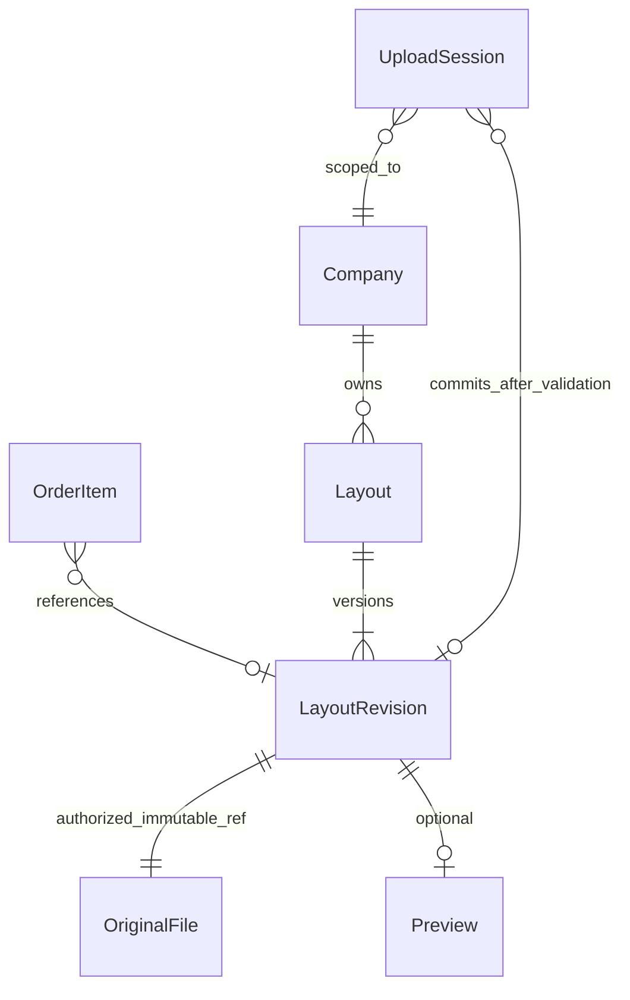

# Следующий scope: 13 пунктов и план реализации

Исторический контроль целостности Wave A: fingerprint 206 runtime/test/config-файлов `e81cedc15667b8e2d1f4045babd3b82053f78744f5e8ad20e0891682300d7325`, локальный manifest `output/playwright/next-scope-a/evidence-integrity.json`. Это значение из отчёта 10.11, не контрольная сумма текущей ревизии.

Основания и варианты исходного scope 10.11. Это не текущая очередь: №01–09/12 поставлены, №11 снят без реализации, №10/13 отложены. Более поздние COMM-DOCS-решения отдельно. Актуальные гейты — [DECISIONS](DECISIONS.md), работа — [DELIVERY_PLAN](DELIVERY_PLAN.md).

Текущее состояние12.11 после merge №06: **10/13 реализованы и слиты**, №11 закрыт без реализации вложений, №10/13 backlog. [PR #44](https://github.com/SigmeD/flexomir_os/pull/44) MERGED по поручению Owner «вливай в main/origin», main6d3fa83, CI head7c5b017 7/7SUCCESS; [новые post-merge проверки PASS](FOS06_ITEM_ACTIONS_DELIVERY_2026-11-12.md). Более ранние планы и OPEN ниже — история декомпозиции; текущая очередь — [DELIVERY_PLAN](DELIVERY_PLAN.md).

Уточнение 12.11: G-02 выбран Owner — вариант А, причины блокировки только у полей; `dirty && valid` сохраняется. №05 реализована в [PR #43](https://github.com/SigmeD/flexomir_os/pull/43), локальный QA завершён, Owner разрешил merge 12.11; полная M8 приёмка остаётся открытой. [Текущий контракт и CI](FOS05_REPEAT_ITEM_SAVE_2026-11-12.md#доставка-и-ci). Формулировки OPEN и очереди ниже сохраняют исходную декомпозицию 10.11; прежняя очередь на момент №05 была №05 → №13/10; актуальный остаток задан более поздним решением выше. CMP-рефакторинг и PR #40 отдельно.

Источник: Owner поручил 10.11.2026 разобрать и начать `D:/downloads/FLEXOMIR_OS_NEXT_SCOPE_13_CODEX_SDLC_TZ_2026-11-10.md`. Это рабочая декомпозиция к [DELIVERY_PLAN](DELIVERY_PLAN.md), не второй CURRENT-план и не утверждение открытых продуктовых решений.

## База и границы

- `git fetch origin`: main/base `7b17db6dab85e3645c55f3e91fcef81b7dfe26b7`; продукт PR31 `a400b9d`. GitHub open PR: 0. Основная папка, одна новая ветка `fix/next-scope-a-correctness`; четыре stash сохранены.
- Drive CURRENT перечитан: revision modified `2026-11-10T14:09:37.549Z`, содержит POST-M8 scope 01–13 и ту же очерёдность. SRS modified `2026-11-06T12:54:47.366Z`, E2E `2026-11-02T10:25:14.515Z`; API/storage/ACL и Delete Item не утверждены.
- Figma `7rvIYc6yj3OA7gxmf1xJbv`, Select set `1148:311`, Default `1148:292`: metadata, screenshot и design context перечитаны. Closed field 44px сохраняется; новый approved open-list contract использует frozen FosPopup. Новые визуальные решения не утверждены.
- Ревизия документов была 10.11, следующая 24.11; двухнедельная уборка сейчас не требуется.
- Наша зона — Screens/frontend, fixtures, UI adapters. Frozen FE11-v0.2, пять protected sources, manifest, menu role14/18/500, API/1С и реальные файлы сохраняются.

## Разбор по пунктам

| ID | Причина / объём | Мелкие задачи и проверяемый результат | Зависимость / gate |
| --- | --- | --- | --- |
| 01 | Profile заменяет содержимое shell; Orders screen владеет своим root/detail. Desktop повторный select реализован bubble-handler, Drawer same-id не вызывает route callback | A1.1 RED clean Profile→active Orders обе роли, click/Enter/Space/touch. A1.2 отдельно dirty Save/Discard/Cancel и save-error. A1.3 закрытие Profile через workspace guard, root через владельца экрана. A1.4 остальные разделы, focus, list filter/scroll/history, пять ширин | Wave A; без изменения линзы |
| 02 | Новый hover-preview расходится с frozen selection-only | B2.1 описать pointer/keyboard/touch. B2.2 проверить возможность одного preview поверх существующего adapter. B2.3 представить выбор v0.2 либо отдельная v0.3. B2.4 только после решения — isolated pilot и modal/regression QA | G-01 OWNER_OPEN; frozen не менять |
| 03 | Визуальное замечание до общих дат PR31 | B1.1 пустой/заполненный Manager draft на пяти ширинах. B1.2 измерить Company→Products→General→Dates против DS spacing. B1.3 один Manager reference patch только при доказанном расхождении. B1.4 Client regression, Owner просмотр → распространение | OWNER_VISUAL_OPEN; нельзя считать автоматически REPRODUCED |
| 04 | required empty placeholder передаётся в общий popup как enabled option | A2.1 RED required placeholder vs optional filter. A2.2 единое правило required + emptyIsPlaceholder на уровне adapter, без запрета legitimate empty. A2.3 keyboard/typeahead/first focus, native proxy/reset/FormData, readonly/disabled/controlled rejection. A2.4 Item shape/material и Manager company, filter regression | Wave A; FOSSelect общий для всех consumers |
| 05 | dirty считается отдельно, Save требует validDemoItem; исторический UPLOAD без файла invalid | A3.1 воспроизвести completed→duplicate→qty/name и причину блокировки. A3.2 сохранить существующую политику dirty&&valid. A3.3 проверить Local/Library/HELP, стабильный Item ID, один Order, cancel/no autosave, source immutable. A3.4 убрать устаревший unavailable marker после реального выбора источника, только если RED подтверждён | G-02 OWNER_OPEN: A disabled+reason vs B dirty+validate on click. Не выбирать B без Owner |
| 06 | duplicate/delete отключены из-за открытых прав и after-1C lock | C1.1 матрица role/company/state/transfer/item/revision. C1.2 сценарии Add/Confirm/Cancel/last-item. C1.3 concurrency/idempotency/error contract. C1.4 frontend proof только после gate; затем API-интеграция отдельным инкрементом | G-03 PO_API_BLOCKED |
| 07 | Native calendar рисуется ОС, CSS не заменяет его | B2.5 сравнить native/custom по стоимости и a11y. B2.6 проект общего adapter RU/keyboard/min-max/readonly/date string. B2.7 один isolated pilot после выбора, five widths/zoom/video. B2.8 Owner gate перед любым rollout | G-04 OWNER_OPEN; не менять YYYY-MM-DD и Client agreedDate |
| 08 | Round Plus сейчас image circle + CSS glyph | B3.1 карта SectionAddItem consumers. B3.2 один Client New reference с существующим neutral material/press helper. B3.3 44px hit area, keyboard/touch/reduced-motion/forced-colors. B3.4 Owner gate → Manager reuse | G-05 OWNER_VISUAL_OPEN |
| 09 | HeaderAction gradient и FOSAction hierarchy имеют разные tints | B4.1 token/state/consumer inventory. B4.2 по одному HeaderAction/FOSAction pilot, primary/secondary/disabled/pressed и reference background. B4.3 contrast/fallback/transparency. B4.4 Owner/DS gate → общие токены и все consumers | G-05 OWNER_VISUAL_OPEN; не унифицировать прозрачность механически |
| 10 | Library содержит metadata, нет authorized original bytes; More/download disabled честно | C2.1 read-only state audit. C2.2 ACL/version/production use и confirm/error/retry spec. C2.3 unavailable preview fallback. C2.4 интеграция после доступного authorized endpoint | G-07 PO_API_BLOCKED; не подменять original PNG-превью |
| 11 | В SRS Support attachments — кандидат | C3.1 optional local-selected UX spec и сохранение текста. C3.2 native chooser/remove/replace/cancel/error. C3.3 MIME/bytes/count/scanning/retention/Support Team schema. C3.4 отдельный demo pilot и API реализация после решений | G-08 OWNER/PO/API_OPEN; не симулировать отправку |
| 12 | Один LocalFileControl обслуживает Library и Local; Library с fileName='' оставляет главный Upload | A4.1 audit EMPTY/LOCAL/LIBRARY/HELP/UNAVAILABLE и возврата из picker. C4.1 state→label/actions mapping общего ArtworkSource. C4.2 isolated pilot отличимых Library/Local состояний. C4.3 Owner visual acceptance → consumers. Future UPLOADING/READY только по реальному API | Wave A audit, затем OWNER_VISUAL_OPEN; связан с05/13 |
| 13 | Item хранит только filename; Library.add отдельный, нет общего persistent storage | C5.1 data/ERD и lifecycles A/B ниже. C5.2 staging/orphan/cleanup/idempotency/atomic link. C5.3 решение Owner/PO/Алексея. C5.4 согласованный API/fixtures/error shapes → M9 frontend integration | G-06/G-07 PO_API_BLOCKED |

## Очерёдность поставок

1. **A / correctness:** 01,04, подтверждённая безопасная часть05 и audit12. Одна ветка/PR, короткие commits RED→GREEN. До B — targeted/full regression и independent read-only QA.
2. **B / UI:** spacing03 и material08/09 сгруппировать по общим источникам; для независимых инкрементов отдельные ветки/PR от свежей main, по одному reference до Owner gate. Не начинать rollout из непроверенного A.
3. **B2 / pilots:** 02 и07 самостоятельные эксперименты; approved production consumers не переводить до решений.
4. **C / product design:** сначала12 и модель13, затем10/11/06 с владельцами прав/данных. При отсутствии API выполняется документационный/изолированный дизайн-этап; реальных серверных success нет.

## Wave A: точки изменений и варианты

| Figma / source | React / контракт | Consumers / подход |
| --- | --- | --- |
| Shell637:180, Nav lens1578:493, Drawer1962:3834/3854, Profile3215:1357 | AppShell + CabinetNavigation + OrderDemoWorkspace; navigate(section,onCommit) выполняет existing Profile guard один раз, затем callback корневого экрана | Client/Manager Orders, Layouts/Companies/Support. EXTEND lifecycle, REUSE visual/motion |
| Select1148:311/292/299/307/1169:364 | FOSSelect→FOSSelectPopup: required placeholder недоступен, optional semantic empty доступен | Shape/Material, Manager company, CompanyOrders filter, lab. EXTEND adapter, без local option patches |
| Artwork634:445; Item1791:6130/1782:6025 | OrderItemForm dirty/valid сохраняются; ArtworkSource source transition очищает устаревшее unavailable состояние | New/Repeat/Edit Client/Manager. REUSE current UI; redesign12 DEFER |

Рассмотрены: screen-local обходы (дублируют правила и не покрывают Drawer), изменение frozen Rows (запрещено), общий lifecycle/field adapter (минимальный правильный уровень). Выбран последний в рамках поручения исправлять source-level причины.

### Проверяемые шаги A

- [x] Preflight Git/Drive/Figma и impact map; обычная feature-ветка.
- [x] A0: новые browser tests до патча; сохранены RED trace/video/screenshots с base SHA; отдельно ALREADY_FIXED и UX_CHANGE.
- [x] A1: явный общий selection dispatch вместо DOM-bubble обхода; Profile clean/dirty/root/focus, Drawer same-id/rest, обе роли/разделы. Targeted124/124; item/manager guards вне Profile сохраняются.
- [x] A2: недоступность required placeholder с первой enabled focus option; native validity/reset/controlled и semantic-empty filter проверяются прежними/новыми сценариями.
- [x] A3: повторённая позиция и смена источника, без изменения Save gate; stale unavailable notice RED→GREEN.
- [x] A4: аудит12 без rollout нового визуального состояния; G-02/остальные gates записаны.12 audit captures включают Manager03 на пяти ширинах.
- [x] A5: build PASS, focused cross-browser/touch124/124, пять ширин/a11y/reduced-motion/forced-colors, full582 PASS/4 SKIP; frozen5 fingerprints PASS. Повторы focus24/24 и integration3/3.
- [x] A6 QA: independent read-only review PASS/READY WITH RISKS, замечания воспроизведены и исправлены; один отдельный Chromium390 runtime PASS. LIVE docs синхронизированы. Доставка — один Draft PR с проверкой фактического head/CI в GitHub; merge только по отдельному поручению.

Команды: `npx playwright test --config=playwright.next-scope.config.ts --workers=2`; `npm run build`; `npm run test:e2e -- --workers=2`. Исходный RED хранить отдельно от GREEN. Скриншоты/trace/video локально в `output/playwright/next-scope-a/`; не публиковать личные данные. Figma screenshot target закрытого Select просмотрен, visual gates новых UX открыты.

## FOS13: модель и альтернативы для обсуждения

Это архитектурная гипотеза, **не утверждённая API schema**.

| Альтернатива | Последовательность | Преимущество | Что согласовать |
| --- | --- | --- | --- |
| A: библиотека после upload acknowledgement | local selected → upload+server validation → stable company Layout → Item references revision → Save Item | Файл сразу повторно доступен | orphan lifetime/cleanup, cancel, duplicate upload, ACL до сохранения Item |
| B: библиотека после Save Item/Order | local selected → staging upload+server validation → Save Item/Order commits link+Layout атомарно | Меньше неиспользованных записей | staging TTL/reload recovery, retry/idempotency, transaction failure compensation, when visible |

Для обоих: filename не равен originalRef; PNG preview не равен original; ID выдаёт сервер; Company ownership проверяется сервером. Ошибки upload/validation/save, retry с lost response, cancel, reload, смена Company/роли, concurrent replace, use-in-production lock и deleted/unavailable source нужны в будущих контрактных E2E. Для HELP ссылка не требуется; одновременно два источника запрещены. Выбор A/B остаётся Owner/PO/Алексей.

## Статусы проверки

Текущие результаты, исходные ошибки тестовых селекторов, ограничения независимого review и итоговые проверки — [отчёт wave A](NEXT_SCOPE_13_2026-11-10.md). Не считать code written/build PASS визуальной приёмкой, merge или готовностью API.

## FOS06: матрица для согласования

Это вопросы к Owner/PO/Алексею, не реализованные разрешения.

| Контекст | Что подтверждено | Что требуется решить до Duplicate/Delete |
| --- | --- | --- |
| Client, своя Company, локальный draft до1С | Demo позволяет редактировать состав | Duplicate/Add commit, delete confirm, 0 items и Send disabled; серверный scope/ACL/version OPEN |
| Manager, доступная Company, private draft | Есть локальный composer | Права на Item, явный Save и момент публикации; серверный scope OPEN |
| Client/Manager, общий опубликованный Order до1С | E2E допускает правки в пределах прав | Владелец операции, revision conflict, retry/idempotency и atomic delete OPEN |
| 1С pending/error/retry/success, Client | E2E запрещает редактирование с начала передачи | Не включать Delete/Duplicate в существующем Order в обход lock; повтор завершённого Order — отдельная команда |
| 1С initiated, Manager | Правки минимального MVP выполняются в1С | Исключение «удалять всегда» требует явного изменения SRS/DEC-038 |
| Чужая Company / недоступный Order | Изоляция tenant обязательна | Серверная проверка принадлежности даже при ручном запросе; React disabled не ACL |
